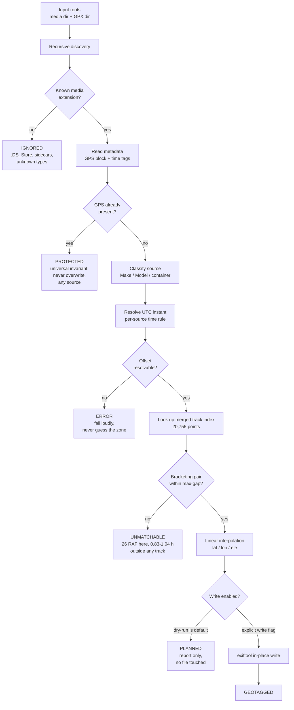
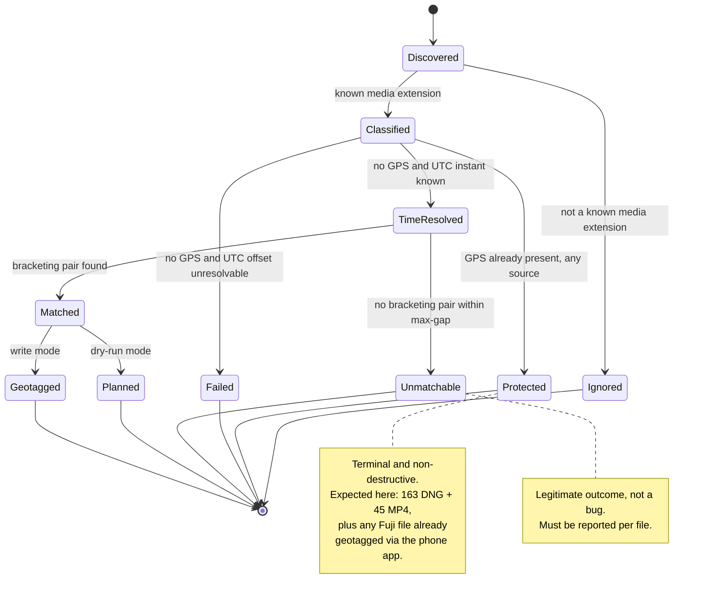
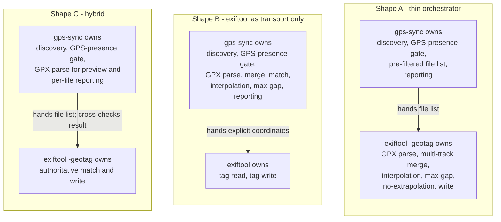

# Analysis — gps-sync: GPX-driven media geotagger

## Scope and Research Status

- Phase 1 research output for issue `001-gpx-photo-geotagger`. Audience: the Phase 2 design step and the Phase 3 design reviewer.
- No ticket text — constraint validation skipped. No issue, epic, or milestone was loaded in this session and no verbatim ticket text was supplied, so no ticket-originated restrictions have been validated and none are enforceable in design review.
- All quantitative claims below were measured on the user's real data in this session and are traceable to the session evidence record. Where evidence is absent it is labelled as a gap rather than inferred.
- Originals under `/Volumes/Data SSD 2TB/PhotoArchive/` and `/Users/astavonin/Downloads/tracks` were never modified; every write test ran on copies in a scratchpad.

## Problem Framing

`gps-sync` is a CLI tool that takes a directory of GPX tracks and a directory of photos/videos, walks both recursively, and for every media file that carries no GPS metadata derives a position from the tracks by timestamp and writes it into the file.

### The core invariant

**For every file, regardless of source: if GPS metadata is already present, skip it. Never overwrite an existing position.** This is a universal per-file precondition on every write, evaluated from the file's own metadata. Source identity — camera make, model, container format, directory — plays no part in this decision. The only thing source identity ever determines is how to interpret the file's *timestamp* (see the time-semantics section, where source dependence is real and unavoidable).

This framing matters because the measured per-source GPS distribution in this archive invites a false generalisation. All 349 Fujifilm RAF files in the sample lack GPS, and all 163 DJI DNG files have it — but "RAF is always a target" and "DNG is always protected" are properties of this one dataset, not of the sources. The Fujifilm X-T5 can receive location from a paired phone through the Fujifilm companion app (user-stated; no such file exists in the sample, so it is unverified here), so some Fuji RAF or MOV files may legitimately arrive already geotagged. Symmetrically, a DJI file shot without satellite lock would arrive without GPS and would become a target. A classifier that branched on source would get both cases wrong. A classifier that branches on measured per-file GPS presence gets both right without knowing anything about the source. Implementing that predicate well is a separate problem from framing it, and a harder one: a naive container-level check is measured below to fail on all 45 DJI MP4 files, in the unsafe direction.

### Why the invariant is a safety requirement, not an optimisation

Skipping already-geotagged files is not about saving work — it is about not destroying correct data with wrong data. Each of the 163 DJI DNG files carries the *drone's* position; the GPX track carries the *pilot's* position. Comparing every in-track DNG against the position interpolated from the track at the same instant (n=107) gives a **median separation of 1035 m, p90 2939 m, and maximum 4620 m**. Writing track-derived coordinates onto those files would relocate them by kilometres. The same hazard applies to any file whose embedded position came from a device that was not on the hiker's wrist — iPhone video, a second camera, a previously geotagged Fuji frame. The 1035 m figure is the evidence for *why* the invariant must hold; it is not the basis for a DJI-specific rule.

An independent verification makes the hazard concrete rather than theoretical: exiftool's native `-geotag` was run against a copy of a DJI DNG that already held valid drone GPS. Before: `42.1562621, 77.3553647` at 1654.594 m. After: `42.1561543, 77.3550698` at 1747.725 m — a **27.1 m horizontal displacement** of coordinates that were already correct. exiftool overwrites unconditionally and offers no skip-if-already-geotagged switch. The invariant therefore cannot be delegated; it must be enforced by our tool before any write reaches exiftool.

### What the invariant does not forbid

The invariant forbids destroying an existing position. It does not forbid writing a position into a field that is empty, and the distinction is sharper than it first appears: **publishing a container-level atom and geotagging-from-track write the same destination field from entirely different data sources, and only the latter is forbidden for drone media.** A DJI MP4 has nothing at container level to overwrite, and its own telemetry stream holds the drone's true position — so populating `[Keys] GPSCoordinates` from that telemetry destroys nothing and introduces no foreign data, whereas populating the same field from the hiker's GPX track would be wrong by the drone-to-pilot margin. A reviewer should not read the measured container-level emptiness of the 45 MP4 files as an invariant violation waiting to happen; whether that publishing operation is in scope at all is a separate, open scope question recorded below.

### Outcome categories

Every discovered file ends in exactly one terminal state: **Ignored** (not media), **Protected** (GPS already present), **Failed** (no GPS but the UTC instant cannot be established), **Unmatchable** (no track coverage within the gap limit), **Planned** (dry-run), or **Geotagged** (written). Four of the six are non-destructive by construction.

## Codebase Context — There Is None

`/Users/astavonin/projects/gps-sync` is empty and is not a git repository. There is no existing code, no established module layout, no prior art in-repo, and no internal API to conform to. Conventional codebase analysis is therefore not applicable, and the integration surface for this tool is entirely external:

| Integration surface | What it constrains |
|---|---|
| exiftool 13.55 (`/opt/homebrew/bin/exiftool`) | The only credible metadata read/write backend; its tag-group behaviour and CLI semantics are hard constraints |
| Fujifilm RAF container | Proprietary RAW layout; dictates that in-place write safety must be empirically verified, not assumed |
| Adobe DNG container | Read-only in practice for this archive, but write safety is unverified |
| QuickTime MOV/MP4 atoms | Tag-group-sensitive GPS storage; ISO 6709 coordinate string format |
| GPX 1.1 (Garmin Connect flavour) | Input schema; UTC `Z` timestamps; `<ele>` present; `ns3:TrackPointExtension` irrelevant |
| Host Python 3.15.2 + `uv` | Runtime and dependency-management surface; no relevant library is installed yet |

Design decisions in Phase 2 are therefore unconstrained by legacy code and fully constrained by these external contracts.

## Processing Model



The pipeline stages and their skip branches. Note the ordering: the GPS-presence gate sits **before** source classification, because the invariant does not depend on source. Source classification exists only to feed the time-resolution stage.



Per-file outcome states. Exactly one terminal state per file; only `Geotagged` mutates a file. This enumeration is the natural shape of the tool's report and of its exit-code contract.

## Data Inventory

Photo set: `/Volumes/Data SSD 2TB/PhotoArchive/2026/Issyk Kul` — 564 files, directory depth 2 (root plus six subdirectories: Jety-Oguz, Barskoon Valley, Yrdyk Valley, Skazka Canyons, Karakol Gorge, Panorama Shatyly).

| Ext | n | Source (Make/Model) | GPS present in this sample | `DateTimeOriginal` | `OffsetTimeOriginal` | `CreateDate` | Expected role here |
|---|---|---|---|---|---|---|---|
| `.RAF` | 349 | FUJIFILM X-T5 | none | yes, all 349 | `+06:00`, all | yes | geotag target |
| `.DNG` | 163 | DJI FC9313 | yes, all 163 | yes | absent | yes | protected |
| `.MP4` | 45 | DJI, no `Make` tag | container: none; per-frame telemetry track only, visible only with `-ee` | absent | absent | yes | protected from track-derived writes; see scope question |
| `.MOV` | 5 | FUJIFILM X-T5 | none | yes | `+06:00` | yes | geotag target |
| `.DS_Store` | 2 | — | — | — | — | — | ignored |

In this sample that gives **354 geotag targets** (349 RAF + 5 MOV) and **208 protected files** (163 DNG + 45 MP4), with 2 non-media files to ignore. Read the final column as *expected population statistics for this archive* — what the tool will typically encounter — and not as the decision rule. The decision rule is the per-file GPS-presence gate; these counts are what that gate is predicted to produce on this input, and they are the baseline against which a run's report can be sanity-checked.

Non-media files must be ignored silently rather than reported as failures. `.DS_Store` is the instance present here; sidecar files (`.xmp`), editor caches, and extracted JPEG previews are plausible in a wider archive. Extension-based filtering is sufficient for the measured data, with the caveat recorded under risks.

## GPS-Presence Detection — Measured Probe Results

The invariant's correctness rests entirely on the quality of the "has GPS?" predicate, so all 564 files were probed at every location GPS can hide: `EXIF:GPSLatitude`, `XMP:GPSLatitude`, `Keys:GPSCoordinates`, `ItemList:GPSCoordinates`, `UserData:GPSCoordinates`, `Composite:GPSPosition`, and `EXIF:GPSLatitudeRef`.

### Stills: one probe suffices

`Composite:GPSPosition` is a clean single-probe detector for stills — present for all 163 DNG, absent for all 349 RAF, with no ambiguous cases. It is also robust against the partial-block hazard, verified directly: on a written RAF copy, `GPSLatitude` and `GPSLongitude` were cleared while `GPSLatitudeRef` survived alone, and `Composite:GPSPosition` correctly went absent, because the composite tag requires both latitude and longitude. Both halves of that result matter. The partial-block state is real and reachable — including as the outcome of an interrupted write by this very tool, since the verified RAF write assigns eight GPS tags individually — and `Composite:GPSPosition` classifies it correctly as "no usable position".

No file in the archive sits at `(0, 0)`. The zero-island hazard is hypothetical on this data, not observed.

### Video: a container-level probe fails, and fails in the dangerous direction

**All 45 DJI MP4 files report nothing for `Composite:GPSPosition`, `Keys`, `ItemList`, and `UserData`.** Their GPS exists only as a per-frame telemetry stream inside a media track, invisible without `-ee`. A naive container-level presence check therefore classifies all 45 as *needing* a geotag, and writing a track-derived position onto them would be wrong by the drone-to-pilot margin already established — median 1035 m, maximum 4620 m.

This is the concrete case where the universal invariant is correct in principle while a naive implementation of "has GPS" violates it in practice. It is the strongest reason the detection predicate must be specified deliberately in Phase 2 rather than left to the obvious one-tag check.

### Why Capture One shows no location on the DJI videos

The user observes that Capture One displays no location for the DJI videos, and the probe explains why. `exiftool -s -G1 -Keys:all -ItemList:all -UserData:all <dji.mp4>` returns **0 GPS tags at container level**. Capture One, Finder, Photos, and Lightroom all read container atoms, not per-frame telemetry streams, so they correctly report "no location".

The footage is therefore **not mis-tagged — the position was simply never published where viewers look**. This reframes the DJI-video item materially: it is not redundant data the tool should ignore, it is real, accurate data that is invisible to every tool the user actually uses. exiftool itself hints at the discrepancy, emitting "Warning: [minor] The ExtractEmbedded option may find more tags in the media data" on a container-level read.

### The cost of an honest probe

| Probe | Measured cost | What it sees |
|---|---|---|
| Full `-ee` scan of one 1405 MB DJI MP4 | **6.1 s**, yielding 6707 GPS samples | the per-frame telemetry — the only probe that sees it at all |
| Full `-ee` across all 45 videos | **roughly 4.6 min** (extrapolated from the single measured file; actual cost scales with file size) | as above |
| `-fast2` | 0.096 s, returns nothing | stops before the media data, so it **cannot see embedded telemetry at all** — not a usable shortcut |
| Container-level handler probe | **0.08 s per file, 4.7 s for all 45** — about 75x faster than `-ee` | DJI MP4 expose `MetaFormat = dbgi` with `HandlerDescription = "CAM dbgi"` and `HandlerType = Metadata Tags`; Fujifilm MOV show only `HandlerType = Time Code` and no `MetaFormat`, so the two sources separate cleanly |

The handler probe is a **candidate** cheap telemetry-presence discriminator for Phase 2, not a decision. It separates the two video sources in this archive cleanly at negligible cost. Its caveat is structural rather than technical: `dbgi` is a DJI-specific signature, so keying on it reintroduces vendor-specific knowledge into a rule the user wants to be source-agnostic. That tension — a source-agnostic invariant whose only cheap video implementation is vendor-specific — is recorded as an open question below and is Phase 2's to resolve.

## The Per-Source Time-Semantics Problem

This is the single largest correctness hazard in the tool, and it is the one place where source identity is genuinely load-bearing. Three mutually incompatible timestamp conventions coexist inside one directory tree:

| Source | Tag carrying the instant | Semantics | Offset information | Resolution rule |
|---|---|---|---|---|
| Fujifilm RAF / MOV | `DateTimeOriginal` | local wall time | `OffsetTimeOriginal` = `+06:00`, present on all 354 | self-describing; use the embedded offset — authoritative, no flag needed |
| DJI DNG | `DateTimeOriginal` | **local** wall time | **no offset tag at all** | offset must come from outside the file |
| DJI MP4 | QuickTime `CreateDate` | **UTC** | not applicable — already UTC | use as-is; applying an offset would double-count it |
| GPX trackpoints | `<time>` | UTC, `Z` suffix | explicit | reference frame for all matching |

Evidence for each row. Fuji: `OffsetTimeOriginal` is present and reads `+06:00` on every one of the 349 RAF and 5 MOV. DJI DNG: filename `DJI_20261027100910_0064_D.DNG` against `DateTimeOriginal` `2026-10-27T10:09:10` — identical, so the tag is local time and the filename stamp is local too. DJI MP4: filename `DJI_20261026093526_0013_D.MP4` against `CreateDate` `2026-10-26T03:35:26` — a 6-hour deficit, so the tag is UTC while the filename is local.

The decisive proof is the track-overlap test on the DNG set. Interpreting DNG `DateTimeOriginal` as UTC places **0 of 163** files inside any track. Interpreting it as local time at `+06:00` places **107 of 163** inside a track. A 0-versus-107 split is not a marginal signal; the local reading is correct and the UTC reading is wrong by the full offset.

The design consequence is that **a single global `--utc-offset` flag is wrong for a mixed folder**. Applied uniformly to this directory it would be a no-op on Fuji files (which carry their own offset and should ignore the flag), correct on DNG files, and a 6-hour error on MP4 files (which are already UTC). Offset resolution must be a per-file decision driven by what the file actually contains, with source classification selecting the rule. The user's settled decision — EXIF offset tag first, explicit CLI flag as fallback, fail loudly rather than guess — is the right shape, but the fallback must not be a blunt global addition applied to every file that lacks `OffsetTimeOriginal`: a UTC-native container lacking an offset tag needs no offset, while a local-time container lacking one needs the flag. These two cases are indistinguishable without source or container knowledge.

In this specific archive the flag's blast radius happens to be nil, because every file that needs it (DNG, MP4) is protected by the invariant and never written. That is a dataset artifact of the same kind as "RAF is always a target", and it should not be mistaken for a reason the distinction does not matter. A DJI DNG shot without satellite lock becomes a geotag target, and at that moment the tool is writing to a local-time, no-offset-tag file — exactly the case the fallback must get right.

## Track Characteristics and the max-gap Finding

Track set: `/Users/astavonin/Downloads/tracks` — 7 files, GPX 1.1, `creator="Garmin Connect"`, roughly 8 MB total, **20,755 `<trkpt>`**. Timestamps are UTC with a `Z` suffix. Every point carries `<ele>`. `ns3:TrackPointExtension` carries air temperature, heart rate, and cadence, all irrelevant to geotagging.

| File | Track name | Points | Span (UTC) | Median dt | Max dt |
|---|---|---|---|---|---|
| activity_24855779045 | Kok Jaiyk Valley | 3968 | 10-26 04:49 → 09:19 | 3 s | 30 s |
| activity_24864742550 | Fairy Tail Canions | 2643 | 10-27 02:29 → 05:20 | 3 s | 28 s |
| activity_24867378667 | Shatyly Panorama | 1093 | 10-27 08:22 → 09:37 | 3 s | 31 s |
| activity_24891302165 | Karakol Gorge | 6070 | 10-29 02:44 → 09:46 | 4 s | 32 s |
| activity_24902171217 | Yrdyk Valley 1/2 | 3145 | 10-30 02:44 → 06:08 | 3 s | 65 s |
| activity_24902171736 | Yrdyk Valley 2/2 | 1260 | 10-30 07:25 → 08:35 | 3 s | 20 s |
| activity_24912825946 | Barskoon | 2576 | 10-31 02:27 → 05:02 | 3 s | 29 s |

Merged timeline: 2026-10-26 04:49Z → 2026-10-31 05:02Z. Six inter-track gaps exceed ten minutes: 17.16 h, 3.03 h, 41.12 h, 16.97 h, **1.29 h**, 17.86 h.

The structural finding: **maximum intra-track gap is 65 s; minimum inter-track gap is 1.29 h** (4644 s). These two distributions do not overlap, and the separation factor is roughly 71x. Consequently **any `--max-gap` value between about 70 s and about 1.2 h produces byte-identical results on this data**. The parameter is a binary in-track/out-of-track discriminator here, not a precision knob — tuning it within that range cannot change a single outcome, and a reviewer should not expect sensitivity analysis to show otherwise.

Recommended default: **120 s**. It clears the 65 s worst in-track gap with an 85 % margin, sits two orders of magnitude below the 1.29 h narrowest inter-track gap, and matches the value (`GeoMaxIntSecs=120`) already exercised successfully in the `-geotag` feasibility test. The parameter should nonetheless remain user-settable, for reasons this dataset cannot demonstrate: a logger sampling once per minute or once per five minutes would need a much larger value to interpolate at all, a logger with genuine multi-minute dropouts mid-activity would need the limit to distinguish real coverage from a bridged dropout, and a user wanting stricter provenance may want a value below the default. The parameter earns its place from those populations, not from this one.

## Interpolation Accuracy

A leave-one-out test on the tracks themselves quantifies the method error directly: each interior point was dropped, its position re-derived by linear interpolation from its two neighbours, and the result compared against the known truth (n = 20,741, brackets ≤ 120 s). Result: **median 0.30 m, p90 1.08 m, p99 2.64 m, maximum 9.80 m.** Track speed over the same data is median 0.65 m/s and p90 1.40 m/s — walking pace, which is why the straight-line assumption holds so well at 3–4 s sampling.

Linear interpolation therefore contributes sub-metre error at this sampling density and **is not a meaningful error source**. There is no accuracy argument for a more sophisticated interpolator (spline, great-circle-aware, speed-weighted); the simplest method is already an order of magnitude inside typical consumer GPS receiver noise.

### The two large numbers answer different questions

Precision matters here, because the analysis contains a 0.30 m figure and a 1035 m figure and conflating them would be a serious error:

| Measurement | n | Value | What it measures |
|---|---|---|---|
| Leave-one-out interpolation error | 20,741 | median 0.30 m, max 9.80 m | **method error** — how wrong our interpolation is relative to a known true position on the same track |
| DNG GPS versus track-interpolated position | 107 | median 1035 m, max 4620 m | **physical separation** — how far the drone was from the pilot at the same instant |

The 1035 m figure is **not** method error and must never be cited as such. It is the real distance between two different objects, and it is large precisely because the method is accurate: an inaccurate method would blur the separation rather than reveal it. The first number says track-derived coordinates are trustworthy for media that was physically on the track. The second says they are catastrophically wrong for media that was not. Both conclusions rest on the method being sound.

## Coverage Expectations

| Target set | Matchable | Rate | Bracketing interval |
|---|---|---|---|
| RAF | 323 / 349 | 92.6 % | median 5 s, max 26 s |
| MOV | 5 / 5 | 100 % | 2, 6, 7, 8, 16 s |

The 26 unmatchable RAF split cleanly: 14 fall before the day's first track point and 12 after the last, all between **0.83 h and 1.04 h outside** the nearest track boundary (examples: DSCF8326–8330, DSCF8673–8679). The cause is behavioural, not technical — frames shot before the watch was started or after it was stopped. Since the nearest track data is roughly an hour away and the hiker was demonstrably moving at walking pace, extrapolating a position across that interval would be an invention, not a measurement.

Skipping them is therefore the correct behaviour and a **legitimate outcome, not a bug**. The design requirement that follows is a reporting requirement: the tool must enumerate skipped files with the reason and the magnitude of the miss (nearest track point and the time distance to it) so the user can distinguish "outside track coverage" from "something is wrong with my timezone handling" — a 6-hour systematic miss and a 50-minute behavioural miss look identical in a bare count. The 92.6 % expected hit rate on this archive also serves as a regression baseline: a run producing a materially different number signals a time-resolution defect rather than new data.

## Tooling Landscape and Integration Points

### The RAW-only constraint eliminates pure-Python EXIF writers

The decisive constraint is that this archive contains no JPEG or TIFF originals at all — the still-image targets are Fujifilm RAF, and the protected stills are Adobe DNG. Pure-Python EXIF writers are built for JPEG and TIFF containers: `piexif` operates on JPEG APP1 segments, and Pillow's EXIF support likewise assumes JPEG/TIFF structure. Neither parses or safely rewrites the proprietary Fujifilm RAF container, which embeds a FujiIFD alongside the RAW payload and a large preview JPEG. **exiftool is effectively the only credible write backend** for this data. This is a hard constraint on the architecture, not a preference.

Environment as measured: exiftool 13.55 at `/opt/homebrew/bin/exiftool`, whose `-listwf` (writable formats) includes RAF, DNG, MOV, MP4, HEIC, JPG, and TIFF. Python is 3.15.2 (Homebrew). **No relevant Python library is installed** — `piexif`, `PIL`, `gpxpy`, `pyexiv2`, `exifread`, and `rawpy` are all missing. `uv` (`/Users/astavonin/.local/bin/uv`) and `pipx` are available, so dependency management has no blocker; GPX parsing can equally use the standard library, since GPX 1.1 is plain XML and the needed subset is `<trkpt lat lon>`, `<ele>`, and `<time>`.

### RAF in-place write safety — verified in depth

This is the result that de-risks the user's in-place write decision. Command tested on a copy:

```
exiftool -overwrite_original -GPSLatitude=.. -GPSLatitudeRef=N -GPSLongitude=.. \
  -GPSLongitudeRef=E -GPSAltitude=.. -GPSAltitudeRef=above \
  -GPSDateStamp=.. -GPSTimeStamp=.. file.RAF
```

| Check | Result |
|---|---|
| exiftool report | "1 image files updated"; values read back correctly, exposed as signed decimals in the `[Composite]` group |
| RAW sensor payload | **byte-identical** — the final 36,520,070 bytes match exactly; first difference anywhere in the file is at offset 89 |
| Metadata preservation | 198 tags before → 212 after (+14 GPS tags); `comm -23` diff of tag-name sets is **empty**, so nothing was lost |
| Embedded preview JPEG | **bit-identical image** — every marker segment matches, including the 3,477,231-byte entropy-coded scan (MD5 equal); FFE1, FFC4, FFDB, FFDD, FFC0 all equal |
| File size | shrank 52,968 bytes, 40,076,176 → 40,023,208 |
| `-validate` | only a pre-existing Fujifilm quirk, "FujiIFD tag 0xf010 VignettingParams overlaps 0xf00f", present in the untouched original too |

The 52,968-byte reduction is localised entirely to trailing padding after the preview block's EOI marker. No image data and no metadata content was lost — the RAW payload and the preview scan are both proven identical. It is nonetheless a non-zero byte-level change to an original file and is recorded under risks so a reviewer can judge it rather than discover it.

### MOV (Fujifilm) write — tag group is load-bearing

| Attempt | Outcome |
|---|---|
| `-Keys:GPSCoordinates="+42.29744+078.27001+2226.200/"` (ISO 6709) | **works**; reads back via `[Keys]` and via `[Composite] GPSPosition` |
| `-QuickTime:GPSCoordinates="lat lon alt"` | **fails** with a `PrintConvInv` error |
| `-UserData:GPSCoordinates="lat lon alt"` | **fails** with a `PrintConvInv` error |
| `-XMP:GPSLatitude` / `-XMP:GPSLongitude` | writes successfully |
| File size | grew 228,119,552 → 228,122,419 (+2,867 bytes) |

Video geotagging is therefore not symmetric with stills: it needs the `[Keys]` group and an ISO 6709 coordinate string rather than the separate signed-decimal GPS tags used for RAF. Phase 2 must treat the still and video write paths as distinct, and the choice of whether to additionally write XMP is open.

### Batched write attribution — positional by default, nominal with `-echo3`/`-echo4`

A write phase that hands exiftool a batch of paths and then reports a per-file outcome for each one depends entirely on what that single batched process says about each path it was given. That reporting granularity had never been probed here. A batched argfile write was already measured to *apply* distinct per-file coordinates correctly, which is a different question from what the process *reports* about each path, and every other exiftool claim in this document rests on a measurement where this one rested on an assumption.

Conditions, measured 2026-11-15 on exiftool 13.55 (`/opt/homebrew/bin/exiftool`), the version pinned throughout this document. Four real RAF fixtures were copied into a scratchpad, with GPS stripped from selected copies via `-gps:all= -xmp:gps:all=` to manufacture positionless write candidates; nothing under `testdata/` or the photo archive was written. The invocation was a single batched process, `exiftool -@ argfile`, with per-file blocks separated by `-execute`, each block carrying `-overwrite_original`, a per-file re-gate condition `-if 'not $Composite:GPSPosition'`, and per-file tag assignments. Five paths went into one batch, chosen to produce every write conclusion plus a path that reaches no conclusion at all: two positionless and writable, one already carrying a position, one positionless but `chmod 444`, and one nonexistent.

**Result 1 — exiftool does not return named per-path write conclusions.** stdout carried only unnamed counts, one or two lines per `-execute` block, in block order:

```
    1 image files updated
    1 image files updated
    1 files failed condition
    1 image files updated
    0 image files updated
    1 files weren't updated due to errors
```

stderr carried the only path-bearing line:

```
Error: File not found - <abs path>
```

Process exit code: **1**. Attribution from the default output is therefore **positional, not nominal** — the only link between a result line and the path it describes is block order. The line count per block is also not constant: one line for an applied write, one for a condition refusal, but two for an error. Naive line-to-block zipping therefore desynchronises on precisely the error case, which is the case that most needs correct attribution.

**Result 2 — the three write conclusions are distinguishable from each other by message.** Each carries its own stdout wording, so a re-gate refusal is not indistinguishable from a silent skip:

| Conclusion | stdout message |
|---|---|
| applied | `1 image files updated` |
| refused by the re-gate | `1 files failed condition` |
| failed | `0 image files updated` **plus** `1 files weren't updated due to errors`, with a path-bearing `Error:` line on stderr |

The gap Result 1 leaves is therefore one of identity rather than of kind: the output says what happened, five times over, and never to which file.

**Result 3 — `-echo3` / `-echo4` give positive per-path attribution, as block terminators.** Adding `-echo3` and `-echo4` arguments naming the path to each block emits that marker to stdout and to stderr respectively. The measured ordering, with the applied, refused and failed blocks shown, is that the marker arrives at the **end** of its execution, after that block's own result lines:

```
    1 image files updated
BEGIN <abs path A>
    1 files failed condition
BEGIN <abs path C>
    0 image files updated
    1 files weren't updated due to errors
BEGIN <abs path E>
```

On stderr the named `Error:` line likewise precedes its own block's marker. Three consequences are worth recording. Per-path attribution becomes nominal rather than positional on both streams, without a second process. A block whose marker is **absent** is exactly a path that reached no conclusion, so a path with no attributable result gains a positive detection signal instead of being inferred from a counting mismatch, and the last marker present bounds how far an interrupted batch got. And the marker is a terminator rather than a prefix — the marker text used here reads `BEGIN <path>`, which is actively misleading on that point — so a parser keyed on it must buffer each block's lines until the next marker rather than treat a marker as a block header.

**Result 4 — `-overwrite_original` ignores the target file's own write permission.** The `chmod 444` fixture was written: its position changed to the planned value while its mode remained `-r--r--r--`. It accounts for the third `1 image files updated` line in the Result 1 output above, where the fixture set would otherwise predict only two applied writes. The mechanism is that exiftool writes a temporary file in the containing directory and renames it over the target, so only the **directory's** writability gates the write, never the file's. A user who makes a file read-only to protect it is therefore not protected by that mode bit. This is recorded as a measured fact without resolving its consequences, and it is unrelated to write attribution: no earlier measurement in this document touched file-mode behaviour at all. Two things it bears on. The never-overwrite invariant's enforcement rests entirely on this tool's own metadata gate, with no filesystem-level backstop beneath it. And any mechanism intended to preserve a file's prior bytes — a retained `_original` copy, or a review folder of symlinks pointing at originals — is preserving them against this write behaviour rather than against a filesystem that will refuse the write.

What the four results settle, against the standing open question of whether exiftool supplies per-path write results at the granularity a write-attribution contract needs. Result 1 answers it: it does not, so a contract mapping every intended path to exactly one of applied, refused, failed or unattributable cannot be read off the default output. Result 2 narrows the gap to identity rather than kind. Result 3 supplies a mechanism that closes the identity gap and makes the no-conclusion case positively detectable. Result 4 is a separate safety fact bearing on the invariant rather than on attribution.

Limits, stated plainly. The measurement used RAF only, so the message wordings are unverified for DNG and for every other container. Those wordings are 13.55-specific and are themselves a version-pinned dependency of anything parsing them, in the same way `-Keys:GPSCoordinates` acceptance is version-sensitive. And the `-echo3`/`-echo4` terminator ordering above was observed in this batch, not verified against exiftool's own documentation, so it should be treated as measured behaviour rather than as a documented contract.

### exiftool native `-geotag` — the capability inventory

```
exiftool -overwrite_original -geotag "tracks/*.gpx" \
  '-geotime<${DateTimeOriginal}${OffsetTimeOriginal}' \
  -api GeoMaxIntSecs=120 -api GeoMaxExtSecs=0 <paths>
```

Measured as working, with no code of ours:

| Capability | Mechanism |
|---|---|
| Multi-GPX merge | wildcard argument to `-geotag` |
| Linear interpolation between bracketing points | built in |
| Max interpolation gap, i.e. our `--max-gap` | `-api GeoMaxIntSecs=120` |
| Refusal to extrapolate beyond track ends | `-api GeoMaxExtSecs=0` |
| Timezone from the EXIF offset tag | the `-geotime` expression concatenating `DateTimeOriginal` and `OffsetTimeOriginal` |
| Correct, explicit refusal of out-of-track files | verified on DSCF8336.RAF, 48.7 min before the day's first point: warning "Time is too far before track in File:Geotime", result "0 image files updated" |
| Recursive directory walking and extension filtering | native, with `-ext` filters |
| Throughput | **20 RAF geotagged in 1.85 s wall in a single process, about 11 files/s → all 349 in roughly 32 s** |

The `GeoMaxExtSecs=0` argument was passed explicitly in the test; whether it matches exiftool's own default was not measured, so Phase 2 should set it explicitly rather than rely on a default.

### The one thing `-geotag` cannot do

It has no skip-if-already-geotagged switch and overwrites existing GPS unconditionally — verified by the 27.1 m displacement of correct drone coordinates described in the problem-framing section. Every other piece of the matching problem is already solved inside exiftool; the single unsolved piece is the single hard safety requirement.

## Build vs Buy — The Question Phase 2 Must Answer

This is the most consequential open architectural decision and it is deliberately left unresolved here.

The situation is unusual. exiftool already implements essentially the entire functional specification — multi-GPX merge, linear interpolation, gap limiting, no-extrapolation, EXIF-offset-aware time resolution, recursive walking, and correct refusal of out-of-track files — at a throughput that makes the whole archive a 32-second job. What it does not implement is the one requirement that cannot be compromised: the universal do-not-overwrite invariant. So the question is not "can we reuse exiftool's matching logic" (we can) but **how much of the matching logic our tool should own, given that the delegated component is unsafe by default and must be fenced by us regardless**.



Candidate ownership splits. The GPS-presence gate sits on our side of the boundary in all three, because it must.

| | Shape A — thin orchestrator | Shape B — exiftool as transport | Shape C — hybrid |
|---|---|---|---|
| Code we own | smallest | largest | medium |
| Matching correctness | exiftool's, battle-tested across decades and formats | ours, must be tested from scratch against the measured accuracy figures | exiftool's, with our independent preview |
| Dry-run fidelity | hard — exiftool's planned result is not directly enumerable without running it, so predicted output may diverge from applied output | exact — we computed the coordinates, so dry-run and write report the same numbers | exact preview, but the preview is a second implementation that can disagree with the authority |
| Per-file reporting detail | limited to what exiftool's stderr exposes; the "0.83 h outside the track" style of diagnostic needs our own GPX reading anyway | full control — nearest point, time distance, bracketing interval all available | full control |
| Max-gap semantics | `GeoMaxIntSecs`, exiftool's definition | ours, must be defined and documented | both, and they must agree |
| Video write path | `-geotag` behaviour on MOV `[Keys]` is unverified in this session | explicit, uses the verified `-Keys:GPSCoordinates` ISO 6709 form | needs verification like A |
| Performance | best, batched single process, about 32 s for 349 files | our matching is trivial in-memory work over 20,755 points, but per-file exiftool invocations risk dominating; only the batched case was measured | between |
| Dependency coupling | tightest — behaviour is exiftool's, including across version upgrades | loosest — exiftool used only for read and write | tight plus a parallel implementation to maintain |
| Testability | hardest to unit-test; correctness lives in a subprocess | easiest — matching is a pure function over parsed tracks and timestamps | mixed |
| Failure mode if exiftool changes | silent behavioural drift in matching | drift confined to tag read/write | drift plus preview/authority disagreement |

Two observations the designer should weigh, neither of which settles the question. First, the "limited reporting" weakness of Shape A is sharper than it looks: satisfying the coverage-reporting requirement (naming the 26 skipped files and how far outside the track each one is) requires reading the GPX ourselves regardless, which erodes much of Shape A's code-size advantage and pushes it toward Shape C by gravity. Second, the accuracy evidence removes what would normally be the strongest argument *against* owning the matching: linear interpolation at median 0.30 m error is simple enough that a from-scratch implementation carries little correctness risk, and its behaviour is fully specified by the measured bracketing statistics.

**Phase 2 must pick one and justify it. This document deliberately does not.**

## Settled Inputs and Their Evidence Implications

The user fixed four decisions before research. They are inputs, not findings — but the measured evidence has consequences for each.

| Decision | Evidence implication |
|---|---|
| **Language: Python** | Confirmed viable, with a constraint: no pure-Python EXIF writer can touch RAF, so Python's role is orchestration and matching, never EXIF byte surgery. No relevant library is installed; `uv` is available; GPX 1.1 needs only standard-library XML. |
| **Timezone: EXIF offset first, CLI flag fallback, fail loudly** | Correct shape, and sufficient for all 354 Fuji targets, which carry `+06:00`. But the fallback cannot be a blunt global addition: DJI MP4 is already UTC and would be double-offset, while DJI DNG is local-with-no-offset and genuinely needs the flag. Fallback must be per-file and container-aware. |
| **Write mode: in place, dry-run by default, writes only under an explicit flag** | De-risked for RAF by the byte-level verification above, and for Fujifilm MOV via the `[Keys]` path. Note two caveats: `-overwrite_original` suppresses exiftool's `_original` backup, so the dry-run default is the only safety net unless an opt-in backup mode is added; and write safety for DNG, MP4, and HEIC containers is **unverified**, which matters the moment the invariant promotes one of those to a target. |
| **Matching: linear interpolation with `--max-gap`, skip when exceeded** | Accuracy fully validated — median 0.30 m, max 9.80 m. `--max-gap` is a binary discriminator on this data; recommended default 120 s; the parameter's justification comes from sparser third-party tracks, not from this archive. |

## Risks

| ID | Risk | Evidence basis | Mitigation direction for Phase 2 |
|---|---|---|---|
| R1 | **iPhone evidence gap.** The user names iPhone video as a source that already carries coordinates, but **no iPhone file exists in the sample**, so its GPS tag location, its time semantics, and its container write behaviour are entirely unverified. | user-stated source list; zero iPhone files measured | Do not encode iPhone-specific assumptions. The universal invariant protects iPhone media correctly without any iPhone knowledge, which is the strongest argument for the invariant framing. Acquire a sample before claiming support. **Resolved** — see `## Clarifications`, the write-allowlist verification gate: an iPhone HEIC still carrying a position is `Protected` with no iPhone-specific knowledge, and one without a position is refused as an unverified container rather than written. |
| R2 | **"Has GPS" is not a settled predicate, and the naive version fails unsafely on video.** All 45 DJI MP4 report no GPS at container level while carrying per-frame telemetry, so a container-level check marks them as geotag targets — a direct violation of the invariant by an implementation that looks correct. | measured probe of all 564 files across seven tag locations; see the detection section | `Composite:GPSPosition` is verified sufficient for stills, partial blocks included. Video needs an explicit decision between a full `-ee` scan (about 4.6 min for 45 files) and a cheap handler probe (4.7 s, but vendor-specific). State the chosen rule per container class and document which direction it fails in. |
| R3 | **RAF loses 52,968 bytes of trailing padding on write.** Verified harmless — RAW payload byte-identical, preview scan MD5-identical, zero tags lost — but it is still a byte-level mutation of an original. | measured, 40,076,176 → 40,023,208 | State it in the design and in user-facing documentation so the behaviour is disclosed rather than discovered. The dry-run default and an opt-in backup mode both reduce exposure. |
| R4 | **exiftool is an external runtime dependency with version-sensitive behaviour.** All results were measured on 13.55. Tag-group acceptance is demonstrably version-sensitive: `-Keys:GPSCoordinates` works while `-QuickTime:` and `-UserData:` fail with `PrintConvInv` on this version. | measured on 13.55 | Detect presence and version at startup, fail with a clear message if absent, and declare a minimum tested version. Shape A couples hardest to this risk; Shape B confines it to read/write. |
| R5 | **Non-media files in the tree.** `.DS_Store` is present (2 files); sidecars, caches, and extracted previews are plausible in a wider archive. | measured | Extension allowlist, silent ignore, and never count ignored files as failures. An allowlist is safer than a denylist because unknown types default to untouched. |
| R6 | **`-overwrite_original` removes the backup safety net.** The tested command uses it, so no `_original` copy survives. | measured command | Consider an opt-in mode that keeps `_original`, or at minimum document that the chosen flag is a deliberate trade of disk space against recoverability. |
| R7 | **Clock offset between camera and GPS receiver is unmeasured.** The 92.6 % hit rate and 5 s median bracketing interval suggest the clocks are roughly aligned, but no independent camera-versus-GPS clock check was performed. A systematic camera clock error would shift every written position by a fixed distance, and the leave-one-out accuracy figure would not detect it. | absence of measurement | Record as a known limitation. exiftool exposes a `-geosync` option for this purpose; it was not exercised in this session, so treat it as an unverified candidate. **Closed by direct measurement** — see `## Clarifications` → `### R7 closed by direct measurement (archive-wide, 2026-11-14)`: 518 archive-wide RAF carry both the camera clock and a satellite-derived `GPSDateTime`, bounding the clock to within 1 s of GPS time, roughly 1 m of position error. `--time-shift` is retained as a general-purpose control for third-party or future data, not as a remedy for a known defect. |
| R8 | **Write safety unverified for DNG, MP4, and HEIC.** Only RAF and Fujifilm MOV were tested. These containers are listed as writable by `-listwf`, which is not the same as verified-safe. | `-listwf` output; no write test performed | Either restrict writes to verified containers and refuse others with a clear message, or verify before extending. The invariant makes this latent rather than immediate, but a lockless DJI file reaches it. |
| R9 | **Paths contain spaces.** Both `/Volumes/Data SSD 2TB/...` and `.../Issyk Kul` contain spaces, and subdirectory names do too. | measured paths | Pass arguments as argument lists, never as interpolated shell strings. For long file lists, exiftool's `-@ argfile` mechanism is a candidate, unverified in this session. |
| R10 | **Per-file exiftool invocation could dominate runtime.** The 11 files/s figure was measured with 20 files in a **single** process; per-file process spawning was not measured and exiftool startup cost is the known dominant term. | measured batched case only | Batch wherever the chosen shape allows. `-stay_open` is a candidate mitigation, unverified in this session. |
| R11 | **Honest video detection can cost more than the geotagging it guards.** A full `-ee` scan is about 4.6 min for the 45 videos, against roughly 32 s to geotag all 349 stills — detection would be the dominant cost of a run, and it is spent entirely on files that will be skipped. | 6.1 s measured on one 1405 MB file, extrapolated to 45; 1.85 s measured for 20 RAF | The cheap handler probe, a tiered probe, or caching detection results per file are all candidates. Note the asymmetry: the cost is paid to protect files, so a cheaper probe that fails unsafely is not an acceptable optimisation. |

## Open Questions

- **What exactly counts as "has GPS"?** The probe results above narrow this question substantially but do not close it, and it remains the gate on which the entire safety invariant rests. Status of each hazard after measurement:
  - **Partial GPS block — real, reachable, and solved for stills.** The verified RAF write path assigns eight GPS tags individually (`-GPSLatitude`, `-GPSLatitudeRef`, `-GPSLongitude`, `-GPSLongitudeRef`, `-GPSAltitude`, `-GPSAltitudeRef`, `-GPSDateStamp`, `-GPSTimeStamp`), so a partially populated block is representable, including as the result of an interrupted write by this tool. Measured: `Composite:GPSPosition` goes absent when latitude and longitude are cleared even though `GPSLatitudeRef` survives, so it handles this case correctly.
  - **Zero-island position `(0, 0)` — hypothetical here.** No file in the archive sits at `(0, 0)`. Syntactically a valid coordinate and semantically a failed fix, so a rule is still needed, but no instance exists to calibrate against.
  - **Coordinates in XMP rather than the EXIF GPS IFD — reachable.** `-XMP:GPSLatitude` and `-XMP:GPSLongitude` were verified writable on MOV, and no file in the sample carries XMP-only coordinates, so a check scoped to the EXIF GPS IFD would miss a state this tool can itself create.
  - **For video, GPS in `[Keys]`, `[ItemList]`, or `[UserData]`.** The Fujifilm MOV case reads back through `[Keys]` and `[Composite] GPSPosition`, and the group that works for writing is not interchangeable with the groups that fail on write.
  - **For video, GPS existing only as per-frame telemetry in a media track — measured, and the unsolved one.** The DJI MP4 case: nothing appears at container level for any of the four video probes, and `-ee` is required to see the telemetry at all. The handler index is not fixed — Track2 on one file, Track3 on another — so no code should key on a specific index. A container-level check reports "no GPS" for all 45 of these files, which is the dangerous direction.

  Phase 2 must choose a detection rule, state which of these states it treats as "has GPS", and document which direction it fails in. `Composite:GPSPosition` is measured sufficient for stills; the video rule is the live decision. Deliberately unresolved here.
- **How should video telemetry presence be detected, given that the cheap probe is vendor-specific?** Three candidates with measured costs: full `-ee` on every video (honest and source-agnostic, about 4.6 min for 45 files and scaling with file size); the `MetaFormat = dbgi` / `HandlerDescription = "CAM dbgi"` handler probe (4.7 s for all 45, about 75x cheaper, but DJI-specific and therefore a vendor rule inside a source-agnostic invariant); or a tiered approach using the cheap probe as a positive short-circuit and falling back to `-ee` only for files it cannot classify. `-fast2` is excluded — it is 0.096 s but blind to telemetry. The trade-off is runtime against vendor neutrality, and it is a design decision.
- **Is publishing a container-level GPS atom for DJI video in scope at all?** This is a scope question for Phase 2, not a recommendation, and it is **undecided**. The user's earlier instruction was that DJI files need no updates; the Capture One observation reopens it, because the drone's position exists and is accurate but is invisible to every viewer the user has. The evidence, so the question can be decided rather than guessed:
  - **The operation is distinct from geotagging-from-track.** Same destination field, entirely different data source. Publishing the drone's own first telemetry sample destroys nothing (container level is empty) and introduces no foreign data, so it does not violate the invariant. Publishing the hiker's track position into the same field would be wrong by median 1035 m, maximum 4620 m. The two must never be conflated in the design.
  - **A fix is verified on a copy.** `-Keys:GPSCoordinates="+42.338703+078.237449/"` (ISO 6709, derived from the clip's first telemetry sample, with `-api QuickTimeUTC`) populates `[Keys] GPSCoordinates` and `[Composite] GPSPosition` — exactly what Capture One would display. The telemetry stream is intact after the write and the file grew **90 bytes** (1,473,664,019 → 1,473,664,109).
  - **Implementation trap: the telemetry carries no altitude.** On the measured clip, all 6707 samples carry `GPSDateTime` (UTC, `Z`) but **`GPSAltitude` is absent from every sample**. A `-p` expression referencing `$GPSAltitude#` silently drops all 6707 lines unless `-f` is used — a silent-empty-result failure mode, not an error.
  - **Which sample to publish is a visible choice, not a rounding detail.** Within a single 1.9-minute clip the drone moved **791.0 m** first-to-last (42.3387025, 78.2374486 → 42.3371148, 78.2280672) with a **686.2 m maximum spread from the centroid**. A single container-level point is an approximation of a moving subject at that magnitude, so first-sample versus centroid versus some other representative is a real decision with a several-hundred-metre consequence.

  If Phase 2 takes this in scope it is a second, separate operation with its own data source, its own write path, and its own flag — not an extension of the geotagging pass. If it stays out of scope, the finding should be recorded in user documentation so the user knows why Capture One shows nothing.
- **Which build-vs-buy shape?** See the build-vs-buy section. Phase 2 decides.
- **Does `-geotag` write MOV correctly?** The `-geotag` feasibility test covered RAF. Fujifilm MOV geotagging was verified only through direct `-Keys:GPSCoordinates` assignment. If Shape A or C is chosen, `-geotag` behaviour on MOV must be verified before relying on it.
- **Should XMP coordinates be written alongside the native GPS tags?** `-XMP:GPSLatitude` and `-XMP:GPSLongitude` write successfully on MOV. Whether writing both improves downstream tool compatibility or merely creates two sources of truth that can diverge is undecided.
- **What is the exit-code and report contract?** The six terminal states are enumerated above; how they map to exit codes, to machine-readable output, and to the distinction between "nothing to do" and "something went wrong" is a design decision.

## Evidence Provenance

Every number in this document was measured in session — on 2026-11-14 except where a section states its own measurement date — against the live datasets `/Volumes/Data SSD 2TB/PhotoArchive/2026/Issyk Kul` (564 files) and `/Users/astavonin/Downloads/tracks` (7 GPX files, 20,755 trackpoints), with exiftool 13.55 and Python 3.15.2. All write tests ran on copies in a scratchpad; no original was modified. GPS-presence detection was probed across all 564 files at seven tag locations, and the DJI video telemetry stream was scanned in full on one 1,473,664,019-byte clip (6707 GPS samples). One figure in this document is extrapolated rather than directly measured and is labelled as such: the roughly 4.6 min cost of a full `-ee` scan across all 45 videos, scaled from a single 1405 MB file measured at 6.1 s. Claims not backed by measurement are marked as gaps in the risks and open-questions sections — principally the iPhone source, camera-versus-GPS clock offset, write safety for DNG/MP4/HEIC, `-geotag` behaviour on MOV, and the per-file-spawn and `-stay_open` throughput cases.

## On-Device Scope

NO

Evidence: `gps-sync` is a local command-line tool. Its entire runtime surface is the host filesystem, the host Python interpreter (3.15.2), and a local `exiftool` subprocess (`/opt/homebrew/bin/exiftool`, 13.55) — all recorded under "Codebase Context — There Is None" and "Tooling Landscape and Integration Points" in this document. The project directory `/Users/astavonin/projects/gps-sync` is empty and not a git repository, so it contains no `CLAUDE.md`, `README.md`, Makefile, packaging script, or CI configuration that references target hardware, a device, a HIL rig, an OTA or firmware artifact, or a deploy step. No sensor, network-interface, boot, or embedded-runtime code path is involved: the tool's inputs are GPX XML files and image/video files on local or external volumes, and its only side effect is in-place metadata mutation of those files. No verification entry point of the `verify-device` family exists or is needed. Verification is therefore entirely host-local (linters, unit tests, integration tests against copies in a scratchpad).

## Clarifications

Recorded during Phase 2 Q&A. Several items here resolve open questions listed above; where a question was closed by measurement rather than by user choice, the measurement is given.

**Q: Does "photo update" mean stills only, deferring all video?**
Options considered: stills only with all video to part 2; stills plus Fuji MOV geotagging; stills with video abandoned entirely.
**Decision:** stills only — all video defers to a separate second issue. Issue 001 covers RAF/DNG-class stills; `.MP4` and `.MOV` fall into the Ignored bucket via the extension allowlist. This removes the entire video-detection problem from this issue: the `-ee`-versus-`dbgi` trade-off, the 4.6 min scan cost, and the "cheap probe is DJI-specific inside a source-agnostic rule" tension all move to issue 002, together with the 5 Fuji MOV geotag targets and the DJI container-atom publishing question. The 354-target figure stated earlier in this document therefore becomes **349 targets for issue 001**.

**Q: Which build-vs-buy shape?**
Options considered: Shape A thin orchestrator, Shape B exiftool as transport, Shape C hybrid.
**Decision:** **Shape B** — `gps-sync` owns discovery, the GPS-presence gate, GPX parsing, track merging, matching, interpolation, max-gap and all reporting; exiftool is used only as a tag read/write transport. Rationale, in the order that settled it: the symlink review folder and the `--extend` reporting requirement both demand per-file reason and miss-magnitude data, which requires reading the GPX ourselves regardless, so Shape A's code-size advantage does not survive the actual requirements; dry-run fidelity is exact under B because we compute the coordinates; matching becomes a pure function over parsed tracks, which is the most testable arrangement; exiftool version risk is confined to read and write rather than to matching semantics; and the measured interpolation error of median 0.30 m means owning the matching carries little correctness risk. The performance objection was removed by measurement (below).

**Q: Collapse classification into one call with a discriminated return type, or keep separate predicates?**
Options considered: single `classify` returning a tagged variant; separate `is_media` / `has_gps` / `resolve_utc` / `match` predicates.
**Decision:** single call returning a **discriminated union** over the six terminal states (`Ignored`, `Protected`, `Failed`, `Unmatchable`, `Planned`, `Geotagged`), each variant carrying its own payload, plus a `via` discriminator (`INTERPOLATED` | `EXTENDED`) on the two success variants. Both the reporter and the symlink writer must handle every variant exhaustively, so adding a state becomes a test or type error rather than a silent omission at one call site.

### Decisions carried in from the pre-design conversation

**Q: How should unprocessed files be surfaced for review?**
Options considered: HTML contact sheet with embedded thumbnails; symlink review folder; both; single montage JPEG.
**Decision:** **symlink review folder** — `_unprocessed/` containing reason subfolders (`outside-track/`, `already-tagged/`, `no-timestamp/`) of symlinks to the originals, so files open directly in Capture One. The HTML contact sheet was offered, costed (~213 ms/file, 5.5 s for 26 files, via the 4416x2944 `PreviewImage` each RAF carries) and declined.

**Superseded in part — the bucket names only.** `outside-track/` was later renamed and split: `design.md`'s reason registry declares `no-track-coverage/`, `sampling-dropout/` and `between-segments/` in its place, and that registry is authoritative for every bucket name — the two companion names in the parenthesis above, `already-tagged/` and `no-timestamp/`, do match it. The rest of this decision — the symlink review folder itself, and the contact sheet declined — stands unchanged.

**Q: Should near-miss photos outside track coverage be recoverable?**
Options considered: opt-in `--extend` flag; strictly no fallback; defer to design.
**Decision:** **opt-in `--extend <duration>`**, default strict with no extrapolation. Justified by the measured distribution: all 26 unmatchable RAF sit within ~63 min of a track endpoint in two tight bursts — five frames 09:59:06–09:59:49 local on 10-26 (~50 min before that day's track starts) and seven frames 12:05:18–12:05:26 local on 10-31 (~63 min after it ends). `--extend 90m` would recover all 26. Extended results must be reported distinctly from interpolated ones (hence the `via` discriminator) so the weaker provenance is never silently blended into the same count.

**Q: Where does a DJI video's published location come from? (issue 002, recorded here for continuity)**
Options considered: first telemetry sample; centroid; median; last sample; the GPX track.
**Decision:** **centroid of the clip's own telemetry** — user rationale: it says where the video was taken in general, and for a pan or orbit it lands on the subject being filmed. Supersedes the first-sample recommendation in the open-questions section above. Measured consequences for implementation: naive arithmetic mean is sufficient (spherical unit-vector mean differs by 0.008 m); time-weighting is unnecessary (sampling is a regular 16–17 ms, so weighted and unweighted agree to 0.00 m); but the mean is **not outlier-robust** — a single injected `(0,0)` fix moves it 1.2 km while the median moves 0.0 m, so samples must be sanitised before averaging. The centroid sits 51.5 m from the nearest actually-flown sample on the reference clip, so the "position the drone never occupied" objection is quantitatively minor.

### Open questions closed by measurement during Q&A

**Q: R9 — do paths containing spaces break argument passing?**
**Resolved by measurement:** `-@ argfile` reads each line literally with no shell quoting, and a write to `/sp dir/a b.RAF` succeeded and read back correctly. R9 is closed: use an argfile, never an interpolated shell string.

**Q: R10 — does per-file exiftool invocation dominate runtime?**
**Resolved by measurement:** one batched `-j` read returned all 512 still records with the needed tags in **2.6 s** (~5 ms/file), against **~65 ms/file** when spawning per file. A batched `-@ argfile` write applied **distinct per-file coordinates to 10 RAF in 0.549 s in a single process**, each file receiving its own correct values. Projected full run under Shape B: ~2.6 s read plus ~18 s batched writes, **≈21 s**, against ≈32 s measured for Shape A's `-geotag`. Batch both phases; never spawn per file. The performance argument for delegating to `-geotag` is withdrawn.

**Q: R8 — is DNG write-safe? (a lockless DNG becomes a target)**
**Resolved by measurement for DNG:** GPS written to a DNG copy whose GPS had been stripped. The trailing **64,254,467 bytes are byte-identical**, the differing region is confined to the 101,289 → 98,615-byte header/metadata area, size changed −2,674 bytes, **zero tags were lost** (196 → 207, +11 GPS), and the embedded `PreviewImage` is **MD5-identical**. The maker-notes-offset warning that appeared in an earlier test **pre-exists on the untouched original** (baseline: 4 warnings, 2 minor) and is not caused by writing; after the write it is absent, i.e. exiftool normalised the offsets. DNG joins RAF as a verified-safe container. HEIC, JPEG and TIFF remain unverified and absent from this archive.

**Q: Would a check scoped to the EXIF GPS IFD miss XMP-only coordinates?**
**Resolved by measurement:** no — `Composite:GPSPosition` catches them. With the EXIF GPS group stripped and only `XMP:GPSLatitude`/`XMP:GPSLongitude` set, Composite still reported the position; clearing both made it go empty. This DNG in fact stores its position in an `[XMP-drone-dji]` namespace, so the fallback covers vendor XMP namespaces too. Combined with the earlier partial-block result, **`Composite:GPSPosition` is a single sufficient probe for stills**, covering the EXIF GPS IFD, XMP including vendor namespaces, and partially populated blocks. The detection open question is therefore closed for issue 001; the video portion of it moves to issue 002.

### Assumptions (user deferred or not asked; reasonable defaults taken)

**Q: How should a `(0, 0)` position be treated?**
**Decision:** assumption — treat any syntactically present position, including `(0, 0)`, as **Protected**, and report it under a distinct reason in the review folder so the user can act on it manually. The user's never-overwrite instruction is unconditional, so the tool must not decide that an existing position is garbage. No `(0, 0)` file exists in the archive to calibrate against.

**Q: Backup mode versus `-overwrite_original`?**
**Decision:** assumption — default to `-overwrite_original` (no `_original` copy), since the user's chosen dry-run-by-default is the intended safety net, with an opt-in flag to retain `_original` for users who want it. R6 is thereby documented rather than silently accepted. The RAF trailing-padding loss (52,968 bytes, R3) and the DNG header-region change must both be disclosed in user-facing documentation.

**Q: Which containers may be written?**
**Decision:** assumption — an allowlist of **verified-safe containers (RAF, DNG)**; any other extension that reaches the write stage is refused with an explicit message naming the container and stating that write safety is unverified, rather than attempted on the strength of exiftool's `-listwf`. Listing a format as writable is not the same as having verified it byte-for-byte.

**Q: `--max-gap` default?**
**Decision:** assumption — **120 s**, per the recommendation above: it clears the 65 s worst in-track gap with an 85 % margin and sits far below the 1.29 h narrowest inter-track gap. User-settable, justified by sparser third-party tracks rather than by this archive.

### Open-question resolutions (Phase 2 Step 5)

**Q: What should the process exit code mean?**
Options considered: only `Failed` non-zero; only tool errors non-zero; graded codes with `Unmatchable` exiting 2.
**Decision:** **only `Failed` is non-zero.** Exit 0 when every file reached a correct terminal outcome — this includes the 26 legitimate coverage misses and an idempotent re-run in which every file is `Protected`. Exit 1 if any file terminates `Failed` (`TIME_UNRESOLVABLE`, `WRITE_ERROR`, `WRITE_UNSUPPORTED_CONTAINER`). Exit 2 for tool-level failure before per-file processing: bad arguments, exiftool absent, unparseable GPX. Rationale: `Unmatchable` is a correct result on this archive, not a malfunction, so it must not make a run look broken; `Failed` means the tool intended to act and could not, which is the condition a script should notice.

**Superseded in part — the code set and the `Failed` reason list.** `design.md`'s exit-code contract is authoritative: four codes against this entry's three, and five `Failed` reasons against this entry's three. What changed and why: a fourth code, **3**, was added so that a completed write run whose audit record could not be written is distinguishable from a clean run — it is the one condition a re-run cannot reconstruct, so folding it into 1 would report that a file could not be written when every file was — and `METADATA_INDETERMINATE` and `WRITE_UNATTRIBUTED` joined the `Failed` reasons once the three-valued detection gate and the write-attribution contract were specified. The principle this entry settled stands unchanged: `Unmatchable` and `Protected` exit 0, `Failed` is non-zero, and a tool-level failure before any per-file outcome exits 2.

**Q: Should a machine-readable run record be emitted?**
Options considered: `--json` on demand only; `--json` on demand plus an automatic log on write runs; human report only.
**Decision:** **both.** A `--json` flag prints the full per-file record to stdout, and every `--write` run additionally saves a timestamped JSON log of what it changed. Rationale: writes are in-place and irreversible by default, so the log is the only artifact that permits auditing or reversing a run after the terminal scrollback is gone. The automatic log is written only on write runs, which preserves the verified property that a dry run leaves every byte on disk untouched.

**Superseded in part — the stream placement only.** This entry originally read "prints the full per-file record to stdout **with the human-readable report on stderr**". That stream placement is **superseded** by the later entry *"Q: Where should the human-readable report go?"* below, which settles it the other way: `--json` *suppresses* the human report rather than relocating it, stdout always carries the primary output, and "stderr is reserved for warnings and errors". Read the later entry as authoritative for which stream carries the report, and `design.md` as authoritative for what stderr carries — `design.md` widens that later entry's stderr wording, as the marker recorded there states. The rest of this decision — that both a `--json` record and an automatic write-run log are emitted — stands unchanged.
**Assumption (not asked):** the automatic log is written outside the scanned media tree, for the same reason FR10 places the review folder outside it — a log file inside the tree would be discovered on the next run. It defaults beside the review folder and follows `--review-dir` when that is relocated.

**Q: Should XMP coordinates be written alongside the native EXIF GPS tags?**
Options considered: EXIF GPS only; write both EXIF and XMP; EXIF default with an opt-in `--also-xmp`.
**Decision:** **EXIF GPS only.** Rationale: this is exactly the write path Phase 1 verified byte-for-byte on RAF and DNG, so no part of the container is modified outside what was measured; it leaves one source of truth that cannot diverge; and Capture One, Lightroom and Apple Photos all read EXIF GPS from RAW. Detection is unaffected by the choice, since `Composite:GPSPosition` reads XMP regardless, so the never-overwrite invariant and re-run safety behave identically either way. Writing XMP as well would modify a container region the byte-level verification did not cover and would require re-verifying both containers before use. Accepted limitation: a downstream tool that reads only XMP will not see positions written by `gps-sync`.

**Q: How should a camera-versus-GPS clock offset be handled? (R7)**
**Resolved partly by measurement.** No ground truth for the Fuji clock exists in this archive: a corrected probe (`-if '$Composite:GPSPosition'` *without* `-f`, which otherwise makes the condition see the literal `-` and match everything) found **0 of 349 RAF carry a position**, while the same probe correctly finds 163 of 163 DJI DNG. The phone-pairing case is a real requirement with no instances here, so the offset cannot be measured directly.

The *cost* of an offset was measured instead, over all 349 RAF against the merged index. Speed at the photo instant: **median 0.15 m/s, p90 1.15, p95 1.32, max 1.61 m/s** — walking pace, nothing vehicle-borne; **65.6 % of frames are shot below 0.5 m/s**. Resulting displacement per systematic offset:

| Offset | Median | p90 | p95 | Worst |
|---|---|---|---|---|
| 10 s | 1 m | 11 m | 13 m | 16 m |
| 30 s | 4 m | 34 m | 40 m | 48 m |
| 60 s | 9 m | 69 m | 79 m | 96 m |
| 120 s | 18 m | 138 m | 159 m | 193 m |
| 300 s | 44 m | 345 m | 397 m | 482 m |

323 of 349 photos fell inside coverage, independently reproducing the 92.6 % hit rate recorded earlier. Note what the measurement does and does not show: it does not prove the clock is correct — a systematic offset would still land photos inside multi-hour track windows — it bounds the damage if the clock is wrong. The bound belongs to this archive; a trip shot from a vehicle at 60 km/h would scale every figure by roughly 40.

Options considered: a knob plus a per-run sensitivity line; a knob alone; no knob with the bound documented.
**Decision:** **knob plus sensitivity line.** Expose `--time-shift <duration>`, default 0, applied before matching and **never auto-detected**; and have the report print one line giving the median speed at photo instants and the displacement a 60 s error would cause on that run. The incremental cost is low because the matcher already holds the bracketing points the speed figure needs, and it means the bound is re-measured on every future archive rather than inherited from this one — so a vehicle-based trip announces its own higher sensitivity instead of silently carrying 40x the exposure. R7 moves from unquantified to bounded-and-observable.

**Q: What would justify extending the write allowlist to HEIC, JPEG or TIFF?**
Options considered: a documented verification gate; refuse permanently and revisit as a separate issue; add JPEG and TIFF now on the strength of exiftool's maturity.
**Decision:** **a documented verification gate.** A container joins the write allowlist only after the same byte-level verification Phase 1 applied to RAF and DNG — payload identity, tag-set preservation, embedded-preview digest, no tag count regression — run against a real file of that type, with the evidence committed to the repository. The design records this bar explicitly so extending the list is a checklist rather than a judgment call. Rationale: it keeps the allowlist growable without weakening the standard the rest of the design rests on, and it declines to adopt JPEG or TIFF now, since no file of either type exists in this archive to verify against and `-listwf` listing a format as writable is not evidence of write safety. Stakes are low in practice — the archive is RAW-only and the iPhone contributes video rather than stills — so no file currently reaches this refusal path. R1 (the iPhone evidence gap) resolves here: an iPhone HEIC still that already carries a position is `Protected` by the invariant with no iPhone-specific knowledge, and one without a position terminates `Failed{WRITE_UNSUPPORTED_CONTAINER}` rather than being written unverified.

### R7 closed by direct measurement (archive-wide, 2026-11-14)

The earlier entry concluded no Fuji ground truth existed. That was true only of `2026/Issyk Kul`. An archive-wide scan of all **2,865 RAF** found **603 that carry a position**, all from the X-T5, in 2024–2026 Bishkek trips plus Langkawi and Singapore. They split into two populations with different provenance:

| Population | Frames | Signature |
|---|---|---|
| A — camera, phone-supplied fixes | 518 | `GPSDateTime` present and varying per frame |
| B — externally tagged by exiftool | 85 | no `GPSDateTime`; `XMP Toolkit: Image::ExifTool 12.76`; GPS in `[XMP-exif]` |

Population B is `2024/Bishkek/Kol-Tor Lake` (80 frames) and `2025/Bishkek/Alamedin Gorge` (5). Kol-Tor's 80 frames share **one coordinate across 4.3 h** of shooting.

**The clock offset is directly readable on population A**, because each frame carries both the camera clock (`DateTimeOriginal` + `OffsetTimeOriginal`) and a satellite-derived UTC instant (`GPSDateTime`). Per-file, `camera_UTC − GPS_UTC` = clock error + fix staleness, so the **per-day minimum** is the estimator: the freshest fix contributes near-zero staleness. Across 25 shoot days the median daily minimum is **+14 s**, and on well-sampled days it is +1 to +4 s (82 frames → +1 s; 38 → +1 s; 35 → +3 s; 25 → +2 s). Days with large minima are small samples (8 frames → +408 s) where no fresh fix was captured. Five frames on the May 2024 Langkawi days are **negative, to −53 s**, which staleness cannot explain and which bounds the slow side.

**Conclusion: the X-T5 clock is accurate to within a few seconds, and to −53 s at worst over three years.** Against the displacement table above, that is roughly 1 m of error at the median. R7 moves from unquantified to **measured and closed**; `--time-shift` is retained as a general-purpose control for third-party or future data, not as a remedy for a known defect. Its default of 0 is now evidence-backed rather than assumed.

**Separate finding, not a change to this issue.** The camera's own geotagging is substantially unreliable: on population A, **73.6 % of fixes are over 60 s old at the shutter, 51.2 % over 5 min, 7.7 % over 1 h**, to a maximum of 7,263 s (2.0 h); median 329 s, p90 2,625 s. Positions are recycled 3.4x (518 frames share 153 distinct coordinates). At the measured p90 walking pace of 1.15 m/s, the median fix age implies up to ~378 m of displacement and p90 up to ~3.0 km. All 603 files are nonetheless correctly `Protected` — the never-overwrite invariant is unconditional and population B's XMP-only storage is caught by `Composite:GPSPosition`, as previously verified. The consequence to record is that `gps-sync` will preserve positions that are demonstrably worse than what the track would compute, and that each file carries the evidence of its own unreliability (fix age, or the absence of `GPSDateTime` entirely). Acting on that is a candidate for a later issue and **must not** weaken the invariant in issue 001.

**Implementation trap confirmed a third time:** `-n` disables `-d` date formatting as well as print conversion, so a query combining `-n` with `-d` returns raw `YYYY:MM:DD HH:MM:SS` and ISO parsing fails. Together with the `-f` trap on `-if` conditions and the `-p`-skips-undefined-lines trap, every exiftool query in this project needs its flag interaction checked before its output is trusted.

#### Correction to the R7 reading, and the time-source non-choice it implies

The user's reading of the mechanism is the correct one: the dominant signal in `camera_UTC − GPS_UTC` is **phone-fix staleness, not camera-clock error**. The X-T5 caches whatever position the paired phone last supplied and does not refresh it often, so `GPSDateTime` records when the *phone* got a fix, not when the shutter fired.

Why the clock conclusion survives that correction: staleness is non-negative, so `camera_UTC − GPS_UTC` can only **overstate** clock error, never understate it. A per-day minimum of +1 s is therefore a hard upper bound — the clock is within 1 s of GPS time regardless of how rarely the phone syncs. An infrequent refresh interval does not weaken the bound; it only means the large deltas carry no information about the clock, which is why the estimator discards them.

The five negative frames (to −53 s, May 2024 Langkawi) were previously attributed to a slow clock. The more likely explanation is a write-time artifact: the camera stamping GPS data when it flushes the file rather than at exposure, with a fresher fix arriving in between — plausible during burst shooting. Both readings sit far inside the tolerance that matters, so the design is unaffected, but the clock-error attribution was the weaker one and is withdrawn.

**Non-choice to state explicitly in the design: `gps-sync` must use `DateTimeOriginal` (+ `OffsetTimeOriginal`) as the photo's time source and must never use `GPSDateTime`, even though the latter is satellite-derived and therefore looks more authoritative.** `GPSDateTime` is the stale quantity — median 329 s old, p90 2,625 s, max 2.0 h — while the camera clock is accurate to within 1 s. Preferring the satellite timestamp is a plausible-sounding proposal that would inject up to two hours of error into matching, so it is recorded here as a rejected alternative rather than left for a reviewer or implementer to re-raise. Note also that `GPSDateTime` is absent entirely on the 85 externally tagged frames, so it is not even universally available.

**Q: Where should the human-readable report go?**
Options considered: `--json` replaces the report on stdout; report on stdout with `--json` moving it to stderr; report unconditionally on stderr.
**Decision:** `--json` replaces the human report on stdout. stdout always carries the primary output — human report by default, pure JSON under `--json`, which suppresses the human version — and stderr is reserved for warnings and errors. Rationale: neither stream ever changes meaning, so a redirect always captures the requested format, and a plain run redirected with `>` is not silently empty. Accepted cost: the human report and JSON cannot both be obtained in one run; the always-on write log covers auditability, so this is a convenience cost only.

**Superseded in part — the stderr scope only.** "stderr is reserved for warnings and errors" is narrower than the contract `design.md` adopted: stderr carries warnings, errors **and** the `--verbose` trace, because putting the trace on stdout would make `--json --verbose` unparseable and would make a stream's meaning depend on a flag — the property this decision exists to protect. `design.md`'s stream assignment is authoritative for what each stream carries. The rest of this decision — that `--json` suppresses the human report rather than relocating it, and that stdout always carries the primary output — stands unchanged.
