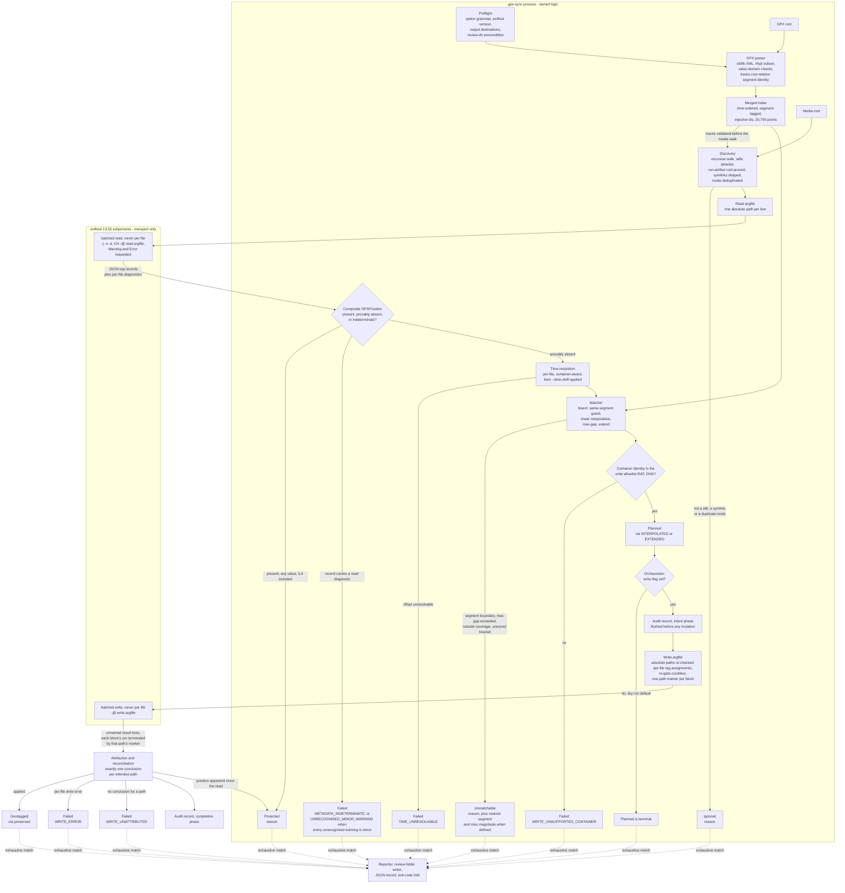
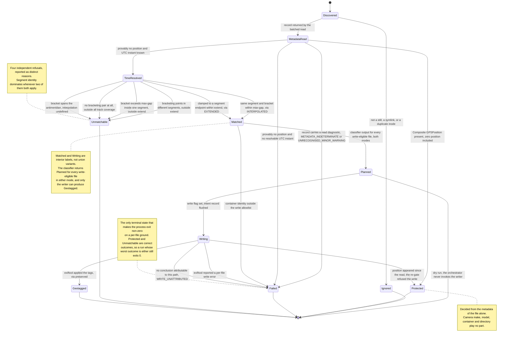
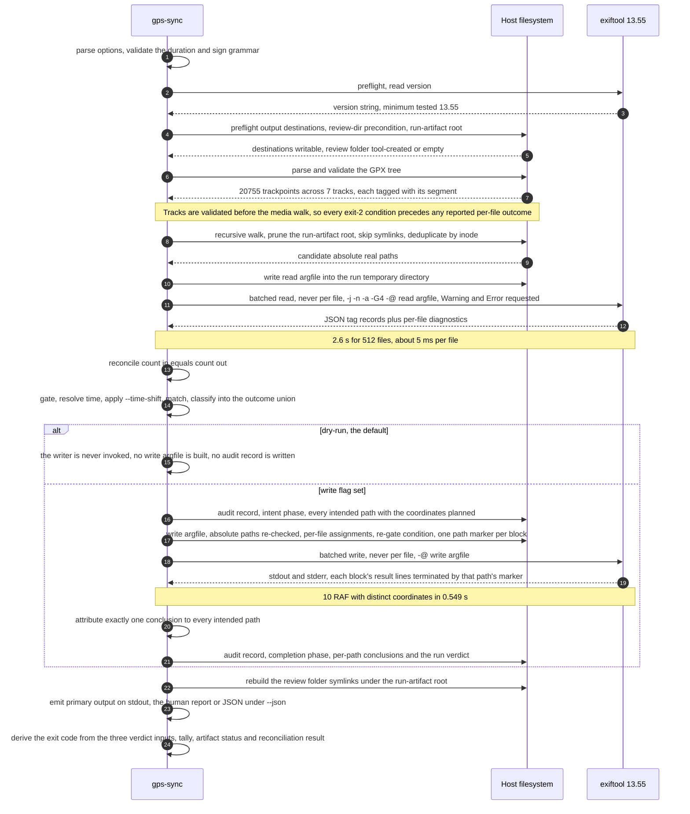

# Design — gps-sync: GPX-driven stills geotagger

**Goal:** `geotagging`
**Milestone:** `milestone-01-core-geotagging` · no ticket
**Feature:** issue `001-gpx-photo-geotagger` · no ticket
**Branch:** `feature/gps-sync-photo-geotagger`
**Status:** Approved
**Revision:** 4

---

## 1. Problem Statement

A 564-file trip archive holds 349 Fujifilm RAF stills with no GPS metadata, alongside 7 Garmin Connect GPX tracks totalling 20,755 trackpoints that cover the same five days. The positions exist; they are simply in different files from the photographs. Closing that gap by hand is not viable at this volume, and the obvious automated route is unsafe: exiftool's native `-geotag` already implements multi-track merge, linear interpolation, gap limiting and EXIF-offset-aware time resolution, but it has no skip-if-already-geotagged switch and overwrites existing coordinates unconditionally. Measured on a copy, `-geotag` displaced correct drone coordinates in a DJI DNG by 27.1 m.

The same archive contains 163 DJI DNG files that already carry the *drone's* position, while the GPX track carries the *pilot's*. Over the 107 DNG files that fall inside track coverage, the two positions are a median 1035 m apart, p90 2939 m, maximum 4620 m. An unconditional pass over this tree would therefore relocate 163 correct files by kilometres. The single requirement that no existing tool satisfies is also the one that cannot be compromised, so the tool's architecture is determined less by the matching problem — which is well understood and measured to sub-metre accuracy — than by where the never-overwrite decision is made and whether anything downstream can bypass it.

A second class of risk sits beside the first and is addressed by the same structure. A write under `-overwrite_original` is in place and irreversible, so the question of *what changed* has to be answerable after the fact and after an interruption, not only after a clean run. The design therefore treats the record of a write as a first-class output with its own ordering guarantee, on the same footing as the never-overwrite gate itself: a run that cannot say which files it touched has lost information even when every byte it wrote was correct.

Why now: the archive is complete and static, the track data is in hand, and Phase 1 measured every quantity this design depends on against the real data, including byte-level write-safety verification for the two containers that will be written.

---

## 2. Goals and Non-Goals

### Goals

- Write a position into every still that lacks one and whose capture instant falls inside track coverage, derived by linear interpolation between two bracketing trackpoints of the same track segment.
- Enforce one universal per-file invariant: if a position is already present, the file is never written. The decision is made from the file's own metadata, never from camera make, model, container or directory, and a file whose metadata could not be read cleanly is refused rather than assumed to be empty.
- Default to dry-run, apply writes only under an explicit flag, and produce identical classification in both modes so the dry-run report is exact rather than predictive, up to the three outcomes that only a write run can produce — `Failed{WRITE_ERROR}`, `Failed{WRITE_UNATTRIBUTED}` and `Protected{POSITION_APPEARED}`.
- Report every file's terminal outcome with a reason, and for coverage misses report which refusal applied, the nearest track segment, the magnitude of the miss and the parameter value that would change the outcome, so a timezone defect, a sampling dropout and a camera used between activities are three distinguishable diagnoses with three different remedies rather than one count.
- Make a run consumable by a script as well as by a person: an exit code in which only a genuine failure, a write set that was not what the tool intended, or a run-level artifact the run undertook to produce going missing or incomplete is non-zero, an on-demand JSON record of every per-file outcome, and a two-phase audit record of every write run — written before the first mutation and completed after the last, so an interrupted run is detectable rather than invisible.
- Attribute exactly one conclusion to every file the tool intended to write, keyed by a marker the write invocation emits for each file rather than by the position of a line in the backend's output, and reconcile that set the way the read phase is reconciled, so the audit record never reports a file as written when the tool cannot establish that it was.
- Preflight every destination the run will write to, alongside the exiftool version check, so a misdirected or unwritable output path is refused before any byte of media changes.
- Treat the camera clock as a measured quantity rather than an assumption: `--time-shift` for data whose clock is unknown, plus a per-run report line giving the speed at photo instants and the displacement a 60 s clock error would cause on that run, so every archive states its own exposure instead of inheriting this one's.
- Surface unprocessed files as a `_unprocessed/` symlink folder with one subfolder per refusal reason, rebuilt as a bounded operation over entries the tool itself created, so they open directly in Capture One and so nothing else in the target directory is ever removed.
- Complete a full pass over the 512-still reference archive in roughly 21 s by batching both exiftool phases.
- Restrict writes to containers whose in-place write safety was verified byte-for-byte (RAF, DNG), decided from container identity rather than from the filename, and refuse any other container explicitly.

### Non-Goals

- **All video is out of scope for this issue.** `.MP4` and `.MOV` are excluded by the stills allowlist and terminate as `Ignored`. This removes four things from issue 001 and hands them to issue 002: the 5 Fujifilm MOV geotag targets, the DJI container-atom publishing question, the `[Keys]` ISO 6709 video write path, and the entire video GPS-detection problem — the full `-ee` scan versus `MetaFormat = dbgi` handler-probe trade-off, the roughly 4.6 min scan cost for 45 clips, and the tension of a vendor-specific probe inside a source-agnostic invariant.
- No extrapolation of motion. `--extend` clamps to a track endpoint; it never projects heading or speed.
- No writes to JPEG, TIFF or HEIC. Unverified containers are refused, not attempted on the strength of exiftool's `-listwf`. The bar that would admit one later is stated as a constraint in §3, so extending the allowlist is a checklist rather than a judgment call.
- No XMP GPS properties. The EXIF GPS tag set is written and nothing else, because that is exactly the write path the byte-level verification covered; §7 records the accepted limitation.
- **No use of exiftool's own geotagging machinery anywhere in the shipped tool.** `-geotag`, `-geosync` and the `Geo*` API options are prohibited rather than merely unused, and the single exception is the cross-implementation check in §6, which runs only in the test suite. §5 states the prohibition as an invariant.
- **No copy-back write mode.** `-overwrite_original_in_place` preserves filesystem attributes that the chosen mode does not, and it is declined anyway because it achieves that by copying a temporary file's contents over the original, so an interruption during the copy damages the photograph itself. §7 records the decision and the attribute cost it accepts.
- No GUI, no HTML contact sheet and no thumbnail rendering. The contact sheet was costed at roughly 213 ms per file (5.5 s for 26 files, using the 4416x2944 `PreviewImage` each RAF carries) and declined in favour of the symlink folder.
- No alternative interpolator. Measured method error is median 0.30 m; a spline, great-circle or speed-weighted variant would optimise a non-problem.
- No automatic clock-offset detection. `--time-shift` is a correction the user supplies explicitly; the tool never infers one. The X-T5 clock has been measured directly against satellite time and is accurate to within 1 s, so there is nothing here to detect — and the files that could calibrate it are, by the invariant, exactly the files that are never written.
- No use of `GPSDateTime` as a photo's time source. It is satellite-derived and therefore looks authoritative, but it is the stale quantity; §5 states the rule and §7 records it as a rejected alternative.
- No support for concurrent mutation of the media tree during a run. §5 states the exclusive-access assumption and the write-phase re-gate that limits the damage when it is violated, but the tool does not coordinate with another writer.

---

## 3. Implementation Context

**Repository:** `/Users/astavonin/projects/gps-sync`

**This section records the starting state, not the current one.** It describes the repository as it stood when this design was written, before any implementation existed, because that starting state is what makes the build, test and run entry points below deliverables of this feature rather than extracted ones. Those entry points and the `README.md` have since been delivered; `CLAUDE.md` and git history remain absent.

At that point the repository contained only `planning/` and `harness/`. There was no source code, no git history, no build file, no `README.md`, no `CLAUDE.md` and no CI configuration, so no legacy code constrains this design and every contract below is external. `harness/gps_sync_proto.py` is a throw-away design-validation prototype, not a dependency.

**Functional Requirements:**

| ID | Requirement | Measured anchor |
|---|---|---|
| FR1 | Recursively discover stills under a media root using a case-insensitive extension allowlist. Everything else terminates as `Ignored` under a reason, silently, and is never counted as a failure. The ignore path exists for entries that are not stills at all — sidecars, caches, `.DS_Store`, system files, and the `_original` backup copy `--keep-original` retains — and not for stills the tool declines to write: a recognised still extension always becomes a candidate so that its position state is read and reported. | `.DS_Store` present (2 files); sidecars and caches plausible in a wider archive (R5); an `_original` sibling is by construction the pre-write bytes and therefore positionless, so admitting it would make it a write target |
| FR2 | Never write a file that already carries a position. The predicate is the presence of `Composite:GPSPosition`, and any present position — `(0,0)` included — is `Protected`. The predicate is three-valued: a record that could not be read cleanly is *indeterminate* and is refused, never read as "no position". The predicate is re-evaluated by the backend immediately before each file is modified, so a position that appeared after the batched read still protects the file. | drone-to-pilot separation median 1035 m, max 4620 m (n=107); `-geotag` displaced already-correct coordinates by 27.1 m |
| FR3 | Resolve each file's UTC instant per container class, from a table total over the combinations of container class and present time tags: use an embedded `OffsetTimeOriginal` when it is present and non-blank, consult `--utc-offset` only for local-time containers that lack an offset tag altogether, refuse a file whose offset tag is present but blank rather than letting the flag stand in for it, and fail loudly rather than assume a zone or substitute a different time semantic. Resolve the instant for every candidate whose record was read, including files the gate protects, and carry it on every variant that can hold one. | DNG `DateTimeOriginal` read as UTC places 0/163 inside a track; read as local `+06:00` it places 107/163 |
| FR4 | Parse every GPX file under a tracks root, tag every trackpoint with an identity that is injective within the run, merge them into one time-ordered index under a declared duplicate-collapse rule that cannot remove either endpoint of a segment boundary, and derive positions by linear interpolation between two bracketing trackpoints **of the same segment**. | 7 files, 20,755 trackpoints; leave-one-out method error median 0.30 m, p99 2.64 m, max 9.80 m (n=20,741) |
| FR5 | Refuse to interpolate across a segment boundary, and independently refuse a bracketing interval that exceeds `--max-gap` (default 120 s, user-settable). Report every refusal as its own reason, and when more than one applies to the same file, report the segment boundary — the primary invariant dominates. | two synthetic segments 60 s apart in time and 50.0 km apart in space: `--max-gap` alone accepts the 60 s bracket and fabricates a position 25.0 km from each segment end. The narrowest real inter-track gap is 1.29 h against a 120 s default, so both refusals hold for every real inter-track miss |
| FR6 | Provide opt-in `--extend <duration>` that clamps to the nearer endpoint of any gap interpolation refused and reports the result as `via EXTENDED`, never blended into the interpolated count, carrying the clamp magnitude and the refusal it overrode. | all 26 unmatchable RAF sit within roughly 63 min of a track endpoint; `--extend 90m` recovers all 26 |
| FR7 | Default to dry-run. Writes occur only under an explicit `--write` flag, and classification is identical in both modes except for the three outcomes only a write run can reach: `Failed{WRITE_ERROR}`, `Failed{WRITE_UNATTRIBUTED}` and `Protected{POSITION_APPEARED}`. | — |
| FR8 | Write only to containers whose in-place safety was verified byte-for-byte (RAF, DNG), decided from the content-derived container identity rather than from the filename extension. Refuse any other container, and any file whose identity and extension disagree, with a message naming both and stating that write safety is unverified. | RAF and DNG write verifications below; `-listwf` lists HEIC, JPG and TIFF as writable, which is not the same as verified (R8) |
| FR9 | Report every file's terminal outcome with a reason. For coverage misses, report which refusal applied, the nearest track segment, the magnitude of the miss and the parameter value that would change the outcome; never sum two refusal reasons into one count. | the 26 misses sit 0.83–1.04 h outside the nearest boundary; a 6 h systematic miss and a 50 min behavioural miss are indistinguishable in a bare count, and a dropout inside one activity calls for a different user response than a camera used between two |
| FR10 | Build a `_unprocessed/` symlink folder with one subfolder per refusal reason, located outside the scanned media tree by default, relocatable with `--review-dir`, and rebuilt as a bounded operation over entries the tool itself created. Exclude it from discovery wherever it sits, together with the rest of the run-artifact root: a review root inside the media tree is permitted and pruned rather than refused, so the prune is a live mitigation. Link names mirror each file's path relative to the media root, so two files sharing a basename cannot collide. | `exiftool -r` reported 2 RAF for a directory holding 1 real file plus 1 symlink; `find -type f` reported 1 |
| FR11 | Use `-overwrite_original` by default, decided on interruption-safety grounds, with `--keep-original` to retain exiftool's `_original` copy. Disclose the byte-level container changes **and** the filesystem-attribute consequence in user-facing documentation. | RAF loses 52,968 B of trailing padding; DNG header region changes by −2,674 B with 64,254,467 trailing bytes identical |
| FR12 | Preflight before any work begins: validate the option grammar, detect exiftool and read its version, and prove every destination the run will write to is usable — the run-artifact root, the audit-record directory, the per-run temporary directory the argfiles live in, and the review folder under its rebuild precondition. Fail with an actionable message if any of these is absent, too old, unwritable or holds foreign content. | measured on 13.55; `-Keys:GPSCoordinates` writes while `-QuickTime:` and `-UserData:` fail with `PrintConvInv` on that version (R4) |
| FR13 | Map the run's result to a process exit code: **0** when every file reached a correct terminal outcome — `Unmatchable` and `Protected` included — the write phase's reconciliation reported nothing outside the intended write set, and every artifact the run promised was completed; **1** when any file terminates `Failed`, or when the write phase reports a conclusion for a path the run did not intend to write; **2** for a tool-level failure that aborts the run before any per-file outcome is reported and before any file is mutated; **3** when the per-file work completed and was reported but a run-level artifact the run undertook to produce is missing or incomplete. | 26 of 349 RAF are legitimately `Unmatchable` at default settings, and an idempotent re-run reports every file `Protected`; both are correct results on this archive, so neither may make a run look broken. `Failed` means the tool intended to act and could not, which is the condition a script has to notice. A missing audit record after an in-place write is the one condition a re-run cannot reconstruct |
| FR14 | Emit the per-file outcome record as JSON under `--json`, on stdout, *suppressing* the human-readable report rather than relocating it. stdout always carries the primary output — the human report by default, pure JSON under the flag — and stderr carries diagnostics in both modes: warnings, errors and the `--verbose` trace. The JSON must carry everything the report carries that is not formatting; that clause is the requirement, and the list that follows is illustrative rather than closed — per-variant and per-reason counts, the coverage rate, the remedy figures and the sensitivity-line figures as well as the per-file records. | writes are in place under `-overwrite_original`, so the audit record is the only artifact that can audit or reverse a run once the terminal scrollback is gone. Keeping run artifacts out of the media tree by default is the FR10 reason — anything written inside the tree would be discovered on the next run were it not pruned, which is why the prune covers the whole run-artifact root wherever the user points it |
| FR15 | Provide `--time-shift <signed duration>`, default `+0s`, added to each resolved UTC instant before matching, applied at exactly one point, and **never** auto-detected. | the clock is measured, not assumed: 518 archive-wide RAF carry both the camera clock and a satellite-derived `GPSDateTime`, giving a per-day minimum of `camera_UTC − GPS_UTC` of +1 to +4 s on well-sampled days against a median of +14 s over 25 shoot days. Fix staleness is non-negative, so that difference can only overstate clock error — a +1 s daily minimum is a hard upper bound, roughly 1 m of position error. The default of 0 is therefore evidence-backed, and the flag exists for third-party or future data carrying no such evidence. The earlier `0 of 349` reading belonged to the `2026/Issyk Kul` subtree alone, which is exactly why it misled; the corrected probe behind both figures requires `-if '$Composite:GPSPosition'` *without* `-f`, or the condition sees the literal `-` for an undefined tag and matches every file |
| FR16 | Print one sensitivity line per run: the median speed at the matched photo instants, and the displacement a 60 s clock error would cause on that run's own data. State which files contributed and how many were excluded. | speed at the photo instant median 0.15 m/s, p90 1.15, p95 1.32, max 1.61 m/s, with 65.6 % of frames below 0.5 m/s; a 60 s offset displaces the median photo 9 m and the worst 96 m, a 300 s offset 44 m and 482 m. The bound belongs to this archive — a vehicle-borne trip at 60 km/h scales every figure by roughly 40 — so it must be re-measured on every run rather than inherited from this one |
| FR17 | Attribute exactly one conclusion to every path the write phase intended to write — applied, refused by the re-gate, failed, or unattributable — and reconcile the set the way the read phase is reconciled: every intended path appears exactly once in the conclusions, and a path with no conclusion is reported as unattributable rather than assumed either way. Attribution is **nominal rather than positional**: every per-file block of the write invocation emits a marker naming its own path, each of the first three conclusions is recognised by its own message inside that block, and a block whose marker never appears is the unattributable case. | measured on 13.55: the backend returns no named per-path result. Its default write output is unnamed counts in block order, and the line count per block is not constant — one line for an applied write, one for a condition refusal, two for an error — so positional line-to-block correspondence desynchronises on exactly the case that most needs attribution. `-echo3` and `-echo4` restore nominal attribution on stdout and stderr. The read phase has had a count-in-equals-count-out contract since Phase 1 because a dropped record reads as "no position", the unsafe direction; the write phase's unsafe direction is an audit record claiming a file was written when it was not |
| FR18 | Write the audit record in two phases: the intended write set, flushed to disk before the writer process is spawned, and the per-path conclusions after it returns. A record still in its intent phase is the incomplete-run marker, and a later run that finds one names it in the report. | an interrupted batch mutates an arbitrary prefix of its targets, and a file carrying GPS is indistinguishable from one that arrived `Protected`, so the set of mutated files is unrecoverable from the filesystem alone. The last path marker the batch emitted bounds how far it reached, which is the one thing the record can state about an interruption beyond the intended set |
| FR19 | Rebuild the review folder only over entries the tool itself created, under a precondition that the target is absent, empty, or carries the tool's own marker naming this media root and a marker version the tool recognises. Refuse a target that holds foreign content, and refuse a resolved review root that **is the media root or contains it** — the derived default root as well as an explicit `--review-dir`. A review root *inside* the media tree is permitted, because discovery prunes the run-artifact root wherever it sits; a root that is or contains the media root is refused because that same prune would then swallow the media tree. Refuse at preflight, before anything is removed and in dry-run as well as in write mode, and re-evaluate the per-entry bounded-removal rule again at removal time. | rebuilding the review folder is the one filesystem write in this design that could destroy data the tool did not create, and it is reachable from the mode presented as the primary safety net. The inside-the-tree arrangement is the one the harness measured — identical counts across two passes where `exiftool -r` reported 16 RAF for 14 real files — so refusing it would discard the evidence and leave the prune with no reachable purpose |
| FR20 | Declare the reason vocabulary once: a single mapping from each reason value to its stable JSON string, its review subfolder, its human label, its remedy text and its exit-code term. The reporter, the review-folder writer, the JSON record and the exit-code fold all derive their rendering from that one declaration, and exhaustiveness is required over the reason enumerations and not only over the variants, because a reason declared without its renderings hides exactly the files a user most needs to find — a file the tool tried to write and could not. | — |
| FR21 | State the user contract in one place: an inventory of every flag with its argument, default and effect, one grammar for the durations `--max-gap`, `--extend` and `--time-shift` share, and the sign convention for the signed one. | the flag set is the tool's entire user surface; a duration written as `90m`, `60s`, `120 s` and a bare `5400` across four documents is four grammars until one is chosen |
| FR22 | Validate every parsed trackpoint against a value domain before it enters the index: coordinates present, numeric, finite, in range and not the `(0,0)` sentinel; `time` present and parseable. Drop and count a point that fails; fail the run when a file yields no usable point. State what an absent `<ele>` means for the written altitude tags. | one corrupt point fabricates positions for every file it brackets — the same hazard class as the segment-boundary defect, a value satisfying every stated constraint while naming a place the camera never was. `<ele>` is optional in GPX 1.1 and the on-every-point property is a Garmin Connect flavour observation, not a guarantee |

**Non-Functional Requirements:**

| ID | Requirement | Measured basis |
|---|---|---|
| NFR1 | Container-level metadata is read and written in batches. **Per-file process spawning is forbidden**: the number of exiftool processes a run spawns must not grow with the candidate count. One read process and one write process per run is the measured arrangement at the reference envelope; a bounded chunking of an argfile is permitted above it provided the amortised per-file process cost stays in the measured order. The requirement is scoped to container-level metadata and does not constrain a future per-clip telemetry read. | batched read 2.6 s for 512 files, about 5 ms per file, against about 65 ms per file when spawning per file; a batched `-@ argfile` write applied distinct coordinates to 10 RAF in 0.549 s in one process |
| NFR2 | A full pass over the reference archive completes in roughly 21 s. The figure is stated at its measured envelope — 512 candidate stills in a 564-file tree, 349 of them written — and is a guide rather than a bound: the archive-wide population is 2,865 RAF, and write wall time scales with payload size. NFR1's process-count assertions are this requirement's standing verification; no wall-clock assertion gates the suite. | 2.6 s batched read plus about 18 s of batched writes for 349 files |
| NFR3 | Default-settings coverage on the reference archive is 323/349 = 92.6 %, under the numerator and denominator §5 defines. A materially different figure indicates a time-resolution defect, not new data. A run in which nothing reached the matcher reports the rate as not applicable, which is the healthy reading for an idempotent re-run rather than a regression. | measured; bracketing interval median 5 s, max 26 s |
| NFR4 | A dry run mutates no media file: it opens no file in the media tree for writing and changes no mtime anywhere in that tree. Everything it creates belongs to the tool: the run-artifact root and the audit-record directory, created empty at preflight when absent; the review folder with its marker file and its symlinks; and the read argfile, which lives in a per-run temporary directory outside both the media tree and the run-artifact root, removed when the run ends and **retained past it under `--verbose`**, whose paths are then printed. Those artifacts lie outside the media tree in every arrangement but one: a review root the user points inside it with `--review-dir`, which places the review folder, its marker and `runs/` there by the user's own direction and is pruned from discovery wherever it sits. Nothing else the tool writes is ever added inside the media tree, in either mode, with one further exception named here so the property is not read wider than it holds: on a **write** run `--keep-original` retains exiftool's `_original` sibling beside each written file, which is the only file the tool adds inside the tree, is added only under that flag, and is never a candidate on a later run. A dry run writes **no audit record** — the audit-record directory may be created, but it stays empty. | — |
| NFR5 | Every path reaches exiftool as a literal argfile line or an argv element — never an interpolated shell string, never a glob, never a bare directory — and **every such path is absolute**, so no line can be read as an option whatever the filename begins with. | `-@` lines are read literally with no shell quoting; a write to `/sp dir/a b.RAF` succeeded and read back correctly (R9 closed). `-fast2` was measured to make exiftool "return nothing", which is the fail direction an option-shaped line would take |
| NFR6 | A `README.md` at the repository root is a deliverable of this feature and is where every disclosure this design mandates lands: the byte-level effect of a write on each allowlisted container, the `-overwrite_original` trade and the filesystem attributes it does not preserve, the measured fact that a write succeeds regardless of the target file's own permission bits so making a file read-only does not protect it, the three parameter definitions that are gps-sync's own rather than exiftool's together with the `--time-shift` sign convention, the hard-link consequence, the exclusive-access assumption, and the fact that a positionless DJI DNG is always refused because of a minor warning its camera originals carry. | R3 and the DNG verification; the three definitions differ in kind from exiftool's same-named options, so a user comparing outputs is misled without them |
| NFR7 | The same `README.md` states that `Protected` makes no claim about a position's *quality*: the tool preserves existing positions unconditionally, including ones measurably worse than the track would compute, and it names the measured basis so the user can judge. | 603 archive-wide RAF carry positions at a median fix age of 329 s, p90 2,625 s, max 2.0 h; 80 of them share one coordinate across 4.3 h. A user sees those files in `already-tagged/` with nothing distinguishing them from well-tagged files |
| NFR8 | The exiftool subprocess is reached through one named transport boundary with three declared operations and declared result shapes, substitutable in tests. The write operation's declared shape is the batch's two output streams **partitioned into per-block runs by the path markers**, not named per-path conclusions — the backend supplies none — and the message wordings the partition is read against are a version-pinned dependency alongside the tag-group acceptance and flag interactions §5 records under exiftool version coupling. Its hardest-to-reproduce failures — a below-minimum version, a record-count mismatch, a per-file write error and an unattributable batch failure — are exercised at unit level against a substituted transport, with the real binary retained as the standing integration check that the shapes still hold. | Shape B's testability argument rests on the owned part being isolable; that holds for the matcher and the classifier and must be extended to the boundary whose failure modes cannot be produced on demand. The write operation's shape is now measured rather than assumed: a five-path batch on 13.55 covering an applied write, a condition refusal, an error and a path reaching no conclusion at all |

**Constraints:**

| Constraint | Consequence for the design |
|---|---|
| exiftool 13.55 at `/opt/homebrew/bin/exiftool` is the only credible write backend. The archive contains no JPEG or TIFF originals, and pure-Python EXIF writers target JPEG APP1 and TIFF structure — neither `piexif` nor Pillow can parse or safely rewrite the Fujifilm RAF container with its FujiIFD and embedded preview. | exiftool is a hard runtime dependency. Python's role is orchestration and matching, never EXIF byte surgery. |
| exiftool has no skip-if-already-geotagged switch and overwrites unconditionally. | The never-overwrite invariant cannot be delegated. It must be enforced on our side of the subprocess boundary, the subprocess must never receive a path that did not pass it, and the predicate is additionally re-evaluated by the backend immediately before each file is modified. |
| exiftool implements the whole matching problem itself, and its geotagging options are a standing temptation to route around the owned pipeline. | `-geotag`, `-geosync` and the `Geo*` API options are prohibited in the shipped tool as a stated invariant, not merely unused. The cross-implementation check in §6 is the sole exception and runs only in the test suite. |
| An argfile line beginning with `-` is read as an option, not as a path, and a suppressing option changes how every following line is read. | Every path reaching exiftool is absolute and is checked to be so immediately before emission. This is a different defence from literal argfile lines, which close shell injection and not option injection. |
| `exiftool -r` lists symlinks; `find -type f` does not. | Discovery is ours, not exiftool's. The run-artifact root defaults outside the scanned tree and is pruned during discovery wherever it sits. |
| Writing to a symlink path replaces the symlink with a real file and leaves the original un-updated. | Discovery skips symlinks entirely, and the writer asserts that guarantee at its own boundary rather than inheriting it silently. |
| Two directory entries can point at one inode, and a rename-based write breaks the link. | Discovery deduplicates candidates by device and inode, so one inode yields one outcome and the report cannot claim two files were written when one was. |
| Paths contain spaces: `/Volumes/Data SSD 2TB/...` and `.../Issyk Kul`, and subdirectory names too. | Argv lists and argfiles only. No shell is involved anywhere in the tool. |
| Host runtime is Python 3.15.2 with `uv` available, and no relevant library is installed — `gpxpy`, `piexif`, `PIL`, `pyexiv2`, `exifread` and `rawpy` are all absent. | GPX 1.1 is plain XML and the needed subset is `trkpt` lat/lon, `ele` and `time`, so the standard library suffices and the dependency surface stays near zero. |
| GPX input is Garmin Connect flavour GPX 1.1: UTC `Z` timestamps, `ele` on every point, `ns3:TrackPointExtension` carrying temperature, heart rate and cadence. The `ele`-on-every-point property is an observation about this flavour; `<ele>` is optional in GPX 1.1 and third-party tracks are anticipated. | Parse the three-element subset, ignore extensions, validate every value, and define the altitude write for a bracket in which elevation is not derivable. |
| The tool assumes exclusive access to the media tree for the duration of a run. Classification completes before any byte is written, so a gate decision is acted on roughly 20 s after it was made. | The assumption is stated rather than implied, and the write invocation re-evaluates the gate predicate per file as defence in depth. The re-gate can only move a file out of the write set, never into it. |
| The repository was empty at design time, and is not a git repository. | The build, test and run entry points below are deliverables of this feature rather than existing commands, as is `README.md`. |
| Adding a container to the verified-safe write allowlist requires evidence, not confidence. exiftool's `-listwf` listing a format as writable is not evidence of in-place write safety, and container bytes are not the only thing a write can lose. | A container joins the write allowlist only after the same verification Phase 1 applied to RAF and DNG — payload identity, tag-set preservation, embedded-preview digest, no tag-count regression — **extended with a filesystem-attribute check** measured in the write mode the tool actually uses: extended attributes, Finder tags, resource fork, creation date, POSIX mode and ownership — **and with a re-verification of the write phase's three result-message wordings**, which the attribution parser reads and which were measured on RAF only. The evidence is committed to the repository. JPEG, TIFF and HEIC are not admitted now, because no file of either type exists in this archive to verify against. Extending the allowlist is therefore a checklist rather than a judgment call, and the gate is the same one that makes the iPhone evidence gap harmless: an iPhone HEIC still carrying a position is `Protected` with no iPhone-specific knowledge, and one without a position is refused rather than written unverified. RAF and DNG are admitted on the existing byte-level evidence; the attribute measurement for both, and the message-wording re-verification for DNG, are preconditions of the first release that writes. |

**Verification:**

Neither `README.md` nor `CLAUDE.md` existed when this design was written, so these commands are deliverables of this feature rather than extracted ones.

```bash
# Build / compile — interpreted language; dependency sync and entry-point install
uv sync

# Test — linters first (Phase 6 order), then unit tests, then integration tests
uv run ruff check . && uv run ruff format --check . && uv run mypy .
uv run pytest -m "not integration"
uv run pytest -m integration          # requires exiftool on PATH

# Debug / run — dry-run is the default; no file is modified
uv run gps-sync --media <media-root> --tracks <gpx-root>
uv run gps-sync --media <media-root> --tracks <gpx-root> --verbose
uv run gps-sync --media <media-root> --tracks <gpx-root> --json > run.json   # JSON replaces the report

# Local-time containers that carry no offset tag need the zone stated explicitly
uv run gps-sync --media <media-root> --tracks <gpx-root> --utc-offset +06:00

# Recover near-misses, then apply; --keep-original retains exiftool's _original copy
uv run gps-sync --media <media-root> --tracks <gpx-root> --extend 90m
uv run gps-sync --media <media-root> --tracks <gpx-root> --write --review-dir <dir>
uv run gps-sync --media <media-root> --tracks <gpx-root> --write --keep-original
```

**Note on the forms above.** The two check commands hold as written: `mypy .` is clean because `[tool.mypy]` excludes the test tree, so strict checking covers the shipped package alone, and `pytest -m "not integration"` is genuinely the unit pass because an end-to-end test is marked `integration` as well as `e2e` and is therefore deselected by that one selector. Two deviations are deliberate rather than drift. The repository drives the same commands through `.venv/bin/` instead of `uv run`, which is the equivalent invocation with no network dependency; and the development environment (`.venv`) deliberately carries no install of the package, so the end-to-end suite drives the tool as a module with `src` on the path. That is a choice, not a limitation of the host: `pipx install .` succeeds here, and the `Makefile` provides `install`, `install-editable` and `uninstall` targets that put the `gps-sync` entry point on `PATH` in its own isolated environment, documented in the `README.md` usage section. Both forms are kept here because they are what a user with a normal environment runs; the `README.md` of NFR6 states the local equivalents.

**On-Device Verification:** N/A — `gps-sync` is a local macOS CLI tool whose only runtime surface is the host filesystem, the host Python interpreter and a local exiftool subprocess; the authoritative record is the `## On-Device Scope` section of `analysis.md`, which reads `NO` (on-device scope: NO).

**Context Files:**

- `/Users/astavonin/projects/gps-sync/planning/geotagging/milestone-01-core-geotagging/issues/001-gpx-photo-geotagger/analysis.md` — Phase 1 research; the source of every quantitative claim in this document
- `/Users/astavonin/projects/gps-sync/harness/TEST-REPORT.md` — validation run against real copied data: 11 checks, the independent exiftool oracle agreement, and the segment-boundary defect it surfaced
- `/Users/astavonin/projects/gps-sync/harness/gps_sync_proto.py` — design-validation prototype, not the deliverable and not a dependency
- `/opt/homebrew/bin/exiftool` — version 13.55, the minimum tested version
- `/Volumes/Data SSD 2TB/PhotoArchive/2026/Issyk Kul` — reference media tree, 564 files; read-only in tests
- `/Users/astavonin/Downloads/tracks` — reference GPX tree, 7 files, 20,755 trackpoints; read-only in tests

---

## 4. Architecture Overview



Shape B in full: everything inside `OURS` is ours, and the exiftool subprocess appears exactly twice — once as a batched tag reader and once as a batched tag writer. Both GPX parsing and matching sit on our side, which is what makes the dry-run branch exact: the coordinates reported by a dry run are the same values a write run would apply, because we computed them.

Four orderings in that diagram are load-bearing rather than incidental.

**Preflight comes first and covers destinations as well as the backend.** The exiftool version check and the proof that every path the run will write to is usable are one stage, because both answer the same question — can this run finish what it starts — and both must answer it before any media byte changes. A review folder that cannot be rebuilt, or that holds content the tool did not create, is as much a reason to refuse a run as a missing binary.

**Track parsing and validation precede the media walk.** Every tool-level abort condition that can be decided without reading a media file — bad options, a missing or too-old backend, an unusable destination, unparseable GPX, a GPX yielding no timed points, a segment-identity collision — therefore fires before the first per-file outcome exists. The remaining abort conditions belong to the read and the write phases, and the exit-code contract states the property at the scope that holds for all of them: an exit-2 abort precedes any per-file outcome being *reported*. That is what makes the exit-code partition true as stated rather than true by approximation, and it fails fast on cheap input instead of after the measured 2.6 s read.

**The GPS-presence gate precedes container classification**, because the invariant does not depend on source, while time resolution follows it, because that is the one place where container identity is genuinely load-bearing. The gate is three-valued: a record the backend could not produce cleanly is refused rather than read as carrying no position, which is the direction a two-valued gate fails in.

**The mode branch sits after the last gate that can refuse a file and is applied by the orchestrator, not by the classifier.** The classifier never sees the write flag: it returns `Planned` for every file that is matched and write-eligible, in both modes. In a dry run `Planned` is terminal because the orchestrator simply does not invoke the writer; in a write run the writer consumes exactly those outcomes. `--time-shift` is applied at the tail of time resolution rather than at any later stage, so matching, reporting and the write all see one already-corrected instant and the correction has exactly one application point.

The three skip branches that keep files safe (`Protected`, `Failed`, `Unmatchable`) all terminate before the write argfile is constructed, so the only channel into the writer carries `Planned` outcomes. The write phase then adds a second reconciliation of its own, symmetric with the reader's: the intended set is recorded before the writer is spawned, and every path in it must come back with exactly one conclusion.



Every file reaches exactly one of the six terminal variants, and only `Geotagged` mutates a file. `Matched` and `Writing` are interior labels of the pipeline rather than members of the union — the union's membership is fixed at six, which is what lets four consumers match it exhaustively — and their placement carries the design's load-bearing properties.

The write-allowlist refusal is evaluated out of `Matched`, before the mode branch, so a dry run reports a refusal a write run would also produce. `Planned` is the classifier's output for every write-eligible file in both modes, so "a dry run writes nothing" is a property of the orchestrator never invoking the writer rather than of a flag consulted inside the classifier, and `Geotagged` is a value only the writer can produce. The write error path leaves `Writing` for `Failed` rather than for `Geotagged`, so a per-file exiftool failure is never reported as a success; the unattributable path leaves `Writing` for `Failed` too, under its own reason, because a file the tool cannot report on is not a file it may report as written. The re-gate path leaves `Writing` for `Protected`, and it is one-way: the write phase can only remove a file from the write set, never add one, so the dry-run report stays an upper bound on what a write run will modify.

The `via` discriminator is attached when the match is made and is preserved through every variant a matched file can terminate in — `Planned`, `Geotagged`, the three write-phase `Failed` reasons and `Protected{POSITION_APPEARED}` — which is what keeps the weaker provenance of an extended result out of the interpolated count and what makes the coverage rate's `via` breakout total over its own membership. The process exit code is a fold over three verdict inputs: this terminal tally, the status of the run's own artifacts, and the write phase's reconciliation result. `Failed` is the only variant in the tally that makes a run non-zero — which is a further reason the write-refusal paths lead to `Failed` rather than into a widened `Unmatchable`: a refusal the tool intended to act on must be visible to a script, while a legitimate coverage miss must not be.

---

## 5. Detailed Design

### Component map

| Component | Responsibility | Input | Output |
|---|---|---|---|
| Option parser | Parse and validate the flag inventory, including the shared duration grammar and the signed form | CLI arguments | validated options, or a tool-level failure |
| Run orchestrator | Sequence the phases, apply the mode branch, and derive the process exit code from the run's three verdict inputs — the terminal tally, the artifact status and the write-phase reconciliation result | validated options | process exit status: 0, 1, 2 or 3 |
| Preflight | Resolve the exiftool binary and verify its version; resolve the run-artifact root, the audit-record directory and the review folder, and prove each usable under its precondition — all before any other work begins | options, configured or discovered binary path | validated invocation handle and validated destinations, or a fatal error |
| exiftool transport | The single named boundary to the subprocess, with three operations — version, batched read, batched write — and declared result shapes. Substitutable in tests | argfiles and argv lists | version string; per-path tag records and per-path diagnostics; the write batch's stdout and stderr partitioned into per-block runs by the path markers, plus the process status |
| GPX parser | Read the `trkpt` subset of every GPX file under the tracks root, validate every value, and tag each point with an identity derived from the file's path relative to the tracks root | tracks root | timed point sequences, each point carrying a segment id; per-file drop counts |
| Merged track index | Present all tracks as one immutable time-ordered structure suitable for bisect, under a declared collapse rule, without losing segment boundaries | per-segment sequences | merged index with per-point segment identity; the set of temporally overlapping segment pairs |
| Discovery | Walk the media root, apply the stills allowlist, prune the run-artifact root, skip symlinks, deduplicate by inode, resolve every path to an absolute real path | media root, allowlist, resolved run-artifact root | resolved absolute candidate paths; `Ignored` outcomes with reasons |
| Batched metadata reader | Obtain one tag record plus any per-file diagnostic per candidate from the batched read, never from a process per file, and reconcile the returned set against the requested set | candidate paths | one tag record and diagnostic slot per path |
| Classifier | The single `classify` entry point, with no knowledge of the write flag: run the three-valued GPS gate, time resolution including the `--time-shift` application, matching and the container-identity write check, and return one discriminated `Outcome` | tag record, diagnostic, merged index, options | one `Outcome` variant; `Planned` for every write-eligible file |
| Matcher | Pure position derivation, interpolating only within a single track segment, and reporting the provenance of the result | index, shifted UTC instant, `max_gap`, `extend` | interpolated or extended, each carrying its provenance and, where defined, the bracket's speed; or a `NoCoverage` refusal carrying its reason, the nearest segment and the miss where one exists, and the bracket width and unsound-bracket detail where those are defined |
| Audit-record writer | Write the intended write set before the writer is spawned and the per-path conclusions after it returns, as one two-phase record | the `Planned` set, the run's options, the conclusions | a timestamped record under the run-artifact root |
| Batched writer | Apply the planned tag assignments through the batched write, never through a process per file, carrying the re-gate condition and one path marker per block, and attribute exactly one conclusion to every intended path from the marker-delimited blocks | the `Planned` outcomes | `Geotagged`, `Protected`, or `Failed` per path |
| Reason registry | Declare each reason value once, with its stable JSON string, review subfolder, human label, remedy text and exit term | — | the single mapping every rendering derives from |
| Reporter | Render counts, per-file detail, the coverage rate, the remedy figures and the clock-sensitivity line, exhaustively over the variants and the reason enumerations | the complete outcome sequence, the artifact status, the write-phase reconciliation result | human-readable report on stdout, suppressed under `--json` |
| Review-folder writer | Materialise `_unprocessed/<reason>/` symlinks under the rebuild precondition, exhaustively over the variants and the reason enumerations | the complete outcome sequence | symlink tree under the run-artifact root |
| Run-record writer | Serialise the outcome sequence and the run-level figures as JSON to stdout under `--json`, in place of the human report | the complete outcome sequence, the run's options, the artifact status, the write-phase reconciliation result | JSON record on stdout |

### The CLI contract

The flag set is the tool's entire user surface, so it is inventoried here rather than distributed across the requirements.

| Flag | Argument | Default | Effect |
|---|---|---|---|
| `--media` | directory | required | root of the media tree to scan. Resolved once to an absolute real path; if the root itself is a symlink it is resolved and scanned, and the skip rule applies only to entries found inside the walk |
| `--tracks` | directory | required | root of the GPX tree to parse. Resolved the same way |
| `--write` | — | absent | apply writes. Absent means dry-run, which is the default |
| `--max-gap` | duration, zero or greater | `120s` | maximum width of a bracketing interval *within one segment*, inclusive. The admissible range is the whole non-negative duration domain: the sign rule below rejects everything under it and there is no upper bound, so there is no separate out-of-range refusal |
| `--extend` | duration, zero or greater | `0s` | clamp window measured from the nearer endpoint of a gap that interpolation refused. `0s` disables extension. Same admissible range as `--max-gap`, and for the same reason: a larger window recovers more files at a provenance the outcome records, so no value is out of range |
| `--time-shift` | signed duration | `+0s` | added to each resolved UTC instant before matching. Never inferred |
| `--utc-offset` | `±HH:MM` | none | offset for local-time still containers that carry no `OffsetTimeOriginal`, and for nothing else. No default: its absence on such a file is a failure, not an assumed zone |
| `--review-dir` | directory | the run-artifact root described below | parent of the `_unprocessed/` tree and of the audit-record directory. It may not be, or contain, the media root; it may lie *inside* the media tree, where discovery prunes it |
| `--keep-original` | — | absent | retain exiftool's `_original` copy instead of suppressing it. This is the flag FR11 names, and it is the only mechanism that keeps the prior bytes |
| `--json` | — | absent | emit the machine-readable record on stdout *in place of* the human report |
| `--verbose` | — | absent | emit a diagnostic trace on stderr: the exact exiftool invocations, the argfile paths, the pruned run-artifact path, and the per-file ignore reasons. It also changes one lifetime: both argfiles and their temporary directory are **retained after the run ends** instead of being removed, which is what makes a printed invocation reproducible by hand |

**Duration grammar, shared by `--max-gap`, `--extend` and `--time-shift`.** A duration is a decimal number followed by one unit suffix: `s` for seconds, `m` for minutes, `h` for hours. A bare number with no suffix is seconds. No compound form is accepted: `90m` and `5400s` and `5400` are the same value, and `1h30m` is a parse error rather than a silently accepted prefix. Whitespace between the number and the unit is not accepted, so the document's prose figures such as "120 s" are prose, not input syntax. A leading `+` or `-` is accepted only by `--time-shift`; for the other two a sign is a parse error, since neither has a meaning below zero. Those two are unbounded above: no admissible maximum is defined, because no value above the default produces an unsafe outcome rather than merely a permissive one — the segment guard is independent of `--max-gap`, and an over-wide `--extend` records its clamp magnitude on every outcome it recovers. The sign rule is therefore the whole of their range check and no out-of-range refusal exists. Every parse error is a tool-level failure before any work begins.

**`--time-shift` sign convention.** The value is **added to the file's resolved UTC instant to obtain the instant used for matching**: `matching_instant = resolved_instant + shift`. So a camera whose clock ran slow — it stamped `12:00:00` on an exposure made at true `12:01:00` — is corrected with `--time-shift +60s`, and a camera that ran fast is corrected with a negative value. The convention is stated here because an inverted sign does not fail, it silently doubles the error the flag exists to remove, and §6 pins the direction with a test rather than leaving it to the implementer.

### The Outcome contract

The classifier returns a discriminated union rather than a bag of optional fields, and the reporter, the review-folder writer, the JSON serialisation and the exit-code fold must all match it exhaustively, so adding a seventh state becomes a type or test error rather than a silent omission at one call site.

```
Outcome =
    Ignored{path, reason, detail?}
  | Protected{path, position?, instant?, reason, via?, provenance?, bracket_speed?, context?}
  | Failed{path, instant?, reason, detail?, via?, provenance?, bracket_speed?, context?}
  | Unmatchable{path, instant, reason, nearest_segment?, miss_s?, bracket_s?, detail?, context?}
  | Planned{path, instant, position, via, provenance, bracket_speed?, context?}
  | Geotagged{path, instant, position, via, provenance, bracket_speed?, context?}

position    = {lat, lon, ele?}                   -- ele absent when elevation is not derivable
via         = INTERPOLATED | EXTENDED            -- open enumeration; see below
provenance  = Interpolated{segment, bracket_s}
            | Extended{segment, clamp_s, overridden_reason}
context     = {make?, model?, file_type?}        -- descriptive; Ignored carries none
```

The union stays at six variants under all of this: the exit code's tally term is a fold over the same sequence, the JSON record is a serialisation of it, and the audit record is a projection of its `Planned` subset, so none of them adds a state and the exhaustiveness property is untouched.

**`instant` rides on every variant that can hold one, including `Protected`.** Time resolution is evaluated for every candidate whose record was read, not only for the files that pass the gate. The gate's *decision ordering* is unchanged — the GPS-presence gate still runs first and is not influenced by the instant, which is what keeps the invariant source-independent — but the resolved instant is cheap, pure computation over a record already in hand, and attaching it costs nothing. An unresolvable instant on a `Protected` file is not a failure; the field is simply absent. The reason this matters beyond tidiness is that a `Protected` file's date is exactly what a later destination-layout feature needs, and without it that feature would have to either reorder this pipeline or re-implement the container-class table below.

**`position` is present on `Protected` for the two reasons that supply it and absent for the one that does not.** For `POSITION_PRESENT` and `ZERO_POSITION` the value comes from the file's own tag record. For `POSITION_APPEARED` the tool learns only that the backend's per-file condition declined: the appeared coordinates are never read, and the write output carries no position, so the field is absent — the same treatment the union already gives `instant` and elevation. Absence has exactly one meaning on that reason, and the renderings state it: the file now carries a position whose value this run never saw. Filling it with the *planned* position would put a coordinate the file does not carry into the audit record, which is the adjacent error to the one the reconciliation invariant exists to prevent. Three consumers are bound by that. The JSON per-file record renders the field as absent rather than as a coordinate or a zero, distinguishably from `ZERO_POSITION`. The altitude-availability reading below makes no statement for such a file. And issue 003's destination layout is promised a position on `Protected{POSITION_PRESENT}` and `Protected{ZERO_POSITION}` only — for a `POSITION_APPEARED` file it has the instant and must read the file itself if it needs the coordinate, which is sound because that reason means the file was written by something else between this run's read and its write.

**The match payload survives a write-phase refusal, on whichever variant the refusal lands.** `via`, `provenance` and `bracket_speed` are attached when the match is made, so a file that reached the matcher keeps them whatever it terminates as: they are mandatory on `Planned` and `Geotagged`, and optional on `Failed` and `Protected`, present exactly on the reasons that follow a match — `WRITE_UNSUPPORTED_CONTAINER`, refused out of the match itself, plus `WRITE_ERROR`, `WRITE_UNATTRIBUTED` and `POSITION_APPEARED`, all three of which were `Planned` before the write phase reached them — and absent on `TIME_UNRESOLVABLE`, `METADATA_INDETERMINATE`, `UNRECOGNISED_MINOR_WARNING` and the other two `Protected` reasons, none of which ever reached the matcher. That one presence rule is what makes the coverage rate's `via` breakout total over its own six member classes, and what lets the JSON carry a provenance for every file that had one. It asserts nothing about a position: a provenance names a segment, a bracket width, a clamp magnitude and an overridden reason, never a coordinate, so carrying it on `POSITION_APPEARED` records what the run planned without claiming what the file holds.

**`nearest_segment` and `miss_s` are optional on `Unmatchable`, and they are absent together under exactly one condition: an index holding no points at all.** Every other refusal has an endpoint to name and a distance to it — the outer endpoint for an instant beyond the index's ends, the nearer endpoint of the gap for a boundary or a width refusal, the bracket's own two points for an unsound one — so both fields are present. Against an empty index there is no segment to claim as nearest and no miss to measure, and neither is invented: the matcher returns the refusal with both absent, and the report says the index was empty rather than naming a segment that does not exist.

**`bracket_s` and `detail` on `Unmatchable` exist because the registry's remedy column promises per-file specifics the reason alone cannot carry.** `bracket_s` is the bracketing interval's own width. It is present on the three refusals that have a bracketing pair — `SEGMENT_BOUNDARY`, `MAX_GAP_EXCEEDED` and `BRACKET_UNSOUND` — and absent on `OUTSIDE_COVERAGE`, which has no pair at all, and against an empty index. It is carried rather than recomputed because the `--max-gap` remedy figure is the smallest value that would admit the file, which is the bracket width under that parameter's inclusive boundary, and that figure is **not** derivable from `miss_s`: the miss is measured from the instant to the nearer endpoint, so a file can sit seconds from one end of an hour-wide bracket. `detail` is present on `BRACKET_UNSOUND` alone and names the bracket's two trackpoints with their segments, instants and longitudes, which is what makes that reason's "the two trackpoints are named" remedy true of each file rather than of the reason in general. It is the same field `Ignored` and `Failed` already carry for the same purpose: on `Ignored` it holds the real target of a skipped symlink and the retained path of a duplicate inode, which are exactly the specifics those two rows' remedies promise.

**`context` carries the descriptive fields the reader retrieves, and no classification decision turns on them.** A `context` holds `make`, `model` and `file_type`, each optional because a record need not supply it, and it rides on every variant whose file had its record read — `Protected`, `Failed`, `Unmatchable`, `Planned` and `Geotagged`. `Ignored` is the one variant without it, and necessarily so: an entry is ignored on its filename, its symlink status or its inode, all of which discovery decides during the walk and therefore before the batched read, so there is no record for a context to come from. The field is a contract rather than a presentation detail because it has a consumer beyond the renderings. `make` and `model` are context only, under the invariant stated with the reader's requested fields that no gate, branch or default may read them, and the report shows them on the per-file line while the JSON carries all three. `file_type` is additionally the value the writer's pre-emission re-check tests against the write allowlist — the container-identity component of that re-check, specified in Phase 2 below — so a `Planned` outcome reaching the writer without a context, or with one naming a container outside the allowlist, is an internal-consistency failure that aborts the run rather than a file that is written anyway.

**Altitude availability is folded into `position` rather than carried beside it.** A `position` is a latitude and a longitude with an optional elevation, filled only when both bracketing points carry `<ele>`, so a position without an elevation *is* the case in which the write set drops `GPSAltitude` and `GPSAltitudeRef`. That is the field the report, the JSON record and the intent record read when they state whether altitude was available. No separate flag exists, because a second field could disagree with the coordinate it describes. A `Protected{POSITION_APPEARED}` outcome carries no `position` at all, so it makes no altitude statement in either direction: what the renderings show is the absent position, not an absent elevation.

**Provenance is shaped to the match that produced it, not to the ordinary case.** An `Interpolated` provenance carries the segment and the bracket width. An `Extended` provenance carries the segment it clamped to, the clamp magnitude, *and the refusal the clamp overrode* — `SEGMENT_BOUNDARY`, `MAX_GAP_EXCEEDED` or `OUTSIDE_COVERAGE`. Three fields, not four: it carries **no** separate nearest-segment field, because a clamp goes to the nearest endpoint by construction, so such a field could never differ from `segment` and would only be a second name for the same value — a redundant field that two renderings could disagree about. (`nearest_segment` on `Unmatchable` is a different field answering a different question: there the match was refused, so the nearest segment is not the one a position came from.) Without the overridden reason the report cannot distinguish a frame clamped across a dropout inside one activity from one clamped across a boundary between two activities, which is precisely the weaker-provenance case the 50 km counterexample was about — and it is the case that becomes the common one under `--extend 90m`, the setting that recovers all 26 real misses.

**`bracket_speed` is explicitly optional, with a defined value in every degenerate case.** It is the matcher's only output that is neither a position nor a refusal, it exists because the sensitivity line of FR16 needs a per-file speed, and the matcher is the only component that holds the points it comes from — the reporter aggregates the values and never consults the index. Its definition:

| Match shape | `bracket_speed` |
|---|---|
| Interpolated across two distinct points | distance between the bracketing points divided by their time difference |
| Exact hit on a stored point | the speed of the adjacent interval on the later side within the same segment; the earlier side when the point is its segment's last |
| Exact hit on the only point of its segment | absent |
| Extended clamp | the speed of the interval adjacent to the clamped endpoint, inside that endpoint's own segment |
| Extended clamp onto the only point of its segment | absent |
| Single-point index | absent |

Absent is an explicit value and never zero, because zero is a legitimate speed — 65.6 % of the reference frames were shot below 0.5 m/s — and a run that silently folded absences in as zeros would understate its own clock exposure. **Only `Planned` and `Geotagged` outcomes with `via INTERPOLATED` and a present `bracket_speed` contribute to the sensitivity fold.** The `via` term keeps the two error sources apart: an extended result's position error is dominated by the clamp window rather than by the speed across some adjacent interval, so folding them together would average unrelated quantities, and the report states the clamp-window distribution for extended files separately. The *variant* term is equally load-bearing now that the match payload survives a refusal, and its ground is what the figure is *about* rather than any claim of equal populations: an interpolated file that failed its write still holds a speed, and the fold excludes it because the line states the clock exposure of the positions the run stands behind — planned in a dry run, applied in a write run — not of every file that reached the matcher. The restriction does **not** equalise the two modes' populations; it is precisely what makes them differ, in the same direction as every other dry-run figure. `Failed{WRITE_ERROR}`, `Failed{WRITE_UNATTRIBUTED}` and `Protected{POSITION_APPEARED}` are `Planned` in a dry run and so contribute there, while a write run excludes them, so **the dry run's fold population is an upper bound on the write run's** rather than equal to it, and the printed median over one tree can move between the modes by exactly the files the write run did not deliver. That cost is accepted rather than hidden, because the line states how many files were excluded and why. The excluded classes are `Ignored`, `Unmatchable`, every `Failed`, every `Protected`, every `via EXTENDED` outcome and every contributor whose speed is absent; the report states how many files were excluded and why.

**`via` is an open enumeration and is named here as a contract a later issue will extend.** Each value declares which provenance shape accompanies it, which is what lets a non-track provenance be added without widening the union or making the existing fields optional by accident. Issue 002's DJI container-atom position comes from the centroid of a clip's own telemetry — no bracket, no clamp, no track segment — so it arrives as a third `via` value with a provenance shape of its own rather than as a seventh variant or as a bracket field left empty.

### The reason registry

Exhaustiveness at the variant level is not enough, because the report, the review folder and the JSON are keyed on reason values rather than on variant names. The reason vocabulary is therefore declared once, and the renderings are derived from that declaration rather than maintained alongside it. **The exhaustiveness obligation extends to these enumerations: the reporter and the review-folder writer must handle every row, and adding a row without its renderings is a type or test error.**

| Variant | Reason | Review subfolder | Human label | Remedy the report prints | Exit term |
|---|---|---|---|---|---|
| `Ignored` | `NOT_A_STILL` | none | not a still | — | 0 |
| `Ignored` | `SYMLINK` | none | symlink skipped | the real target is named when it lies inside the media root, so it is visible that the file was discovered on its own merit | 0 |
| `Ignored` | `DUPLICATE_INODE` | none | second link to a file already processed | the retained path is named | 0 |
| `Protected` | `POSITION_PRESENT` | `already-tagged/` | position already present | none needed; the file keeps its position and is linked here only so it can be browsed | 0 |
| `Protected` | `ZERO_POSITION` | `zero-position/` | position present but zero | clear the coordinates by hand if the position is wrong; the tool will not decide that for you | 0 |
| `Protected` | `POSITION_APPEARED` | `appeared-mid-run/` | position appeared between the read and the write | re-run; check for a concurrent writer | 0 |
| `Unmatchable` | `MAX_GAP_EXCEEDED` | `sampling-dropout/` | sampling dropout inside one activity | raise `--max-gap` to at least the bracket width reported for the file | 0 |
| `Unmatchable` | `SEGMENT_BOUNDARY` | `between-segments/` | camera used between two activities | use `--extend` with at least the miss reported for the file; `--max-gap` is not the remedy for a segment boundary | 0 |
| `Unmatchable` | `OUTSIDE_COVERAGE` | `no-track-coverage/` | instant outside the index's outer ends | use `--extend` with at least the miss reported for the file, or add the covering track to the tracks root | 0 |
| `Unmatchable` | `BRACKET_UNSOUND` | `unsound-bracket/` | bracket crosses the antimeridian | none; the two trackpoints are named so the track can be inspected | 0 |
| `Failed` | `TIME_UNRESOLVABLE` | `no-timestamp/` | no resolvable UTC instant | pass `--utc-offset` when the file is local-without-offset; otherwise repair the time tag | 1 |
| `Failed` | `METADATA_INDETERMINATE` | `unreadable-metadata/` | metadata could not be read cleanly | inspect the file; the backend's own diagnostic is quoted | 1 |
| `Failed` | `UNRECOGNISED_MINOR_WARNING` | `unrecognised-warning/` | the file read, but with a minor warning the tool does not recognise | none; the warning is quoted and the file is not written. A DJI DNG shows this warning whether or not exiftool has rewritten it, and the allowlist grows only with evidence | 1 |
| `Failed` | `WRITE_UNSUPPORTED_CONTAINER` | `unsupported-container/` | write safety unverified for this container | move the file out of the scanned tree, or take the container through the verification gate | 1 |
| `Failed` | `WRITE_ERROR` | `write-failed/` | the backend refused the write | the backend's own diagnostic is quoted | 1 |
| `Failed` | `WRITE_UNATTRIBUTED` | `write-unattributed/` | the tool cannot establish whether this file changed | inspect by hand against the audit record named in the report; a re-run does not settle it | 1 |
| `Planned` | — | none | position planned | — | 0 |
| `Geotagged` | — | none | position written | — | 0 |
| — (run level) | `WRITE_UNINTENDED_PATH` | none | the backend concluded about a path the run did not intend to write | inspect the completion record, which names the path verbatim, and check for a concurrent writer | 1 |

Three properties of this table are deliberate. The stable JSON string is the reason name verbatim, so there is one vocabulary rather than two to keep in step. Every reason that can leave a *candidate* without a position has a subfolder, including the three write-phase reasons, because a file the tool tried to write and could not is the case a user most needs to find — and `write-unattributed/` is the one bucket whose contents require manual inspection rather than a re-run. And every "none" in the subfolder column is an explicit branch rather than a fall-through — the three `Ignored` reasons, which name entries that never became candidates, the two success variants, and the run-level row — so a future reason cannot silently inherit "no link".

`WRITE_UNINTENDED_PATH` is the one row with no variant, because its condition is a property of the write phase's reconciliation rather than of any discovered file: the backend concluded about a path that was never in the intent set, so there is no candidate to classify and nothing to link. What the row declares is the label, the remedy and the exit term, which is what keeps the registry the single declaring mapping for the exit-code fold.

### Discovery and the two-tier allowlist

Discovery is ours rather than `exiftool -r` for a measured reason: `-r` lists symlinks. Two allowlists exist, and conflating them would force a choice between invisibility and an unverified write.

| Tier | Contents | Enforced at | Keyed on | Behaviour for anything else |
|---|---|---|---|---|
| Stills candidate allowlist | recognised still extensions, case-insensitive: `.RAF`, `.DNG`, `.JPG`, `.JPEG`, `.TIF`, `.TIFF`, `.HEIC` | Discovery | the filename extension | `Ignored{NOT_A_STILL}`, silently, never a failure — this is where `.MP4` and `.MOV` leave the pipeline for issue 001 |
| Verified-safe write allowlist | RAF and DNG containers only | Classifier, before the mode branch | the content-derived container identity reported by the backend | `Failed{WRITE_UNSUPPORTED_CONTAINER}` naming the container and stating that write safety is unverified |

A JPEG in the tree is a still: the user needs to know it exists and whether it carries a position, so it must be read, gated and reported rather than silently ignored like a `.DS_Store` — and it must not be written, because its in-place write safety has not been verified byte-for-byte. The two tiers are what let both be true at once, and they are keyed on different things for a reason stated below.

**The two tiers are keyed on different properties, because they encode different evidence.** Candidacy is a question about what the user probably wants looked at, and the filename is the right and only cheap answer — a file must be selected before anything has read it. Writability is a question about container *structure*, since that is what the byte-level verification measured: payload identity, tag-set preservation, preview digest, no tag-count regression, and the filesystem-attribute check the gate now also requires. An extension is not evidence about structure. The write gate therefore tests the content-derived identity the batched read already returns, and the extension is used only for candidacy. When the two disagree — a `.RAF` that is not a RAF container, or a DNG container under a `.JPG` name — the file is refused as `Failed{WRITE_UNSUPPORTED_CONTAINER}` with a message naming both the extension and the identity. Refusing rather than trusting the identity is the conservative direction: a disagreement means something about the file is not what it appears to be, which is not a state to write into.

Discovery invariants:

- An allowlist, never a denylist: an unknown extension defaults to untouched.
- Discovery is a filesystem walk that **skips symlinks entirely**, files and directories alike. Skipping rather than resolving is the measured choice: it yields identical counts across two consecutive passes over a tree containing a review folder, it cannot pull in a file that lies outside the media root the user asked to scan, and it removes traversal cycles by construction. A real file inside the root is discovered on its own merit, so skipping a link to it loses nothing.
- **A skipped symlink is counted and reported** as `Ignored{SYMLINK}`, not silently dropped. Every other non-candidate is visible as an `Ignored` outcome precisely so a hole is distinguishable from a deliberate skip, and a symlinked shoot directory would otherwise make an entire subtree yield zero candidates, zero outcomes and zero report lines — indistinguishable from an empty directory, and silently absent from the coverage denominator. The report names the real target when it lies inside the media root, so the user can see that the file itself was discovered on its own merit; `--verbose` lists every skip.
- **The media root itself is resolved, not skipped.** The skip rule applies to entries encountered inside the walk. A user who points `--media` at a symlinked volume or shoot folder is asking for that tree to be scanned, so the root is resolved once to an absolute real path and the walk proceeds from there. The same rule applies to the tracks root.
- **Candidates are deduplicated by device and inode.** Two directory entries pointing at one inode are both real files, so both pass the symlink skip, both classify identically, and under a rename-based write only one of them ends up carrying the coordinates — while a naive report would claim both were geotagged. The first path in a deterministic walk order is the candidate; each further path on the same inode is `Ignored{DUPLICATE_INODE}` with the retained path named beside it. Hard-linked trees are therefore processed once per inode rather than refused, because a backup tool's artifact should not make a tree unprocessable; the consequence — that the other links continue to resolve to the pre-write content — is reported for any run in which a duplicate was skipped, and documented.
- **The extension test is applied to the filename's own final extension, which is what keeps exiftool's `_original` backup out of discovery.** `--keep-original` retains `DSCF1234.RAF_original` beside the file it wrote, and that name's final extension is `_original` rather than `.RAF`, so the allowlist does not admit it and it terminates `Ignored{NOT_A_STILL}`. The rule is stated as an invariant and asserted rather than left to whichever extension-matching idiom an implementer reaches for, because this is the one mechanism that puts a new file inside the scanned media tree and that sibling is by construction the pre-write bytes — positionless, so a discovery that admitted it would read it, match it, write it, and destroy the only copy of the prior bytes `--keep-original` exists to keep. A name ending in `_original` is never a candidate and therefore never a write target, whatever precedes it.
- Every emitted path is an absolute real path, which is the precondition the batched reader and the batched writer both depend on.
- **The resolved run-artifact root is pruned unconditionally** — `_unprocessed/` with its marker and its reason buckets, and `runs/` — whether it lies inside or outside the media root, and the pruned path is named once in the report. The inside case is reachable by design rather than by accident: `--review-dir` may point there and the containment rule refuses only a review root that is or contains the media root, so this prune is a live mitigation and not a guard against a configuration the tool rejects anyway.

### Symlink and link hazards, and the constraints they impose

**Hazard 1 — double counting.** `exiftool -r` counts symlinks as files. Against a directory holding one real RAF plus one symlink to it, it reported 2 RAF while `find -type f` reported 1; on a fuller fixture tree containing a review folder with 2 symlinks, it reported **16 RAF entries for 14 real files**, while the filesystem walk excluded them and produced identical counts across two consecutive passes. If `_unprocessed/` sits inside the scanned tree, every reviewed file is counted twice on the next run, which corrupts the coverage figure that NFR3 relies on as a regression baseline. That arrangement is **permitted rather than refused** — the containment rule below refuses only a review root that is or contains the media root — both because the review folder exists to be opened in Capture One, where a user may reasonably want it beside the media it mirrors, and because it is the arrangement the harness actually measured. Three mitigations are therefore all required, because each alone is defeatable: discovery is ours rather than `exiftool -r`, the walk skips symlinks, and the run-artifact root is pruned wherever it sits — inside the media root as well as outside it.

**Hazard 2 — write through a link.** Writing to a symlink path replaces the symlink with a real file and leaves the original un-updated. The failure is silent and doubly wrong: the user would see a successful write while the original still has no position, and the review folder would quietly turn into a folder of real files that the next run discovers as candidates.

Discovery's skip is the mechanism that prevents this, and it is the *only* mechanism that prevents it — so the second line of defence is stated as what it actually is, an assertion rather than an independent path. **Immediately before the write argfile is emitted, every target path is re-checked against the guarantees discovery is supposed to provide: the path is absolute, and its final component is not a symlink.** A violation is not a property of user data — discovery cannot emit such a path — so it is an internal-consistency failure: the run aborts as a tool-level failure before the writer is spawned and before any byte changes, naming the offending path. That is defence in depth with a named mechanism and a defined outcome, and it keeps the invariant checkable at the boundary that depends on it rather than inherited silently from an upstream stage. The regression test for this hazard asserts the skip and the assertion, not a write that travels through a link, because under this design that write is unreachable.

**Hazard 3 — one inode, two names.** Covered by the inode deduplication above. It is listed as a hazard rather than a detail because its failure symptom is the same silent success as Hazard 2: without deduplication the report claims two files were geotagged when the bytes of only one of them changed.

### Batched metadata reader

The batched read invokes `exiftool -j -n -a -G4 -@ <argfile>` and returns a JSON record per candidate carrying `SourceFile`, `Composite:GPSPosition`, `DateTimeOriginal`, `OffsetTimeOriginal`, `CreateDate`, `FileType`, `Make`, `Model`, and the per-file `Warning` and `Error` pseudo-tags. Invariants:

- The read is batched, and the number of processes does not grow with the candidate count: one read process per run at the reference envelope, and a bounded chunking of the argfile above it. **Per-file spawning is forbidden by NFR1** — about 5 ms per file batched against about 65 ms per file spawned.
- Count in equals count out. A candidate present in the argfile but absent from the JSON is a tool-level failure that aborts the run, never a silently dropped record — a missing record treated as an empty one would read as "no position present", which is the unsafe direction. Under the exclusive-access assumption a candidate cannot legitimately vanish between discovery and the read, so the abort is correct rather than harsh: it reports that the assumption was violated instead of classifying a file whose state is unknown.
- **Per-file diagnostics are part of the record, not noise to discard.** `Warning` and `Error` are requested as tags so they arrive in the same JSON object, keyed by the same `SourceFile`, and reach the classifier alongside the tags. The gate below is three-valued because of them.
- **`-a` is a safety requirement rather than a convenience, because without it the gate's third value is defeated for a whole population.** Asked for `Warning` without `-a`, exiftool 13.55 returns only the *first* warning generated while parsing a file, so an allowlisted benign warning masks every warning behind it. Measured on the committed DNG fixture whose GPS directory is defective: it carries the allowlisted `[minor] Possibly incorrect maker notes offsets` first and `Bad GPS directory` behind it, and without `-a` the reader saw only the first. The record then read as carrying nothing but an allowlisted warning, so a file whose GPS directory exiftool had explicitly reported as unreadable would have been classified **provably absent** and become a write target. That is the direction the three-valued gate exists to refuse, and the masking is general rather than particular to that fixture — any diagnostic behind an allowlisted one was invisible — so keeping every instance is part of the read contract and not an implementation detail.
- **`-G4` makes the retained instances addressable, and the grouping rule the record parser applies is part of the same contract.** With `-a` alone the duplicates would collide under one JSON key; `-G4` makes `-j` emit instance-qualified keys — `:Warning`, `Copy1:Warning`, `Copy2:Warning` — which the parser groups by bare tag name. **For a scalar tag the primary instance wins (the unprefixed `:` form, ahead of every `CopyN:`), and for the diagnostics every instance is collected.** That rule is a contract rather than a detail because it decides which `DateTimeOriginal` resolves a file's instant and therefore which coordinate is written. It is also stated as *lowest copy number first* rather than *first key emitted*, because the two are not the same: exiftool emits keys in extraction order, which on TIFF-family containers can be the reverse of copy order — IFD0's XMP pointer is processed before the ExifIFD one — so a non-preferred `Copy1:` instance can precede the preferred `:` one in the record. Reading the key order instead of the copy number silently selects the wrong instance's timestamp. `SourceFile` is emitted unprefixed and is read unchanged, so the count-in-equals-count-out reconciliation above is unaffected by the key shape.
- **A scalar instance that is present but blank decides, rather than falling through to a copy.** The reader returns the primary instance's own value whatever it holds, so a blank `:OffsetTimeOriginal` leaves the offset unresolvable instead of silently promoting the `Copy1:` value — the reading the gate already gives a composite key present with an empty value, generalised: **a present-but-blank tag is an unreadable value, not an absent one.** This rule and the instance ranking above are stated together because the two of them decide which `DateTimeOriginal` resolves a file's instant and therefore which coordinate is written. The distinction between blank and absent is *recorded* for `OffsetTimeOriginal` alone, because that is the one tag whose absence routes to a user flag rather than to a refusal, so conflating the two states there would let `--utc-offset` stand in for a value the backend reported as unreadable; for every other scalar the record carries — `DateTimeOriginal`, `CreateDate`, `FileType`, `Make` and `Model` — blank and absent fail in the same safe direction and need no separate representation.
- **A key outside the `-a -G4` instance shape is refused, and the refusal aborts the run rather than degrading one file.** The reader accepts only the key shapes its own invocation can emit: the unprefixed `SourceFile`, the primary `:Tag`, and `CopyN:Tag` for a copy number of 1 or more, where the tag name is a bare word — no colon, no dot, no dash and no surrounding whitespace. Anything else is a tool-level failure that aborts the whole run with nothing mutated, naming the key, the file whose record carried it, the exiftool version in use and the remedy. A bare `Tag`, a group name such as `Composite:GPSPosition`, a group name *behind* a copy prefix such as `Copy1:ExifTool:Warning`, a key with trailing whitespace such as `:Make` followed by a newline, and `Copy0:` are all refused. Two of those are worth naming for the reason they are refused rather than merely for being outside the shape: the tag name is matched as a *word* rather than as "anything but a colon", because the looser form still admitted a trailing newline and so let one tag name differ invisibly from another; and `Copy0:` is refused outright rather than read as a synonym for the primary, which removes a rank-0 tie between two instances that nothing but dictionary order could then have broken. Five things make the run-level abort the right disposition rather than a per-file `Failed`. **The key shape is a property of the backend's output contract, not of the file**: every record in the batch is parsed by one rule, and the grouping flags re-key the whole record at once — measured on 13.55, the reader's own `-G4` yields `:GPSPosition` and `:DateTimeOriginal`, while `-G0:4` yields `Composite:GPSPosition` and `EXIF:DateTimeOriginal`, `-G1:4` yields `ExifIFD:DateTimeOriginal`, and `-G4:0` yields `Copy1:ExifTool:Warning`. Degrading the one file to `Failed{METADATA_INDETERMINATE}` would therefore leave every other record being classified by a parser that has just proved it cannot name keys, and a mis-grouped record reads as **"no position"**, the unsafe direction. It matches this section's own precedent: count-in-equals-count-out already aborts for the identical reason. `METADATA_INDETERMINATE` is reached from per-file evidence — the `Error` and `Warning` content the backend emitted about *that* file — which an unrecognised key is not, so that reason's remedy would point a user at their own file and quote a diagnostic that does not exist. The refusal cannot fire after a mutation, because the record parse belongs to the read: it precedes classification and precedes the writer process existing at all. And the availability cost is bounded and recoverable — exit 2 with nothing touched, remedied by pinning the backend to a version whose shape the reader knows or by a code change — where the alternative's cost is a stream of silent refusals under a parser whose contract has changed. The well-formed-group-with-an-unknown-name case is deliberately **not** carved out: deciding which component of `Copy1:ExifTool:Warning` is the tag name is exactly the guess the refusal exists to decline. **This refusal is also the only thing standing where an upper version bound does not.** The preflight version check is a floor and nothing more — it rejects a backend below the minimum tested version and accepts every version above it, by design, since refusing to run against a newer exiftool would be worse than useless. A newer version that changes the key shape therefore reaches the reader, and this is the check that catches it, which is why its message names the tested version as the thing to pin rather than reporting a range the tool enforces.
- Every requested field has a declared consumer. `Composite:GPSPosition` feeds the gate; `DateTimeOriginal`, `OffsetTimeOriginal` and `CreateDate` feed time resolution; `FileType` feeds the write gate; `Warning` and `Error` feed the gate's third value and the `Failed` detail text. `Make` and `Model` feed the report and the JSON record **as context only**, and the design's central thesis forbids them any other role: **no gate, branch or default anywhere in the classifier may read `Make` or `Model`.** That is stated as an invariant and asserted by a test, because an informational field adjacent to a classifier is exactly the seam through which source-branching re-enters a design built to avoid it.
- `-n` so coordinates and timestamps return numeric, removing the PrintConv ambiguity that otherwise differs between read and write forms. The flag interactions measured in Phase 1 apply here and must be re-checked for any query that is added: `-n` also disables `-d` formatting, `-f` makes an `-if` condition see the literal `-` for an undefined tag, and `-p` skips undefined lines.
- Argfile lines are read literally, so paths containing spaces need no quoting (R9, closed by measurement), and every line is an absolute path for the separate reason given under the write-phase contract.

### GPS-presence gate — where the never-overwrite invariant is enforced

The predicate is the presence of `Composite:GPSPosition`, and it was measured sufficient for stills: present for all 163 DNG and absent for all 349 RAF with no ambiguous cases, and verified to cover three states that a narrower check would miss.

| State | Measured behaviour of `Composite:GPSPosition` |
|---|---|
| Position in the EXIF GPS IFD | present |
| Position only in XMP, including the `[XMP-drone-dji]` vendor namespace, with the EXIF GPS group stripped | present — a check scoped to the EXIF GPS IFD would miss it |
| Partially populated block: `GPSLatitudeRef` surviving alone after latitude and longitude are cleared | absent — the composite tag requires both latitude and longitude, so a partial block correctly reads as "no usable position" |

**Those three states were measured with a different query from the one the reader issues, so they are re-verified at the reader's own invocation.** The measurement used `-if '$Composite:GPSPosition'`; the reader asks for `-j -n -a -G4` with `Warning` and `Error` requested as tags, and this design's standing rule is that every exiftool query has its flag interactions verified before its output is trusted — `-n` disabling `-d` formatting is a measured instance of exactly that. Since the gate is the never-overwrite invariant's sole enforcement point, and since `-overwrite_original` was measured to write through even a read-only file so there is no filesystem-level backstop beneath it, §6 asserts all three values against the real binary under the reader's exact invocation, naming the XMP-only vendor-namespace state and the partial-block state. The partial block is the one whose correct reading *creates* a write target, which makes it the state where a flag interaction would do the most damage.

Any present position is `Protected{POSITION_PRESENT}`, and `(0,0)` is `Protected{ZERO_POSITION}`. The never-overwrite instruction is unconditional, so the tool must not decide that an existing position is garbage; a zero position is reported under its own reason so the user can act on it manually. No file in the archive sits at `(0,0)`, so this rule has no calibration data and is a policy choice rather than a measured one.

**The gate is three-valued, because "the tag is absent" and "the tag could not be read" are different facts.** The reader closes one hole already — a candidate absent from the JSON is fatal, because treating a missing record as empty would read as "no position", the unsafe direction. The symmetric hole is a record that is *present but defective*: a damaged or truncated container, a partially parseable IFD, or any file for which the backend emitted a diagnostic. Such a record carries no `Composite:GPSPosition` for a reason that has nothing to do with the file lacking a position, and a two-valued gate cannot tell the two apart — so it reads the dangerous one as a write target.

| Gate value | Condition | Outcome |
|---|---|---|
| present | `Composite:GPSPosition` present with a parseable value | `Protected`, under `POSITION_PRESENT` or `ZERO_POSITION` |
| provably absent | the tag is absent from a record that carries no `Error` and no `Warning` outside the benign allowlist | continue to time resolution |
| indeterminate | the record carries an `Error`; or a `Warning` outside the benign allowlist; or the tag present with an empty or unparseable value | `Failed`, quoting the backend's own diagnostic — under `UNRECOGNISED_MINOR_WARNING` when there is no `Error` and *every* unrecognised warning carries a `[minor]` severity tag, and under `METADATA_INDETERMINATE` in every other case |

The benign-warning allowlist is deliberately short and grows only by the standard the container allowlist already sets. It starts with the maker-notes-offset warning that Phase 1 measured as **pre-existing on an untouched DNG original**, which is therefore evidence about the container and not about the read. A warning joins the list only after being observed on a file whose position state is independently confirmed, with the evidence committed alongside the container evidence. The conservative direction is the default: an unrecognised warning makes the record indeterminate, so the failure mode of an incomplete allowlist is a file refused rather than a file overwritten.

**The indeterminate value carries two reasons, because an unrecognised *minor* warning is a different diagnosis from an unreadable record.** A DJI DNG carries **two** minor warnings on every read: the allowlisted `[minor] Possibly incorrect maker notes offsets`, and `[Minor] Not decoding some large array(s)`, which is not on the list. The second comes from the `ProfileHueSatMapData` arrays every camera original from this drone carries, so it is present in the file as it left the camera and no rewrite is needed to reach it — `-a` is simply what surfaces it from behind the first. Admitting it to the benign allowlist would have widened that allowlist without the evidence the paragraph above requires — a warning observed on a file whose position state is independently confirmed. The refusal is therefore kept and the *reason* is split instead. A record with no `Error` whose unrecognised warnings are **all** tagged `[minor]` terminates `Failed{UNRECOGNISED_MINOR_WARNING}`; any `Error`, any warning carrying no minor tag, or a composite tag present with an unparseable value stays `Failed{METADATA_INDETERMINATE}`. The quantifier is "every unrecognised warning is minor-tagged" rather than "at least one is", so a serious warning sitting beside a minor one cannot soften the reason, and exiftool capitalises the tag inconsistently — `[minor]` and `[Minor]` both occur on one file — so the severity test is case-insensitive.

**What makes the split safe rather than merely convenient** is that the severity tag is exiftool's own and is withheld exactly where it matters: `Bad GPS directory` arrives **unprefixed**, because the minor flag is false for a GPS directory, so the one warning class that bears directly on whether a position could be read cannot be mistaken for a minor one and routed to the softer reason. The split also changes no decision anywhere. Both reasons are `Failed`, both carry exit term 1, both have a review bucket, both are refused before the matcher and neither carries a match payload — so the file is never written under either, and a misclassification between the two could not make a file a write target or move an exit code. What the split buys is only a report that distinguishes "an unrecognised minor warning stands between the read and a position" from "the backend could not read this file", which are two different things for a user to act on.

**The user-visible consequence is stated rather than left to be discovered: a positionless DJI DNG from this drone can never be written.** Because the hue/sat-map warning is in every camera original, such a file is refused under `UNRECOGNISED_MINOR_WARNING` and linked under `_unprocessed/unrecognised-warning/` even though its metadata read correctly, and no flag and no action on the file changes that. It is invisible on this archive, where every DJI DNG already carries the drone's own position and is therefore `Protected` before any diagnostic is consulted — but a DNG shot without satellite lock is exactly the case the write allowlist admits, so the refusal is a real limitation of this release and `README.md` of NFR6 discloses it alongside the others. Widening the allowlist to lift it is the verification gate's business, not a judgment call.

**Known fail direction.** A position present only as a per-frame telemetry stream inside a media track reads as absent at container level — measured on all 45 DJI MP4 files, which report nothing for `Composite:GPSPosition`, `Keys`, `ItemList` and `UserData`. That is the dangerous direction, and the stills allowlist is what makes it unreachable in issue 001: video never reaches the gate. The video exclusion is therefore a safety mechanism in this issue, not only a scope cut, and issue 002 cannot simply widen the allowlist without first deciding the video detection rule.

**Why the invariant cannot be delegated, and where it is enforced.** exiftool overwrites existing GPS unconditionally and offers no skip switch, verified by the 27.1 m displacement of already-correct drone coordinates. The gate therefore sits inside our process, upstream of the subprocess boundary, and is evaluated before time resolution and before any coordinate is computed. It is enforced three further times, each closing a different bypass:

- **Structurally.** The batched writer's input type admits only `Planned` outcomes, so a `Protected` outcome is not representable at its input and the write argfile is constructed exclusively from that one variant.
- **At the argument boundary.** No directory, wildcard or glob is ever passed to exiftool, because a glob would re-admit protected files behind the gate's back. Every write is an explicit per-file argfile line, and every line is an absolute path.
- **At the moment of the write.** The write invocation carries a per-file condition that re-evaluates the gate predicate immediately before each file is modified, inside the same process and at no extra spawn. This is defence in depth against the concurrency window described next, and it is one-way: a file the condition rejects is not written and terminates `Protected{POSITION_APPEARED}`, so the re-gate can only remove a file from the write set and never add one. **A rejection is recognised by a positive signal rather than by silence.** It has its own measured message inside that path's own marker-delimited block, so it is distinguishable both from an error and from a path the batch reported nothing for — which matters because a refusal is this design's own concurrency defence and routes to exit 0 with a re-run remedy, while an unreported path routes to exit 1 with manual inspection.

**The concurrency window, stated rather than implied.** Classification completes for every candidate before any byte is written, so a gate decision taken from metadata read at the start of a run is acted on roughly 20 s later. If a file gains a position in that window — a second gps-sync run, or Capture One, which this design expects to be open since the review folder exists so files open directly in it — a tool with no re-gate would overwrite it. **gps-sync assumes exclusive access to the media tree for the duration of a run**, that assumption is documented in `README.md` rather than left to be inferred, and the write-phase re-gate is what bounds the damage when the assumption is violated. The exact form of the condition must be verified against the target exiftool version before it is trusted, because the measured `-f` interaction makes `-if '$Composite:GPSPosition'` match every file when `-f` is also present; §6 pins both directions of the condition against the real binary.

### Per-source time resolution

This is the one place where container identity is load-bearing. Three mutually incompatible conventions coexist in one tree, so a single global offset addition is wrong by construction: applied uniformly it is a no-op on Fuji files that carry their own offset, correct on DNG, and a 6-hour error on MP4 files that are already UTC.

The table is total over the combinations of container class and present time tags that the reader can return, so no record falls through it:

| # | Container class | `DateTimeOriginal` | `OffsetTimeOriginal` | `CreateDate` | Instant source | Offset source | Outcome |
|---|---|---|---|---|---|---|---|
| 1 | still | present | present, non-blank | any | `DateTimeOriginal` | the embedded `OffsetTimeOriginal`; `--utc-offset` is ignored even when supplied | resolved — all 349 RAF are here, reading `+06:00` |
| 2 | still | present | absent, or present but blank | any | `DateTimeOriginal` | `--utc-offset`, consulted only for the absent case and never for a blank tag | resolved with the flag when the tag is absent; `Failed{TIME_UNRESOLVABLE}` naming the file and the absent tag without it, and `Failed{TIME_UNRESOLVABLE}` naming the blank tag whenever it is present but blank, flag or no flag |
| 3 | still | absent | any | present | — | — | `Failed{TIME_UNRESOLVABLE}`: `CreateDate` is **not** admissible as a still's exposure instant |
| 4 | still | absent | any | absent | — | — | `Failed{TIME_UNRESOLVABLE}` |
| 5 | QuickTime-family, UTC-native | any | any | present | `CreateDate` | none; applying an offset would double-count it | reserved, and unreachable in issue 001 because video is `Ignored` |
| 6 | QuickTime-family, UTC-native | any | any | absent | — | — | `Failed{TIME_UNRESOLVABLE}`; reserved alongside row 5 |

Row 3 is the row that needed deciding, because the reader retrieves `CreateDate` for every candidate and a still whose `DateTimeOriginal` was stripped by an earlier tool is entirely plausible. **`CreateDate` is refused for stills**: in a still's EXIF it is the digitisation instant rather than the exposure instant, the two coincide in a camera original but not in a file that has been through a converter, and the difference between them is exactly the "position written from a different time semantic" hazard this table exists to prevent. No file in the archive exercises the row, so there is nothing to verify a substitution against — and under this project's standard, writing a position on unverified time semantics is the wrong direction to fail in. The flag that recovers a stripped-offset file exists; no flag recovers a stripped exposure instant, and the design does not invent one.

The local reading of rows 1 and 2 is not an assumption: interpreting DNG `DateTimeOriginal` as UTC places 0 of 163 files inside any track, while interpreting it as local `+06:00` places 107 of 163. A 0-versus-107 split settles it. The UTC-native class is evidenced independently by `DJI_20261026093526_0013_D.MP4` whose `CreateDate` reads `2026-10-26T03:35:26` — a 6-hour deficit against the filename stamp.

Invariants:

- Time resolution runs for every candidate whose record was read, and its result rides on the outcome. Its *failure* is terminal only for a file that reached it through the gate: a `Protected` file whose instant cannot be resolved stays `Protected`, with the instant absent.
- `--utc-offset` has exactly one application point, row 2. It is never added at the top of the pipeline, because a UTC-native container and a local-without-offset container are indistinguishable from the time tags alone; the class is derived from the container type together with the set of present time tags.
- The flag has no default value. Its absence on a row-2 file produces `Failed`, never an assumed zone.
- **The offset tag is three-valued here for the same reason the GPS gate is three-valued, and row 2 is where the third value would otherwise do damage.** A present-but-blank `OffsetTimeOriginal` is an unreadable value, not an absent one, so it is refused as `Failed{TIME_UNRESOLVABLE}` naming the tag rather than treated as row 2's absent case. Reading it as absent would hand the file to `--utc-offset`, and the flag's value has no relation to the zone the blank tag failed to state: on a RAF carrying two instances of the tag, the blank primary beside a readable `Copy1:` holding `+06:00`, a run supplying `--utc-offset +00:00` resolves an instant six hours out and plans a position roughly 8 km from the true one — on a file that would then be written. A malformed non-blank offset was already refused, so the blank case is the asymmetry being closed rather than a new policy, and it fails in the direction every other unreadable value in this design fails in.
- On this archive the flag's blast radius is nil, because every file that would need it is `Protected`. That is a dataset artifact and not a reason to weaken the rule: a local-time, no-offset DNG carrying no position is a write target the moment one exists, and at that moment the tool is writing from `--utc-offset` alone. A DNG from *this* drone would not reach that point today — the unrecognised minor warning its originals carry refuses it first — so the row's live case is a DNG from any other source, which is precisely why the rule may not rest on a property of one drone's files.

**Clock offset — where `--time-shift` is applied.** `--time-shift <signed duration>`, default `+0s`, is added to the resolved UTC instant as the final step of this stage: after the per-container rules above, before the matcher sees anything. There is exactly one application point, because two would double-count the shift, and it sits here rather than in the matcher because the matcher is a pure function of an instant and must not know what produced it. Everything downstream — matching, the review folder, the report, the write — therefore sees one already-corrected instant. The sign convention is the one stated in the CLI contract: the value is added, so a slow clock is corrected with a positive shift.

The shift is never inferred, and after direct measurement there is nothing in this archive to infer. 518 archive-wide RAF carry both the camera clock and a satellite-derived `GPSDateTime`, which makes `camera_UTC − GPS_UTC` readable per frame; because fix staleness is non-negative that difference can only overstate clock error, so its per-day minimum is an upper bound — +1 to +4 s on well-sampled days against a median of +14 s over 25 shoot days, which is roughly 1 m of position error. The earlier reading that the archive held no clock ground truth was a property of the `2026/Issyk Kul` subtree alone, where 0 of 349 RAF carry a position; generalising from one subtree to the archive is what made it wrong, and the correction is why the default of 0 is now evidence rather than assumption.

Auto-detection stays refused on three grounds that survive the measurement. The calibration population and the target population are disjoint by construction: only a file that already carries a position carries a `GPSDateTime` to calibrate against, and such a file is `Protected` and never written, so the estimator can never be run on the files it would correct. The estimator also degrades silently on thin samples — a day with 8 frames yields +408 s where well-sampled days yield +1 s — so an auto-detector would confidently apply a several-minute shift on a sparse day. And the correction it would compute is roughly 1 m, an order of magnitude inside the measured interpolation error, so there is no defect to remedy. The sensitivity line therefore remains for the cases the measurement does not cover rather than for this one: a third-party track, a different camera, or a vehicle-borne trip at 60 km/h, which reports roughly 40 times this archive's exposure. Coverage is not evidence for any of it — the 92.6 % figure of NFR3 cannot distinguish a correct clock from one wrong by minutes, which is why the `GPSDateTime` cross-check was needed to settle the question.

**The photo's time source is `DateTimeOriginal` (with `OffsetTimeOriginal`), never `GPSDateTime`.** This non-choice is stated because the opposite sounds obviously right: `GPSDateTime` is satellite-derived and so looks more authoritative than a hand-set camera clock. It is in fact the stale quantity. The X-T5 caches whatever position the paired phone last supplied and refreshes it rarely, so `GPSDateTime` records when the *phone* got a fix, not when the shutter fired — measured over the 518 frames at a median 329 s old, p75 897 s, p90 2,625 s, p95 5,042 s and a maximum of 7,263 s, which is 2.0 h, with 73.6 % older than 60 s and 51.2 % older than 5 min. Preferring it would inject up to two hours of error into matching in order to escape a clock error of about 1 s. It is not universally available either: 85 frames carry no `GPSDateTime` at all.

The rule is load-bearing rather than theoretical, and the detection table above says why. A file whose latitude and longitude have been cleared while a `GPSLatitudeRef` survives reads as having no usable position, so it is a write target — and nothing guarantees that its `GPSDateStamp` and `GPSTimeStamp` were cleared along with the coordinates. That is precisely a file that gets written and could still offer a stale GPS timestamp to anything willing to read one.

A further invariant follows: `GPSDateTime`, `GPSDateStamp` and `GPSTimeStamp` are never read as an instant source anywhere in the tool. They are write targets only, within the tag set the writer applies from the matched trackpoint.

### GPX parser, value validation and the merged track index

The parser reads the `trkpt` lat/lon, `ele` and `time` subset with the standard library and ignores `ns3:TrackPointExtension`. The tracks root is resolved once to an absolute real path; inside the walk symlinks are skipped and counted, for the same reasons discovery skips them, and the skip is named in the report so a symlinked tracks folder cannot silently contribute nothing.

**Every trackpoint is validated against a value domain before it enters the index.** The structural attack surface is closed separately — `DOCTYPE` and entity declarations are rejected rather than relying on parser defaults — but a structurally valid file can still carry a value that fabricates positions for every photo it brackets, which is the same hazard class as the segment-boundary defect: a value satisfying every stated constraint while naming a place the camera never was.

| Defect | Disposition |
|---|---|
| `time` absent, or present and unparseable | drop the point, count it |
| `lat` or `lon` absent, non-numeric, or not finite | drop the point, count it |
| `lat` outside ±90, or `lon` outside ±180 | drop the point, count it |
| `lat` and `lon` both exactly zero | drop the point, count it — the `(0,0)` sentinel is refused rather than trusted, because no trackpoint in this archive's domain is at Null Island and a sentinel that reaches a bracket fabricates a position half an ocean away |
| `ele` absent or invalid | **keep the point**; the position is two-dimensional, and the altitude rule below applies |
| every point in a file dropped, or a file yielding no timed points | tool-level failure naming the file, because a silently empty track would present as universal `Unmatchable` |

Drop counts are per file and are reported, so a track that lost points is visible rather than merely smaller. A dropped point is never interpolated across: dropping it widens the bracket its neighbours form, which the `--max-gap` constraint then judges on its merits.

**Elevation is derivable only when both bracketing points carry it.** When it is not — an absent `<ele>`, or an extend clamp onto a point without one — the file's write set omits `GPSAltitude` and `GPSAltitudeRef` entirely and the remaining six tags are written. Omitting is the only safe option: a substituted zero would assert sea level, and interpolating from one endpoint would invent a gradient. The outcome's `position` then carries no elevation, which is how the report and the JSON say altitude was not available, and the writer's tag-set invariant is stated in terms of this rule rather than as an unconditional eight.

**Every trackpoint is tagged at parse time with an identity that is injective within the run:** the path of the source GPX file *relative to the tracks root*, with POSIX separators, plus the index of its `trk` element plus the index of its `trkseg` element — for example `2026-10/activity_24855779045.gpx#trk0seg0`. The identity has to be assigned during parsing, because it is structural information that the merge destroys and no later stage can reconstruct: once points from several activities are interleaved by time, nothing in a bare coordinate-and-instant tuple says which activity it belonged to.

**Injectivity is the segment guard's precondition, and the key is chosen to deliver it.** A bare file *name* does not: two GPX files sharing a basename in different subdirectories of the tracks root — a per-day folder convention, a re-download into a subfolder — would collide on `<name>#trk0seg0`, and at that moment two unrelated activities are one segment as far as the guard can tell, so interpolation across them is permitted and the 25 km fabrication class returns with no guard to catch it. The relative path is unique within a run by construction. Because the guard's correctness rests on it, injectivity is also *asserted* rather than assumed: the index build checks that the identities it has assigned are pairwise distinct, and a collision is a tool-level failure naming both sources, raised before discovery and therefore before any per-file outcome exists.

The merged index is a single immutable time-ordered structure built once per run, with non-decreasing instants and every point still carrying its segment id, so the matcher can refuse to cross a boundary and the reporter can name which segment a near miss was near. Two cases need a declared rule rather than the words "collapsed deterministically", because in a merged multi-track index they are reachable.

**Duplicate instants.** Points sharing an instant *within one segment* collapse to the first in file order; the rest are dropped and counted, which keeps the index strictly ordered inside a segment where the bisect's assumptions live. Points sharing an instant *across segments* are **never collapsed**: both are retained, ordered between themselves by segment id so the result is deterministic. The reason is direct — collapsing one side of a boundary would remove the very evidence the primary invariant depends on, turning a boundary into an ordinary adjacent pair, which is the fabrication the guard exists to prevent. Stated as an invariant: **the collapse rule may never remove either endpoint of a segment boundary.** The exact-hit branch inherits one consequence: an instant held by points of two different segments is ambiguous, so it is not an exact hit but a boundary refusal — the safe reading, and the one that keeps a hit from silently returning a point from the wrong activity.

**Temporally overlapping segments.** Nothing prevents two segments from covering the same period: two devices recording one hike, or the same activity exported twice into the tracks folder. In the overlap region the merged order interleaves points from both segments, so every bracket spans a boundary and the guard refuses the whole region. That is the safe behaviour and it is kept — but it is also *misdiagnosed* if nothing else is said, because the user is told "the camera was used between two activities" when the cause is a duplicate file in a folder. The index build therefore detects overlapping segment pairs and the run reports each one on stderr, naming both segments and the overlap span, so the `SEGMENT_BOUNDARY` refusals inside it are attributable to their real cause. It is a warning rather than a failure, because two devices recording one hike is legitimate input.

**The merge is only sound because every point carries a segment identity.** Merging 7 tracks into one timeline turns the gap between two activities into an ordinary adjacent pair, and interpolation between two such neighbours averages two unrelated activities into a coordinate the camera never occupied. `--max-gap` does not prevent this and must not be relied on to: it is a constraint on the *width* of the bracket, so it rejects a wide inter-track gap only when that gap happens to be wider than a sampling dropout. The segment identity is what makes the merged representation safe; `--max-gap` is a second, independent constraint applied *within* a segment.

### Matcher

The matcher is a pure function over the index — no I/O, no clock, no global state. That purity is a deliberate consequence of Shape B: owning the matching is only acceptable because the owned part is trivially testable in isolation.

**Primary invariant: interpolation is only ever performed between two points of the same track segment. `--max-gap` is a second, independent constraint applied within a segment.** Both checks must pass; neither substitutes for the other.

This is a correctness requirement, not a refinement, and the measurement that establishes it is a counterexample to relying on `--max-gap` alone. Two synthetic segments 60 s apart in time but 50.0 km apart in space, with a photo timestamped dead centre of the gap, produce a 60 s bracket — comfortably inside the 120 s default — so `--max-gap` accepts it, and naive interpolation over the merged index returns a position 25.0 km from the end of the first segment and 25.0 km from the start of the second. That coordinate was never occupied, and it passes every other check in this design. With the segment guard in place the same photo is correctly classified `Unmatchable` with reason `SEGMENT_BOUNDARY`.

**Why Phase 1 did not surface this.** On the reference archive the maximum intra-track gap is 65 s and the minimum inter-track gap is 1.29 h, so the two distributions do not overlap and `--max-gap` alone happens to be sufficient *for this data*. That is a dataset artifact of exactly the kind `analysis.md` warns about where it cautions against reading per-source GPS distribution as a decision rule — the 71x separation masked a missing constraint rather than demonstrating that none was needed. It breaks the first time a user pauses and restarts a watch, or records two activities close together in one day, both of which are ordinary behaviour.

**`NoCoverage` is the matcher's refusal result**, named here because it is the third return shape of the pure function rather than a member of the `Outcome` union: it carries the reason the matcher assigned, the nearest segment where one exists, the magnitude of the miss, and the two bracket fields the `Unmatchable` variant declares — the bracket width wherever a bracketing pair exists, and the detail naming an unsound bracket's two trackpoints. The classifier renders it as the `Unmatchable` variant under that same reason, copying those fields across unchanged, and the matcher never constructs an `Outcome` itself.

The refusal order is itself part of the contract, because the four refusals are not mutually exclusive:

```
bisect index by instant -> i
no points at all                                          -> NoCoverage, reason OUTSIDE_COVERAGE, nearest none, miss undefined
exact hit, all points at that instant in one segment      -> that position, bracket_s = 0, via INTERPOLATED
exact hit, points at that instant in two segments         -> treat as a boundary, below
i = 0, or i >= len(index): no bracketing pair exists      -> extend may clamp to the outer endpoint; else NoCoverage, reason OUTSIDE_COVERAGE
index[i-1].segment != index[i].segment                    -> extend may clamp to the nearer endpoint; else NoCoverage, reason SEGMENT_BOUNDARY
index[i].t - index[i-1].t > max_gap                       -> extend may clamp to the nearer endpoint; else NoCoverage, reason MAX_GAP_EXCEEDED
bracket spans the antimeridian                            -> NoCoverage, reason BRACKET_UNSOUND; extend does not apply
otherwise                                                 -> interpolate lat, lon and (when both endpoints carry ele) ele, via INTERPOLATED
```

**Precedence, stated because the predicates overlap on every real inter-track miss.** An interior inter-track gap is simultaneously a segment boundary and a bracket far wider than `--max-gap`: the narrowest inter-track gap on this archive is 1.29 h against a 120 s default, so both hold for every such file. The order above makes **segment identity dominate**, which is the correct choice for the diagnosis the design exists to make trustworthy — `MAX_GAP_EXCEEDED` tells the user to raise `--max-gap`, and for a boundary file that is the wrong knob by this design's own argument. The segment check is the primary invariant, so it is also the primary reason.

**`OUTSIDE_COVERAGE` is a reason in its own right, not a special case of the other two.** Both bracket-based refusals presuppose a bracketing *pair*; an instant before the index's first point, after its last, or against an empty index has no pair at all, and is neither a segment boundary nor an exceeded width. This is reachable on the reference archive rather than theoretical: the 10-26 and 10-31 bursts sit before the index's first point and after its last. It carries its own review bucket, its own state transition and its own remedy text, and the miss magnitude is the distance from the instant to the one endpoint that exists.

**`BRACKET_UNSOUND` covers a bracket whose endpoints straddle the antimeridian** — a longitude pair differing by more than 180°. Linear interpolation in degrees is not defined across that discontinuity: it would sweep the long way round the globe and return a position in the wrong hemisphere. The bracket is refused rather than wrapped, because wrapping is untested, it cannot occur in this archive's domain, and an untested arithmetic path is not what should stand between a correct track and a fabricated coordinate. `--extend` does not rescue it, because the refusal is about the arithmetic rather than about distance in time; the two trackpoints are named in the report so the track can be inspected.

**The two gap reasons remain distinct diagnoses and the reporter keeps them apart.** `MAX_GAP_EXCEEDED` means a sampling dropout inside one activity, which the user may answer by raising `--max-gap`, while `SEGMENT_BOUNDARY` means the camera was used between two activities, which `--max-gap` cannot and should not fix. Collapsing them into one "outside track coverage" count would tell the user to turn exactly the wrong knob. The review buckets are named for the diagnoses rather than for the symptom they share — `sampling-dropout/`, `between-segments/` and `no-track-coverage/` — so the folder a user browses cannot invite the same collapse that the reporter is forbidden to make.

**The extend tie-break is to the earlier endpoint.** `--extend` clamps to the nearer endpoint of the refused gap, and "nearer" is undefined at exact equality — which is not a contrived case, since the harness's own 25 km counterexample used a photo dead centre of the gap. At equal distance the **earlier** endpoint wins. The choice is arbitrary in accuracy terms and deliberate in determinism terms: a tie resolved by index order is reproducible across runs and platforms, where a tie resolved by floating-point comparison order is not.

Note what the guard deliberately does *not* block: `--extend` may clamp across a segment boundary, because clamping takes its position from a single endpoint and therefore never averages two activities. This is not a loophole but a requirement — the 26 real unmatchable frames sit outside per-day track boundaries, which are interior segment boundaries of the merged index, so a guard that also blocked extend would make `--extend 90m` unable to recover them.

Every successful match carries the provenance the Outcome contract defines, including the speed figure whose definition is tabulated there. The reporter aggregates those values; it never consults the index.

Three definitions in this section are ours and must be documented in `README.md`, because none of them is inherited from exiftool:

- **`--max-gap` is the width of the bracketing interval within one segment** — the elapsed time between the two trackpoints surrounding the instant — not the distance from the instant to the nearer point. The boundary is inclusive: a bracket exactly equal to `--max-gap` is accepted. This is a second definition alongside exiftool's `GeoMaxIntSecs`, so a user comparing our output against `exiftool -geotag` must be told they are not the same quantity.
- **Default 120 s.** It clears the 65 s worst in-track gap with an 85 % margin and sits a factor of 39 below the 1.29 h narrowest inter-track gap. On this archive the parameter is therefore a binary in-track/out-of-track discriminator: any value between about 70 s and about 1.2 h produces identical results, so no sensitivity tuning is possible here and none should be expected. That coincidence is also what masked the missing segment guard, so it is a property of this data and not a reason to treat the parameter as a coverage boundary. It remains user-settable for populations this archive cannot demonstrate — a logger sampling once per minute, or one with genuine multi-minute dropouts mid-activity.
- **`--extend D` applies to any gap that interpolation refused for a distance reason — a bracket wider than `--max-gap`, a segment boundary, or an instant outside the index's outer ends, interior gaps included — and clamps to the nearer endpoint of that gap, earlier endpoint on a tie.** The window is measured from that endpoint. An outer-ends-only definition would under-recover, because the unmatchable frames sit outside per-day track boundaries, which are interior boundaries of the merged index; `--extend 90m` must recover all 26. Clamping rather than extrapolating is the second half of the rule: a clamp's error is bounded by the distance the subject travelled in the window, which at the measured median 0.65 m/s walking pace is large but honest, whereas extrapolating heading and speed across an hour invents a direction. `via = EXTENDED` keeps the result separately counted so the weaker provenance is never silently blended into the interpolated figure, and the clamp magnitude plus the overridden refusal ride on the outcome so the report can say which kind of gap was crossed.

Linear interpolation needs no justification beyond the measurement: leave-one-out error is median 0.30 m, p90 1.08 m, p99 2.64 m and maximum 9.80 m over 20,741 points, an order of magnitude inside consumer GPS receiver noise. That figure is method error and must never be confused with the 1035 m median drone-to-pilot separation, which measures the physical distance between two different objects and is the evidence for the never-overwrite invariant rather than for any property of the matcher.

### The write-phase contract

Everything a write run does to the filesystem is specified here as one contract rather than as separate rules for the writer and for the audit record, because the two are the same obligation seen from two sides: a batched in-place write is only safe to the extent that what it did is recoverable afterwards. The ordering below is the contract; the sequence diagram that follows is its phase order.



**Phase 1 — preflight, shared with the backend check.** Before the media walk, the run proves every destination it will write to. The run-artifact root and the audit-record directory are created if absent and proven writable; the review folder is checked against the rebuild precondition stated below; a per-run temporary directory for the argfiles is created outside both the media tree and the run-artifact root. A failure anywhere here is a tool-level failure that aborts the run before any media byte changes — including in dry-run, which is correct rather than pedantic: a dry run whose review folder cannot be produced should say so before it spends 2.6 s reading a tree.

**Phase 2 — intent, before the mutating process exists.** On a write run, after classification and before the writer is spawned:

1. Every target path is re-checked against the guarantees discovery provides: absolute, final component not a symlink, container identity in the write allowlist, listed no more than once, outcome variant `Planned`. A violation is an internal-consistency failure — discovery cannot produce such a path — so the run aborts as a tool-level failure, naming the path, before any mutation.
2. The audit record is created in the audit-record directory with its phase marked `intent`, carrying the run's options, the media and tracks roots, the exiftool version, and one entry per intended path with the coordinates planned, the `via`, the provenance and whether altitude is included. The file is flushed and synced to disk.
3. Only then is the write argfile emitted and the writer spawned. Every argfile path line is verified to begin with `/` immediately before emission; a line that does not is an internal-consistency failure and is never written.

**Phase 3 — attribution, with a reconciliation invariant matching the reader's.** The backend returns **no named per-path write result**, which is measured rather than assumed. Its default output is unnamed counts in block order, and the line count per block is not constant — one line for an applied write, one for a condition refusal, two for an error — so positional line-to-block correspondence desynchronises on precisely the case that most needs correct attribution. The invocation therefore carries its own naming mechanism: **every per-file block emits a marker naming that block's own path, to stdout and to stderr** (`-echo3` and `-echo4`), and the marker arrives at the *end* of its block, after that block's own result lines. **A block's output is therefore the run of lines its marker terminates** — the marker is a terminator, not a header, so the parser buffers lines until the next marker rather than keying on a prefix. The marker's text is the target's own absolute path and nothing else: no prefix, both because a decorated marker reads as a block header and misleads about exactly the ordering above, and because it keeps NFR5's absolute-path invariant uniform over every line of the argfile that names a file, tag lines and marker lines alike. A marker line is nevertheless not a path the backend opens — `-echo3` and `-echo4` take their argument as text to print. The transport returns those per-block runs and the process status; the writer maps each intended path to **exactly one** conclusion:

| Conclusion | Signal in that path's own block | Outcome |
|---|---|---|
| applied | `1 image files updated` | `Geotagged`, `via` and provenance preserved |
| refused by the re-gate | `1 files failed condition` | `Protected{POSITION_APPEARED}`, carrying its `via` and provenance but no position |
| failed | `0 image files updated` together with `1 files weren't updated due to errors`, and the path-bearing `Error:` line on stderr | `Failed{WRITE_ERROR}`, quoting the backend's message |
| unattributable | the path's marker never appears, so no block is attributable to it | `Failed{WRITE_UNATTRIBUTED}` |

**Each of the first three conclusions rests on a positive signal rather than on an absence, and the fourth has a positive signal of its own.** The three messages are distinct, so a re-gate refusal is not indistinguishable from a path the batch said nothing about — the distinction a user feels as the difference between exit 0 with "re-run" and exit 1 with "inspect this by hand". A **missing marker** is what identifies the unattributable case, so it is detected rather than inferred from a counting mismatch, and the **last marker present** bounds how far an interrupted batch reached, which is the one thing the completion record can say about an interruption beyond naming the intended set.

The three message wordings are 13.55 behaviour measured on RAF, and they are a version-pinned dependency of the parser on the same footing as the tag-group acceptance and the three flag interactions recorded under exiftool version coupling in the cross-cutting properties below. They are unverified for other containers, so a container entering the write allowlist re-verifies them at the same gate that measures its bytes and its attributes.

**The reconciliation invariant: the set of attributed conclusions equals the intended set, each path exactly once.** It is the write-phase mirror of the reader's count-in-equals-count-out rule, and it exists for the mirror-image reason. The reader's unsafe direction is a dropped record reading as "no position"; the write phase's unsafe direction is an audit record claiming a file was written when the tool cannot establish that it was. So a path with no conclusion is never resolved by inference in either direction — not `Geotagged` because the bytes may be unchanged, and not `WRITE_ERROR` because they may have changed. `WRITE_UNATTRIBUTED` says exactly what is known: the tool cannot tell. It is the one reason whose remedy is manual inspection rather than a re-run, it has its own review bucket for that reason, and the report states it in those words rather than as a generic failure.

A backend failure that cannot be attributed to any path — the process died, produced no output of its own, or was killed mid-batch — makes **every** intent path whose marker never appeared `WRITE_UNATTRIBUTED`. A non-zero process status is not that condition and must not be read as it: the measured five-path batch exited 1 because one member errored while three others applied correctly, so the status is a run-level fact and the per-path conclusions come from the blocks. The arrangement is deliberately pessimistic: an interrupted batch mutates an arbitrary prefix of its targets, so the honest statement about any member of that batch without its own conclusion is that its state is unknown. Conversely a conclusion arriving for a path that is *not* in the intent set is recorded verbatim in the completion record and makes the run non-zero, because it means the write set was not what the tool intended and that is not a condition to pass over quietly.

**Phase 4 — completion, after the last mutation.** The audit record is rewritten with its phase marked `complete`, carrying every path's conclusion, the coordinates actually applied for the applied ones, and the run verdict. The rewrite is atomic: a sibling temporary file in the same directory, synced, then renamed over. If it fails, the intent-phase record remains on disk and the run exits under the artifact-failure code; the intent record is then the floor of what might have changed and the report says so.

**What the ordering guarantees.** A record written only after the fact could not testify about a run that was killed before it, which is why the intent phase is flushed ahead of the first mutation rather than the whole record being written at the end. That placement is what makes each of the following true as stated. Under the ordering above:

- A record in `complete` phase is the exact statement of what the run changed.
- A record in `intent` phase means a write process was spawned and did not finish: an arbitrary subset of the paths it lists may now carry new coordinates, and none of them can be told apart from a file that arrived `Protected` by looking at the file. **That record is the incomplete-run marker**, and a later run that finds one in the audit-record directory names it in the report before doing anything else, so the condition surfaces instead of ageing quietly.
- The absence of any record for a run means no write process was spawned for it, because the record is flushed before the spawn and a failure to flush it aborts the run before the spawn.
- A write run that changes nothing still writes a record, in `complete` phase, with an empty intended set — so "nothing to do" and "something went wrong" remain distinguishable.

**Interruption granularity.** The writer's unit of interruption is a file rather than a tag. exiftool assembles each output file in full and puts it into place as one step, so a run killed mid-batch leaves a prefix of files fully written and the remainder untouched, rather than a file with four of its tags applied. The design therefore does not pin the order of the individual tag assignments and does not rely on one: no ordering of assignments would make a partially written file safer than the file-granular behaviour already provides. Two things follow. First, the recoverable partial-GPS-block state measured in Phase 1 — refs surviving alone, read correctly as "no usable position" — is the design's answer for exactly one case: a file that *arrives* in that state from some other tool. An interruption of this tool is answered by the file-granular property instead, which is the stronger statement, since a file this tool writes is either untouched or carries the complete tag set and therefore never holds a partial block. Second, the file-granular property is relied upon and is therefore verified rather than assumed: §6 kills the writer mid-batch and asserts that every file in the batch is either untouched or fully written.

**The write set.** For an allowlisted still container the write set is exactly the EXIF GPS tags `GPSLatitude`, `GPSLatitudeRef`, `GPSLongitude`, `GPSLongitudeRef`, `GPSAltitude`, `GPSAltitudeRef`, `GPSDateStamp` and `GPSTimeStamp` — eight, assigned individually, reduced to six when elevation is not derivable for that file, and nothing else. The batched write applies distinct per-file coordinates to every target, never a process per file (verified: 10 RAF with their own values in one process in 0.549 s). No `-XMP:GPSLatitude` or `-XMP:GPSLongitude` is written, even though both were verified writable, because the byte-level verification covered the EXIF path only — adding XMP would modify a container region the measurement never reached and would require re-verifying both containers before use. Detection is unaffected either way, since `Composite:GPSPosition` reads XMP regardless, so the never-overwrite invariant and re-run safety behave identically; §7 records the accepted limitation. **The invariant is scoped to still containers**, which is what leaves room for the container-keyed write path video needs without the invariant having to be amended.

**Backup mode.** `-overwrite_original` is the default and `--keep-original` retains exiftool's `_original` copy. The mode is chosen rather than inherited, and the ground is interruption safety: the alternative copy-back mode preserves filesystem attributes the rename-based mode does not, but it achieves that by copying a temporary file's contents over the original, so an interruption during the copy damages the photograph itself — and under this project's stated priority, losing a photograph outranks losing a Finder tag. The attribute consequence is therefore accepted, disclosed in `README.md`, and *measured* rather than assumed: the container verification gate now includes an attribute check in the write mode the tool actually uses, so what a write costs in extended attributes, Finder tags, resource fork, creation date, mode and ownership is a known quantity per container. `--keep-original` is named as the mitigation for a user whose attributes are load-bearing, since the retained original keeps its own inode and everything attached to it. The default remains the suppressing one because the dry-run default is the intended primary safety net and retaining `_original` doubles the footprint of a 40 MB-per-file RAW tree.

**Measured byte-level effects, both of which `README.md` must disclose.** RAF loses 52,968 bytes of trailing padding after the preview block's EOI marker, with the final 36,520,070 bytes of RAW payload byte-identical, the 3,477,231-byte preview scan MD5-identical, and zero tags lost (198 to 212, the 14 added being GPS). DNG changes only the header and metadata region, 101,289 to 98,615 bytes, with the trailing 64,254,467 bytes byte-identical, zero tags lost (196 to 207), the embedded `PreviewImage` MD5-identical, and the maker-notes-offset warning that appears pre-existing on the untouched original.

Writer invariants, in summary:

- The writer never decides whether to write. It applies what classification produced, and its input type admits only `Planned`.
- Every path it receives is absolute and real, and it asserts both rather than inheriting them.
- Every block it emits carries its own path marker, so no path is written without the means to attribute the result, and every intended path leaves with exactly one conclusion, and the set is reconciled.
- Nothing it does is unrecorded: the intent precedes the first mutation and the completion follows the last.

### Run artifacts: where they live, how they are named, how long they last

Everything the tool writes lives under one run-artifact root. By default and by derivation that root lies outside every media tree; the one arrangement that puts it inside one is a `--review-dir` the user points there, which the containment rule below permits and discovery's prune covers wherever it sits.

```
<review-root>/
    _unprocessed/<reason>/<path relative to the media root>   ← rebuilt per run
    runs/<timestamp>-<pid>.json                               ← append-only; never deleted by the tool
```

`<review-root>` defaults to `~/gps-sync/<media-slug>/`, where `<media-slug>` is the media root's basename followed by a short digest of its absolute path, so two trees sharing a basename do not share a root. `--review-dir D` relocates both subtrees to `D/_unprocessed/` and `D/runs/`. The flag gives up that derivation, so two media trees can be pointed at one root: the marker's media-root field is what detects it and constraint 2 below makes it a refusal, rather than each run rebuilding over the other tree's review folder and interleaving its audit records in one `runs/`. The resolved root is subject to the containment rule of constraint 4 however it was obtained, by derivation or by flag. The choices are deliberate: a visible home directory rather than a hidden state directory because browsing the review folder in Capture One is the folder's entire purpose; one root per media tree so the audit history accumulates where the tree's own history belongs; derived from `$HOME` so a test can redirect it; and `runs/` a *sibling* of `_unprocessed/` rather than a child, because `_unprocessed/` is rebuilt every run and an audit trail inside a directory that is cleared per run would be destroyed by the next dry run. The report prints the absolute path of both on every run.

**Audit-record naming and retention.** A record is named `<UTC basic ISO-8601 to the second>-<pid>.json`, for example `20261114T153012Z-41288.json`. Lexicographic order is chronological, which is what makes a directory listing a history. The pid component resolves a same-second collision between two runs, and a collision within one run is impossible because a process writes one record. The clock is an injected dependency, so the naming contract is unit-testable rather than only observable. **The tool never deletes a record**; `runs/` is append-only and pruning is the user's decision, because the record is the only artifact that can audit or reverse an in-place write.

**Argfiles, and exactly two lifetimes.** Both argfiles are created in the per-run temporary directory established at preflight, outside the media tree and outside the run-artifact root. **Without `--verbose` they and their temporary directory are removed when the run ends. Under `--verbose` they are retained past the end of the run** and their absolute paths are printed. That is the only lifetime under which the flag's documented purpose holds: reproducing a read or a write by hand is something a user does after the run has finished and printed the invocation, so an argfile removed at exit would leave the printed command referring to a file that no longer exists. The tool does not delete a retained argfile later either — pruning that directory is the user's decision, as it is for `runs/` — and the distinction is observable, which is what makes it testable. The intent-phase audit record remains the write run's independent record of the same assignments, but it is not a substitute for either argfile: it exists only on a write run and it does not carry the read query at all, and a dry run debugging a classification is the case a user is most likely to be in. NFR4 names the retained argfile among a dry run's durable outputs for that reason.

### Reporter and review-folder writer

The report is the tool's observability surface for a person, as the JSON record of FR14 is for a script and the audit record of FR18 is for the question of what changed; there is no metrics endpoint and no streaming log, so between the three they must be sufficient to diagnose a run after the fact. It consumes the complete outcome sequence and matches both the variants and the reason enumerations exhaustively, emitting per-variant and per-reason counts with the two success counts split by `via`.

Six reporting behaviours are requirements rather than conveniences.

- **Per-file refusal detail.** An `Unmatchable` line carries its reason, the nearest segment id and the miss magnitude, because a roughly 6 h systematic miss (a timezone defect) and a roughly 50 min behavioural miss (frames shot before the watch was started) are indistinguishable in a bare count.
- **No summing across reasons.** The `Unmatchable` count is broken out by reason and never summed into a single "outside track coverage" figure, because the four reasons call for four different user responses — and one of them calls for no response at all.
- **The remedy, not only the diagnosis.** For each refusal reason the report prints the remedy text the reason registry declares, and where the tool holds the magnitudes it prints the *value* that would change the outcome: the smallest `--extend` duration that would recover the files refused for a distance reason, and the smallest `--max-gap` that would admit the ones refused for width. On the reference archive this is the single most valuable line the tool can emit — 26 files are `Unmatchable`, `--extend 90m` recovers all 26, and every miss magnitude is already known, so the threshold is computable rather than something the user must guess after first discovering that the flag exists. For `SEGMENT_BOUNDARY` the line states explicitly that `--max-gap` is not the remedy, because raising it is the wrong knob by this design's own argument.
- **The coverage rate, defined.** NFR3 makes the figure a regression baseline, so both of its terms are defined over the outcome variants rather than left to the implementer. The **denominator** is the number of candidates that reached the matcher: `Unmatchable` + `Planned` + `Geotagged` + `Failed{WRITE_UNSUPPORTED_CONTAINER}` + `Failed{WRITE_ERROR}` + `Failed{WRITE_UNATTRIBUTED}` + `Protected{POSITION_APPEARED}`. The last four are all matched files — `WRITE_UNSUPPORTED_CONTAINER` is refused out of the match itself, while the other three were `Planned` before the write phase reached them — and each counts as covered for one reason: coverage measures whether the track could supply a position, not whether the write succeeded. The **numerator** is that set minus `Unmatchable`. Excluded from both, because none of them reached the matcher: every `Ignored`, `Protected{POSITION_PRESENT}`, `Protected{ZERO_POSITION}`, `Failed{TIME_UNRESOLVABLE}`, `Failed{METADATA_INDETERMINATE}` and `Failed{UNRECOGNISED_MINOR_WARNING}`. On the reference archive that is 323/349 = 92.6 %, the 163 `Protected` DNG excluded, which reproduces NFR3's figure by construction. The numerator is additionally broken out by `via`, so a baseline comparison cannot be inflated by `--extend` — and that breakout is total over the numerator's own membership because the match payload survives a write-phase refusal, so each of the six member classes carries the `via` it was matched under rather than appearing in the rate with no provenance to split on. **When the denominator is zero the rate is reported as not applicable** — never 0 %, and never a division. That case is not an edge: it is the idempotent re-run, in which every file is `Protected{POSITION_PRESENT}` and nothing reaches the matcher, and the report states that "not applicable" is the healthy reading for such a run rather than a regression against 92.6 %.
- **The clock-sensitivity line.** It gives the median speed across the brackets the matcher actually used together with the displacement a 60 s clock error would cause at that speed — folded from the `bracket_speed` the success variants carry, so the reporter needs no access to the index, and printed on every run including a dry one. Only `Planned` and `Geotagged` outcomes with `via INTERPOLATED` and a present speed contribute — the variant restriction as well as the `via` one, so the figure describes the positions the run stands behind rather than every file that reached the matcher, even though a matched file can now terminate `Failed` or `Protected` with a speed still attached. The restriction makes the two modes' populations differ rather than match: a dry run's population is an upper bound on a write run's over the same tree, exceeding it by the files the write run planned but did not deliver. The line states how many files were excluded and why, and a separate line gives the clamp-window distribution for `via EXTENDED` files, which is their own exposure statement. Its purpose is to keep the cost of a wrong camera clock a measured property of the run in hand rather than a figure inherited from this archive: a vehicle-borne trip reports roughly 40 times this archive's exposure and says so itself. When no file contributed, the line reports that it is not applicable rather than dividing by zero.
- **Incomplete prior runs.** Before anything else, the report names any audit record in `runs/` still in its intent phase, with its timestamp and the number of paths it lists, so an interruption surfaces on the next run instead of ageing into the archive.

The report also names once per run: the pruned run-artifact path, each skipped symlink and duplicate inode with the path retained in its place, each GPX file's dropped-point count, each pair of temporally overlapping segments, any conclusion the write phase reported against a path outside the intent set, and the absolute paths of the review folder and the audit record. `Make` and `Model` appear on the per-file line as context. `--verbose` adds the exact exiftool invocations and the argfile paths.

**Stream assignment.** stdout carries the primary output — the human report by default, pure JSON under `--json` — and **stderr carries diagnostics in both modes: warnings, errors and the `--verbose` trace.** The verbose trace is on stderr rather than stdout for the same reason the report is on stdout: a stream's meaning must not depend on a flag. Putting it on stdout would make `--json --verbose` unparseable and silently void the one property the stream contract exists to guarantee, and both flags are documented and independent, so the combination is reachable. The cost is that stderr's purpose is stated as diagnostics rather than as warnings and errors alone, which is the narrower claim giving way to the one that is actually true.

The review-folder writer materialises `_unprocessed/<reason>/` as symlinks to the real paths discovery emitted, one subfolder per reason value exactly as the registry declares, so the refusal reasons stay visually separate in the folder the user actually browses. It matches the variants and the reason enumerations exhaustively, and the fact that `Planned`, `Geotagged`, the three `Ignored` reasons and the run-level `WRITE_UNINTENDED_PATH` row produce no link is an explicit branch rather than a fall-through. It never writes tags, and its default location is outside the scanned media tree for the reason given under Hazard 1.

**Link naming mirrors the media tree.** Inside a reason bucket a link's path is the file's path *relative to the media root*, directories created as needed — so `a/b/DSCF1234.RAF` becomes `_unprocessed/sampling-dropout/a/b/DSCF1234.RAF`. Reason buckets are flat while the media tree is recursive, so a flat basename scheme would collide whenever two subdirectories hold the same basename, which is ordinary when a frame counter wraps or two bodies are in use; the collision would silently under-report the exact set of files the folder exists to surface. Mirroring is injective by construction, needs no collision rule at all, and preserves the provenance a user needs to find the original. Link counts are therefore asserted recursively. **A component of that mirrored path which already exists and is not a real directory — a regular file, or a symlink to anything — is never replaced.** The link is not created, the report names the entry, and the review folder is reported incomplete under the artifact-failure code; replacing it would mean removing something the tool did not create, at a path the user can point anywhere, which is the one thing the rebuild rules exist to forbid.

**The rebuild is a bounded operation, not a directory wipe.** Rebuilding removes prior entries so stale ones cannot survive a run, at a path the user can point anywhere, which makes it the one filesystem write in this design that could destroy data the tool did not create — and it is reachable from dry-run, the mode presented as the primary safety net. It is therefore constrained on four sides. Constraints 1, 2 and 4 are preflight conditions, checked before anything is removed; **constraint 3 is a per-entry rule and is evaluated again at the moment of removal**, because on a write run the two are roughly 20 s apart and the exclusive-access assumption covers the media tree, not this directory — which is by design the folder a user browses in Capture One, an application that writes sidecar and catalog files into browsed folders.

1. **Only `_unprocessed/` is rebuilt**, never the review root itself and never `runs/`.
2. **The target must be absent, empty, or carry the tool's own marker, and the marker must agree with this run.** The marker is a file written inside `_unprocessed/` naming the media root and the tool version, and both fields are read as well as written. A target that exists, is non-empty and carries no marker is refused, naming the directory and explaining that gps-sync will not remove content it did not create. **A marker naming a different media root is refused**, naming both roots: the derived default root is one per media tree precisely so that two trees do not share one, and an explicit `--review-dir` can reintroduce the condition the default avoids — each run would rebuild over the other tree's review folder and interleave its audit records in one `runs/`. **A marker whose version the running tool does not recognise is refused**, naming the version, because the bounded-removal rule is stated in terms of a layout this tool declares and a layout it cannot interpret is not one it may remove entries from; the remedy in both cases is to point `--review-dir` elsewhere or to clear the folder by hand. An empty unmarked directory is accepted and marked.
3. **Only entries the tool would itself have created are removed**: the marker, the declared reason subfolders, the directories mirroring the media tree inside them, and symlinks within those. A regular file, a symlink outside a reason subfolder, or a directory that is not a declared reason bucket is never removed; its presence is a refusal naming the entry. **The rule is re-evaluated per entry at removal time**, so an entry that appeared after preflight — the case the window above makes real — is refused rather than removed: the entry stays, the report names it and declares the review folder incomplete, and the run exits under the artifact-failure code. A preflight pass is therefore permission to attempt the rebuild, never a licence to remove a particular entry.
4. **The review root may not be, or contain, the media root.** A review root that resolves to the media root itself, or to an ancestor of it, is refused at preflight, and the ground is exact: the run-artifact root is what discovery prunes, so a root that is or contains the media root would prune the media tree out of the walk and the run would find no candidates at all. The same arrangement is the one in which a path the bounded removal is licensed to remove, or the append-only `runs/` directory, can coincide with or enclose the tree the run undertook only to read. `/` and `$HOME` are refused as review roots in their own right. **The test applies to the resolved review root the run actually uses — the derived default as well as an explicit `--review-dir` — so `--media ~`, which places the default root inside the media tree, is checked by the same rule as the flag.** A review root *inside* the media tree is **not** refused: discovery prunes the whole run-artifact root wherever it sits, which is the mitigation Hazard 1 names and the arrangement the measured evidence used, and the review folder is designed to be opened in Capture One beside the media it mirrors. Containment is tested on resolved absolute paths.

### Exit-code contract

The exit code is a fold over the run's three **verdict inputs** — the terminal-state tally, the status of the run's own artifacts, and the write phase's reconciliation result — computed by the run orchestrator once every candidate has been classified. The third input is named alongside the other two because a conclusion reported against a path outside the intent set appears in neither of them: it produces no `Failed` variant, since there is no candidate to attach one to, and it leaves no artifact missing. Four values:

| Code | Condition | What it tells a caller |
|---|---|---|
| 0 | every file reached a correct terminal outcome — `Ignored`, `Protected`, `Unmatchable`, `Planned` or `Geotagged`, in any mixture — the write phase's reconciliation produced no conclusion outside the intended write set, and every artifact the run undertook to produce was completed | the tool did what it could correctly do. This includes the 26 legitimate coverage misses on the reference archive and an idempotent re-run in which every file is `Protected`: both are correct results, and a run that is correctly a no-op is not a broken run |
| 1 | at least one file terminates `Failed`, for any of the six reasons; **or** the write phase's reconciliation reports a conclusion for a path that was not in the intent set, which raises the code without producing a `Failed` variant because there is no candidate to attach one to | the tool intended to act on a file, or to conclude about it, and could not — or the write set was not what the tool intended. This is the condition a script has to notice, and the six `Failed` reasons plus the run-level reconciliation reason distinguish a metadata defect, an unreadable record, an unrecognised minor warning, a refusal by policy, a backend failure, an unattributable write and an unintended path in the report, not in the code |
| 2 | a tool-level failure that aborts the run before any per-file outcome is reported and before any file is mutated | the run never started, so no per-file conclusion exists and none should be read into it |
| 3 | the per-file work completed and was reported, but a run-level artifact the run undertook to produce is missing or incomplete | the classification is trustworthy and the record of it is not. After a write run this is the one condition a re-run cannot reconstruct, so it is reported as success-with-missing-audit rather than as a plain failure |

**The code is total over the tool's own I/O failures**, which is why there are four values rather than three. Each class below has an assigned disposition rather than falling between the codes:

| Failure class | Detected | Disposition |
|---|---|---|
| bad arguments, unparseable duration, a sign where none is allowed | option parsing | 2 |
| exiftool absent or below the minimum tested version | preflight | 2 |
| run-artifact root, `runs/`, or the temporary directory not creatable or not writable | preflight | 2 |
| `_unprocessed/` non-empty and unmarked, or holding foreign entries; a marker naming a different media root, or carrying an unrecognised marker version; a resolved review root — default or explicit — that is or contains the media root | preflight | 2 |
| tracks root absent, not a directory, or unreadable | GPX phase, before discovery | 2 — the symmetric case to the media root below, and detected earlier because track parsing precedes the media walk |
| GPX unparseable, `DOCTYPE` or entity present, no timed points in a file, segment-identity collision | GPX phase, before discovery | 2 |
| media root absent, not a directory, or unreadable; read argfile not writable | discovery | 2 |
| a candidate in the argfile absent from the read JSON | read reconciliation | 2 — the run aborts and reports no per-file outcome, because a candidate cannot legitimately vanish under the exclusive-access assumption |
| a read record carrying a tag key outside the `-a -G4` instance shape | read, at record parse | 2 — the whole run aborts rather than one file degrading, because the key shape is a property of the backend's output contract and not of that file; the parse precedes classification and the writer process, so nothing can have been mutated |
| a candidate whose record carries a backend diagnostic | read | `Failed{METADATA_INDETERMINATE}`, or `Failed{UNRECOGNISED_MINOR_WARNING}` when there is no `Error` and every unrecognised warning is minor-tagged → 1 either way |
| a target path failing the writer's re-check; write argfile or intent record not writable | intent phase, before any mutation | 2 |
| the writer process failing as a whole, or any intent path returning no conclusion | attribution | `Failed{WRITE_UNATTRIBUTED}` → 1 |
| a conclusion for a path not in the intent set | attribution | recorded verbatim in the completion record → 1 |
| the completion-phase rewrite failing after the batch ran | after mutation | 3 |
| review-folder symlink creation failing partway through, after the precondition passed; a mirrored path component that exists and is not a real directory; an entry the per-entry bounded-removal rule refuses at removal time although preflight passed | after classification | 3 |
| a write error on stdout after the per-file work completed | output | 3, with the message on stderr |

**Precedence and reachability.** 2 is exclusive of everything else: when it fires no tally is reported, which is what keeps 1 and 2 mutually unreachable within one run and makes the code say *where* the run broke rather than only that it did. The phase ordering is what makes that true as stated rather than approximately — every exit-2 condition is detected before any per-file outcome is *reported*, and every condition that can be decided without reading a media file is detected before the first outcome even exists, which is why GPX parsing and validation precede the media walk. Between the remaining values the run reports the highest that applies, ordered 0 < 1 < 3: a missing record of an in-place write outranks a file the tool declined to write, because the second is reconstructible by re-running and the first is not. A caller that needs the distinction reads the verdict inputs themselves — the tally, the artifact status and the reconciliation result, all three of which the report and the JSON always carry — rather than the code, which is a summary and not the whole answer.

**The code is a maximum over the tally rather than a majority vote.** One `Failed` among three hundred successes still exits 1, because the question a caller asks is whether anything needs attention.

**The deliberate asymmetry** is that `Unmatchable` does not raise the code while `Failed` does, although both leave a file without a position. `Unmatchable` is the data's answer: the camera was used where no track covers it, and on this archive that is true of 26 files at default settings. `Failed` is the tool's answer: it had a position to write and did not write it, or it could not establish the file's state at all. Collapsing the two would make the reference archive exit non-zero on a correct run, which trains a caller to ignore the code.

**`WRITE_UNSUPPORTED_CONTAINER` stays inside `Failed` and therefore inside exit 1, and the choice is deliberate.** The objection is real: the candidate allowlist admits JPEG, TIFF and HEIC while the write allowlist admits RAF and DNG, so a single extracted JPEG preview in the tree makes every run exit 1 with no flag that suppresses it — which is the shape of the argument §7 uses against graded codes. It is nonetheless the right code. A non-zero exit here says something true and actionable: there is a file in this tree that looks like a geotagging target and that this tool will not touch. Two user actions clear it, and the report names both — move the file out of the scanned tree, or take its container through the verification gate — so it is not the unclearable condition the objection assumes. The alternative, routing a policy refusal to exit 0, would make the tool silent about the one category of file it deliberately declines, and silence is the failure mode this design works hardest to avoid. The rationale has to agree with the routing, and FR1 is where it does: the ignore path exists for entries that are not stills at all — sidecars, caches, `.DS_Store`, system files — while an extracted `.JPG` preview carries a recognised still extension and is therefore a candidate, read and reported like any other still. It reaches the write gate and is refused there, which is the routing this paragraph defends.

### Machine-readable run record

The JSON record and the audit record share one serialisation of the outcome sequence, carrying variant names and reason enumerations as the registry's stable strings, so the two emissions and the human report can never disagree about what happened.

- **`--json`** prints the full per-file record to stdout *in place of* the human-readable report, suppressing it rather than relocating it. Nothing moves between streams as a function of a flag, so a redirect always captures the primary output in whichever format was requested, and `gps-sync > out.txt` on a plain run is not silently empty. Because the flag replaces the report rather than moving it, the JSON carries everything the report carries that is not merely formatting — per-variant and per-reason counts, the coverage rate with both terms, the remedy figures, the sensitivity-line figures and the clamp-window distribution, the run-artifact paths, the artifact status, the write-phase reconciliation result, and the per-file records including each file's instant, its provenance and its context fields wherever the file carries them. The cost is that the report and the JSON cannot both come from one run; §7 records it, and the audit record is what keeps that a convenience cost rather than an auditability one.
- **Every write run** additionally writes the two-phase audit record described above, whether or not `--json` was given, because the record's value is precisely that it does not depend on a flag the user may not have remembered.

Two placement rules follow:

- **The audit record is written on write runs only.** A dry run emits none, which is what preserves the property NFR4 states.
- **It lives under the run-artifact root**, which by default and by derivation is outside the scanned media tree, for the reason FR10 gives for the review folder: anything the tool writes inside the tree it scans would become input to the next run were it not pruned. The hazard is weaker here than Hazard 1's double count — a `.json` would be `Ignored{NOT_A_STILL}` rather than mis-geotagged — but the tool should not add files to a tree the user asked it only to read, and the run's two artifacts belong in one place. A user who points `--review-dir` inside the media tree moves both of them there deliberately, and the prune is what keeps that arrangement safe.

### Cross-cutting properties

- **Classification is mode-independent, and the classifier does not take the write flag.** Every gate that can refuse a file — the stills allowlist, the three-valued GPS gate, time resolution, the four matcher refusals, the container-identity write check — is evaluated before the mode branch, and the classifier returns `Planned` for every write-eligible file in both modes. The orchestrator applies the mode branch by deciding whether to invoke the writer at all. This is what makes the dry-run report exact rather than predictive, and it is the property Shape A could not provide.
- **The exit code is mode-independent only up to the outcomes a write run alone can reach, and the difference matters in one direction.** The tally difference between a dry run and a write run is not merely `Planned` versus `Geotagged`: `Failed{WRITE_ERROR}`, `Failed{WRITE_UNATTRIBUTED}` and `Protected{POSITION_APPEARED}` are reachable only when the writer runs, as is a reconciliation result carrying a conclusion for a path outside the intent set. Exit 3 is not confined to a write run in the same way: the completion-phase audit record is an artifact only a write run produces, and it is the one exit-3 condition a re-run cannot reconstruct, but the review folder and the primary output are artifacts of a dry run too — so a dry run whose symlink rebuild fails partway through, or whose stdout write fails after the per-file work completed, also exits 3. So the sound statement is the one a user relies on when something is already wrong — **a dry run that exits 1 tells the user the write run will too, and which files will fail, before any byte is written** — and the converse does **not** hold: a clean dry run does not imply a clean write run, because the backend can still fail on a file, be interrupted, or find a position that appeared since the read. The report says so where it reports a clean dry run, rather than leaving the user to infer a guarantee the design does not make.
- **Classification completes for every candidate before any byte is written.** This follows from batching and buys two things: an error during classification aborts before any mutation, and the report describes the same set in both modes. Its cost is the concurrency window, which the write-phase re-gate bounds.
- **The tool is idempotent and self-protecting on re-run.** A file written by a previous run now carries a position, so the gate classifies it `Protected` on the next run. Measured on copied data: a second write pass over an already-processed tree reported `Protected` = 15 — the 3 files that arrived with drone GPS plus the 12 just written — and changed zero bytes. Idempotence is therefore a consequence of the invariant rather than a separate mechanism, which is worth stating because it is also what makes an interrupted run safe to simply repeat: the files the previous attempt wrote protect themselves, and the ones it did not are still targets.
- **Security.** GPX files are external input, so the parser rejects `DOCTYPE` and entity declarations rather than relying on parser defaults, and validates every value it keeps. No shell is involved anywhere: exiftool is invoked with an argv list and all paths travel as literal argfile lines, which defeats **shell** injection — a filename cannot run a command, and a space-bearing path was measured to round-trip correctly. That is a different guarantee from defeating **option** injection, and the distinction is load-bearing: an argfile line beginning with `-` is read by exiftool as an option, and the measured `-fast2` case — which makes exiftool "return nothing" — shows the fail direction is *toward* the invariant, because a read that returns no tags reads as "no position present" and turns every following already-geotagged file into a write target. The reader's count invariant does not catch that, because the line is not consumed *instead of* a path; it changes how subsequent lines are read. **The defence is the absolute-path invariant of NFR5**: every path reaching exiftool is absolute, so it begins with `/` and cannot be parsed as an option whatever the filename starts with, and each line is checked immediately before emission in both argfiles. The tool makes no network calls, holds no secrets, and writes only to the run-artifact root and to paths discovery produced.
- **The Shape B boundary is a prohibition, not only a structure.** exiftool implements the whole matching problem, so a contributor adding a convenience path through it would violate Shape B without violating any invariant stated as a positive rule. The prohibition is therefore explicit: **no shipped code path may use `-geotag`, `-geosync`, any `Geo*` API option, or any invocation that reads a GPX or NMEA file, and no exiftool expression may compute a position.** The sole exception is the cross-implementation check in §6, which runs only in the E2E suite. The likeliest place for a violation is issue 002's MOV path, where `-geotag` is the obvious shortcut and `analysis.md` still carries "does `-geotag` write MOV correctly?" as an open question — which is exactly why the rule is written down now rather than discovered later. §6 asserts it over every invocation the shipped code can construct.
- **Extension points for issue 002, and the contracts 002 will change.** Configurable without restructuring: the stills candidate allowlist, the container-class table in time resolution (whose UTC-native rows are already present and reserved), and the write allowlist with its verification gate. The detection predicate must be extended rather than configured, because container-level probing cannot see per-frame telemetry. And two contracts will genuinely change, which is said here rather than left as a surprise: the `via` enumeration gains a third value for a centroid-derived position, with its own provenance shape — which is why `via` is declared open and why each value declares the provenance that accompanies it, so the addition widens neither the union nor the existing fields. The eight-tag write-set invariant is scoped to still containers for the same reason, so the container-keyed `[Keys]` path video needs does not require amending it. The claim this design makes is therefore the narrower and true one: 002 extends two declared contracts and restructures nothing.
- **Extension point for issue 003.** A `Protected` file carries its resolved instant whenever one could be resolved, and its position for the two reasons that supply one — `POSITION_PRESENT` and `ZERO_POSITION`, which between them are the already-geotagged DJI and iPhone media that make up the archive's `Protected` majority. That is what a `<year>/<country-region>/<place>` destination layout needs, and resolving the instant for every candidate is what makes it possible without reordering this pipeline or re-implementing the container-class table. The stated exception is `Protected{POSITION_APPEARED}`, which carries no position because this run never read the coordinates that appeared: 003 gets the instant and must read the file itself for the position, which is the correct behaviour anyway, since by that reason's definition the file was written by something else after this run read it.
- **exiftool version coupling.** Tag-group acceptance is demonstrably version-sensitive on 13.55, where `-Keys:GPSCoordinates` writes while `-QuickTime:` and `-UserData:` fail with `PrintConvInv`. Flag *interactions* are version-sensitive in the same way, and three are measured: `-n` disables `-d` formatting, `-f` makes an `-if` condition match every file, and `-p` skips undefined lines. The write phase's three result-message wordings — `1 image files updated`, `1 files failed condition`, and `1 files weren't updated due to errors` — join that measured, version-pinned surface, because the attribution contract parses them; they were measured on 13.55 over RAF and are unverified for other containers. So was the `-echo3`/`-echo4` marker *ordering* the partition rule depends on: the marker terminating its block rather than heading it is measured behaviour, not a documented guarantee, which is why §6 asserts it against the real binary rather than treating it as given. Shape B confines that exposure to tag read and write rather than to matching semantics, but it does not remove it — hence the startup version check, the declared minimum tested version, and the rule that every exiftool query added later has its flag interactions verified before its output is trusted.

---

## 6. Test Requirements

Three rules govern every test that touches media.

**Fixtures are copies, created in the test's own temporary directory**, and no test may write to an original — including the reference archive, which is opened read-only and only by the conditional regression test named in the third rule.

**Every binary fixture is either committed to the repository or derived by the test from a committed one.** The committed corpus is where the copies come from, held to the same standard the container-verification evidence already meets: six Fujifilm RAF and one DJI DNG camera original, one DJI MP4, the 7 Garmin Connect GPX files, and two non-stills the `Ignored` cases need — an `.xmp` sidecar and a `readme.txt` — which with the two declaring artifacts below is **19 files, measured on 2026-11-15**. **No HEIC and no JPEG is committed, and nothing in the corpus derives a HEIC**; the JPEG fixtures the non-allowlisted-container cases use are extracted from a committed RAF's own embedded preview. No `.DS_Store` is committed either: the two the `Ignored` cases need are planted per tree by the test that wants them, deliberately, so that a committed file at the same path cannot let the planting be deleted unnoticed. `testdata/.baseline.md5` — 18 rows, one per file but itself — and `testdata/MANIFEST.json` are the authoritative inventory, and the enumeration here describes them rather than duplicating a list that has to be kept in step; the baseline covers `MANIFEST.json` too, so the declared oracle is not the one artifact whose own drift goes undetected. The RAF and DNG are full camera originals rather than size-reduced stand-ins, because the byte-level, tag-set, preview-digest and attribute assertions are statements about a real container and do not hold on a truncated one; **353 MB of repository weight, measured on the same date**, is the accepted cost of making the write-safety argument reproducible rather than anecdotal. Everything else this section names is derived from that corpus by the test itself — the truncated RAF, the GPS-stripped copies, the derived JPEG pair, the `-fast2.RAF` and space-bearing names, the 10 RAF of the distinct-coordinate batch, the 14-RAF discovery tree, the renamed-extension pair and the mid-batch-kill tree — so no suite depends on the presence of the reference archive to build a fixture.

**The committed corpus is pinned, and its state is part of the test contract.** `testdata/.baseline.md5` records the md5 of every fixture file, and every fixture that derives files from the corpus fails when a file has drifted, gone missing, or been added without being recorded, naming each one; `GPS_SYNC_CORPUS_BASELINE=ignore` is the explicit opt-out. Twelve RAFs that a prototype run had written positions into were restored to their baseline on 2026-11-15, after which the baseline enforced with no drift. The corpus was then reduced to seven stills — `day1/DSCF8326.RAF` and `day4/DSCF8679.RAF` (outside coverage, either side of the tracks), `day2/sub/DSCF8443.RAF`, `day2/sub/DSCF8444.RAF`, `day1/DSCF8340.RAF` and `day3/DSCF8526.RAF` (matched, on three tracks), and the DJI DNG `drone/DJI_20261026094631_0036_D.DNG` (already positioned) — plus the DJI MP4, the `.xmp` sidecar, `readme.txt` and the seven GPX files, giving **Matched 4, Protected 1, Unmatchable 2 and Ignored 3 over the corpus as committed**, reproducible from `testdata/MANIFEST.json` independently of the matcher. **An `Ignored` figure has to say which tree it describes, because two differ by construction.** Over `testdata/` itself the three are the `.xmp` sidecar, the MP4 and `readme.txt`. A tree the E2E suite builds reports **Ignored 5**, because each such tree plants its own two `.DS_Store` files rather than cloning committed ones; both figures are correct for their own tree, and the E2E expectation is stated as the corpus total plus the planted pair so the two cannot drift apart. The reference archive remains the authoritative source of every original; the corpus holds only what a test needs. Fixture counts quoted elsewhere in this section describe trees the tests *derive* — the 10 RAF of the distinct-coordinate batch and the 14-RAF discovery tree are both cloned from one committed RAF — so they are unaffected by the reduction; the composition and the repository weight stated above are the post-reduction measurements.

**A test that needs something the repository cannot hold declares a skip condition naming it.** Exactly two do: the coverage regression over the reference archive's 349 RAF, skipped when `/Volumes/Data SSD 2TB` is not mounted, and any case that reads the reference GPX tree at `/Users/astavonin/Downloads/tracks` in preference to the committed copies of those same 7 files. Everything else runs anywhere exiftool 13.55 is installed, which is what makes the write-safety, attribute and interruption assertions re-verifiable off this machine rather than only on it.

**The instance-selection rule of the batched read has its own test requirement, because it decides which coordinate is written.** Unit tests must show that the primary instance wins in both key orders (primary first, and a `CopyN:` instance first) for every scalar time and identity tag the record reads — `DateTimeOriginal`, `OffsetTimeOriginal`, `CreateDate`, `FileType`, `Make` and `Model`; that the ranking is numeric rather than lexical, with a fixture in which `Copy10` and `Copy2` stand alone so that only a numeric rank selects `Copy2`; and that every diagnostic instance is collected whatever its copy number. Records used by classifier-level tests must be produced by the record parser from `-a -G4`-shaped input, never constructed with derived fields supplied, so that no test can bypass the derivation. An integration test must show, on a fixture whose `Copy1:` instance precedes its `:` instance in the key order, that the record's value equals a plain `-j -n` read of the same file.

**The key-shape refusal has its own test requirement, because it is an exit-2 abort and not a per-file outcome.** Unit tests must show that every key outside the `:Tag` / `CopyN:Tag` shape is a tool-level failure whose message names the offending key, the file whose record carried it and the exiftool version, and that the run is abandoned rather than one file degrading — asserted over a shape set that covers each refused category, not one example: a bare `Tag`, a group name in front of the tag (`Composite:GPSPosition`), **a group name behind a copy prefix (`Copy1:ExifTool:Warning`, which `-G4:0` really emits, and `Copy1:Composite:GPSPosition`)**, a copy prefix with no number, a lower-case `copy`, **a key with trailing whitespace**, and `Copy0:`. Those last three categories each pin a rule a looser matcher passes. The group-behind-a-copy case is the one a matcher that accepts "anything but a colon" as the tag name regroups under a tag name of its own, which is the mis-grouping that reads as "no position". The trailing-whitespace case is the one that *same* looser matcher also accepts, making two keys that differ only by a newline into two different tag names — so the test is what holds the tag name to a bare word. And `Copy0:` is asserted refused rather than treated as the primary's synonym, because accepting it would create two rank-0 instances of one tag whose order only the dictionary decides. A test must also show that the refusal is reached through the ordinary read path — a transport returning one such key aborts the run — so the abort is pinned where it actually fires rather than only at the parser. The complementary positive control is that `SourceFile` is the only unprefixed key accepted.

**The blank-primary rule has its own test requirement in both directions.** A record whose `:OffsetTimeOriginal` is blank beside a readable `Copy1:OffsetTimeOriginal` must terminate `Failed{TIME_UNRESOLVABLE}` *even when `--utc-offset` is supplied* — the assertion is on the outcome and its reason, not merely on the record's field value, because the field value alone does not show that the flag was refused the chance to stand in. The same must hold against the real binary in write mode, with the target's bytes asserted unchanged, since this is the path on which a blank read as absent planned a position roughly 8 km out. The mirror case is asserted too: a blank `:DateTimeOriginal` beside a readable copy is `Failed{TIME_UNRESOLVABLE}` rather than resolving from the copy. A test must fail if a blank value is mapped to "absent" anywhere between the record parser and time resolution.

### Unit Tests

**Segment guard, as a pure function over a synthetic index** (the regression for the measured 25.0 km fabrication; these must fail against a max-gap-only matcher):

- **Two segments 60 s apart in time and 50.0 km apart in space, instant dead centre of the gap: `Unmatchable` with reason `SEGMENT_BOUNDARY`, and no coordinate returned.** A max-gap-only implementation returns an interpolated position here and passes every other test in this file, so this case is the one that discriminates.
- Same geometry with `--max-gap` raised far above the 60 s bracket: still `Unmatchable` with reason `SEGMENT_BOUNDARY`, proving the guard is independent of the gap limit rather than a tighter version of it.
- Two points of the same segment within `--max-gap`: interpolated normally, proving the guard does not over-reject.
- A bracket spanning a watch pause — one file, one `trk`, two `trkseg` elements: not interpolated across the pause, even when the pause is shorter than `--max-gap`.
- **Overlapping geometry, where both refusals apply: an inter-segment gap far wider than `--max-gap`, which is the shape of every real inter-track miss on this archive. The reason is `SEGMENT_BOUNDARY`, never `MAX_GAP_EXCEEDED`.** This is the precedence case; without it an implementation that checks width first passes every other reason test while sending the user to the wrong knob.
- Reason assignment is correct and exclusive on the disjoint geometries too: a wide bracket inside one segment yields `MAX_GAP_EXCEEDED`, a boundary with a narrow gap yields `SEGMENT_BOUNDARY`, and neither case is reported as the other.
- Segment identity derivation: two `trkseg` elements in one `trk` get different ids; two `trk` elements in one file get different ids; **two files with the same basename in different subdirectories of the tracks root get different ids** — the injectivity case, which a basename-keyed implementation fails while passing every other identity test, and whose failure silently permits interpolation across two unrelated activities.
- A deliberately constructed identity collision is a tool-level failure naming both sources, raised before any per-file outcome exists.
- `--extend` is allowed to clamp across a segment boundary: an instant inside an over-wide inter-segment gap but within `--extend` of the nearer endpoint returns that endpoint's position with `via EXTENDED`, never an interpolated blend of the two segments — and the outcome carries `overridden_reason = SEGMENT_BOUNDARY`.

**Matcher, as a pure function over a synthetic index:**

- Exact timestamp hit returns that point's position with `bracket_s = 0` and `via INTERPOLATED`.
- Bracket within `--max-gap` and within one segment returns the interpolated latitude, longitude and elevation; the midpoint of a two-point bracket returns the arithmetic midpoint of all three.
- Bracket width exactly equal to `--max-gap` is accepted (the documented inclusive boundary).
- Bracket width one second over `--max-gap` is rejected, returning `NoCoverage` with the correct miss magnitude.
- **Instant before the first point, no `--extend`: `Unmatchable` with reason `OUTSIDE_COVERAGE`**, nearest is the first point, miss magnitude correct. The reason is asserted explicitly, not merely the absence of a position.
- **Instant after the last point, no `--extend`: `Unmatchable` with reason `OUTSIDE_COVERAGE`**, nearest is the last point.
- Instant before the first point within `--extend`: clamped to the first point's position, `via EXTENDED`, with `overridden_reason = OUTSIDE_COVERAGE` and the clamp magnitude recorded.
- Instant beyond the `--extend` window: `Unmatchable`, reason preserved.
- **Interior gap wider than `--max-gap` but within `--extend` of the nearer endpoint: clamped to that endpoint**, with `overridden_reason = MAX_GAP_EXCEEDED`. This is the case the 26 real misses require, and an outer-ends-only implementation passes every other extend test while failing this one.
- **Instant exactly equidistant between the two endpoints of an over-wide gap: clamped to the earlier endpoint**, asserted as the documented tie-break rather than as whichever the implementation happens to choose.
- A bracket whose endpoints' longitudes differ by more than 180°: `Unmatchable` with reason `BRACKET_UNSOUND`, no position returned, and `--extend` does not rescue it.
- Single-point index: only an exact hit or an extend clamp can match, and `bracket_speed` is **absent** in both cases rather than zero.
- **Empty index: `Unmatchable` with reason `OUTSIDE_COVERAGE` for every instant, no exception, and no nearest segment claimed.**
- `bracket_speed` is defined as tabulated for each shape: two-point bracket, exact hit mid-segment, exact hit on a segment's last point, extend clamp, and each degenerate case where it is absent. A test asserts absent is distinguishable from zero in both the report and the JSON.
- Duplicate instants within one segment collapse to the first in file order and the index remains non-decreasing.
- **Duplicate instants across two segments are not collapsed, and an exact hit on such an instant is a `SEGMENT_BOUNDARY` refusal rather than a position from either segment.** This is the regression on the rule that the collapse may never remove either endpoint of a boundary; an implementation that collapses globally passes the within-segment case and fabricates across the boundary here.
- Two temporally overlapping segments: every bracket in the overlap is refused as `SEGMENT_BOUNDARY`, and the run emits an overlap warning naming both segments and the span.
- Leave-one-out regression on a synthetic walking-pace track reproduces sub-metre median error, which catches a transposed latitude/longitude or an inverted interpolation weight that the other cases would not.

**GPX parsing and value validation:**

- A point with no `time`, a non-numeric `lat`, a NaN `lon`, a `lat` of 91, a `lon` of 181, and a point at exactly `(0,0)`: each dropped and counted, with the surviving points still forming a valid index.
- A dropped point widens its neighbours' bracket rather than being interpolated across: the resulting bracket is judged by `--max-gap` on its merits.
- A point with no `<ele>` is kept, and a bracket in which either endpoint lacks elevation produces an outcome whose write set omits the two altitude tags; the report and JSON state that altitude was unavailable.
- A file in which every point is dropped, and a file with no timed points: each a tool-level failure naming the file.
- Per-file drop counts appear in the report.

**Time resolution, total over the table:**

- Row 1 — local plus offset present: UTC derived from the embedded offset; the Fuji `+06:00` case.
- Row 1 with `--utc-offset` also supplied: the embedded offset wins and the flag is ignored.
- Row 2 with the flag supplied: the flag is applied. Row 2 without it: `Failed{TIME_UNRESOLVABLE}` naming the file and the missing tag — the fail-loudly path.
- **Row 3 — a still with `DateTimeOriginal` absent and `CreateDate` present: `Failed{TIME_UNRESOLVABLE}`.** This is the totality case, and it asserts the decision that `CreateDate` is not admissible as a still's exposure instant rather than leaving an implementer to substitute it.
- Row 4 — a still with no usable time tag: `Failed{TIME_UNRESOLVABLE}`.
- Row 5 — UTC-native container with `--utc-offset` supplied: no offset is applied, guarding against the 6-hour double count.
- Malformed timestamp string: `Failed`, not an exception.
- **A `Protected` file whose instant cannot be resolved stays `Protected`, with the instant absent and no failure raised** — the ordering property issue 003 depends on.
- **A `Protected` file whose instant *can* be resolved carries it.**
- **Classification is invariant under `Make` and `Model`:** the same tag record classified with those fields altered, swapped, or absent yields an identical `Outcome` in every respect but the context fields. This is the guard on the rule that no gate may read them.
- Evidence replay over a fixture index: a DNG-style local timestamp matches the track while the same value read as UTC does not, reproducing the shape of the 0-versus-107 result.

**Detection predicate, three-valued:**

- `Composite:GPSPosition` present: `Protected{POSITION_PRESENT}`.
- `Composite:GPSPosition` absent from a record carrying no diagnostic: not `Protected`, and classification continues.
- Partial block — `GPSLatitudeRef` present with latitude and longitude absent, hence no composite, no diagnostic: not `Protected`, and not reported as such.
- XMP-only coordinates, including a vendor-namespace record: `Protected{POSITION_PRESENT}`.
- `(0,0)`: `Protected{ZERO_POSITION}`, and the two `Protected` reasons render as their own documented strings and land in their own buckets.
- **A record carrying an `Error`: `Failed{METADATA_INDETERMINATE}`, quoting the diagnostic.**
- **A record carrying a `Warning` outside the benign allowlist and carrying no minor severity tag — `Bad GPS directory` — is `Failed{METADATA_INDETERMINATE}`.**
- **A record whose only unrecognised diagnostic is a minor-tagged warning is `Failed{UNRECOGNISED_MINOR_WARNING}`**, quoting it, and the same record is `Failed{METADATA_INDETERMINATE}` again once an `Error` or an untagged warning is added beside it. Both directions are asserted, because the quantifier is "every unrecognised warning is minor-tagged": an implementation reading it as "at least one is" passes the first half and softens the reason on exactly the record that carries a serious warning too. The severity test is also asserted case-insensitively, since `[minor]` and `[Minor]` both occur on one real file.
- **A record carrying only the benign maker-notes-offset warning: classified on its tags as normal**, which is what keeps the allowlist from making every DNG indeterminate.
- **A record in which the composite key is present but empty or unparseable: `Failed{METADATA_INDETERMINATE}`, not treated as absent.** This is the case where the safe reading and the convenient reading differ.

**Discovery and allowlists:**

- `.MP4` and `.MOV`: `Ignored{NOT_A_STILL}` (the issue-001 video exclusion).
- `.DS_Store` and `.xmp`: `Ignored{NOT_A_STILL}`, never a failure.
- Extension matching is case-insensitive (`.raf` and `.RAF` both admitted).
- Unknown extension: `Ignored{NOT_A_STILL}`.
- **An `_original` sibling is never a candidate:** `DSCF1234.RAF_original` sitting beside a real `DSCF1234.RAF` is `Ignored{NOT_A_STILL}` and appears in neither argfile. The extension test is asserted against the whole filename's final extension, so an implementation that splits on the first dot or strips trailing suffixes fails here while passing every other allowlist case. This is the regression on the one mechanism that puts a new file inside the scanned tree.
- A recognised still outside the write allowlist (`.HEIC`) is admitted by discovery and refused later, not ignored at discovery.
- **A symlink inside the tree is `Ignored{SYMLINK}` with an outcome and a report line**, and the count is visible; a symlinked subdirectory contributes its reason rather than vanishing.
- **A media root that is itself a symlink is resolved and scanned**, and its contents are discovered normally.
- **Two hard links to one inode yield one candidate and one `Ignored{DUPLICATE_INODE}`**, with the retained path named; the report never claims two files were written.
- The resolved run-artifact root — `_unprocessed/` with its marker and `runs/` — is pruned whether it lies inside or outside the media root, and the pruned path is named once.

**Union and reason exhaustiveness, and writer input:**

- The reporter and the review-folder writer each handle all six variants; a test enumerating the union's members asserts a handler exists for each, so adding a variant fails.
- **A test enumerating the reason registry asserts that every row has a subfolder decision, a human label, a remedy text and an exit term, and that the reporter and the review-folder writer handle every row** — so adding a reason without its renderings fails rather than silently falling through. The three `Ignored` reasons' "no link", the two success variants' "no link" and the run-level `WRITE_UNINTENDED_PATH` row's "no link" are asserted as explicit decisions, and the run-level row's exit term is asserted to be the one the fold applies when a conclusion arrives for a path outside the intent set.
- Every reason's stable JSON string equals its name verbatim, asserted over the whole registry so the two vocabularies cannot drift apart.
- **`Protected{POSITION_APPEARED}` carries no `position`, and the absence renders as absence:** the JSON omits the field rather than emitting a coordinate or a zero, and the report says the position the file now carries was never read by this run — asserted beside a `Protected{ZERO_POSITION}` entry in the same sequence, so the two are distinguishable and neither is rendered as the other. Both other `Protected` reasons carry a position.
- **The match payload survives a write-phase refusal, asserted in both directions:** `Failed{WRITE_UNSUPPORTED_CONTAINER}`, `Failed{WRITE_ERROR}`, `Failed{WRITE_UNATTRIBUTED}` and `Protected{POSITION_APPEARED}` each carry the `via`, the provenance and the bracket speed of the match that preceded them, while `Failed{TIME_UNRESOLVABLE}`, `Failed{METADATA_INDETERMINATE}`, `Failed{UNRECOGNISED_MINOR_WARNING}`, `Protected{POSITION_PRESENT}` and `Protected{ZERO_POSITION}` carry none. Both directions are needed: an implementation that attaches the fields to every `Failed` passes the first half alone.
- Write-argfile construction: `Protected`, `Unmatchable`, `Failed` and `Ignored` outcomes never appear; a container outside the write allowlist never appears; one line per tag assignment; the resolved real absolute path is used; **and every block carries its own `-echo3` and `-echo4` marker whose text is that block's absolute path and nothing else**, so no block can be emitted without the means to attribute its result.
- **Every path line in both argfiles begins with `/`**, asserted over a fixture set including a file whose basename begins with `-`; a path that does not is an internal-consistency failure and is never emitted.
- **The writer's pre-emission re-check rejects a symlink path and a relative path** as internal-consistency failures that abort before the writer is spawned, rather than being written through.

**The write-phase contract, against a substituted transport:**

- **A mixed-outcome batch: of five intended paths, two applied, one error, one refused by the re-gate, one with no conclusion at all.** The substituted transport supplies the declared shape — the two streams partitioned into per-block runs by the path markers — and reproduces the measured message wordings and the measured line counts, one line for an applied write, one for a refusal and two for an error. The outcomes are `Geotagged` ×2, `Failed{WRITE_ERROR}`, `Protected{POSITION_APPEARED}` and `Failed{WRITE_UNATTRIBUTED}`; the exit code is 1; and the completion record carries all five conclusions. The attribution contract assigns each of those five its own conclusion, and this mixture is what discriminates an implementation that treats a non-zero process status as failing every file, or as failing none.
- **The marker-termination parsing rule:** a block's output is the run of lines *preceding* its marker, never the run following it, asserted over output whose blocks carry one, one and two result lines respectively — so the error block's second line is attributed to the erroring path rather than to the next one. The variable line count is what breaks a positional parser, and an implementation that reads a marker as a block header passes a uniform-line-count fixture while failing this one.
- **A block whose marker never appears makes exactly that path `WRITE_UNATTRIBUTED`**, asserted with the markers of the paths before and after it present so the missing marker is the only signal available; no other path's conclusion changes, and the report states the last marker present as the bound on how far the batch reached.
- **Reconciliation: a conclusion set smaller than the intent set makes exactly the missing paths `WRITE_UNATTRIBUTED`**, and a conclusion for a path not in the intent set is recorded verbatim and makes the run non-zero.
- **A whole-process failure with no per-file output makes every intent path `WRITE_UNATTRIBUTED`** — none `Geotagged`, none `WRITE_ERROR`.
- `WRITE_UNATTRIBUTED` renders in its own bucket and its remedy text says the file needs manual inspection against the named audit record, not a re-run.
- **The intent record is written and synced before the transport's write operation is called**, asserted by a transport that fails the assertion if the record is absent when it is invoked. This is the ordering property, and it is the only way to test it without killing a process.
- A transport whose write operation raises after reporting two applied paths leaves a record in `intent` phase; the next run names it in the report before anything else.
- The completion rewrite failing yields exit 3 with the per-file tally intact and reported, and the intent record still on disk.
- A write run with an empty intent set still produces a `complete` record with an empty intended list.
- The transport's three operations are exercised in isolation: a below-minimum version string is rejected with an actionable message; a read result missing a requested path aborts the run; a read result carrying diagnostics reaches the gate.

**Preflight and run artifacts:**

- **A review root that is the media root, or contains it: refused at preflight, exit 2, in dry-run as well as write mode.** Asserted for an explicit `--review-dir` *and* for the derived default root, because the containment test applies to whichever root the run resolved — the default case is driven by pointing `--media` at the directory the default root derives into, which is the one way the rule's omission left the hazard reachable.
- **A `--review-dir` inside the media tree is accepted**, populated, and pruned from discovery: a second pass over the same media root yields identical candidate counts and no link is ever a candidate. This is the permitted arrangement, so the case asserts acceptance rather than refusal; the measured form of the same configuration is the Hazard 1 integration regression.
- `/` and `$HOME` as `--review-dir`: refused.
- **A non-empty `--review-dir` holding foreign files and no marker: refused at preflight with nothing removed**, asserted by digesting the directory before and after. This is the data-loss regression on the one write in this design that could destroy data the tool did not create.
- An empty unmarked target: accepted, marked, and populated.
- A marked target holding prior links: rebuilt, with the prior links gone.
- **A marker naming a different media root: refused at preflight, exit 2, naming both roots, with nothing removed** — the two-media-trees-one-explicit-review-dir case, asserted by running the same `--review-dir` against a second media tree and digesting the first tree's review folder before and after. **A marker carrying an unrecognised version: refused, naming the version.** Both fields the marker declares therefore have a consumer, which is the standard the design sets for every requested field.
- **An entry that appears between preflight and removal is refused rather than removed:** a foreign regular file is created inside a declared reason bucket after the precondition passed and before the rebuild runs, and the rebuild leaves it in place, names it, reports the review folder incomplete and exits 3. This is the time-of-check/time-of-use regression on the one write that can destroy data the tool did not create, and the window is real because the review folder is the directory the design expects Capture One to have open.
- **A mirrored path component that exists and is not a real directory is never replaced:** a regular file, and separately a symlink, standing where a mirrored subdirectory would go — the link is not created, the entry is named, the review folder is reported incomplete, and the run exits 3 with the pre-existing entry byte-identical.
- **A rebuild that fails partway through after the precondition passed** — one reason subfolder's symlink creation made to fail with the earlier buckets already written: **exit 3**, with the per-file tally intact and reported, and the report naming the review folder as incomplete. Asserted in dry-run as well as write mode, because this is the first of the two artifact failures a dry run can reach.
- **A write error on stdout after the per-file work completed** — stdout closed before the primary output is flushed: **exit 3**, with the message on stderr, asserted in both the human-report and `--json` modes. This is the second dry-run-reachable artifact failure, and it is the one case in which the tally is trustworthy and no reader ever sees it.
- **A marked target that also holds a foreign regular file: refused, naming the entry, with nothing removed.**
- `runs/` is never touched by a rebuild: a prior audit record survives a dry run that rebuilds `_unprocessed/`.
- Audit-record naming against an injected clock: the name is the documented form, two records from different runs sort chronologically, and a same-second pair with different pids does not collide.
- An unwritable run-artifact root: exit 2 before the media walk.
- **Argfile lifetime, one assertion per flag state:** created outside the media tree and the run-artifact root in both; **absent after a run without `--verbose`**, and **still present after a run with it**, with the printed paths resolving to the retained files so the printed invocation is reproducible by hand after the process has exited. Both states are asserted, and they are observably different: a retention that ended with the run would be indistinguishable from the default lifetime and would leave every printed path dangling.

**Exit-code mapping, as a pure function over the three verdict inputs — a tally, an artifact status and a reconciliation result:**

- A tally of `Geotagged` and `Planned` only: exit 0.
- **A tally whose only non-success outcomes are `Unmatchable`: exit 0.** This is the reference archive's own shape — 323 matched and 26 `Unmatchable` — and it is the case that discriminates: a graded-code implementation treating a coverage miss as a problem passes every other test here and fails this one.
- **An all-`Protected` tally: exit 0.** The idempotent re-run shape; a run that correctly does nothing is not a broken run.
- An `Ignored`-only tally, no candidate still in the tree at all: exit 0.
- A single `Failed{TIME_UNRESOLVABLE}` in an otherwise all-success tally: exit 1. The code is a maximum over the tally, not a majority vote.
- All six `Failed` reasons asserted individually: each alone yields exit 1, so a mapping that handles only some is caught.
- Mixed `Unmatchable` and `Failed`: exit 1, proving the `Failed` term dominates rather than being diluted.
- **A clean tally, every artifact complete, and a reconciliation result carrying a conclusion for a path outside the intent set: exit 1.** The disjunct raises the code from the third verdict input alone — no `Failed` variant appears anywhere in the tally and there is no candidate to attach one to — which is the case that discriminates a fold reading only the tally and the artifact status.
- **A clean tally with a failed completion record: exit 3.** A tally containing `Failed` *and* a failed completion record: **exit 3**, asserting the documented 0 < 1 < 3 precedence.
- Each tool-level failure exits 2 without consulting a tally: unparseable GPX, a GPX yielding no timed points, a segment-identity collision, a tracks root that is absent, not a directory, or unreadable, a media root that is absent, not a directory, or unreadable, an unknown CLI flag, an unparseable duration, a signed `--max-gap`, an absent exiftool binary, a stub reporting a below-minimum version, a foreign `--review-dir`, a marker naming a different media root, a resolved review root that is or contains the media root, a requested path missing from the batched read, and a read record carrying a tag key outside the instance shape the parser accepts. The last two are the conditions detected after discovery has produced outcomes in memory, so each is additionally asserted to report no tally — which is the form the exit-2 exclusivity property actually takes for them.
- **Exit 2 and every per-file code are mutually unreachable in one run: no exit-2 condition can coexist with a reported tally**, which the phase ordering makes satisfiable — the GPX conditions are detected before discovery emits its first outcome.
- **The same tally yields the same code in dry-run and write mode with `Planned` substituted for `Geotagged`, and the three write-only outcomes are asserted unreachable in dry-run** — the restated exit-code half of mode independence, including the explicit assertion that a clean dry run does not imply a clean write run.

**Clock offset, `--time-shift`:**

- Default `+0s` is an identity: every outcome over a fixture index is identical with the flag absent and with `--time-shift +0s`.
- **A constant-speed synthetic track with `--time-shift 60s` moves the matched position along the track by speed × 60 s, within interpolation tolerance.** Asserted at a walking-pace speed and at a vehicle-pace speed, so the distance is shown to scale the way the measured displacement table says it does.
- **The sign convention is the documented one: the shift is added to the resolved instant, so `+60s` matches the position the subject held 60 s later and `-60s` the position 60 s earlier.** The test pins the direction against hand-computed positions — an inverted sign silently doubles the error the flag was meant to remove.
- The shift is applied after UTC resolution, not before: a local-plus-offset file and a UTC-native file denoting the same instant land on the same position under the same shift. This is the double-count guard, and it fails if the shift is folded into `--utc-offset`.
- One application point only, asserted by comparing the matched bracket against the hand-computed shifted instant rather than by counting calls.
- A shift that carries an in-coverage instant outside coverage yields `Unmatchable` with the correct reason and miss magnitude; a shift that carries an out-of-coverage instant into coverage matches normally.
- **Nothing infers a shift.** With the flag absent, a fixture whose timestamps carry a deliberate 300 s systematic offset is matched at its uncorrected instants and the resulting misses are reported as misses; no code path compensates.

**CLI grammar:**

- `120`, `120s`, `2m` and `0.5h` parse to the same values as their equivalents; `1h30m`, `120 s`, `2M` and an empty string are parse errors.
- A sign on `--max-gap` or `--extend` is a parse error; `+60s` and `-60s` on `--time-shift` parse and carry opposite signs.
- `--utc-offset` accepts `+06:00` and `-05:30` and rejects `6`, `+6` and `+06:00:00`.
- Every flag in the inventory is accepted with its documented default, and `--keep-original` exists under that name — asserted so the flag cannot stay nameless.

**Reporter, over a synthetic outcome sequence:**

- **An `Unmatchable` line carries its reason, its nearest segment id and its miss magnitude**, asserted on the rendered text rather than on the outcome object, so a matcher that computes the values and a reporter that drops them are distinguishable.
- **The two gap reasons are never summed**: a sequence with both present renders two counts and no combined "outside track coverage" figure. A reporter that sums passes every matcher test and fails this one.
- **The remedy line names the computable threshold**: over a sequence whose misses are 50 and 62 minutes outside the nearest endpoint, the report names the smallest `--extend` that would recover them; over a sequence of width refusals it names the smallest `--max-gap`; and for `SEGMENT_BOUNDARY` it states that `--max-gap` is not the remedy.
- **Coverage rate**: 323 matched and 26 `Unmatchable` renders 92.6 %; a sequence including `Protected{POSITION_PRESENT}`, `Protected{ZERO_POSITION}`, `Ignored` and `Failed{TIME_UNRESOLVABLE}` members leaves the figure unchanged, proving those are outside both terms; a `Failed{WRITE_UNSUPPORTED_CONTAINER}` member raises the denominator *and* the numerator, proving a matched file that cannot be written still counts as covered; and a `Protected{POSITION_APPEARED}` member raises both terms in the same way, since it was `Planned` before the write phase reached it — the one `Protected` reason inside the rate. **A sequence of `Protected{POSITION_PRESENT}` and `Protected{ZERO_POSITION}` alone renders the rate as not applicable** with the healthy-no-op wording, not as 0 %, while an all-`Protected{POSITION_APPEARED}` sequence has a non-zero denominator and renders 100 %.
- **The numerator is broken out by `via`, and the breakout is total over the numerator's own membership:** a sequence whose numerator holds a `Failed{WRITE_UNSUPPORTED_CONTAINER}`, a `Failed{WRITE_ERROR}`, a `Failed{WRITE_UNATTRIBUTED}` and a `Protected{POSITION_APPEARED}` member splits entirely into the two `via` values with nothing left over, so an `--extend` run cannot report an inflated interpolated figure and no matched-then-refused file falls outside the split. This case and the one above it have to be jointly satisfiable, which is what the surviving match payload buys.
- A sequence containing an intent-phase audit record in `runs/` renders the incomplete-run notice first.
- Each registry row's human label and remedy text renders for a sequence containing that reason, the run-level `WRITE_UNINTENDED_PATH` row excepted: it attaches to no candidate and appears in no outcome sequence, so the registry-enumeration case above is where its label, remedy and exit term are asserted.

**Clock-sensitivity line:**

- Over a synthetic index at a known constant speed, the reported median speed equals that speed and the reported 60 s displacement equals speed × 60 s.
- Only `Planned` and `Geotagged` files with `via INTERPOLATED` and a present speed contribute: `Ignored`, `Unmatchable`, every `Protected`, **every `Failed` — including an interpolated file that failed its write and still carries a speed** — and every `via EXTENDED` file add no speed to the median, and the line states how many were excluded. The `Failed` and `Protected` terms are what confine the fold to the positions the run stands behind, and a paired case pins the consequence the rule actually has rather than the one it might be assumed to have: over two interpolated files that both contribute in a dry run, a write run in which the second terminates `Failed{WRITE_ERROR}` with its speed still attached has one contributor, not two — so the dry run's population is an upper bound on the write run's and the two medians may legitimately differ.
- A separate line reports the clamp-window distribution for `via EXTENDED` files.
- A run with no contributing file prints the line as not applicable and does not divide by zero.
- A vehicle-speed fixture reports a proportionally larger displacement than a walking-pace fixture, which is the property that the bound is re-measured per run rather than inherited from this archive.
- The line is printed on a dry run as well as on a write run.

**JSON record and audit record, as serialisation over a synthetic outcome sequence:**

- One entry per candidate, with all six variants represented and every reason enumeration that attaches to a candidate rendered as its documented stable string. The run-level `WRITE_UNINTENDED_PATH` row is excepted for the same reason it has no bucket — it attaches to no candidate and appears in no outcome sequence — and is carried as part of the run-level reconciliation result rather than as a per-candidate entry.
- Per-variant and per-reason counts derived from the JSON equal the counts in the human report for the same sequence, so the two cannot disagree.
- Under `--json`, stdout carries the JSON record and no human-readable report appears on either stream; asserted by capturing the two streams separately, since a test reading only the combined output would pass against an implementation that emitted both.
- Without `--json`, stdout carries the human-readable report. A redirect of stdout alone captures the complete primary output in both modes, and in neither mode is stdout empty on a successful run.
- A run that emits a warning puts it on stderr in both modes, so the JSON on stdout stays parseable when a warning occurs.
- **`--json --verbose` together: the verbose trace appears on stderr only, and stdout remains valid parseable JSON.** This is the combination that silently voids the stream contract if the trace is misassigned, and both flags are documented and independent so it is reachable.
- The JSON carries the run-level figures as well as the per-file records: per-variant and per-reason counts, both coverage terms, the remedy figures, the sensitivity values, the clamp-window distribution, the run-artifact paths, the artifact status and the write-phase reconciliation result. A `--json` run must not lose information the report would have shown.
- The audit record's intent phase names every intended path with the coordinates planned and contains no non-`Planned` entry; its completion phase names every path's conclusion and the coordinates actually applied.

### Integration Tests

Marked to run separately from unit tests, crossing the real filesystem and a real exiftool.

- **Batched read against a fixture tree:** every candidate returns a record, count in equals count out, and exactly one exiftool process is spawned for the whole tree — a fixture at or below the reference envelope, where NFR1 fixes the count at one. **The process count is asserted for the read and the write phase separately and is this suite's standing verification of NFR2** — a regression to per-file spawning is caught here rather than by a wall-clock bound, which no test asserts.
- **Missing record is fatal:** a candidate that exiftool cannot open produces a tool-level failure rather than a record treated as "no GPS".
- **A damaged container yields a diagnostic, not a silent absence:** a deliberately truncated RAF copy produces a record carrying a backend diagnostic, and the file terminates `Failed{METADATA_INDETERMINATE}` rather than being treated as a write target. This is the indeterminate value of the three-valued gate against the real backend.
- **A second warning is not masked by an allowlisted first one, against the real binary.** Three cases, because the masking is the defect and the two reasons are what it uncovers. The untouched DJI DNG original returns **exactly two** warnings under the reader's invocation — the allowlisted maker-notes one and `[Minor] Not decoding some large array(s)` — which pins that the second is a property of the camera original and not of any rewrite. A DNG copy whose GPS directory is defective carries `Bad GPS directory` behind the allowlisted warning and terminates `Failed{METADATA_INDETERMINATE}` quoting it, with its bytes unchanged: without `-a` that record would have read as provably absent and the file would have become a write target, which is why the case is asserted against the real backend rather than a substituted transport — the masking is a property of the binary. A positionless DNG copy whose instant lies inside the track, so that only the gate stands between it and a write, terminates `Failed{UNRECOGNISED_MINOR_WARNING}`, spawns no write process at all, and is byte-identical afterwards.
- **All three gate values against the real binary, under the reader's own invocation:** `-j -n -a -G4` with `Warning` and `Error` requested as tags, over fixtures covering each measured state — a file carrying an EXIF GPS position, **a file whose coordinates exist only in XMP including the vendor namespace**, **a partial block with `GPSLatitudeRef` surviving alone after latitude and longitude are cleared**, and the truncated copy above. The first two are `Protected{POSITION_PRESENT}`, the partial block is *not* `Protected` and continues to time resolution, and the truncated copy is `Failed{METADATA_INDETERMINATE}`. The states were originally measured under `-if '$Composite:GPSPosition'`, so this is the standing flag-interaction check applied to the gate itself; the partial block is the state whose correct reading creates a write target, and the gate is the never-overwrite invariant's sole enforcement point.
- **The re-gate condition works in both directions on the real binary:** a file with no position is written; a file that gains a position between the read and the write phases is **not** written and terminates `Protected{POSITION_APPEARED}`. The refusal is asserted to come from its own message inside that path's own block rather than from the absence of any output for it, so a refusal and an unreported path are distinguished by the signal the design says distinguishes them. The condition's exact form is asserted here because the measured `-f` interaction makes the obvious form match every file, and a silently inverted condition would disable the second gate without failing anything else.
- **A per-file write error inside an otherwise successful real batch is attributed to the right path:** of several RAF copies in one batched write, one target sits in a directory made read-only so its temporary file cannot be created. That path alone terminates `Failed{WRITE_ERROR}` quoting the backend's own message, every other path in the batch is `Geotagged` with its coordinates correct, and the process exits 1 without that status failing any other path. The fixture is a read-only *directory* rather than a read-only *file*, because a read-only file is written through — §7 records the measured consequence. This is the conclusion the design previously asserted only against a substituted transport.
- **Marker ordering and partition against the real binary:** with a path marker on each block, the marker arrives *after* that block's own result lines on both streams, and the applied, refused and errored blocks of one batch are each attributable to their own path. The ordering is measured behaviour rather than a documented guarantee, so it is asserted here rather than assumed; the batch is the same one as the case above, so the error block's two result lines exercise the variable line count against the real output.
- **Write to a RAF copy:** the GPS tags land and read back correctly; the trailing RAW payload region is byte-identical to the pre-write copy; the tag-name set loses nothing; the size reduction is confined to the trailing padding after the preview EOI.
- **Write to a DNG copy:** the trailing bytes are identical, zero tags are lost, and the embedded `PreviewImage` digest is unchanged.
- **Filesystem attributes across a write**, for both allowlisted containers and both backup modes: extended attributes, Finder tags, resource fork, creation date, POSIX mode and ownership are recorded before and after. The test documents what the chosen mode preserves and what it does not; it is the attribute half of the verification gate, and its measured result is what `README.md` discloses.
- **`--keep-original` in both states:** with the flag, an `_original` sibling exists after the write and is byte-identical to the pre-write copy; without it, no `_original` is produced anywhere in the tree. This is the only mechanism that retains the prior bytes, so both states are asserted rather than assumed. **A second pass over the same tree then admits no `_original` sibling as a candidate** — each is `Ignored{NOT_A_STILL}`, none reaches the gate or either argfile, and every sibling is still byte-identical to the pre-write copy afterwards. Without that, the backup copy is itself positionless and would be geotagged, destroying the only bytes the flag exists to keep.
- **Altitude omission:** a track whose bracketing points lack `<ele>` produces a write of six tags with no `GPSAltitude` or `GPSAltitudeRef`, and the written file carries no altitude.
- **Write refusal keyed on container identity:** a JPEG fixture reaches the write stage and is refused with a message naming the container; the file's bytes and mtime are unchanged; the outcome is `Failed{WRITE_UNSUPPORTED_CONTAINER}` in dry-run as well as in write mode, and the process exits 1 in both. **A RAF container renamed to `.JPG` and a JPEG renamed to `.RAF` are both refused**, naming the extension and the identity — the case that discriminates an extension-keyed gate from an identity-keyed one. **A second JPEG fixture carrying a position is `Protected{POSITION_PRESENT}` and the run exits 0**, so the pair asserts both halves of the gate's behaviour on a non-allowlisted container: a positioned file is protected with no container-specific knowledge, and a positionless one is refused rather than written unverified. **That JPEG pair stands in for the HEIC pair this case was first specified with, and the substitution leaves the HEIC evidence gap open rather than closing it.** No HEIC exists anywhere in the project to commit or to derive one from, and both JPEGs are extracted from a committed RAF's embedded preview, so the pair exercises the same code path and demonstrates nothing about whether `Composite:GPSPosition` is readable from a HEIC container. What the gap does and does not cost is worth stating precisely, because the design's answer to it is structural rather than empirical: a HEIC is never written under any reading of its metadata, since its container identity is outside the write allowlist, so the *safety* claim does not rest on the unmeasured fact. What rests on it is the *classification* claim — that an iPhone HEIC arriving with a position is reported `Protected` rather than `Failed{WRITE_UNSUPPORTED_CONTAINER}` — which is the half §3's evidence-gap argument and `analysis.md`'s R1 state in those words. The gap closes when a HEIC file is acquired and this case is re-run against it, at the same time as the container-verification gate measures its bytes and its attributes; until then the requirement stands as written and is satisfied by the JPEG pair for the code path, not for the container.
- **Mid-batch interruption is file-granular and leaves an intent record:** the writer is killed partway through a batch of RAF copies, and every file in the batch is either byte-identical to its pre-write state or carries the complete tag set — no file carries a partial GPS block. The audit record is present, still in `intent` phase, and lists every path the batch intended; a subsequent run names it in the report before anything else, and re-running completes the remainder while reporting the already-written files `Protected`. This is the regression on the interruption-granularity property the design relies on and on the ordering that makes an interrupted run detectable.
- **Review folder is not re-discovered:** one pass builds `_unprocessed/`, and a second pass over the same media root yields identical counts. This is the Hazard 1 regression and it must also be run with the review folder deliberately placed inside the scanned tree — the configuration the containment rule permits for exactly this reason, and the one the harness measured — where discovery's prune is the only thing preventing the double count. The `runs/` sibling is pruned in the same arrangement, so no audit record is discovered either.
- **Symlinks are skipped, counted, and never written through:** a symlink pointing at a RAF copy inside the media tree is `Ignored{SYMLINK}` with a report line; the real file is discovered on its own merit and written; the symlink is still a symlink afterwards and its target's coordinates are readable through it; and no line of the write argfile names the symlink path. This is the Hazard 2 regression in the form the discovery invariant actually permits.
- **Hard links:** a tree containing two names for one inode yields one candidate, one `Ignored{DUPLICATE_INODE}` naming the retained path, and one written file; the report claims exactly one write.
- **Argfile write to a path containing spaces:** a target under a directory and filename both containing spaces is written and reads back correctly.
- **A path whose basename begins with a dash:** a RAF copy named `-fast2.RAF` is read and written correctly, and the argfile line for it is absolute. This is the option-injection regression; an implementation emitting relative paths fails it by mis-reading the whole argfile rather than by erroring.
- **Distinct per-file coordinates in one batched write process:** 10 RAF copies each receive their own values in a single invocation, and no file receives another's coordinates.
- **exiftool preflight:** the version is parsed from the real binary; a stub reporting an older version is rejected with an actionable message; an absent binary is rejected before any file is touched.
- **Destination preflight:** an unwritable run-artifact root and a foreign non-empty `--review-dir` are each rejected before the media walk, in dry-run as well as write mode, with the directory's contents digested before and after to prove nothing was removed.
- **GPX parse of a real Garmin Connect file:** the point count matches, timestamps parse as UTC, and `ns3:TrackPointExtension` is ignored without error.
- **Segment identities survive parsing and merging:** a GPX carrying multiple `trk` and `trkseg` elements yields distinct ids in the documented `<relative path>#trk<i>seg<j>` form; two copies of one file placed in different subdirectories of the tracks root yield distinct ids; and after merging all 7 reference tracks every point still resolves to the file it came from.
- **Discovery against `exiftool -r` on a tree with symlinks:** on a fixture tree of 14 real RAF plus a review folder holding 2 symlinks, our discovery emits 14 candidates where `exiftool -r` reports 16 entries, and two consecutive passes emit identical counts. This is the Hazard 1 regression in its measured form.
- **Hardened XML:** a GPX carrying a `DOCTYPE` or entity declaration is rejected rather than expanded.
- **Empty and timeless tracks:** a GPX with no timed points is a tool-level failure naming the file, raised before discovery and therefore before any per-file outcome, not a silent universal `Unmatchable`.
- **No prohibited exiftool capability is reachable from shipped code:** every invocation the shipped code can construct is inspected and asserted free of `-geotag`, `-geosync`, any `Geo*` API option and any GPX or NMEA input. The cross-implementation check in the E2E list below is the sole permitted exception and lives only there.
- **Coverage regression against the real archive**, skipped when `/Volumes/Data SSD 2TB` is not mounted: a dry run over the 349 RAF reports 323 matchable, 92.6 % under the defined numerator and denominator, and `--extend 90m` recovers all 26 remaining files as `via EXTENDED` with none counted as interpolated and each carrying its overridden reason. The run exits 0 despite the 26 misses.
- **A dry run writes no audit record and mutates no media file:** over a fixture tree, with the review root at its default outside the tree and without `--verbose`, with and without `--json`: `runs/` holds no record; every input file's bytes and mtime match digests taken before the run; no file of any kind is added inside the media tree; the argfile and its temporary directory are absent after the run; and the only new durable entries anywhere are the ones NFR4 names outside that tree — the run-artifact root with an empty `runs/`, and the review folder's marker file and symlinks. The two states NFR4 excepts are asserted separately rather than folded in here, so the property is pinned at the scope it actually holds: `--verbose` leaves both argfiles behind, and a `--review-dir` inside the media tree places the review folder, its marker and `runs/` there. This is the regression on the property that makes dry-run-by-default the primary safety net.
- **A write run emits a two-phase audit record under the run-artifact root:** the record lands in `runs/` by default, which is outside the media tree, moves with `--review-dir`, is named in the documented form, names every file written with the coordinates applied, reaches `complete` phase, and is not discovered as a candidate by a second pass over the same media root. A prior record in `runs/` survives the run's rebuild of `_unprocessed/`.
- **No XMP GPS properties are written:** after a write to a RAF copy and to a DNG copy, the XMP GPS properties are absent and the tag set added is exactly the EXIF GPS tags the write set names. This guards against a later convenience change widening the write set beyond the container region the byte-level verification covered.
- **Process exit status end to end:** a dry run over a fixture tree composed like the reference archive — matched files plus deliberate coverage misses — exits 0; the same tree plus one unsupported container exits 1; an absent exiftool binary exits 2; a malformed GPX exits 2; a foreign `--review-dir` exits 2. Asserted on the real process's status rather than on the fold in isolation, so a correct fold wired to the wrong return value is caught.

### E2E Tests

- **Full-tree dry run on a copied fixture tree:** per-variant and per-reason counts match the fixture's known composition, no mtime anywhere in the tree changes, and the `_unprocessed/` tree contains exactly the expected reason subfolders and, counted recursively, the expected link counts. The fixture includes two files sharing a basename in different subdirectories, both refused for the same reason, and both appear as distinct links under their mirrored relative paths.
- **Full-tree write run on the same copied tree, immediately after the dry run:** the files the dry run reported as `Planned` are exactly the files reported as `Geotagged`, with the same coordinates — the end-to-end check on the mode-independent-classification property.
- **Re-run idempotence:** a second write pass over the tree produced by the first reports every previously written file as `Protected{POSITION_PRESENT}` — the position is already there at read time, so the re-gate never sees it — writes nothing and changes zero bytes, which exercises the invariant against the tool's own output. The measured shape to reproduce is `Protected` = the files that arrived with GPS plus the files the first pass wrote, and because no candidate reaches the matcher the coverage rate on that pass renders as not applicable.
- **Exit status and audit record across the dry-run, write and re-run sequence:** all three passes exit 0; the write run's record lists exactly the files the dry run reported as `Planned`, with the same coordinates, and reaches `complete` phase; the dry runs produce no record; and the third pass's record carries an empty intended list. The records together are a complete account of what the tool did to the tree, which is the auditability claim behind FR14 and FR18 exercised end to end.
- **Independent cross-check against `exiftool -geotag`:** for the files both implementations match, our coordinates and exiftool's agree to within a documented tolerance, and both refuse the same out-of-coverage files. Measured on copied data, the two agreed to 0.00 cm on all 12 matched files and refused the same 2. This test is the standing guard on the Shape B decision — if the two ever diverge, either our matcher or our understanding of the data has changed — and it is the sole place in the project where exiftool's geotagging machinery may be invoked.

---

## 7. Trade-offs and Alternatives

The consequential decision is how much of the matching problem `gps-sync` owns, given that exiftool already implements nearly all of it but is unsafe by default and must be fenced by us regardless.

### Option B — exiftool as a tag transport only (CHOSEN)

`gps-sync` owns discovery, the GPS-presence gate, GPX parsing, track merging, matching, interpolation, max-gap, `--extend`, reporting, the review folder and the audit record. exiftool reads and writes tags, nothing more.

**Pros:** dry-run is exact, because we computed the coordinates that a write would apply; matching is a pure function over a parsed index, the most testable arrangement available; per-file reporting detail is unconstrained, which the miss-magnitude and remedy requirements need; exiftool version risk is confined to tag read and write rather than to matching semantics; the write phase's attribution and audit ordering are ours to specify, which a delegated write could not offer; the video write path, when issue 002 arrives, is an explicit container-keyed choice rather than inherited behaviour.

**Cons:** the largest owned code surface of the three; we own matching correctness and must test it from scratch rather than inheriting decades of exiftool field exposure; and we carry our own definitions of `--max-gap` (bracket width within a segment), `--extend` (clamp to an endpoint) and `--time-shift` (added to the resolved instant) that differ in kind from exiftool's `GeoMaxIntSecs`, `GeoMaxExtSecs` and `-geosync`, so all three must be documented or a user comparing outputs will be misled. The segment-boundary guard is the concrete price of that ownership: it is a constraint we had to discover, specify and test ourselves, it was missed by the Phase 1 measurements because this archive's track spacing masked it, and it was found only by a validation harness run against copied data. Whether exiftool's `-geotag` applies an equivalent constraint internally was not verified, so the honest statement of the cost is that owning the matching means owning the constraints nobody wrote down — and the cross-implementation check in §6 is the standing mitigation.

### Option A — thin orchestrator

`gps-sync` owns discovery, the GPS gate and reporting, and hands a pre-filtered file list to `exiftool -geotag`, which owns GPX parse, merge, interpolation, max-gap, no-extrapolation and the write.

**Pros:** smallest owned code; matching correctness is exiftool's, battle-tested across decades and formats; measured at 11 files/s in a single process, about 32 s for all 349.

**Cons:** dry-run cannot be exact, because exiftool's planned result is not enumerable without running it, so the predicted output can diverge from the applied output; per-file reporting is limited to what exiftool's stderr exposes, and the "roughly 50 minutes outside the nearest track" diagnostic plus the remedy threshold require reading the GPX ourselves anyway; per-file write attribution and a two-phase audit record would have to be reconstructed from a subprocess's stderr, which is the weakest possible basis for the one artifact that can reverse an in-place write; tightest coupling to exiftool behaviour across version upgrades, with matching drift arriving silently; `-geotag` behaviour on MOV was never verified, so the video path would need its own investigation; correctness lives in a subprocess and is the hardest of the three to unit-test.

### Option C — hybrid

exiftool `-geotag` is the authority for match and write; `gps-sync` parses the GPX independently to produce a preview and per-file reporting.

**Pros:** exact preview and full reporting detail while matching authority stays with exiftool.

**Cons:** two implementations of the same computation that can disagree, and when they do the user sees a preview that does not match the result; two max-gap definitions that must be kept in agreement; the tightest coupling of Option A plus a parallel implementation to maintain. It has Option B's full reporting cost without Option B's single source of truth.

**Decision:** Chose B. Four things settled it; the first three in this order. First, the reporting and review-folder requirements force GPX parsing onto our side regardless — naming each miss, how far outside the track it falls, and the parameter value that would recover it cannot be done from exiftool's stderr — which erodes most of Option A's code-size advantage and pushes A toward C by gravity. Second, the measured interpolation error of median 0.30 m and maximum 9.80 m over 20,741 points removes what would normally be the strongest argument against owning the matching: linear interpolation at walking pace is simple enough that a from-scratch implementation carries little correctness risk, and its behaviour is fully specified by the measured bracketing statistics. Third, B is the only option that gives an exact dry-run, which matters more than usual here because dry-run-by-default is the primary safety net under `-overwrite_original`. The performance objection to B was withdrawn by measurement: a batched read is 2.6 s for 512 files and a batched `-@ argfile` write applied distinct coordinates to 10 RAF in 0.549 s, projecting to roughly 21 s for a full run against about 32 s for Option A's `-geotag`. B is faster, not slower — but only if both phases are batched, which is why NFR1 is a requirement rather than an optimisation. Fourth, corroborating the decision rather than motivating it: a prototype of B's matcher and exiftool's own independent `-geotag` implementation agreed to **0.00 cm on all 12 matched files** in a validation run over copied data, and refused the same 2 out-of-track files. Agreement between two implementations built from different premises is the strongest available evidence that owning the matching carries little correctness risk, and §6 keeps that comparison as a standing test rather than a one-off result.

### Secondary decisions

| Decision | Chosen | Alternative | Why |
|---|---|---|---|
| Classification shape | a single `classify` call returning a six-variant discriminated union, with the reason enumerations declared once in a registry | separate `is_media` / `has_gps` / `resolve_utc` / `match` predicates; or variant-level exhaustiveness alone | exhaustive handling in the reporter, the review-folder writer, the JSON serialisation and the exit fold becomes a type or test error. Separate predicates leave each consumer free to forget a state, and the review folder forgetting a reason is a silent data-quality bug. Variant-level exhaustiveness alone was insufficient for the same reason at one level down: the renderings are keyed on reasons, and a reason without a bucket hides exactly the files a user needs |
| Classifier-to-writer hand-off | the classifier never sees the write flag and returns `Planned` for every write-eligible file in both modes; the orchestrator applies the mode branch by deciding whether to invoke the writer; the writer's input type is `Planned` alone | the classifier takes the mode and returns `Planned` or `Geotagged`; or an extra interior variant for "matched, allowlisted, write mode, not yet written" | the chosen form keeps the union at six, makes "a dry run writes nothing" a property of a component never being invoked rather than of a conditional inside one, and leaves `Geotagged` producible only by the writer. An interior variant would widen the union that four consumers match exhaustively, for a state that exists only between two function calls |
| GPS detection predicate | `Composite:GPSPosition` alone, three-valued, with per-file backend diagnostics as the third input | an explicit multi-group probe across the EXIF GPS IFD, XMP, `Keys`, `ItemList` and `UserData`; or a two-valued present/absent gate | measured sufficient for stills: it covers the EXIF GPS IFD, XMP including the `[XMP-drone-dji]` vendor namespace, and partially populated blocks. The multi-group probe is more code for no additional state caught on stills. The two-valued gate was rejected because "absent" and "unreadable" are different facts and conflating them fails in the destructive direction — a defective record presents as a write target. Its documented fail direction remains: a position present only as per-frame telemetry reads as absent, which is why video is excluded from this issue rather than guarded by a weaker predicate |
| Segment identity key | the GPX file's path relative to the tracks root, plus `trk` and `trkseg` indices, with injectivity asserted at index build | the file's basename plus the two indices | a basename is not unique within a tracks root — a per-day folder convention or a re-download into a subfolder collides — and a collision makes two unrelated activities one segment to the guard, which re-enables the 25 km fabrication with nothing left to catch it. Injectivity is the guard's precondition, so it is asserted rather than assumed, and a collision is fatal before any per-file outcome exists |
| Refusal precedence | segment identity dominates: a file that is both a boundary case and a width case is reported `SEGMENT_BOUNDARY` | width first; or a combined reason | the two predicates hold simultaneously for every real inter-track miss on this archive, since the narrowest inter-track gap is 1.29 h against a 120 s default. `MAX_GAP_EXCEEDED` tells the user to raise `--max-gap`, which for a boundary file is the wrong knob by this design's own argument, so the primary invariant supplies the primary reason. A combined reason would reintroduce the summing FR9 forbids |
| Out-of-coverage refusal | its own reason, `OUTSIDE_COVERAGE`, with its own bucket, transition and remedy | map it onto `MAX_GAP_EXCEEDED` or `SEGMENT_BOUNDARY` | neither existing reason is true of it: an instant beyond the index's outer ends has no bracketing pair at all, so there is no width to have exceeded and no boundary to have crossed. Mapping it onto either would send the user to a knob that cannot help and would make the three §6 cases for it assert a reason the design never defined. It is reachable on the reference archive — the 10-26 and 10-31 bursts sit outside both ends |
| Antimeridian bracket | refuse as `BRACKET_UNSOUND` | wrap the interpolation the short way round; or interpolate in degrees regardless | interpolating in degrees across the discontinuity sweeps the long way and lands in the wrong hemisphere, which is the fabrication class this design exists to prevent. Wrapping is correct arithmetic but untested, cannot occur in this archive's domain, and an untested path is not what should stand between a correct track and a fabricated coordinate. Refusing is visible and recoverable; wrapping silently would not be |
| `--extend` semantics | clamp to the nearer endpoint of the refused gap, earlier endpoint on a tie | extrapolate heading and speed from the endpoint; or leave the tie to the implementation | a clamp's error is bounded by the distance travelled in the window; extrapolation across an hour invents a direction, which Phase 1 judged an invention rather than a measurement. The tie-break is arbitrary in accuracy terms and deliberate in determinism terms — the harness's own counterexample used a photo dead centre of a gap, so the case is reachable, and a tie resolved by index order is reproducible where one resolved by comparison order is not |
| Trackpoint value validation | drop-and-count per defect, with a file yielding no usable point fatal; `(0,0)` refused as a sentinel | trust the parser; or fail the run on any defective point | one corrupt point fabricates positions for every file it brackets, the same hazard class as the segment-boundary defect. Failing the run on one bad point out of 20,755 would make a single glitch in a third-party export unprocessable, while trusting the value writes a place the camera never was. Dropping widens a bracket, which `--max-gap` then judges on its merits — the defect is routed into a constraint that already exists rather than into a new one |
| Absent elevation | omit `GPSAltitude` and `GPSAltitudeRef`, write the remaining six tags | substitute zero; or interpolate from the single endpoint that has it; or refuse the file | a substituted zero asserts sea level, which is a false measurement rather than a missing one, and a one-endpoint gradient is an invention. Refusing the file would discard a perfectly good two-dimensional position over a tag that is optional in GPX 1.1. The write set is therefore stated as eight tags reduced to six when elevation is not derivable, and the outcome records which |
| Write gate key | the content-derived container identity the read already returns | the filename extension, as the candidate allowlist uses | the allowlist encodes byte-level evidence about container *structure*, and an extension is not evidence about structure. Keying the gate by name admits any file called `.RAF` to a write path verified for a container it may not be. The extension remains right for candidacy, because a file must be selected before anything has read it. A disagreement between the two is refused rather than resolved, because something about such a file is not what it appears to be |
| Container write policy | an allowlist of verified containers, RAF and DNG, behind a gate extended with a filesystem-attribute check | trust exiftool's `-listwf`; or verify container bytes only | `-listwf` lists HEIC, JPG and TIFF as writable, which is not the same as verified safe. The invariant makes an unverified write latent rather than impossible, and a positionless file of an unverified container reaches it the moment one is in the tree — on this archive a DJI DNG shot without satellite lock would have been that case, though such a file is now refused earlier under `UNRECOGNISED_MINOR_WARNING`, which narrows the example without touching the argument. The attribute check was added because every Phase 1 measurement compared *contents*, so none of them could observe what the write does to extended attributes, Finder tags, the resource fork or the creation date — load-bearing data in a curated macOS archive used with Capture One |
| Backup mode | `-overwrite_original` by default, with `--keep-original` to retain `_original` | `-overwrite_original_in_place`, which preserves filesystem attributes and the inode; or always retain `_original` | the in-place variant is the better choice on attribute grounds and was declined on integrity grounds: it preserves attributes by copying a temporary file's contents over the original, so an interruption during the copy damages the photograph, where the rename-based mode leaves the original intact on any interruption. Under this project's stated priority — error leads to loss of information that matters — losing a photograph outranks losing a Finder tag, and the attribute cost is accepted, measured by the gate above, and disclosed. Always retaining `_original` doubles the footprint of a 40 MB-per-file RAW tree, so it stays opt-in; it is also the mitigation offered to a user whose attributes are load-bearing, since the retained original keeps its own inode and everything attached to it |
| Hard-linked trees | deduplicate candidates by device and inode; report each skipped link with the path retained in its place | process every path; or refuse a tree containing hard links | processing every path makes the report claim two files were geotagged when a rename-based write changed the bytes of one, which is the silent-success symptom the symlink analysis was written to prevent. Refusing the tree would make a backup tool's artifact fatal. Deduplication keeps one inode to one outcome, and the consequence — the other links still resolving to the pre-write content — is reported and documented rather than discovered |
| Concurrency | state an exclusive-access assumption, and re-evaluate the gate predicate per file inside the existing write process | assume exclusivity silently; or lock the tree; or re-read metadata in a second batch before writing | the gate's decision is taken roughly 20 s before it is acted on, and the design itself expects Capture One to be open, so the window is real rather than theoretical. A lock file cannot bind another application. A second read batch would double the read cost and still leave a window. The backend's own per-file condition closes the window at no extra spawn, and it is one-way by construction, so the dry-run report stays an upper bound on what a write run modifies |
| Write-result attribution | one conclusion per intended path, keyed by a per-block path marker on both streams, reconciled against the intent set, with an explicit unattributable conclusion | treat the process status as the verdict for the whole batch; infer success for any path the backend did not complain about; or read the backend's default output positionally | the unsafe direction here is the mirror of the read phase's: an audit record claiming a file was written when the tool cannot establish it. Treating a non-zero status as failing every file misreports the prefix that was written, and the measured batch exited 1 with three of five paths correctly applied; inferring success from silence misreports the rest. The positional reading was measured and rejected: the backend returns no named per-path result, and its line count per block is one for an applied write, one for a refusal and **two** for an error, so a positional parser desynchronises on exactly the case that most needs attributing. `-echo3`/`-echo4` make attribution nominal at no extra spawn, give the unattributable case a positive signal — a marker that never arrives — and bound an interrupted batch by the last marker present. `WRITE_UNATTRIBUTED` states what is actually known, carries a bucket whose remedy is manual inspection, and is the only honest value for a batch killed partway. The cost accepted is a parser tied to three measured message wordings, which join the version-pinned surface §5 lists |
| Audit-record ordering | two phases — intent flushed before the writer is spawned, completion after it returns | write one record after the run; or write nothing on a dry run and one record on success | a record written only after the fact cannot testify about a run that was killed before it, so under the single-record alternative "no record" would not prove that no write took place. The two-phase form makes an interrupted run *detectable*: a record stuck in `intent` phase is the marker, the next run surfaces it, and because the intent record is flushed before the spawn, the absence of any record does mean no writer was ever spawned |
| Exit-code value set | 0, 1, 2 and a fourth value for a completed run whose own artifact is missing | three values, folding an artifact failure into 1 | the three-value set was not total over the tool's own I/O failures: a post-write audit failure is neither a per-file failure nor an aborted run, and reporting it as 1 would tell a caller a file could not be written when every file was. It is the one condition a re-run cannot reconstruct, which is why it gets its own value and why it outranks 1 in the precedence order |
| Exit code for a policy refusal | `WRITE_UNSUPPORTED_CONTAINER` stays in `Failed` and therefore in exit 1 | route it to exit 0 like `Unmatchable`; or add a suppression flag | a non-zero exit here says something true and actionable — there is a geotaggable-looking file in this tree that the tool will not touch — and the report names the two actions that clear it, so it is not the unclearable condition the objection assumes. Routing it to 0 would make the tool silent about the one category of file it deliberately declines, and silence is the failure mode this design works hardest to avoid. A suppression flag would invite exactly the unverified write the allowlist exists to prevent. The complementary rule sits in FR1: the ignore path is for entries that are not stills at all, so an extracted `.JPG` preview is a candidate by extension and is refused at the write gate rather than ignored at discovery |
| Process exit code overall | 0 unless a file terminates `Failed`, the write phase concludes about a path outside the intent set, or an artifact is missing or incomplete; 2 for a tool-level failure before any per-file outcome | graded codes, with `Unmatchable` exiting 2; or only tool errors non-zero, so nothing per-file ever fails the run | graded codes were declined because under them the reference archive exits non-zero on a correct run — 26 of 349 files are legitimately `Unmatchable` and an idempotent re-run is entirely `Protected` — which teaches a caller to ignore the code. The tool-errors-only variant was declined for the opposite reason: it hides the one condition a script must notice, a file the tool intended to geotag and could not |
| Phase order | GPX parse and validation precede the media walk | discover and read first, parse the tracks when they are needed | the ordering is what makes the exit-code partition true as stated rather than approximately: every tool-level abort condition that can be decided without reading a media file then fires before the first per-file outcome exists, and the read-phase and write-phase aborts fire before any outcome is *reported*, so 2 and the per-file codes are genuinely mutually unreachable and the §6 case asserting it is satisfiable. It also fails fast on cheap input instead of after the measured 2.6 s read |
| Machine-readable output | `--json` on demand **and** a two-phase audit record on every write run | `--json` only; or the human report alone | `--json` alone leaves an in-place, irreversible write with no record once the scrollback is gone, and the request for a record would arrive precisely when it is too late to add one. The human report alone cannot be consumed by a script at all. Writing the audit record on write runs only is what buys both without weakening the dry-run property |
| `--verbose` stream | stderr, with stderr's purpose stated as diagnostics | stdout alongside the report | the stream contract's whole value is that neither stream's meaning depends on a flag. Verbose output on stdout makes `--json --verbose` unparseable and silently voids that property, and both flags are documented and independent so the combination is reachable. The cost is that stderr is described as carrying diagnostics rather than warnings and errors alone, which is the narrower claim giving way to the true one |
| Report destination | stdout always carries the primary output: the human report by default, pure JSON under `--json`, which suppresses the human version | report on stdout with `--json` moving it to stderr; or the report unconditionally on stderr | both alternatives make a stream's meaning depend on a flag, or leave stdout empty on a plain run. Relocating the report under `--json` means `2>` captures different content according to an unrelated flag; fixing the report on stderr means `gps-sync > out.txt` yields an empty file, which reads as a broken run. Reserving stderr for diagnostics keeps both streams' meaning constant in either mode |
| Coverage-rate definition | matched over candidates that reached the matcher, with `Ignored`, `Protected{POSITION_PRESENT}`, `Protected{ZERO_POSITION}` and the two pre-matching failures outside both terms — `Protected{POSITION_APPEARED}` is inside both, having been `Planned` before the write phase reached it — and "not applicable" when the denominator is zero | all candidates as the denominator; or all discovered files | NFR3 makes the figure a regression baseline, so an undefined quantity is a baseline nobody can reproduce — on the harness fixture three defensible readings give 85.7 %, 70.6 % and 52.2 %. The chosen terms reproduce the 92.6 % reference by construction. A naive denominator additionally reads 0 % on an idempotent re-run, which is this design's own canonical healthy no-op, so the zero case is given a word rather than a number. The numerator's `via` breakout is total for a related reason: a matched file keeps its `via` and its provenance through a write-phase refusal, so every member of the numerator has a value to be split by and none of them lands outside the split |
| Review-folder link naming | mirror each file's path relative to the media root inside its reason bucket | flat basenames in each bucket | buckets are flat while the media tree is recursive, so two subdirectories holding the same basename — ordinary when a frame counter wraps or two bodies are in use — collide and silently under-report the exact set of files the folder exists to surface, while making link-count assertions nondeterministic. Mirroring is injective by construction, needs no collision rule, and preserves the provenance a user needs to find the original |
| Review-folder rebuild | a bounded operation over tool-created entries, behind a marker-or-empty precondition, with the per-entry rule re-evaluated at removal time, refusing a review root that is or contains the media root while permitting one inside it | remove the target directory and recreate it; or refuse any review root overlapping the media root in either direction | rebuilding is the one filesystem write in this design that could destroy data the tool did not create, it is reachable from dry-run, and the project's first constraint is that data loss is the dominant risk. A directory wipe at a user-supplied path would make that same hazard unbounded. Refusing *both* containment directions was declined: it would refuse the arrangement the harness measured, leave discovery's prune with no reachable purpose and the "three mitigations are all required" argument without its third, and forbid the one placement a user browsing the folder in Capture One may actually want — while closing nothing, since the prune excludes the root wherever it sits. The direction that is refused is the one the prune cannot absorb: a root that is or contains the media root is a prune subject that swallows the media tree, so the run would discover nothing, and it is also where the bounded removal could be aimed at real media. Removal-time re-evaluation costs a second check and closes the window between a preflight ~20 s earlier and a directory another application is expected to be writing into |
| Run-artifact location | one root per media tree under `~/gps-sync/`, with `_unprocessed/` rebuilt per run and `runs/` an append-only sibling | a hidden state directory; or the log inside the review folder; or a default inside the media tree | the review folder exists so files open directly in Capture One, which a hidden directory undermines. Putting the audit record inside `_unprocessed/` would destroy every prior record the next time a dry run rebuilt it, which is the opposite of an audit trail. A default inside the media tree would put the tool's own output in the tree it was asked only to read, and would make discovery's prune load-bearing on every run rather than only for a user who asks for that placement with `--review-dir` — the hazard FR10 exists for. Deriving the root from `$HOME` keeps it redirectable in tests, and deriving a per-tree slug is what makes the marker's media-root check a safeguard against the explicit flag rather than against the default |
| Audit-record retention | the tool never deletes a record | rotate or cap the directory | the record is the only artifact that can audit or reverse an in-place write, so the tool is the wrong component to decide when one stops mattering. The cost is a directory the user prunes; the alternative cost is a deletion that removes the only evidence of a run nobody has looked at yet |
| GPS tag set written | the EXIF GPS tags only, scoped to still containers | also write `-XMP:GPSLatitude` and `-XMP:GPSLongitude`; or an opt-in `--also-xmp` | the EXIF path is exactly what the byte-level verification covered on RAF and DNG, so writing XMP as well would modify a container region the measurement never reached and would require re-verifying both containers first. It also leaves one source of truth that cannot diverge, and Capture One, Lightroom and Apple Photos all read EXIF GPS from RAW. The opt-in variant was declined because a flag does not discharge the verification debt, it only makes it conditional — an unverified write path that exists is one that will eventually be used. Detection is unaffected either way, since `Composite:GPSPosition` reads XMP regardless, so re-run safety is identical under all three. The scoping to still containers is what leaves issue 002's container-keyed path open without amending the invariant |
| Shape B containment | stated as a prohibition on named exiftool capabilities, asserted by a test | left as a structural description | a structure describes what the code does; a prohibition describes what a contributor may not add. `-geotag` is the obvious shortcut for issue 002's MOV path and `analysis.md` still carries an open question about it, so the rule is written down before the temptation arrives rather than after. The §6 cross-check is the sole exception and lives only in the test suite |
| Camera-clock offset | `--time-shift`, default `+0s`, added to the resolved instant before matching and never auto-detected, plus a per-run sensitivity line | auto-detection from the data; the knob alone; or the bound documented with no knob | auto-detection was declined on three grounds that survive the measurement closing R7. The calibration population and the target population are disjoint by construction: only a file already carrying a position carries a `GPSDateTime` to calibrate against, and the invariant makes that file `Protected` and unwritable, so the estimator can never run on the files it would correct. The estimator degrades silently on thin samples — a day with 8 frames yields +408 s where well-sampled days yield +1 s — so an auto-detector would confidently apply a several-minute shift on a sparse day. And the correction it would compute is roughly 1 m, an order of magnitude inside the measured interpolation error. The knob alone was declined because it leaves the user no basis for deciding whether to reach for it; the documentation-only option because a bound measured on a walking-pace archive understates a vehicle-borne trip by roughly 40x and would be inherited silently. The sensitivity line costs almost nothing — the matcher already holds the bracketing points the speed comes from — and re-measures the bound on every archive. The sign convention is stated and tested because an inverted sign does not fail, it doubles the error the flag exists to remove |
| Sensitivity fold membership | `Planned` and `Geotagged` outcomes with `via INTERPOLATED` and a present bracket speed only, with the clamp-window distribution reported separately for extended results | fold extended results in at their adjacent-interval speed; admit any matched outcome carrying a speed; or treat an absent speed as zero | an extended result's error is dominated by the clamp window, not by the speed across some neighbouring interval, so folding the two averages unrelated error sources and understates the extended files' real exposure. Admitting any matched outcome was declined once the match payload was made to survive a write-phase refusal: an interpolated file that failed its write still holds a speed, and folding it in would report the exposure of a position the run never delivered as part of the run's own figure. The restriction's cost is the mirror of its rationale and is accepted rather than claimed away — it is the restriction, not its absence, that makes the fold's population differ between a dry run and a write run over one tree, since `WRITE_ERROR`, `WRITE_UNATTRIBUTED` and `POSITION_APPEARED` are `Planned` in a dry run and excluded in a write run. The dry run's population is therefore an upper bound on the write run's, consistent with every other dry-run figure in this design, and the exclusion count is what makes the difference visible instead of silent. Treating absent as zero would quietly lower the median on exactly the degenerate cases where the tool knows least, and zero is a legitimate speed here, since 65.6 % of reference frames were shot below 0.5 m/s |
| Photo time source | `DateTimeOriginal` with `OffsetTimeOriginal`; `CreateDate` inadmissible for stills | `GPSDateTime`, as the satellite-derived and therefore apparently more authoritative instant; or `CreateDate` as a fallback when `DateTimeOriginal` is missing | recorded explicitly because both are plausible-sounding improvements an implementer will otherwise re-raise. `GPSDateTime` is the stale quantity, not the authoritative one: the X-T5 caches the paired phone's last fix and refreshes it rarely, so it records when the phone got a fix rather than when the shutter fired — median 329 s old, p90 2,625 s, max 2.0 h over 518 measured frames, with 73.6 % older than 60 s. Preferring it would inject up to two hours of error to escape a clock error of about 1 s. It is also absent entirely on the 85 externally tagged frames, and the partial-GPS-block state verified in §5 means a write target can carry one. `CreateDate` was declined as a fallback because in a still it is the digitisation instant, which diverges from the exposure instant in exactly the files whose `DateTimeOriginal` was stripped by another tool — and no file in the archive exists to verify a substitution against |
| exiftool transport | one named, substitutable boundary with three operations and declared result shapes | call the subprocess directly from the reader and the writer | Shape B's testability argument rests on the owned part being isolable, and the four failure modes that matter most — a below-minimum version, a record-count mismatch, a per-file write error, an unattributable batch failure — are the hardest to produce on demand against a real binary. Without a named boundary they are integration-only, and the write-phase attribution contract has no unit-level home at all |
| Extending the write allowlist | a documented verification gate: byte-level **and** attribute evidence per container, committed to the repository | add JPEG and TIFF now on the strength of exiftool's maturity; or refuse permanently and revisit as a separate issue | adding JPEG and TIFF now has nothing behind it: no file of either type exists in this archive to verify against, and `-listwf` listing a format as writable is not evidence of in-place write safety. Refusing permanently would leave the allowlist unmaintainable by anyone but its author. The gate keeps the list growable without weakening the standard the rest of the design rests on, and it is the same bar RAF and DNG already cleared — now including the attribute check, which none of the original content comparisons could observe |

### Accepted limitations

- **The human report and the JSON record cannot both be obtained from one run.** `--json` replaces the report on stdout rather than moving it, so a user who wants to read the report and keep the machine-readable record runs the tool twice or reads the JSON. This is a convenience cost rather than an auditability one: the audit record is saved on every write run regardless of the flag, so the record of what changed never depends on remembering `--json`.
- **A downstream tool that reads only XMP will not see positions written by `gps-sync`.** The EXIF GPS block is the only place a position is written. This is accepted rather than mitigated: the three applications in play — Capture One, Lightroom and Apple Photos — all read EXIF GPS from RAW, and an XMP write would bring a container region outside the verified write path into use. A user who needs XMP can derive it from EXIF with a separate exiftool pass, which keeps the unverified write out of this tool.
- **A positionless DNG from this drone can never be written, and no flag or action on the file changes that.** Every camera original from this drone carries the `ProfileHueSatMapData` arrays that raise `[Minor] Not decoding some large array(s)`, which is outside the benign-warning allowlist, so such a file is refused at the gate under `Failed{UNRECOGNISED_MINOR_WARNING}` with the warning quoted and is linked under `_unprocessed/unrecognised-warning/` even though its metadata read correctly. This is the conservative direction rather than a defect to work around: the file is never written, the backend's own diagnostic is on the report, and the allowlist grows only on measured evidence — a warning observed on a file whose position state is independently confirmed — so admitting this one to clear the refusal is the verification gate's business and not a judgment call. The limitation is invisible on this archive, where every DJI DNG already carries the drone's own position and is `Protected` before any diagnostic is consulted. Its practical consequence is stated rather than left to be discovered: although the DNG write path is verified byte for byte, it is reachable only for a DNG that does not carry those arrays — in this project a fixture derived by stripping them — so the write allowlist admitting DNG is a statement about the container and not a promise that any DNG this drone produced is a write target. `README.md` of NFR6 discloses it alongside the others.
- **A write does not preserve the file's filesystem attributes.** The rename-based backup mode replaces the original, so extended attributes, Finder tags, the resource fork and the creation date do not survive, and a hard link to the original stops tracking it. The mode was chosen deliberately, because the alternative risks the image itself on an interruption; the cost is measured per container by the verification gate rather than assumed, it is disclosed in `README.md`, and `--keep-original` retains an original that keeps everything attached to it for a user who needs that.
- **A read-only file is not protected from a write, and nothing in the filesystem backs the never-overwrite invariant up.** `-overwrite_original` was measured writing through a `chmod 444` target: the position changed to the planned value while the mode stayed `-r--r--r--`. The mechanism is that exiftool writes a temporary file in the containing directory and renames it over the target, so only the *directory's* writability gates the write, never the file's. This is recorded rather than compensated — the design adds no mechanism to read or honour the mode bit — because the invariant's enforcement is this tool's own metadata gate and the point worth knowing is that there is no second line of defence beneath it. It is also why a user may be misled: making a file read-only is a widely used way of saying "do not touch this", and here it does nothing. `README.md` discloses it for that reason, and it is what `--keep-original` — the only mechanism that retains the prior bytes — is retaining them against: this write behaviour, not a filesystem that would refuse the write.
- **The tool assumes exclusive access to the media tree during a run.** Classification completes before any byte is written, so a position that appears in that window is a real hazard; the backend's per-file re-gate bounds it and is one-way, but the tool does not coordinate with another writer and cannot. Running two instances over one tree, or editing the tree in another application during a write run, is unsupported.
- **The tool reports what a clock error would cost; it does not re-verify the clock on each archive.** The X-T5 clock is measured and closed at about 1 s against satellite time, but that result belongs to this camera over 2024–2026. For a third-party track or another camera the sensitivity line is a bound, not a diagnosis: a systematic offset of minutes stays invisible to every check available inside a run, since it still places photos inside multi-hour track windows and neither the coverage figure nor the sub-metre interpolation error would reveal it. Settling it for new data needs the same kind of outside evidence that settled it here — frames carrying both a camera clock and a satellite instant, or a photograph of a GPS display.
- **`gps-sync` preserves positions that are measurably worse than what the track would compute, and that is the invariant working as specified.** On the 518 camera-geotagged frames the fix is a median 329 s old at the shutter and p90 2,625 s, and positions are recycled 3.4x — 518 frames share 153 distinct coordinates — so at the measured p90 walking pace of 1.15 m/s the median fix age implies up to roughly 378 m of displacement and p90 up to roughly 3.0 km. The 85 externally tagged frames are worse: `2024/Bishkek/Kol-Tor Lake` has 80 frames sharing one coordinate across 4.3 h of shooting. All 603 are nonetheless correctly `Protected`, and the archive-wide scan filtered on `Composite:GPSPosition`, so the XMP-only population being caught is confirmed by construction rather than assumed — further support for writing EXIF only. The never-overwrite invariant is unconditional in issue 001 and is not weakened by any of this: the tool is not licensed to decide that an existing position is bad. What NFR7 adds is only *visibility* — a user who sees 80 files in `already-tagged/` has nothing distinguishing them from 80 well-tagged files unless the documentation says so, which is why the limitation is a documentation deliverable rather than a note in this section alone. What makes a later issue possible is that each file carries the evidence of its own unreliability, in its fix age or in the absence of `GPSDateTime` altogether; acting on that is out of scope here.
- **A write is irreversible and the audit record is a record, not an undo.** `-overwrite_original` is the default and the record names what changed, which makes a run auditable and reversible by hand, but nothing in the tool performs the reversal. `--keep-original` is the only mechanism that retains the prior bytes, at double the footprint.
- **An interrupted write leaves a knowable set, not an empty one.** The two-phase record bounds what may have changed and the file-granular write means no file is left half-tagged, but the intent record is a superset: it lists every path the batch intended, and which prefix of them was actually written is not recoverable from the record alone. Re-running is safe and completes the remainder, so the practical cost is that the exact prefix is unknown rather than that any file is damaged.
- **Issue 002 will extend two declared contracts.** The `via` enumeration gains a value for a centroid-derived position with its own provenance shape, and the write path gains a container-keyed form for video. Both are named in §5 as contracts that will change, so the no-restructuring claim is made at the narrower scope where it is true: 002 extends two declared extension points and restructures neither the pipeline, the union's six variants, nor the exiftool boundary.

---

## 8. Open Questions

*(None — omit this section or list specific open questions as `- [ ] <question>` items)*
