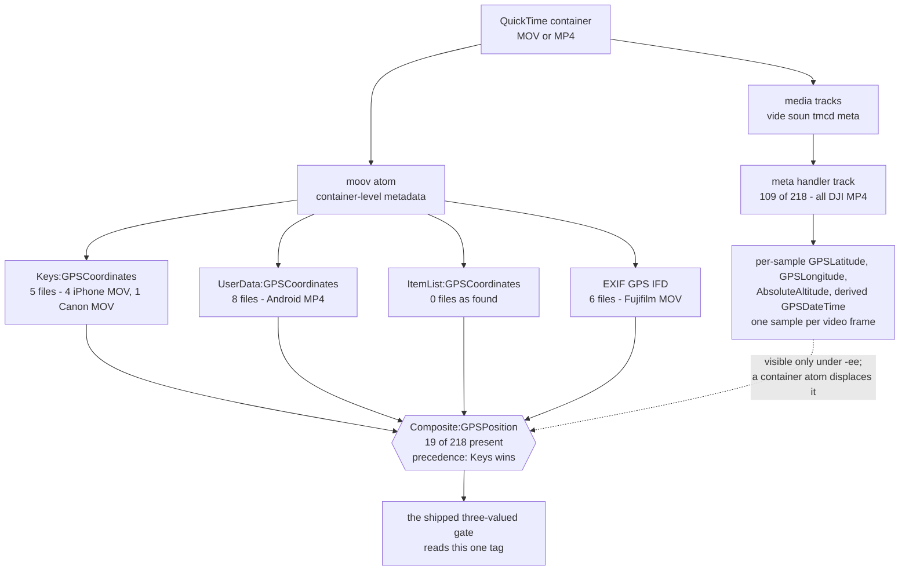
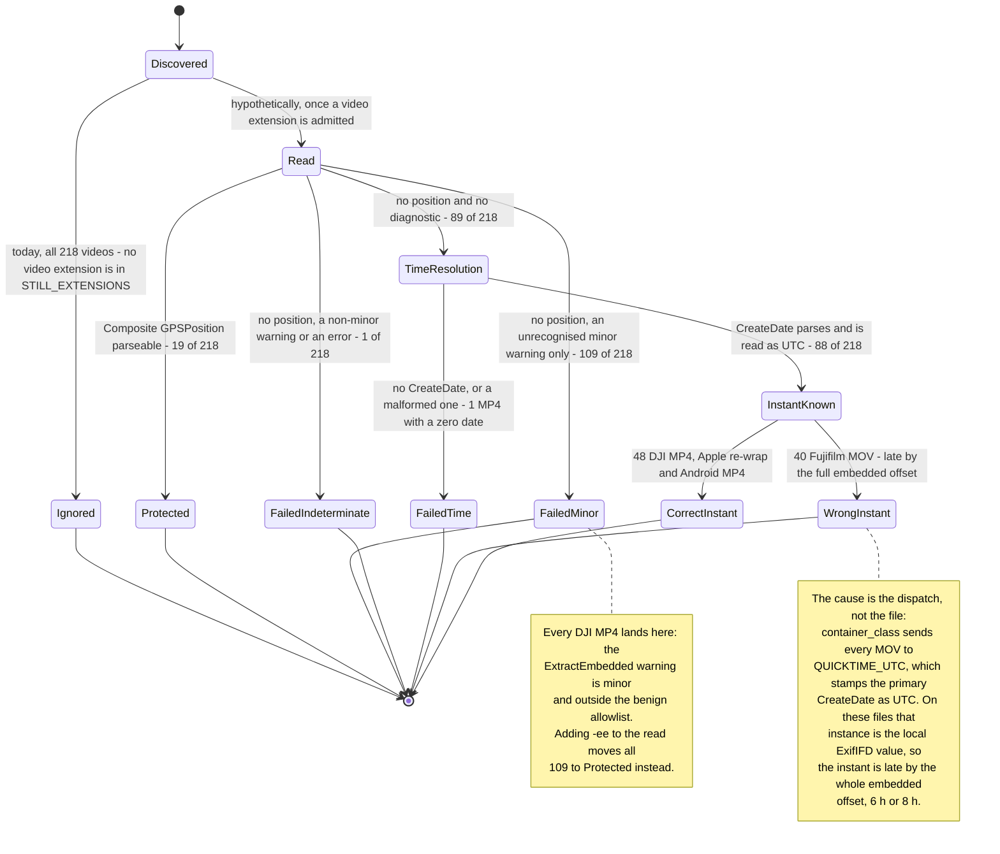
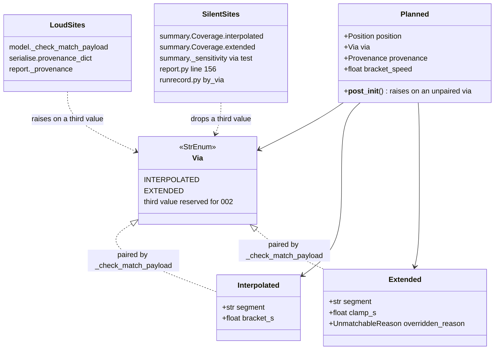
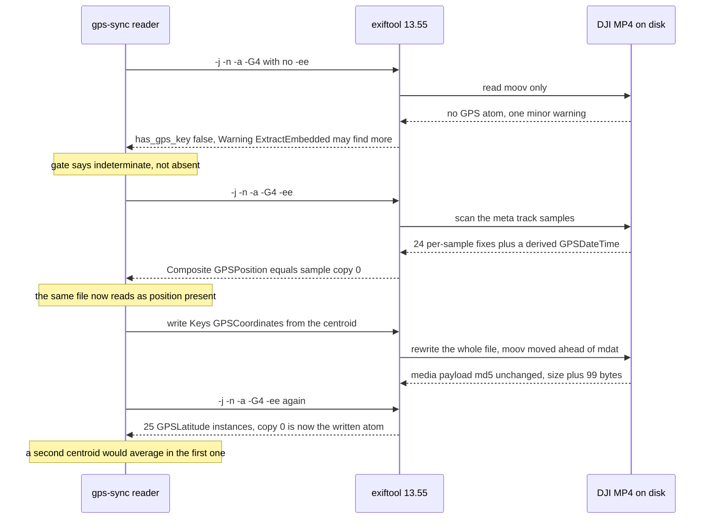

# Analysis — gps-sync: video container location

## Scope and Research Status

- Phase 1 research output for issue `002-video-location`. Audience: the Phase 2 design step and the Phase 3 design reviewer.
- No ticket text and no ticket — constraint validation skipped. No issue, epic or milestone exists for 002 and no verbatim ticket text was supplied, so no ticket-originated restrictions have been validated and none are enforceable in design review. This document deliberately records no validated-constraint section, and none is to be inferred from 001 or from the codebase.
- Every quantitative claim below was measured in session against the live archive and the shipped `src/gps_sync/` tree. Where a question cannot be settled with the files available it is labelled as a gap rather than inferred.
- `/Volumes/Data SSD 2TB/PhotoArchive`, `/Users/astavonin/Downloads/tracks` and `testdata/` were never written to. Every write experiment ran on a copy in a scratchpad; the copy of the committed fixture was verified to carry the baseline digest `434458b550c739cdb58f948b0365e788` before use.
- This document decides nothing of its own. Decisions the user took after the measurements were complete are recorded in `## Clarifications` and marked there as decisions; everywhere else, where a decision must be made it is recorded as an open question with the evidence bearing on it.

## What 002 Is, and What It Inverts

Issue 001 derives a still's position by matching its instant against GPX tracks. Issue 002 has **two position sources**, and the inversion this section names belongs to only one of them.

On the **telemetry path** — the 109 DJI MP4 that carry per-sample GPS — 002 writes a location into a video container **from the centroid of the clip's own telemetry, and never from the GPX track**. On that path the track is not a fallback, not a cross-check and not a source: the drone-to-pilot separation 001 measured (median 1035 m, max 4620 m, n=107) is why. On the **GPX path** — the Fujifilm MOV, which carry no telemetry at all — the position comes from matching the clip's start instant against the merged track index, treated exactly as a still is. That is the scope decision recorded in `## Clarifications`, and it rests on the user's statement that those clips are stationary or near-stationary by shooting practice — a scope constraint, not a measurement, because a file with no telemetry carries no sample from which movement could be computed. So "never from the GPX track" is a rule about the telemetry path, not about 002 as a whole, and every statement of it in this document is scoped to that path.

The telemetry path's inversion has four consequences this research had to measure rather than assume. The matcher, the merged track index, `--max-gap`, `--extend` and the segment-boundary guard are all irrelevant to a centroid, so the centroid's position derivation shares no code with 001's — while the GPX path reuses every one of them unchanged, which is why `## Reuse Audit` below is organised by path rather than by component. The never-overwrite invariant still applies unchanged, but "already has a location" turns out to mean something different for a video container than for a still, and the probe that answers it is not the probe 001 uses. The time-resolution table's reserved QuickTime rows are reachable for the first time, and they are wrong. And the data source — per-sample telemetry — is visible only under a read flag that, measured, makes every file carrying it look as though it already has a position.



The five places a position can sit in a QuickTime container, the one tag that aggregates four of them, and the dotted edge that is this issue's central hazard. Counts are archive-wide over 218 files.

## Population — Archive-Wide Video Census

`find` over `/Volumes/Data SSD 2TB/PhotoArchive` for the ten plausible video extensions returns **218 files: 129 `.mp4` and 89 `.mov`**, and nothing else — no `.m4v`, `.avi`, `.mts`, `.3gp`, `.mkv`, `.webm`, `.lrf` or `.lrv`. One batched container-level read (`exiftool -j -n -G1 -a` over 45 requested tags, 4.99 s) classifies all 218.

| Provenance | n | Container | Codec | Size range | Container position | Per-sample telemetry |
|---|---|---|---|---|---|---|
| DJI camera original — `[Microsoft] Category: pb_file:dvtm_Mini5Pro.proto; model_name:FC9313` | 109 | MP4, `MajorBrand isom` | hvc1 | 24.4 MB – 8.87 GB | **0 of 109** | **109 of 109** |
| Fujifilm X-T5 camera original — `IFD0:Make FUJIFILM` | 47 | MOV, `MajorBrand qt  ` | avc1 ×20, hvc1 ×27 | 91.5 – 793.1 MB | 6 of 47, in an EXIF GPS IFD | none |
| Apple re-wrap, no camera identity — `HandlerVendorID appl`, Core Media or Apple handlers | 37 | MOV, `MajorBrand qt  ` | hvc1 ×34, avc1 ×3 | 3.1 MB – 1.74 GB | 0 of 37 | none |
| No vendor identity, `VID_*` filenames, `SoundHandle`/`VideoHandle` | 20 | MP4, `MajorBrand isom`/`mp42` | avc1 | 2.6 – 133.4 MB | 8 of 20, in `UserData` | none |
| Apple iPhone 17 Pro Max original — `Keys:Model` | 4 | MOV, `MajorBrand qt  ` | apch, Apple ProRes 422 HQ | 1.19 – 4.12 GB | 4 of 4, in `Keys` | none |
| Canon EOS 5D Mark III camera original — `IFD0:Make Canon` | 1 | MOV, `MajorBrand qt  ` | avc1 | 5.5 MB | 1 of 1, in `Keys` | none |

**161 camera originals and 57 re-wraps or unidentified files.** The DJI set alone is **78.80 GB**; the whole video population is **122.3 GB**.

Read the "container position" and "per-sample telemetry" columns as *expected population statistics for this archive*, not as a decision rule — the same reading 001's analysis demands of its own per-source table. Source identity decides nothing about whether a file is written, and it does not decide which of 002's two paths a file takes either — the presence of a `meta` handler track does, and that is a container standard rather than a vendor signature. What source identity does decide is how the file's timestamp is interpreted, where this document finds it is genuinely and unavoidably load-bearing.

### The provenance trap is quantified, and filenames are the trap

The task brief warned that camera-style filenames in this archive do not imply camera originals. Measured: **34 of the 37 Apple re-wrap MOV carry camera-style names — 19 named `DJI*` and 15 named `DSCF*`.** By filename prefix alone, `DJI*` matches 128 files of which only 109 are DJI originals, and `DSCF*` matches 61 of which only 46 are Fujifilm originals. Three of the smallest "DJI" files in the archive (`DJI_20260328094730_0009_D.mov` and siblings) are re-wraps with no `Make`, no `Model`, no `GPSCoordinates`, no `meta` track and — verified by a full `-ee` read — no telemetry whatsoever.

Container-derived identity is the discriminator that works: `MajorBrand`, `HandlerVendorID`, `HandlerDescription`, `MetaFormat` and the per-track `HandlerType` separate originals from re-wraps cleanly on all 218 files. The file extension does not, and neither does the filename.

### One hidden, truncated file is already in the population

`/Volumes/Data SSD 2TB/PhotoArchive/2025/Bishkek/Alamedin Gorge/.DSCF3226.MOV` — 196,083,712 bytes, a Fujifilm X-T5 MOV whose basename begins with a dot and which reads with `Unknown trailer with truncated 'mdat' data at offset 0x5339f0`. It is the only dot-file among the 218. `discovery.py` filters on the final extension and does not skip dot-files, so it would become a candidate the moment a video extension is admitted. No AppleDouble (`._*`), `.lrv`, `.LRF`, `.THM` or subtitle sidecars exist anywhere in the archive.

### Paths

All 218 video paths are absolute and begin with `/`; **all 218 contain a space**; 3 contain `#`; 10 contain `ø`; the longest is 96 characters. A read and a write both round-tripped through an argfile for a path with a `#` in a directory component, a `#` in the basename and a non-ASCII basename (`.../a b#c/Clip #9 Ünïcode.mov`), including the `-echo3` marker echoing the path verbatim. 001's resolution of R9 generalises: an argfile line is read literally, and `#` only begins a comment at the start of a line, which the absolute-path invariant makes unreachable.

## The Presence Probe

### At container level, `Composite:GPSPosition` generalises

The 19 files that carry a container-level position store it in **three different places** — `Keys:GPSCoordinates` (5), `UserData:GPSCoordinates` (8) and an EXIF GPS IFD reported as `GPS:GPSLatitude` (6) — and `Composite:GPSPosition` reports all 19. `ItemList:GPSCoordinates` is used by nothing in this archive. So the stills probe does carry over, for container atoms, across every vendor measured.

It is not, however, a function of all of them. On the Canon MOV, writing `-UserData:GPSCoordinates` or `-ItemList:GPSCoordinates` left `Composite:GPSPosition` still reporting the file's **original** `Keys` value while the newly written value sat in the other group: `Composite:GPSPosition` has a precedence order and **`Keys` wins**. A write to a non-preferred group is therefore invisible to the probe that is supposed to see it, and leaves the file holding two contradictory positions.

### Under `-ee` the probe inverts, and that is this issue's central finding

Per-sample telemetry is invisible without `-ee`. With `-ee`, exiftool builds `Composite:GPSPosition` **from the first telemetry sample**, so the same file, the same tool version and the same shipped code produce opposite verdicts depending on one read flag. Measured against the shipped `TagRecord.from_json` and `classifier.classify` on the 14 smallest DJI clips:

| Read invocation | Shipped outcome for all 14 |
|---|---|
| `-j -n -a -G4` with the shipped `READ_TAGS` | `Failed{UNRECOGNISED_MINOR_WARNING}` ×14 |
| the same plus `-ee` | `Protected{POSITION_PRESENT}` ×14 |

Neither verdict is "write a centroid", and both are terminal. The read that supplies the centroid is the read that makes the file look already positioned — the calibration population and the target population coincide by construction, which is a structural problem rather than a tuning one.

### The full shipped gate over the real population

`classifier.classify` run against the shipped reader's records for all 218 videos, with an empty track index so that anything reaching the matcher reports `OUTSIDE_COVERAGE`:

| Shipped outcome | n | Cause, from the record itself |
|---|---|---|
| `Failed{UNRECOGNISED_MINOR_WARNING}` | 109 | `[minor] The ExtractEmbedded option may find more tags in the media data` — every DJI MP4, matched by `_MINOR_WARNING` and absent from `_BENIGN_WARNINGS` |
| `Unmatchable{OUTSIDE_COVERAGE}` | 88 | provably absent position, instant resolved, empty index |
| `Protected{POSITION_PRESENT}` | 19 | a parseable `Composite:GPSPosition` |
| `Failed{METADATA_INDETERMINATE}` | 1 | the truncated `.DSCF3226.MOV` |
| `Failed{TIME_UNRESOLVABLE}` | 1 | `malformed CreateDate '0000:00:00 00:00:00'` |

The gate's own three verdicts partition as **19 present, 89 provably absent, 110 indeterminate**. No file produced `ZERO_POSITION`: there is no `(0,0)` anywhere in the container atoms.



Every edge count in this diagram was produced by running the shipped `_gate` and `resolve_instant` over the real records; the `WrongInstant` branch is measured against the EXIF-derived truth, not predicted.

### One read can separate the atom from the samples, without a second group family

Requesting the container-level coordinate tags **by group** while printing with `-G4` resolves the inversion, because the group qualifier lives in the request and never appears in the output key. Measured on a DJI MP4 under `-ee`, requesting `-Keys:GPSCoordinates -UserData:GPSCoordinates -ItemList:GPSCoordinates -GPS:GPSLatitude -Composite:GPSPosition -GPSLatitude`:

| File state | Keys present | Emitted keys |
|---|---|---|
| before a container write | no | `:GPSPosition` (first sample), `:GPSLatitude` … `Copy23:GPSLatitude` — **no `GPSCoordinates` key at all** |
| after a container write | yes | `:GPSCoordinates` = the written atom, `:GPSPosition` = the written atom, 25 `GPSLatitude` instances |
| a MOV with neither atom nor samples | no | the record is `{"SourceFile": …}` and nothing else |

So **absence of a `GPSCoordinates` key proves absence of a `Keys`/`UserData`/`ItemList` atom**, while `Composite:GPSPosition` under `-ee` does not. Two caveats are measured. All four groups collapse to the same bare name, so this read says *whether* an atom exists and not *which* group holds it. And the bare name `GPSLatitude` collides with the per-sample tag name, so on a hypothetical file carrying both telemetry and an EXIF GPS IFD the two would be indistinguishable; no such file exists in this archive, but the state is representable.

A third, sharper caveat concerns instance numbering. On the Fujifilm MOV whose position lives in an EXIF GPS IFD, the group-qualified request returns **`Copy1:GPSLatitude` and no copy 0 at all**, while an unrestricted `-GPSLatitude` request on the same file returns both `:GPSLatitude` and `Copy1:GPSLatitude` with the same value. A `-G1:4` read shows why: the two instances are `Composite:GPSLatitude` (copy 0) and `GPS:Copy1:GPSLatitude` (copy 1). **Instance numbers are assigned globally across groups, so excluding a group by request leaves a gap in the copy sequence** — the emitted set depends on the tag list, not only on the file.

### A cheap, container-standard telemetry discriminator exists — and it falsifies 001's candidate

Per-sample GPS can only live in a track whose `HandlerType` is `meta`. Measured over all 218 files:

| `meta` handler track present | n | Vendors |
|---|---|---|
| yes | 109 | all DJI MP4 — 62 with two `meta` tracks (`MetaFormat djmd` + `dbgi`), 47 with one (`djmd` only) |
| no | 109 | Fujifilm MOV, Apple re-wraps, Android MP4, iPhone MOV, Canon MOV |

This matters because **001's candidate probe was `MetaFormat = dbgi` / `HandlerDescription = "CAM dbgi"`, and 47 of the 109 DJI MP4 in this archive have no `dbgi` track at all.** The `dbgi` probe would miss 43 % of the population, in the direction of reporting "no telemetry" for a file that has 2,254 samples. `HandlerType == meta` separates the population exactly, is a QuickTime container standard rather than a vendor signature, and costs 18 ms per file.

The probe was then checked against the honest answer over the whole non-DJI population. A full `-ee` read of **all 109 non-DJI videos (43.54 GB, 4.19 s)** found **0 files with a `SampleTime` tag and 0 files with more than two `GPSLatitude` instances** — 25 `GPSLatitude` instances in total, which is exactly the 6 Fujifilm MOV emitting two instances each plus 13 single-instance container atoms. The 91.5 MB Fujifilm MOV and the 1.19 GB iPhone ProRes MOV were each read individually under `-ee` as well: the first returns an empty record, the second returns its container atom and nothing more. **No non-DJI video in this archive carries per-sample telemetry, measured rather than inferred, and the `meta`-track discriminator agrees with that answer on all 218 files.**

Its limits, stated plainly. `meta` present does not prove GPS present — a `meta` track can carry gyroscope or timecode payloads — so it is a sound *negative* and only a candidate *positive*. And "per-sample GPS can only live in a `meta` track" holds on this archive and follows from how exiftool locates embedded streams, but it was not proved universal: a container that hid GPS in a `vide` track's private payload, or in a format exiftool does not parse, would defeat both the probe and the `-ee` check that corroborates it.

## Telemetry Extraction and What a Centroid Means

A full `-ee` sweep of all 109 DJI MP4 (78.80 GB, **376.72 s** wall) yielded **378,507 GPS samples**. Every number in this section is over that population.

| Property | Measured |
|---|---|
| samples per clip | min 24, p25 1,413, median 2,254, p90 6,922, max 40,842 |
| clips with exactly one sample | **0** — the minimum is 24 |
| clips with zero samples | 0 |
| sample rate | 59.18 – 59.94 Hz, median 59.94 — **one sample per video frame** |
| telemetry span ÷ clip duration | min 0.958, median 1.000, max 1.000 — telemetry covers the whole clip |
| `AbsoluteAltitude` | present on **all 378,507** samples; 1,637.7 – 3,978.5 m, median 2,475.6; 0 negative, 0 zero |
| `GPSAltitude` | **absent from every sample** |
| `GPSDateTime` | present on all samples, and **derived** — see below |
| samples at exactly `(0, 0)` | **0** |
| latitude / longitude range | 41.9155 – 42.8470 / 73.9965 – 78.5125 |
| consecutive-identical sample pairs | 315,268 of 378,398 = **83.3 %** |
| distinct positions ÷ samples | min 0.1668, median 0.1672, max 0.2083 |

Two of these deserve naming.

**The telemetry carries no independent time.** exiftool's own per-file warning under `-ee` is `[minor] Approximating GPSDateTime as CreateDate + SampleTime [x24]`, and it is literally true: across 9,804 samples in 20 clips, `GPSDateTime` equals the first sample's value plus the `SampleTime` delta with **zero deviations above 2 ms and a maximum deviation of 0.500 ms**. So the samples' timestamps are the container clock plus the video frame clock, not satellite time. A centroid needs no time at all, which makes this harmless here — but it means the telemetry can never be matched against a GPX track independently of `CreateDate`, and it is the same shape of trap as the stale `GPSDateTime` 001 measured on stills: the satellite-looking timestamp is the derived one.

**The effective fix rate is about 10 Hz, not 59.94 Hz.** 83.3 % of consecutive sample pairs are byte-identical and the distinct-position ratio is a tight 1/6, so each receiver fix is held across six video frames. An unweighted arithmetic mean over the 59.94 Hz sample list therefore weights each distinct fix by its hold length — which is constant here, so it coincides with a mean over distinct fixes. 001's conclusion that time-weighting is unnecessary survives, but it survives *because* the hold length is uniform, not because sampling is irregular-free.

### What a centroid is, geometrically, across the whole population

| Quantity | n | min | median | p90 | max |
|---|---|---|---|---|---|
| farthest sample from the arithmetic centroid | 109 | 0.01 m | 130.55 m | 495.93 m | **1,695.76 m** |
| first sample to last sample | 109 | 0.02 m | 221.08 m | 898.33 m | **3,113.27 m** |
| arithmetic mean vs component-wise median | 109 | 0.00 m | 7.25 m | 38.79 m | **485.03 m** |
| centroid to the nearest actually-flown sample | 109 | 0.00 m | 3.15 m | 28.67 m | **166.29 m** |
| first sample to the centroid | 109 | 0.01 m | 97.78 m | 454.74 m | **1,586.51 m** |
| altitude: mean vs median, per clip | 109 | 0.00 m | 0.19 m | 12.99 m | **161.91 m** |
| altitude span within a clip | 109 | 0.0 m | 7.0 m | 178.4 m | **499.9 m** |

The "which representative" question 001 raised on one clip is confirmed and widened by two orders of population. First-sample versus centroid is a median 97.8 m and up to 1.59 km decision. Mean versus median is a median 7.25 m decision that reaches **485 m** — 001 measured a 0.008 m mean-versus-spherical-mean difference on one clip and concluded a naive arithmetic mean suffices, which remains true of *that* comparison, but mean-versus-median is a different and much larger quantity. And the centroid sits up to 166 m from any position the drone actually occupied, so the "a point the subject never occupied" objection is minor at the median and not minor at the tail.

### The failure modes the brief asked about, against the real population

| Failure mode | Observed in this archive |
|---|---|
| a clip that moves kilometres | **real** — `DJI_20260607122858_0097_D.MP4` moves 3,113 m first-to-last over 389 s; `DJI_20261029124921_0154_D.MP4` spans 1,696 m from its centroid over 681 s |
| a clip with one sample | **absent** — the minimum is 24 samples; the committed fixture is the minimum |
| a clip whose samples are all zero | **absent** — 0 samples at `(0,0)` in 378,507 |
| a stationary clip | **real** — minimum centroid spread 0.01 m, on the committed fixture |
| a clip with no telemetry despite a `meta` track | not observed; 109 of 109 `meta`-track files yielded samples |

The outlier-robustness hazard 001 recorded — a single injected `(0,0)` fix moving the mean 1.2 km while the median moves 0.0 m — therefore remains a **synthetic** result. No real sample in this archive exercises it, so sanitisation is justified by the hazard's shape rather than by an observed instance, and this document records that distinction rather than smoothing it.

### The committed fixture is atypical, and a reader should know how

`testdata/media/drone/DJI_20261026094214_0024_D.MP4` is a byte copy of its archive original (24,384,519 bytes, matching the `.baseline.md5` digest). It holds **24 samples over 0.4004 s** — the shortest clip in the archive, with a centroid spread of 0.01 m — and 16,000,512 of its 24 MB are a single `free` atom, so it is an aborted or trimmed recording rather than a representative clip. Three of the 109 DJI MP4 are under one second. The fixture exercises the smallest telemetry list in the population and exercises no movement at all; the 1,696 m and 3,113 m cases have no committed fixture.

## The Write Path

### The group-versus-format matrix, and a correction to 001

001 recorded, as its canonical example of version-sensitive tag-group acceptance, that on exiftool 13.55 `-Keys:GPSCoordinates` writes while `-QuickTime:` and `-UserData:` fail with `PrintConvInv`. Re-measured on the same version, that is **a confound, not a group property**: the `Keys` attempt used an ISO 6709 string and the other two used a plain `"lat lon alt"` string, so the group was never the variable. The full matrix, on a Fujifilm MOV copy:

| Value form | `-n` | `Keys` | `QuickTime` | `UserData` | `ItemList` |
|---|---|---|---|---|---|
| ISO 6709 `+42.335033+078.226362+2189.865/` | on | writes | writes | writes | writes |
| ISO 6709 | off | writes | writes | writes | writes |
| plain `42.3350333 78.2263622 2189.865` | on | writes | writes | writes | writes |
| plain | off | **`PrintConvInv`** | **`PrintConvInv`** | **`PrintConvInv`** | **`PrintConvInv`** |

`PrintConvInv` is a value-format refusal that applies to all four groups equally, including `Keys`, and `-n` bypasses it in all four. **The shipped writer always emits `-n` as the first option of every block**, so under the shipped flag set every one of these groups accepts both forms.

Two further facts from the same matrix, on all five container copies (DJI MP4, Fujifilm MOV, Apple re-wrap MOV, Android MP4, Canon MOV): `-QuickTime:GPSCoordinates` and a bare `-GPSCoordinates` both resolve to **`ItemList`**, so `QuickTime:` is not a distinct destination; and `-GPSLatitude`/`-GPSLongitude` land in **`XMP-exif`**, because exiftool will not create an EXIF GPS IFD in a QuickTime container even though it reads one that a camera wrote. That read/write asymmetry is the mechanism behind the next finding.

### The refusal's exit shape is one the attribution contract has never seen

A `PrintConvInv` refusal exits **1**, writes nothing, and puts both of its lines on **stderr** — `Warning: Error converting value for Keys:GPSCoordinates (PrintConvInv)` and `Nothing to do.` — leaving **stdout empty**. A nonexistent group behaves identically with `Warning: Sorry, Bogus:GPSCoordinates doesn't exist or isn't writable`. Under the shipped `writer._conclude`, such a block carries none of `APPLIED_MESSAGE`, `REFUSED_MESSAGE` or `ERRORED_MESSAGE`, so `sum(...) != 1`, and stderr has no `Error:`-prefixed line, so the path concludes **`Failed{WRITE_UNATTRIBUTED}`**. That fails in the safe direction, but it mis-reports: nothing changed, the cause is a malformed value, and the registry's remedy for that reason reads "inspect by hand against the audit record named in the report; a re-run does not settle it".

### Byte-level verification, to 001's standard

Each container copy, written with `-overwrite_original -n -Keys:GPSCoordinates=<ISO 6709>`:

| Container | size delta | media payload (`mdat`) md5 | tag count | tags lost | `-validate` |
|---|---|---|---|---|---|
| DJI MP4, 24.38 MB | **+99** | **identical** | 1,435 → 1,440 | 0 | OK → OK |
| Fujifilm MOV, 91.48 MB | **+164** | **identical** | 214 → 221 | 0 | OK → OK |
| Apple re-wrap MOV, 3.06 MB | **+155** | **identical** | 161 → 167 | 0 | OK → OK |
| Canon MOV, 5.53 MB | **−9** | **identical** | 364 → 364 | 0 | 2 pre-existing minor warnings → the same 2 |

Payload identity, tag-set preservation and no tag-count regression all hold, and the Canon's two pre-existing minor warnings survive unchanged exactly as the RAF's FujiIFD quirk did in 001. Writing `UserData` or `ItemList` instead costs +43 to +51 and +98 to +115 bytes respectively. Coordinate precision round-trips exactly at 16 significant digits (`+42.3350333204822+078.2263622526213/` reads back as `42.3350333204822 78.2263622526213`), and a repeated identical write leaves the file byte-size identical.

### But the diff is not localised — a video write is a whole-file rewrite

This is where video departs structurally from stills. In 001, a RAF write left the final 36,520,070 bytes byte-identical with the first difference at offset 89. Here, atom offsets before and after the DJI MP4 write:

| | `ftyp` | `free` | `mdat` | `moov` |
|---|---|---|---|---|
| before | 0 | 28, 36, 504 | **16,001,016** (5,023,945 B) | 21,024,961 |
| after | 0 | 28, 36, 504 | **19,360,673** (5,023,945 B) | 16,001,016 |

exiftool moved `moov` ahead of `mdat` and relocated the media data by **+3,359,657 bytes**. The payload bytes are identical; their position is not. On the Fujifilm MOV the first differing byte is at **offset 22**, so essentially the entire 91.5 MB file is rewritten for a 164-byte metadata change. Operationally: write cost and write risk scale with file size, not with the size of the change, and a full write pass over the 109 DJI clips rewrites **78.80 GB**.

### The temp file, the disk-space precondition, and the read-only hole

The write creates `<name>_exiftool_tmp` **in the target's own directory** and renames it over the target. Three consequences, all measured:

- Writing a clip needs free space equal to the clip's size **on the volume holding it** — for the archive's 8.87 GB clip, 8.87 GB free on the external drive.
- Omitting `-overwrite_original` leaves a `_original` copy, so the directory holds two full-size files: `k.MOV` at 91,475,611 bytes beside `k.MOV_original` at 91,475,456. Retaining originals across the DJI population would add 78.80 GB to the archive. The `_original` suffix makes the final extension `.mov_original`, which an extension-based candidacy filter excludes, so 001's `_original` exclusion mechanism carries over unchanged.
- **`-overwrite_original` writes through a read-only video file exactly as 001 measured for stills.** A `chmod 444` MOV copy was written — mode still `-r--r--r--` afterwards, position applied, size +146 — because only the directory's writability gates the rename. 001's Result 4 generalises to QuickTime containers, so the never-overwrite invariant has no filesystem-level backstop here either.

### The shipped writer applied unchanged to a video succeeds, and writes to the wrong place

`writer.build_write_lines` was used, unmodified, to emit a real argfile for a `Planned` video target and exiftool was run on it. The result is the worst available failure mode: **it succeeds.**

- exit code 0, stdout `1 image files updated`, both `-echo3` and `-echo4` markers emitted, so the shipped attribution contract concludes `Geotagged`.
- DJI MP4 +2,922 bytes; Fujifilm MOV +2,971 bytes.
- The position lands **entirely in `XMP-exif`** — `XMP-exif:GPSLatitude`, `GPSLongitude`, `GPSAltitude`, `GPSAltitudeRef` — plus a new `XMP-x:XMPToolkit: Image::ExifTool 13.55`. **No `Keys`, no `UserData`, no `ItemList`, no `GPS` IFD.** Capture One, Finder, Photos and Lightroom read container atoms, so the write is invisible to every viewer the user has — which is the exact problem 001 identified as the reason this issue exists.
- `-GPSDateStamp` and `-GPSTimeStamp` are **silently dropped**: two of the eight assigned tags produce nothing in any group, with no warning and no change to the success message.
- `Composite:GPSPosition` reads the XMP value back, so a re-run sees a position and reports `Protected`. The wrong write conceals itself and is not self-correcting.
- 001 decided explicitly against writing XMP at all: *"EXIF GPS only … Writing XMP as well would modify a container region the byte-level verification did not cover and would require re-verifying both containers before use."* Reusing the writer's tag set on video violates that decision while reporting success.

## Time Resolution for Video Containers

`QuickTime:CreateDate` is present on **218 of 218** files; one MP4 carries `0000:00:00 00:00:00`. What it *means* is per-vendor, and the measured picture does not match the reserved rows.

| Source | n | Instant tags present | What the QuickTime atom holds | Evidence |
|---|---|---|---|---|
| DJI MP4 | 109 | `QuickTime:CreateDate` only, as copy 0 | **UTC** | filename stamp minus atom = exactly **6.0 h** on all 109 |
| Fujifilm MOV | 47 | `ExifIFD:CreateDate` as **copy 0**, `QuickTime:CreateDate` as **copy 1**, plus `DateTimeOriginal` **46/46** and `OffsetTimeOriginal` **46/46** (`+06:00` ×41, `+08:00` ×5) | **UTC**, and **not** the recording start — it is the **finalisation** instant | `ExifIFD` local minus atom = 5.981–5.992 h or 7.984–7.991 h, tracking the embedded offset; atom minus (EXIF start + duration) = min 23.95 s, median 23.99 s, max 25.00 s, over the **46 readable** files of the 47 |
| Android MP4 (`VID_*`) | 20 | `QuickTime:CreateDate` only | **UTC** | filename stamp minus atom = exactly **2.0 h** on 19 (Johannesburg, `+02:00`); the 20th is the zero date |
| iPhone MOV | 4 | `QuickTime:CreateDate`, `Keys:CreationDate` | **UTC** | `Keys:CreationDate` = atom + `06:00` with an explicit `+06:00` suffix, on all 4 |
| Apple re-wrap MOV | 37 | `QuickTime:CreateDate`; 34 also carry a **zone-less** `Keys:CreationDate` | **unresolved** | `Keys:CreationDate` sits 4.9–8.8 h *behind* the atom with no offset suffix, consistent with a negative capture zone but not proof of one |
| Canon MOV | 1 | `QuickTime:CreateDate` as copy 0, `ExifIFD:Copy1:CreateDate`, `DateTimeOriginal`, `Canon:TimeZone` = 480 | **local** | the atom equals the EXIF local value exactly, so it is not an independent UTC quantity |

### The reserved rows are wrong for Fujifilm MOV, and the cause is the dispatch

The symptom is a resolved instant late by the camera's whole UTC offset. The cause is neither the file nor the instance-selection rule — it is the dispatch. `resolve_instant` asks `container_class(record.file_type)`, and `container_class` returns `ContainerClass.QUICKTIME_UTC` for any `file_type` in `{"MOV", "MP4", "M4V", "QUICKTIME"}`. That branch then reads `record.create_date` and returns `stamp.replace(tzinfo=UTC) + time_shift`, which *asserts* rather than checks that the value it was handed is already UTC. The container family is the only thing consulted; the time evidence the file carries is never looked at.

On a Fujifilm MOV the assertion is false. `record.create_date` is `records._first(tags, "CreateDate")`, the primary instance, and on these files the primary instance is the **local `ExifIFD` value** — the EXIF copy is the unprefixed copy 0 and the QuickTime atom is `Copy1:`. So the branch stamps a local wall time as UTC and the resolved instant is late by exactly the camera's offset. Instance selection is the mechanism by which the wrong value reaches the branch; the dispatch is why a branch that cannot be right for this file was taken at all.

Re-measured on 2026-11-15 against `/opt/homebrew/bin/exiftool` 13.55, under the shipped reader's own `-j -n -a -G4` shape, on `/Volumes/Data SSD 2TB/PhotoArchive/2024/Langkawi/DSCF2373.MOV`:

| Key | Value | Group |
|---|---|---|
| `:FileType` | `MOV` | |
| `:CreateDate` | `2024:05:04 09:38:01` | ExifIFD — local |
| `Copy1:CreateDate` | `2024:05:04 01:38:59` | QuickTime — UTC |
| `:DateTimeOriginal` | `2024:05:04 09:38:01` | ExifIFD |
| `:OffsetTimeOriginal` | `+08:00` | ExifIFD |
| `:Duration` | `34.034` | QuickTime |

True start `09:38:01 +08:00` = `01:38:01` UTC; shipped `resolve_instant` yields `09:38:01` UTC, **8 h late**.

Across **all 46 readable Fujifilm MOV** in the archive — the 47th is `.DSCF3226.MOV`, the truncated dot-file, which `find ! -name '.*'` excludes:

| Property | Measured, n=46 |
|---|---|
| `DateTimeOriginal` present | **46/46** |
| `OffsetTimeOriginal` present | **46/46** — `+06:00` ×41, `+08:00` ×5 |
| EXIF local is the unprefixed copy 0 | **46/46** |
| `atom − (EXIF start + duration)` | min 23.95 s, median 23.99 s, max 25.00 s |

Two things follow, and the shipped rule gets both wrong at once. The offset error is uniform and total — the resolved instant is late by the whole embedded offset, 6 h on 41 files and 8 h on 5, with no spread. And the atom is not the recording start even where it is genuinely UTC: it trails the start by the clip's duration plus a constant 23.95–25.00 s, so it is the **finalisation** instant. The named file checks against the population — `01:38:59 − (01:38:01 + 34.034 s)` = 23.97 s, inside that band — and the consequence is that a rule which corrected only the offset, by preferring `Copy1:CreateDate`, would still be late by the clip's own length.

**The chosen approach needs no new time rule.** The user's decision is to match the clip's start instant against the track exactly as a still is matched, and 001's primary rule is already that rule: `DateTimeOriginal` with the embedded `OffsetTimeOriginal`, with `--utc-offset` never standing in for a present-but-blank offset. Both tags are present on 46 of 46 files, so the rule is available over the whole population rather than over a subset of it. Routing a Fujifilm MOV down the existing `STILL` branch therefore fixes **both** errors at once — the offset error and the finalisation error — with no new container class, no new predicate inside the branch and no new tag read. Independent corroboration sits in the `-geotag` measurements below, taken for a different question: exiftool's own default `-geotime` on a Fujifilm MOV resolves to `DateTimeOriginal` + `OffsetTimeOriginal` and wrote a coordinate for exactly that instant.

**And the atom branch stays correct where it is correct.** For the 109 DJI MP4 the atom genuinely is a UTC recording start: the filename stamp minus the atom is exactly 6.0 h on all 109, and the per-sample `GPSDateTime` is `CreateDate + SampleTime`, which only holds if `CreateDate` is the start. Nothing in this finding argues against `QUICKTIME_UTC` for those files.

So this document's judgement that `QUICKTIME_UTC` **conflates container family with time semantics** is confirmed, and it now has a concrete shape of fix: dispatch on the time evidence the file carries, not on the container family. A Fujifilm MOV is a QuickTime container that answers the still question, and the single Canon MOV is a QuickTime container whose atom is local (n=1) — two different ways the family label fails to predict the semantics. What the predicate should be exactly — "an EXIF `DateTimeOriginal` carrying an offset outranks a container atom" applied to every container, an explicit per-source table, or a refusal for containers whose semantics are unverified — is a Phase 2 choice, recorded as an open question rather than prescribed here. The instance-selection observation stands as a separate and weaker finding: 001's `design.md` records that the reader's ranking makes "index 0 the primary instance (copy 0, exiftool's preferred one)", while the guarantee the code provides is "the lowest *emitted* copy decides", which depends on the tag list as well as on the file.

**This is one dispatch rule to correct inside 002 — not a blocker, and not a precondition issue.** The evidence the fix needs is already in the files, in tags 001's reader already requests, resolved by a branch 001's code already ships. What makes it matter is the safety consequence the scope decision created: the Fujifilm MOV are now write targets reached through a GPX match, and **a GPX match on a wrong instant writes a wrong position into a file that had none.** That is the one failure the never-overwrite invariant does not catch — the invariant protects files that already carry a position, and these files carry none. The dispatch must be corrected before any Fujifilm MOV is written.

**Superseded — the earlier reading of this finding, 2026-11-15.** Before the re-measurement above, this section attributed the error to `records._first` selecting copy 0, recorded the split as 6.00 h on 42 files and 8.00 h on 5 across all 47 Fujifilm MOV, and gave the finalisation delta as "a constant 24–25 s". That named the symptom's mechanism rather than its cause: `_first` behaves exactly as documented, and preferring `Copy1` instead would leave the instant wrong by the clip's duration. The population is the 46 readable files, not 47, and the offset split over it is 41 and 5. The verdict that the reserved QuickTime rows cannot be relied on for a Fujifilm MOV is unchanged; its cause, its figures and its remedy are restated.

### `-api QuickTimeUTC` is not a semantic fix

It converts the atom from UTC into the **host machine's** local zone and appends that offset: the DJI atom `2026:10:26 03:42:14` becomes `2026:10:26 09:42:14+06:00` on this host. For the DJI, iPhone and Android files the resulting instant is correct and merely rendered in a host-dependent zone. For the Canon MOV, whose atom is already local, it produces `2019:12:27 21:38:41+06:00` against an EXIF local value of `15:38:41` and a camera zone of `+08:00` — wrong by the camera's zone. A run's output would change with the operator's machine timezone.

## `-geotag` — Settled by Measurement, and Whether It Matters

001's `analysis.md` carries *"does `-geotag` write MOV correctly?"* as an open question, and 001's `design.md` predicts 002's MOV path as the likeliest place the Shape B prohibition would be violated. Measured on copies against a synthetic GPX bracketing each target's instant, with `-api GeoMaxIntSecs=120 -api GeoMaxExtSecs=0`:

| Target | `-geotime` | Result |
|---|---|---|
| DJI MP4 | default | **nothing written** — `Warning: No writable tags set`, `0 image files updated`, 0 bytes changed |
| DJI MP4 | default plus `-api QuickTimeUTC` | **nothing written** — identical outcome |
| DJI MP4 | `-geotime<${CreateDate}Z` | **writes** — `1 image files updated`, +2,956 bytes, into `ItemList:GPSCoordinates` **and** `XMP-exif:GPSLatitude/Longitude`; the interpolated coordinate corresponds to exactly `03:42:14Z` |
| Fujifilm MOV | default | **writes** — +3,058 bytes, same two destinations; the coordinate corresponds to exactly `04:49:24Z`, i.e. `DateTimeOriginal` + `OffsetTimeOriginal` |
| Fujifilm MOV | `-geotime<${DateTimeOriginal}${OffsetTimeOriginal}` | **writes** — byte-identical outcome to the default |
| Apple re-wrap MOV | default | **nothing written** — `Warning: [minor] Tag 'DateTimeOriginal' not defined` |

**So yes: `-geotag` writes MOV and MP4 correctly, provided a `-geotime` expression resolves.** The default expression needs an EXIF `DateTimeOriginal`, which **170 of the 218** files do not have — by the per-vendor table above, only the 47 Fujifilm MOV and the single Canon MOV carry one — and `-api QuickTimeUTC` does not supply a fallback.

**And separately: whether it matters depends on the path.** `-geotag`'s only data source is a track file, so it is structurally incapable of producing a centroid of a clip's own telemetry — on the telemetry path it is not a shortcut that happens to be forbidden, it is not a candidate at all. **On the GPX path it is exactly a candidate**, because the operation there *is* a track match on a MOV, and the table above measures `-geotag` performing it correctly on a Fujifilm MOV under the default `-geotime`. 001's `design.md` prediction that 002's MOV path is where the Shape B prohibition would be violated is therefore live rather than hypothetical, and three facts measured above are why taking the shortcut would be worse than a boundary violation. `-geotag` writes to `XMP-exif` as well as to a container atom, so reaching for it would silently violate 001's EXIF-only decision in addition to the Shape B boundary. Its correctness on a Fujifilm MOV comes from exiftool's own default expression resolving to `DateTimeOriginal` + `OffsetTimeOriginal`, not from any rule this project states, tests or can change — right for a reason outside the project's control. And the shipped writer's own tag set already writes `XMP-exif` on a video while reporting success, so the XMP hazard reaches 002 on either path without anyone invoking `-geotag` at all.

The prohibition's enforcement, meanwhile, is unchanged and still conventional. 001's code review recorded as accepted and out of scope that the transport takes a caller-composed argfile and does not inspect it; `transport.write_command` is `[exe, -charset, filename=utf8, -@, argfile]`, and `argfile.emit_argfile` writes whatever lines it is given after checking only that path lines are absolute and newline-free. Nothing structural stops a caller passing `-geotag`.

## The Read Parser Tripwire — Measured

`records._tags_by_name` accepts only `SourceFile` and keys that `fullmatch` `(?:Copy(?P<copy>[1-9]\d*))?:(?P<name>\w+)`, raising `ToolFailure` — exit 2, whole run aborted — for anything else. Measured against the shipped `TagRecord.from_json`:

| Input | Keys | Refusals |
|---|---|---|
| the shipped reader invocation over all 218 videos | 2–9 per record | **0** |
| the shipped reader invocation plus `-ee` over 14 DJI clips | 5 per record | **0** |
| an unrestricted `-j -n -a -G4 -ee` read of the committed fixture | **308** keys, including `:GPSLatitude` through `Copy23:GPSLatitude` | **0** |
| the full `-ee` sweep of all 109 DJI MP4 | up to 40,842 instances of one tag | **0** |

**The tripwire does not fire for video.** `-G4` emits only the instance family, so even a 308-key per-sample record is the shape the parser expects, and the group-qualified read described above keeps the qualifier in the request rather than in the output key. 001's handoff note that "002 reads QuickTime containers and may need a second group family" is not borne out by measurement; a second group family is what *would* trip it, and it is not required for anything this document found.

What a `-G1`-family read would emit, all of which the parser refuses: `QuickTime:CreateDate`, `ExifIFD:Copy1:CreateDate`, `Keys:GPSCoordinates`, `UserData:GPSCoordinates`, `GPS:GPSLatitude`, `Track2:Warning`. The one thing such a read buys that the `-G4` read cannot is **which group** holds an atom, which matters only if 002 needs to distinguish `Keys` from `UserData` from `ItemList` — a question the `Composite` precedence finding makes live, since a write to a non-preferred group is invisible to the probe.

The parser is not the only shape constraint `-ee` touches. `reader.READ_CHUNK_SIZE` is 5,000 paths per process, sized against container-level records; measured `-ee` record sizes are **median 476,574 bytes and maximum 8,894,679 bytes**, so a 5,000-path `-ee` chunk projects to roughly **2.4 GB of JSON** held in memory at once.

## The `via` Enumeration and Its Third Value

`model.Via` is a `StrEnum` documented as open: *"Open enumeration: issue 002 adds a third value."* The pairing rule in `model._check_match_payload` is

```
expected = Interpolated if via is Via.INTERPOLATED else Extended
if not isinstance(provenance, expected):
    raise ValueError(f"provenance {type(provenance).__name__} does not match via {via}")
```

so a third `via` carrying a new provenance class raises at construction, exactly as documented. Neither existing provenance shape fits a centroid: `Interpolated{segment, bracket_s}` and `Extended{segment, clamp_s, overridden_reason}` both name a GPX **segment** identity and a GPX **time interval**, and a centroid has neither. What a centroid-derived position would have to record to be auditable to 001's standard is a question for Phase 2; this document records only what the existing fields are and what the measured data could supply — a sample count, the telemetry span, the aggregation rule actually applied, the dispersion of the samples around the result, and whether a container atom was mixed into the sample list.

The GPX path needs none of this. A GPX-matched MOV produces exactly the outcomes a still produces — `Via.INTERPOLATED` with `Interpolated{segment, bracket_s}`, or `Via.EXTENDED` with `Extended{segment, clamp_s, overridden_reason}` under `--extend` — because it is 001's matcher reaching 001's provenance shapes. The third value and its new provenance shape are therefore the telemetry path's cost alone, and the seven consumption sites below are reached by a third `via` only for clips that carry their own telemetry.

The extension cost is not uniform across call sites, and the split is the finding:

| Site | Behaviour on an unpaired or unknown third `via` |
|---|---|
| `model._check_match_payload` | **raises** `ValueError` at construction |
| `serialise.provenance_dict` | **raises** via `assert_never` on an unknown provenance class |
| `report._provenance` | **raises** via `assert_never` on an unknown provenance class |
| `summary.Coverage.interpolated` / `.extended` | **silently drops** — the two counts no longer sum to `matched` |
| `summary._sensitivity` | **silently miscounts** — the test is `via is Via.EXTENDED`, so a third value falls through and contributes its `bracket_speed` to the clock-sensitivity median, a figure that is meaningless for a centroid |
| `report.py:156` | **silently drops** — renders a hard-coded `(INTERPOLATED n, EXTENDED n)` |
| `runrecord.py:31` | **silently drops** — emits a hard-coded `"by_via": {"INTERPOLATED": …, "EXTENDED": …}` |



Three sites fail loudly as designed; four more consume `via` through a two-value enumeration that a third member leaves silently incomplete. 001's design states the enumeration is open; the measured surface is open at three sites and closed-by-omission at four.

## The `-ee` Read, the Write, and the Idempotency Collision



Every arrow in this diagram is a measured invocation on the committed fixture. The last two are the collision worth stating twice: after a container write, an `-ee` read of the same file reports **25** `GPSLatitude` instances rather than 24, and the written atom takes **copy 0** while the original sample 0 moves to copy 24. So the `-ee` instance list is not "the telemetry samples" once an atom exists — it mixes the atom in and reorders. Code that treats copy 0 as the first sample gets the atom, and code that averages all instances averages the atom into the next centroid. The written file is idempotent under the *gate* (a re-run sees `Composite:GPSPosition` and reports `Protected`), but it is not idempotent under *sample extraction*.

## Reuse Audit — What Extends and What Does Not, Per Path

001's `design.md` states that 002 "extends two declared contracts" — the `via` enumeration and the exiftool transport boundary. Tested component by component against the shipped tree, that claim is too narrow: the two named contracts do extend, and nine other components need changes the claim does not cover — `discovery`, `records.TagRecord`'s field set, `reader`'s chunk size, `classifier`'s warning allowlist and its write allowlist, `timeres`'s container dispatch, the writer's tag set, `summary`'s `via`-keyed figures, `runrecord`'s hard-coded `by_via` keys, and `options`' still-specific help text.

The audit is organised **by path**, because the scope decision in `## Clarifications` gives 002 two position sources and most components have a different verdict on each. The **telemetry path** covers the 109 DJI MP4 that carry per-sample GPS, and derives a centroid from it. The **GPX path** covers the 47 Fujifilm MOV, which carry no telemetry at all, and matches each clip's start instant against the merged track index exactly as 001 matches a still. The discriminator between them is measured and container-standard: a `meta` handler track is present on 109 of 218 files and absent on the other 109, and a full `-ee` read of all 109 non-DJI videos confirms that none of them carries per-sample telemetry.

| Component | Telemetry path — 109 DJI MP4 | GPX path — 47 Fujifilm MOV | Evidence |
|---|---|---|---|
| `transport.py` — the boundary, `version`/`read`/`write`, the marker partition | **extends unchanged** | **extends unchanged** | the `-echo3`/`-echo4` markers, `partition_stream`, the three result wordings and the exit statuses all behaved identically on MOV and MP4 copies |
| `argfile.py` — absolute-path invariant, literal lines | **extends unchanged** | **extends unchanged** | verified on a path with `#` in both a directory and a basename plus a non-ASCII name; all 218 video paths are absolute and every one contains a space |
| `discovery.py` — the walk, symlink skip, inode dedup, prune set, `_original` exclusion | **needs one additive change** | **needs the same change, and the dot-file gap lands here** | `STILL_EXTENSIONS` admits no video and the name itself is still-specific; the final-extension rule excludes `.mov_original` by construction; **dot-files are not skipped**, and the archive's one dot-file is the truncated 196 MB Fujifilm MOV, so the gap falls on this path's own population |
| `records.py` — the `-a -G4` parser, instance ranking, blank-vs-absent | **extends unchanged, with a weaker guarantee than documented** | **extends unchanged** | 0 refusals over 218 container reads, a 308-key `-ee` record and a 40,842-instance sweep; instance numbers are global across groups, so a group-qualified request produced `Copy1:` with no copy 0 — "index 0 is copy 0" is really "index 0 is the lowest emitted copy", which depends on the tag list |
| `records.TagRecord` — the field set | **needs new fields** | **extends unchanged** | a centroid needs per-sample `GPSLatitude`/`GPSLongitude`/`AbsoluteAltitude`, none of which are in `READ_TAGS`, and `AbsoluteAltitude` is the only altitude the telemetry carries; a GPX match needs only fields the record already holds, and `DateTimeOriginal` and `OffsetTimeOriginal` are present on 46 of 46 readable Fujifilm MOV |
| `reader.py` — batching, count reconciliation, `READ_CHUNK_SIZE` | **the chunk size is sized for the wrong read** | **extends unchanged** | count-in-equals-count-out held on both; `-ee` records are median 476 KB and up to 8.9 MB, so a 5,000-path `-ee` chunk projects to ~2.4 GB of JSON — but this path needs no `-ee` at all, and its container-level records are the 2–9-key shape the chunk size was sized against |
| `classifier._gate` — the three-valued position gate | **extends, and produces the wrong answer for the target population** | **extends unchanged** | without `-ee`, 109 of 109 DJI MP4 → `Failed{UNRECOGNISED_MINOR_WARNING}` on the `ExtractEmbedded` warning; with `-ee`, 109 of 109 → `Protected{POSITION_PRESENT}`; neither is writable. No Fujifilm MOV raises that warning — 40 of the 47 reached the matcher with a provably absent position and a resolved instant, 6 are `Protected` on a real EXIF GPS IFD, and the truncated dot-file is correctly `METADATA_INDETERMINATE` |
| `classifier.WRITE_ALLOWLIST` and `_container_refusal` | **needs the container admitted; MP4 is verified** | **needs the container admitted; MOV is verified** | `{"RAF", "DNG"}` admits no video container; the extension-versus-identity cross-check would reject `.mov`/`MOV` mismatches correctly, and the byte-level evidence above — payload identity, tag-set preservation, no tag-count regression, unchanged `-validate` — is what 001's verification gate asks for, measured on a DJI MP4 and on a Fujifilm MOV among others |
| `timeres.py` — the container-class table | **extends unchanged** | **needs one dispatch rule corrected** | the DJI atom is a genuine UTC start — filename stamp minus atom exactly 6.0 h ×109, and `GPSDateTime = CreateDate + SampleTime`; a Fujifilm MOV must take the `STILL` branch instead of `QUICKTIME_UTC`, which needs no new rule because 001's primary rule is available on 46 of 46 files |
| `matcher.py`, `index.py`, `gpx.py`, `--max-gap`, `--extend`, the segment guard | **not applicable** | **extends unchanged — this is 001's path verbatim** | a centroid uses no track, and the drone-to-pilot separation is why it must not; `classify` calls `match(index, …)` unconditionally, so the branch between the two paths has to happen earlier than `classify` does today |
| `writer.py` — attribution, reconciliation, `assert_targets_writable` | **attribution extends; the tag set must not** | **attribution extends; the tag set must not** | the shipped argfile applied to a video reports `1 image files updated` and writes `XMP-exif` only, dropping `GPSDateStamp`/`GPSTimeStamp` silently — measured on both a DJI MP4 and a Fujifilm MOV; `assert_targets_writable`'s allowlist check would reject either target today |
| `model.Via` and the provenance union | **needs a third value — loud at 3 sites, silent at 4** | **extends unchanged** | see the `via` table above; a GPX-matched MOV reaches 001's own provenance shapes, `Interpolated{segment, bracket_s}` or `Extended{segment, clamp_s, overridden_reason}` |
| `registry.py` — the reason registry and the `_assert_complete` import guard | **extends unchanged** | **extends unchanged** | a new reason without a row raises at import; `review_subfolders()` derives from the same rows |
| `review.py` — the symlink review folder, rebuild precondition, marker | **extends unchanged** | **extends unchanged** | bucket names come from the registry; nothing in it is still-specific |
| `audit.py`, `serialise.py`, `runrecord.py` — the two-phase audit record and the JSON record | **extend, with the `by_via` gap** | **extend unchanged** | `outcome_to_dict` is exhaustive over the six variants and omits absent fields; `runrecord` hard-codes the two `via` keys, which only a third value breaks |
| `exitcode.py` — the 0 < 1 < 3 fold, `ArtifactStatus` | **extends unchanged** | **extends unchanged** | the fold is a maximum over registry `exit_term` values plus the reconciliation and artifact inputs |
| `summary.py` — coverage, remedies, clock sensitivity, clamp window | **partly meaningless** | **extends unchanged, and stays meaningful** | `_remedies` is keyed on `--max-gap`/`--extend` and `_sensitivity` reports the displacement a 60 s clock error would cause — neither has meaning for a position derived from a clip's own samples, and a third `via` value contributes its `bracket_speed` to the sensitivity median today; on a clock-matched MOV both figures mean exactly what they mean for a still |
| `options.py` — the CLI contract | **over-constrains a telemetry-only run** | **extends unchanged — `--tracks` is genuinely required** | `--tracks` is `required=True` and `orchestrator._run` parses the GPX tree and builds the index before discovery, which this path needs; only a run selected down to telemetry-carrying files alone would supply a root it never reads. The parser description and the `--utc-offset` help text are still-specific on both paths |

Three verdicts moved when the scope widened, and they are worth naming because the earlier, centroid-only reading of this section got each of them wrong. **`--tracks required=True` is not a defect**: a run that matches Fujifilm MOV against GPX needs a tracks root, and the whole matching stack — `matcher`, `index`, `gpx`, `--max-gap`, `--extend` and the segment-boundary guard — is in scope and extends unchanged rather than being irrelevant. **The time defect moves from "cannot extend as written" to one dispatch rule**, because the correct rule for a Fujifilm MOV is one 001 already ships; see *The reserved rows are wrong for Fujifilm MOV, and the cause is the dispatch* above. And **the branch point becomes a design obligation rather than an observation**: `classify` calls `match(index, …)` unconditionally, so something has to decide a file's path before the gate reaches the matcher, and the only discriminator measured to do that correctly on all 218 files is the `meta` handler track.

## Cost Model

| Operation | Measured | Rate |
|---|---|---|
| container-level census read, 45 tags, 218 files | 4.99 s | 23 ms/file |
| cheap discriminator read (`HandlerType` + `Composite:GPSPosition`), 218 files | **3.93 s** | **18 ms/file** |
| the shipped reader invocation, 218 files | 3.73 s | 17 ms/file |
| full `-ee` sweep, 109 DJI MP4, 78.80 GB | **376.72 s** (216.77 s user) | **4.78 s/GB** |
| full `-ee` sweep, all 109 non-DJI videos, 43.54 GB | **4.19 s** (2.48 s user) | 0.10 s/GB |
| `-ee` on the committed 24 MB fixture | 0.10 s (`-ee` and `-ee2` alike; `-ee3` 0.22 s, same 24 samples) | — |
| write, 91.5 MB MOV, scratchpad on the internal SSD | 0.21 s | ~436 MB/s |
| write, 24.4 MB MP4, same | 0.14 s | ~174 MB/s |

**The `-ee` cost is not proportional to file size, and that reshapes the trade-off 001 set up.** 43.54 GB of non-DJI video scans in 4.19 s while 78.80 GB of DJI video takes 376.72 s, because `-ee` scans the media data only of files that have a metadata track — the 1.19 GB iPhone ProRes clip read in 0.11 s. So an honest archive-wide full `-ee` probe costs **380.9 s measured** (376.72 + 4.19), of which 98.9 % is spent on the 109 files that actually carry telemetry, and the cheap discriminator saves essentially nothing on the other 109 (4.19 s against 3.93 s).

The consequence is that the cheap probe is not a cost optimisation for this issue. 001 recorded the asymmetry that video detection cost is "spent entirely on files that will be skipped"; here the expensive read is spent entirely on the files whose telemetry is the data source, so avoiding it avoids the work rather than the waste. A cheap probe still earns its place for a run that only needs to classify, and the scope decision gives it a second and larger job: because 002 has two position sources, the `meta`-track probe is what decides which path a file takes. That makes it load-bearing for correctness rather than for cost. On runtime grounds alone it still saves nothing.

One extrapolation remains, labelled as such: a full write pass over the 109 DJI clips rewrites 78.80 GB, and the write-throughput figures above were measured on the host's internal SSD with the scratchpad as both source and destination. The archive's external volume was never written to, so the archive-side write rate is **unmeasured**.

## Risks

| ID | Risk | Evidence basis | Direction it fails in |
|---|---|---|---|
| V1 | **The read flag that supplies the centroid also makes the file read as positioned.** Under `-ee`, `Composite:GPSPosition` is the first telemetry sample, so all 109 DJI MP4 become `Protected`; without `-ee` all 109 become `Failed` on a minor warning. | shipped `_gate` run over real records, both ways, 14 clips each | safe but unusable — both verdicts are terminal and neither writes |
| V2 | **The shipped writer succeeds on a video and writes where no viewer reads.** `XMP-exif` only, `GPSDateStamp`/`GPSTimeStamp` dropped silently, `1 image files updated`, idempotent on re-run. | measured with `writer.build_write_lines` unmodified | **unsafe** — reports success, violates 001's EXIF-only decision, self-concealing |
| V3 | **A video write is a whole-file rewrite.** `mdat` relocated by 3.36 MB on a 24 MB file; first differing byte at offset 22 on a 91 MB file; a temp file of equal size in the target's own directory. | atom-offset table before and after; `_exiftool_tmp` observed | an out-of-space failure mid-write on an 8.87 GB clip; the window scales with file size |
| V4 | **`-overwrite_original` writes through a read-only video.** mode unchanged, write applied. | `chmod 444` MOV copy | the invariant has no filesystem backstop on video either |
| V5 | **The container-family dispatch resolves a Fujifilm MOV to a wrong instant, and those files are now write targets.** `container_class` sends every MOV to `QUICKTIME_UTC`, whose branch stamps the primary `CreateDate` as UTC; on these files that instance is the local `ExifIFD` value, so the instant is late by the whole embedded offset (`+06:00` ×41, `+08:00` ×5, no spread). The atom is no better — it is the finalisation instant, start + duration + 23.95–25.00 s. Canon's atom is local. | shipped `resolve_instant` vs `DateTimeOriginal` + `OffsetTimeOriginal`, 46 readable files; re-measured 2026-11-15 | silent, and now consequential — a GPX match on a wrong instant writes a wrong position into a file that had none, the one failure the never-overwrite invariant does not catch. Corrected by routing these files down the existing `STILL` branch |
| V6 | **`Composite:GPSPosition` has a group precedence and `Keys` wins.** A write to `UserData` or `ItemList` leaves the probe reporting the old `Keys` value. | Canon MOV write matrix | a file holding two contradictory positions, with the probe blind to the newer one |
| V7 | **The `dbgi` probe 001 proposed misses 43 % of the DJI population.** 47 of 109 DJI MP4 carry only a `djmd` track. | per-track `MetaFormat` over 109 files | unsafe — reports "no telemetry" for a file with thousands of samples |
| V8 | **An `-ee` batch does not fit the shipped chunking.** Median 476 KB per record, max 8.9 MB; 5,000 paths project to ~2.4 GB of JSON. | per-record JSON sizes over the 109-clip sweep | memory exhaustion on a large tree |
| V9 | **A hidden, truncated file is already in the population.** `.DSCF3226.MOV`, 196 MB, truncated `mdat` trailer; `discovery.py` does not skip dot-files. | archive scan; shipped gate verdict | a single stray dot-file makes the run exit 1 |
| V10 | **A malformed written value concludes `WRITE_UNATTRIBUTED`, not `WRITE_ERROR`.** stdout empty, no `Error:` line, exit 1, nothing changed. | `PrintConvInv` and unknown-group refusals on five containers | safe but mis-reported, with the wrong remedy text |
| V11 | **The outlier hazard is synthetic on this data.** No `(0,0)` sample and no single-sample clip exists in 378,507 samples across 109 clips. | full `-ee` sweep | a sanitisation rule cannot be calibrated against an observed instance here |
| V12 | **Retaining originals doubles the archive's video footprint.** `_original` is a full-size copy; +78.80 GB across the DJI set. | `_original` observed at 91,475,456 bytes beside a 91,475,611-byte target | a disk-space failure rather than a data failure |
| V13 | **The `meta`-track discriminator is verified across this archive but not proved universal.** Every one of the 109 non-DJI videos was `-ee`-read and none carries per-sample telemetry, so the probe agrees with the honest answer on all 218 files — but a container hiding GPS in a track exiftool does not parse would defeat both. | full `-ee` over 43.54 GB of non-DJI video, 0 `SampleTime` tags | a telemetry format outside exiftool's parsers would be missed |
| V14 | **The `-geotag` shortcut is a live candidate again on the GPX path.** `-geotag` writes a Fujifilm MOV correctly under its default `-geotime`, into `ItemList` **and** `XMP-exif`; 001's design named 002's MOV path as the likeliest Shape B violation, and the scope decision makes that path real. Nothing structural stops a caller passing `-geotag`: the transport takes a caller-composed argfile and does not inspect it. | the `-geotag` table above, measured on copies; `transport.write_command` and `argfile.emit_argfile` as shipped | unsafe if taken — it moves position derivation out of this project's own matcher and writes XMP against 001's EXIF-only decision, while reporting success |

## Open Questions

Each is recorded with the evidence bearing on it, and none is answered here. **Four questions that stood in this section when the measurements were taken have since been answered in `## Clarifications`**, and are not repeated: what "already has a location" means for a video container (atom-only), whether the Fujifilm MOV are in scope (in scope, via GPX matching), which aggregation rule the centroid uses (arithmetic mean), and which tag group a video write targets (`Keys`). Two of the four leave a remainder, recorded below — the write-group decision does not close the verification-coverage gap, and the time question survives as a dispatch question rather than a new-rule question.

- **How does a single run both source a centroid and prove the container atom absent?** The measured options are two reads of the same tree (a container-level read for the gate and an `-ee` read for the samples, at 18 ms/file and 4.78 s/GB respectively), or one `-ee` read whose container-level question is asked by group-qualified request so that absence of a `GPSCoordinates` key answers it. The second was measured to work and to keep the read parser untripped. It cannot say *which* group holds an atom; the `Keys` write decision makes that harmless for what 002 writes but not for what it reads, since this archive already stores atoms in `Keys`, in `UserData` and in an EXIF GPS IFD. The question is live on the telemetry path only — the GPX path needs no `-ee`, and the shipped container-level read already gates all 47 Fujifilm MOV correctly.
- **Which files other than the 109 DJI MP4 and the 47 Fujifilm MOV take a path at all?** The scope decision's question named the Fujifilm MOV, and its justification is specific to them — the user's statement that those clips are stationary or near-stationary by shooting practice. Its decision sentence, though, reads "a centroid where the clip carries its own telemetry, a GPX match where it does not", which would also admit the remaining **62** files: 37 Apple re-wraps, 20 Android MP4, 4 iPhone MOV and the 1 Canon MOV. Three measured facts bear on them, and none supports extending the GPX path by default. Their time semantics are the least resolved in the archive — 34 of the 37 re-wraps carry a **zone-less** `Keys:CreationDate` sitting 4.9–8.8 h behind the atom, consistent with a negative capture zone but not proof of one. 13 of the 62 already carry a container position and are `Protected` either way. And no stationarity statement covers them, so matching a whole clip to a single instant has no argument behind it there. Whether they are out of scope, refused explicitly, or admitted on different evidence is undecided.
- **What is the third `via` value's provenance shape?** A centroid has no segment identity and no bracketing interval, so neither existing shape fits. What the measured data could carry: sample count, telemetry span, the aggregation rule applied, the dispersion of samples about the result (the p90 495.93 m and max 1,695.76 m figures above are what makes dispersion worth recording), the altitude source (`AbsoluteAltitude`, since `GPSAltitude` is absent on every sample), and whether a pre-existing container atom was present in the sample list. The four silent `via` consumption sites are the cost of adding it, and that cost falls on the telemetry path alone.
- **What is the dispatch predicate, and does a centroid-derived outcome carry an instant at all?** The *shape* of the time fix is settled by measurement rather than by choice: dispatch on the time evidence a file carries rather than on its container family, and route a Fujifilm MOV down the existing `STILL` branch, which fixes the offset error and the finalisation error together with no new rule. Undecided is the predicate's exact form — "an EXIF `DateTimeOriginal` carrying an offset outranks a container atom" applied to every container, an explicit per-source table, or a refusal for containers whose semantics are unverified (the 37 Apple re-wraps) — and whether the DJI atom keeps `QUICKTIME_UTC` as it stands or is expressed through the same predicate. Separately: a centroid needs no time at all, but `Protected` and `Geotagged` carry an `instant`, 001's design names that field as 003's extension point, and the audit record serialises it — so a telemetry-path outcome either carries a correct instant or carries none.
- **What does the verification gate still require before a video container is admitted?** The write destination is decided (`Keys`), and the byte-level evidence in this document covers MP4 (DJI), MOV (Fujifilm), MOV (Apple re-wrap) and MOV (Canon) for that group under `-n` with ISO 6709 — payload identity, tag-set preservation, no tag-count regression and unchanged `-validate`, which is the standard 001's write-allowlist gate names. What it does not cover: iPhone ProRes MOV, the smallest being 1.19 GB; and the `_original`/`_exiftool_tmp` disk-space precondition, which is new in kind for this project and is a precondition rather than a tag-level property.
- **How is the detection cost paid, and on what?** The cheap `meta`-track discriminator costs 3.93 s for 218 files and is a sound negative; a full `-ee` probe costs about 8 minutes for 122.3 GB. 001 recorded the asymmetry that detection cost is spent protecting files; here it is spent *finding* the data source and *choosing the path*, which inverts the argument. Whether the samples are read once and cached, read twice, or read only for files the cheap probe admits is a design decision.
- **Where does the two-path branch happen, and does a telemetry-only run need a track root?** `classify` calls `match(index, …)` unconditionally and `orchestrator._run` parses the GPX tree and builds the index before discovery, so the branch is not expressible where the gate sits today. For a mixed run that costs nothing — the GPX path needs the index anyway, and `--tracks required=True` is correct for it. For a run selected down to telemetry-carrying files alone it is a track root parsed and never read.
- **Are the clock-sensitivity line and the remedy figures reported per path?** `summary._sensitivity` reports the displacement a 60 s clock error would cause, and `_remedies` reports `--max-gap`/`--extend` thresholds. Both mean exactly what they mean for a still on the GPX path, and neither has meaning on the telemetry path; a third `via` value also contributes its `bracket_speed` to the sensitivity median today. Whether the report splits them by path, suppresses them for one, or simply states their population is undecided.

## Contradictions with 001's Recorded Evidence

Recorded explicitly so a reviewer does not have to rediscover them. Each is a measurement against the same exiftool version 001 used.

| 001's claim | Where | Measured here |
|---|---|---|
| "`-Keys:GPSCoordinates` writes while `-QuickTime:` and `-UserData:` fail with `PrintConvInv`", cited as the canonical example of version-sensitive tag-group acceptance | `analysis.md` MOV write table; `design.md` FR12 evidence cell; `design.md` exiftool-version-coupling paragraph | **a confound.** `PrintConvInv` is a value-format refusal affecting all four groups equally, `Keys` included; ISO 6709 succeeds in all four; `-n` bypasses it in all four. The shipped writer always emits `-n` |
| the DJI video telemetry probe signature is `MetaFormat = dbgi` / `HandlerDescription = "CAM dbgi"` | `analysis.md` probe-cost table and the video-detection open question; `design.md` §non-goals | **47 of 109 DJI MP4 have no `dbgi` track**, only `djmd`. The `dbgi` probe misses 43 % of the population, unsafely. `HandlerType == meta` separates it exactly, and is container-standard rather than vendor-specific |
| "`GPSAltitude` is absent from every sample", read as the telemetry carrying no altitude | `analysis.md` DJI-publishing open question | `GPSAltitude` is indeed absent from all 378,507 samples, but **`AbsoluteAltitude` is present on all of them** (1,637.7–3,978.5 m, median 2,475.6). The telemetry does carry altitude, under a different tag |
| "the roughly 4.6 min scan cost for 45 clips", and "the 5 Fujifilm MOV geotag targets" | `analysis.md` risk R11 and the Clarifications hand-off; `design.md` §non-goals | these are the one-trip-folder figures. Archive-wide the population is **109 DJI MP4 (78.80 GB, 376.72 s measured)** and **47 Fujifilm MOV**, none of which carries telemetry. 001's framing of the Fujifilm MOV as *geotag* targets is the one 002 has since adopted — the scope decision in `## Clarifications` matches them against GPX exactly as stills — so only the count was wrong: 47, not 5 |
| rows 5 and 6 of the time-resolution table: "QuickTime-family, **UTC-native**", `CreateDate` as the instant source | `design.md` time-resolution table; `timeres.ContainerClass.QUICKTIME_UTC` | **unsound, and the cause is the dispatch.** `container_class` routes every MOV/MP4/M4V to `QUICKTIME_UTC` on the container family alone, and on a Fujifilm MOV the primary `CreateDate` instance is the local `ExifIFD` value, so the shipped rule is late by the whole embedded offset — `+06:00` ×41, `+08:00` ×5 over the 46 readable files, no spread. Canon's atom is local. Even where the atom is UTC, on Fujifilm it is the finalisation instant, start + duration + 23.95–25.00 s. The remedy needs no new rule: these files belong on the existing `STILL` branch |
| "002 reads QuickTime containers and may need a second group family; that is a deliberate tripwire for it to update" | `status.md` notes carried from 001 | the tripwire **does not fire**: 0 refusals over 218 container reads, a 308-key `-ee` record and a 40,842-instance sweep. A group-qualified *request* with `-G4` output answers the container-atom question without a second group family |
| "002's MOV path is where the design predicts a violation" of the `-geotag` prohibition, with "does `-geotag` write MOV correctly?" open | `design.md` Shape-B prohibition; `analysis.md` open questions; `status.md` | `-geotag` **does** write MOV and MP4 correctly when a `-geotime` resolves — into `ItemList` **and** `XMP-exif` — and fails silently when it does not (**170 of 218** files carry no EXIF `DateTimeOriginal`). It is irrelevant to the telemetry path, whose data source is not a track file at all — but on the GPX path it is exactly a candidate, which makes 001's prediction live rather than hypothetical. The XMP hazard reaches 002 on either path anyway, through the shipped writer's own tag set |
| "the primary instance … index 0 of each list is the primary instance (copy 0, exiftool's preferred one)" | `records._tags_by_name` docstring; `design.md` read-contract invariants | the guarantee the code provides is "the lowest *emitted* copy decides": a group-qualified request on a Fujifilm MOV returned `Copy1:GPSLatitude` with **no copy 0 emitted at all** |
| 002 "extends two declared contracts" — the `via` enumeration and the transport boundary | `status.md` dependency diagram edge | both do extend. So must `discovery`, `records.TagRecord`'s field set, `reader`'s chunk size, the `_gate`'s warning allowlist, `classifier.WRITE_ALLOWLIST`, `timeres`'s container dispatch, the writer's tag set, `summary`'s `via`-keyed figures and `runrecord`'s `by_via` keys. The two-contract framing understates the surface. One item recorded in this row earlier is withdrawn: `options`' `--tracks required=True` is **not** a defect, because a run that matches Fujifilm MOV against GPX genuinely needs a tracks root |

One 001 claim this document **confirms** rather than contradicts, because it is the invariant everything else rests on: `-overwrite_original` writes through a read-only file. Measured again on a QuickTime container — mode `-r--r--r--` unchanged, write applied, +146 bytes. There is no filesystem-level backstop beneath the gate for video either.

## Evidence Provenance

Every number in this document was measured in session on **2026-11-15**, except where a later section states its own measurement date, with **exiftool 13.55** at `/opt/homebrew/bin/exiftool` and **Python 3.15.2**, against three populations: the archive's complete video set at `/Volumes/Data SSD 2TB/PhotoArchive` (**218 files — 129 MP4, 89 MOV — 122.3 GB**, enumerated by `find` over ten video extensions); the committed fixture `testdata/media/drone/DJI_20261026094214_0024_D.MP4` (24,384,519 bytes, digest verified against `testdata/.baseline.md5`); and the shipped tree at `src/gps_sync/` as of this session, whose `TagRecord.from_json`, `classifier._gate`, `classifier.classify`, `timeres.resolve_instant` and `writer.build_write_lines` were imported and executed read-only over the real records rather than reasoned about.

Container-level reads covered all 218 files, and so did the full `-ee` telemetry sweep — all 109 DJI MP4 (78.80 GB, 378,507 samples, 376.72 s) and all 109 non-DJI videos (43.54 GB, 4.19 s, no per-sample telemetry on any of them). The claim that no non-DJI file carries per-sample telemetry is therefore measured over the whole population rather than extrapolated from the `meta`-handler-track discriminator, and the discriminator's agreement with it over all 218 files is what makes it a verified rather than a candidate negative. Write experiments ran on scratchpad copies of six representative files — DJI MP4, Fujifilm MOV, Apple re-wrap MOV, Android MP4 with and without a position, and the Canon MOV — chosen as the smallest member of each measured provenance class; no iPhone ProRes MOV was write-tested, the smallest being 1.19 GB. No original was modified: `/Volumes/Data SSD 2TB/PhotoArchive`, `/Users/astavonin/Downloads/tracks` and `testdata/` were read only, and the fixture copy's digest was checked before use.

Figures explicitly extrapolated rather than measured, and labelled as such where they appear: the roughly 8-minute archive-wide `-ee` cost, scaled from the two observed per-GB rates; the ~2.4 GB projection for a 5,000-path `-ee` chunk, scaled from the median per-record JSON size; and the +78.80 GB cost of retaining `_original` copies. Write-throughput figures were measured with both source and destination on the host's internal SSD; the archive's external volume was never written to, so its write rate is unmeasured. Claims not backed by measurement are marked as gaps in the risks and open-questions sections — principally non-DJI telemetry formats, iPhone ProRes write safety, the universality of the `meta`-track discriminator, the time semantics of the 37 Apple re-wraps carrying a zone-less `Keys:CreationDate`, the Canon atom's local reading (n=1), and the behaviour of a clip carrying both telemetry samples and an EXIF GPS IFD, which no file in this archive does.

**This document was corrected in place on 2026-11-15**, after the measurements above and after the decisions recorded in `## Clarifications`. The correction pass reorganised `## Reuse Audit` by path, because the scope decision gives 002 two position sources and most components have a different verdict on each — no reuse verdict was dropped, and the three that moved are named in that section's closing paragraph. It re-measured the Fujifilm time-resolution finding and restated its cause, in the same session on the same host with the same `/opt/homebrew/bin/exiftool` 13.55, read under the shipped reader's own `-j -n -a -G4` shape; the superseded reading is marked in place where it stood rather than removed. Those new figures are over the **46 readable** Fujifilm MOV of the 47 the census counts — the 47th is the truncated dot-file, which `find ! -name '.*'` excludes — and apart from the one reconciliation noted next, they are the only figures the correction pass changed. One pre-existing internal disagreement was reconciled by derivation and has since been **confirmed by direct measurement** on 2026-11-15: the count of files carrying no EXIF `DateTimeOriginal` appeared as both 162 and 170. The derivation gave 170 from this document's own per-vendor time table (the 47 Fujifilm MOV and the 1 Canon MOV being the only carriers); a subsequent `-j -n -a -G4` read of all 218 videos returns exactly 48 records carrying `:DateTimeOriginal`, by Make 47 FUJIFILM and 1 Canon, hence 170 carrying none. So 170 is what both sites read and it rests on measurement, not on arithmetic over another table. Where 162 came from was not established. The archive, `/Users/astavonin/Downloads/tracks`, `testdata/` and `src/gps_sync/` were read only, and this `analysis.md` is the only file in the repository the correction pass wrote.

## On-Device Scope

NO

Evidence: unchanged from issue 001 and re-verified for this issue. `gps-sync` is a local command-line tool whose entire runtime surface is the host filesystem, the host Python interpreter (3.15.2) and a local `exiftool` subprocess (`/opt/homebrew/bin/exiftool`, 13.55). Issue 002 adds no new runtime surface: it reads the same containers through the same transport and writes through the same `-overwrite_original` rename. The repository holds no reference to target hardware, a device, a HIL rig, an OTA or firmware artifact, or a deploy step, and no `verify-device` entry point exists or is needed. The inputs are image and video files on local or external volumes and the only side effect is in-place metadata mutation of those files, so verification is entirely host-local — linters, unit tests, and integration tests against copies in a scratchpad.

## Clarifications

Recorded 2026-11-15, in the main conversation, after the measurements above were complete. These are decisions, not findings: each resolves an open question listed in `## Open Questions`, and Phase 2 must treat them as settled rather than re-deriving them from the evidence.

**Q: What counts as "already has a location" for a video container, under the never-overwrite invariant?**
Options considered: atom-only (a stored container position counts, per-sample telemetry does not); any-position-anywhere (telemetry counts too); atom-only plus a distinct new terminal state for a clip with telemetry and no atom.
**Decision:** atom-only — a stored container position is a location, per-sample telemetry is a data source. The deciding evidence is behavioural: no viewer or map reads a clip's telemetry track as its position, so the 109 DJI clips currently read as unpositioned everywhere they are opened. The two rejected readings fail for opposite reasons — any-position-anywhere makes 128 of 218 `Protected` and leaves 002 with zero write targets, while the new-state variant adds registry rows and a sixth-variant question to describe a category that the atom-only reading already makes writable. Consequence: all 109 DJI MP4 become write targets, and the presence probe must be group-explicit so that the `-ee` read which sources the centroid cannot be the read that reports the file as positioned.

**Q: Are the 47 Fujifilm X-T5 MOV originals in scope for 002, given that none of them carries a telemetry track?**
Options considered: out of scope (002 does centroid-from-own-telemetry only); in scope via GPX matching (002 handles both sources); defer to a later issue.
**Decision:** in scope via GPX matching, treated exactly as a still is — 002 handles both sources: a centroid where the clip carries its own telemetry, a GPX match where it does not.

The justification for matching a whole clip to a single instant is that these clips are **stationary or near-stationary by shooting practice** — tripod or handheld, not travelling. That is the user's statement about how the Fujifilm video was shot, recorded here as a scope constraint rather than a measurement: it cannot be verified from the files, because the absence of a telemetry track is precisely what makes them GPX-matched in the first place, so no sample exists from which movement could be computed. The constraint matters because it is what makes the still mechanism sound here. A single instant mapped to a single position is correct for a clip that does not move; the centroid exists only to answer "which of these 2,254 positions is the clip's position?", and on a stationary clip that question does not arise. Phase 2 should therefore reuse 001's match path for these files unchanged rather than inventing a video-specific variant, and should not apply the centroid machinery to them.

This is a deliberate widening of the issue as originally scoped, and it has three consequences that Phase 2 must carry rather than discover. First, "never from the GPX track" is now a rule about DJI clips specifically, not about 002 as a whole; the phrase must be restated at every site that asserts it. Second, `matcher`, `index`, `gpx`, `--max-gap`, `--extend` and the segment-boundary guard all return to scope, so the `## Reuse` assessment above is wrong in the direction of under-counting and `--tracks required=True` ceases to be a defect. Third, and blocking: the Fujifilm time defect measured above becomes live. `ExifIFD:CreateDate` is copy 0 and `QuickTime:CreateDate` is copy 1 on these files, `records._first` takes the lowest emitted copy, and shipped `resolve_instant` is therefore late by exactly 6.00 h on 42 of the 47 and 8.00 h on the remaining 5. A GPX-matched write on a wrong instant is a wrong position written into a file that had none, which is the precise failure the never-overwrite invariant does not protect against. It must be fixed before any Fujifilm MOV is written.

**Superseded in part — the mechanism, the figures and the "blocking" framing, 2026-11-15.** This entry's second consequence has since been acted on: `## Reuse Audit` was reorganised by path and no longer reads as centroid-only. Its third consequence is restated by a re-measurement, and *The reserved rows are wrong for Fujifilm MOV, and the cause is the dispatch* above is authoritative for all three of cause, figures and remedy. The cause is not `records._first`, which behaves exactly as documented — it is `container_class`, which dispatches on the container family alone and so sends every MOV to a branch that asserts the value it reads is already UTC. The offsets are `+06:00` on 41 and `+08:00` on 5 of the **46 readable** Fujifilm MOV, the 47th being the truncated dot-file, and the atom is additionally wrong by the clip's duration plus 23.95–25.00 s, so preferring `Copy1:CreateDate` would not have fixed it. And "blocking" overstates the remedy: no new time rule is needed, because routing these files down the existing `STILL` branch applies 001's primary rule verbatim on evidence present in 46 of 46 files — one dispatch rule to correct inside 002, not a precondition issue. The rest of this consequence stands unchanged, and it is the part that matters: a GPX match on a wrong instant writes a wrong position into a file that had none, which the never-overwrite invariant does not catch, so the dispatch must be corrected before any Fujifilm MOV is written.

**Q: Which aggregation rule produces the position written to a clip that carries its own telemetry?**
Options considered: arithmetic mean of all samples; component-wise median; the midpoint actually-flown sample.
**Decision:** arithmetic mean — conventional, and trivially explainable in the audit record and the provenance shape. The case against it is synthetic here: across 378,507 real samples there are no all-zero samples and no one-sample clips, so the outlier sensitivity that would argue for a median was not found in the archive. Recorded as a decision taken on present evidence: mean and component-median diverge by a median of 7.25 m but by up to 485 m on real clips, so if a future clip does carry corrupt samples this choice is the one to revisit first.

**Q: Which tag group should a video write target?**
Options considered: `Keys`; `UserData`; `ItemList`.
**Decision:** `Keys` — it wins `Composite`'s group precedence, so the probe reads back exactly what was written and a second run is correctly idempotent. The rejected alternatives both lose that precedence, which is not a cosmetic difference: writing `UserData` on the Canon MOV left `Composite` still reporting the old `Keys` value, a successful write invisible to its own presence probe and leaving two contradictory positions in one file. `Keys` is also what this archive's own camera originals use — the 4 iPhone ProRes and the 1 Canon MOV store their positions there. Note this does not by itself fix the shipped writer, which puts the position in `XMP-exif` and silently drops `GPSDateStamp` and `GPSTimeStamp`; the write tag set is a separate change.

### Second round, recorded 2026-11-15 during Phase 2 Q&A

**Q: How should a video run be invoked?**
Options considered: an opt-in `--video` flag on the existing command; one unified run that always admits video; a separate `video` subcommand.
**Decision:** an opt-in `--video` flag. Every existing invocation keeps 001's shipped behaviour exactly, which matters concretely rather than theoretically — the photo path has already been run against the live archive (323 RAF + 98 XMP written on 2026-11-15), so a change in what a bare `gps-sync` invocation does is a real regression risk against real data. When `--video` is given, one run produces one audit record, one exit code and one review folder covering stills and video together, so there are no two reports to reconcile by hand over the archive's mixed folders. The 376.72 s telemetry read is then paid only when video was asked for.

**Q: Should a DJI clip's altitude be written, given that `GPSAltitude` is absent from all 378,507 samples while `AbsoluteAltitude` is present on every one?**
Options considered: write the mean `AbsoluteAltitude`; omit altitude on the telemetry path; omit on the telemetry path but keep track elevation on the GPX path.
**Decision:** write the mean `AbsoluteAltitude` — same source, same aggregation rule and same provenance record as the position, and symmetric with the stills path, which already writes elevation. Two consequences accepted knowingly: this is the aircraft's altitude and not the scene's, so a clip shot at 2,400 m over a lake at 1,600 m records 2,400 m; and the within-clip mean-versus-median altitude spread reaches 161.91 m, which the mean decision above already accepts for the horizontal components.

**Q: Should the two position-derivation paths be one call with a discriminated return, or two entry points the orchestrator dispatches between?**
Options considered: a single derivation call returning a variant that names the producing path or why neither applied; two separate functions with the dispatch rule in the orchestrator.
**Decision:** one call returning a discriminated result. The deciding argument is that it extends a pattern already load-bearing in this codebase rather than introducing a second one — 001's six-variant outcome union with `registry._assert_complete()` iterating the enumerations and refusing import on a missing row. With two entry points the dispatch rule becomes ordinary control flow in the orchestrator, where a file satisfying neither condition, or both, can fall through silently and nothing at the type level forces the third case to be handled.

**Q: Which videos qualify for the GPX-match path? The first-round decision above read "a GPX match where it does not [carry telemetry]", which is broader than the Fujifilm-only question that was put.**
Options considered: a resolvable-instant rule, vendor-agnostic; EXIF-offset carriers only; hard-scoped to Fujifilm MOV.
**Decision:** the resolvable-instant rule — a video takes the GPX path when its start instant is provably resolvable, by either EXIF `DateTimeOriginal` with an embedded `OffsetTimeOriginal` (**47 carriers**, measured 2026-11-15: the 47 Fujifilm MOV and no others — an earlier draft of this entry said "48 carriers: 47 Fujifilm + 1 Canon", which conflated two populations. 48 files carry `:DateTimeOriginal`; only 47 also carry `:OffsetTimeOriginal`. The single Canon `456A6849.MOV` carries `DateTimeOriginal` with no offset tag at all, only `Canon:TimeZone = 480`, so it does not belong to this class and falls to the refusal default — it is `Protected{POSITION_PRESENT}` regardless, so only its reported instant is affected) or a container atom with established UTC semantics (19 Android). The 37 zone-less Apple re-wraps are refused, consistent with 001's refusal to let `--utc-offset` stand in for an offset that is present but unreadable. This **supersedes the narrower Fujifilm-only reading** in the first-round entry above, and it changes no file today: the Android clips are all December 2019 against tracks covering only 2026-10-26 to 2026-10-31, and the iPhone and Canon files already carry positions and stay `Protected`. It was chosen because it states a rule about evidence quality rather than about a vendor — the same principle whose violation produced both the `dbgi` probe that missed 43 % of DJI clips and the `file_type` dispatch that mis-stamps Fujifilm local time as UTC.

**Q: Should a run refuse to start a video write when free space is insufficient, given that a video write is a whole-file rewrite needing space equal to the file?**
**Decision:** assumption — a per-file pre-flight space check immediately before each write, reporting an insufficient-space refusal as its own terminal reason rather than aborting the run. Not escalated to a question because it is not a live constraint on this archive: the volume reports 1,001.79 GB free of 1,863.00 GB, against a largest single clip of 8.87 GB and 74.17 GB for the entire MP4 set. Per-file rather than per-run so that a single oversized clip cannot deny the other targets.

**Q: Should discovery skip dot-files?**
**Decision:** assumption — yes, skip them. `discovery` does not today, and the archive already contains `.DSCF3226.MOV`, a 196 MB hidden file with a truncated `mdat`. It is the reason the Fujifilm population is 47 by `find` but 46 readable, and a truncated container is exactly the input a write should never be attempted on.

**Coverage context for Phase 2, measured 2026-11-15.** Against the current track set (7 GPX, 20,762 trackpoints, 2026-10-26T04:49:34Z to 2026-10-31T05:02:55Z) the write targets today are **109 DJI MP4 on the telemetry path**, which needs no track at all, and **5 Fujifilm MOV on the GPX path** — 46 readable, less 6 already positioned, less those outside the track window. This reconciles 001's handoff figure of "5 Fujifilm MOV geotag targets", which was correct for the available tracks rather than a one-folder artefact; the remaining 41 become targets as tracks are added, so the GPX path must not be sized to today's 5.
