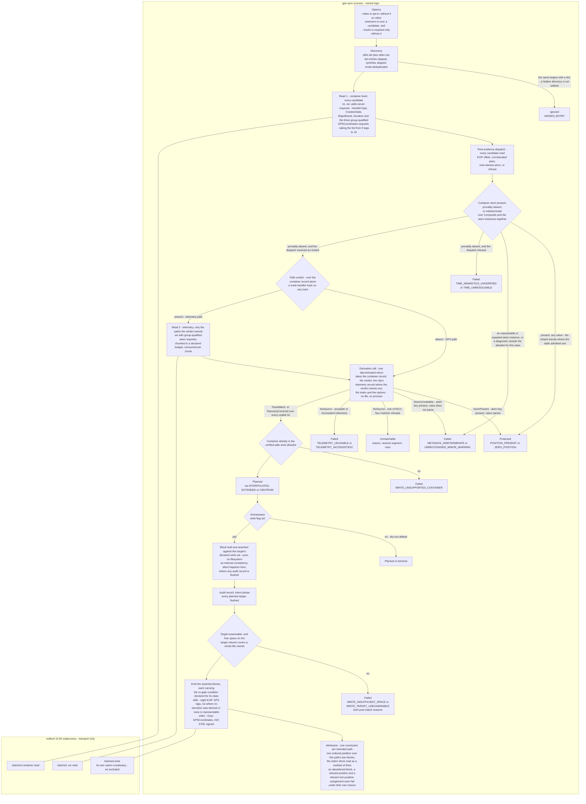
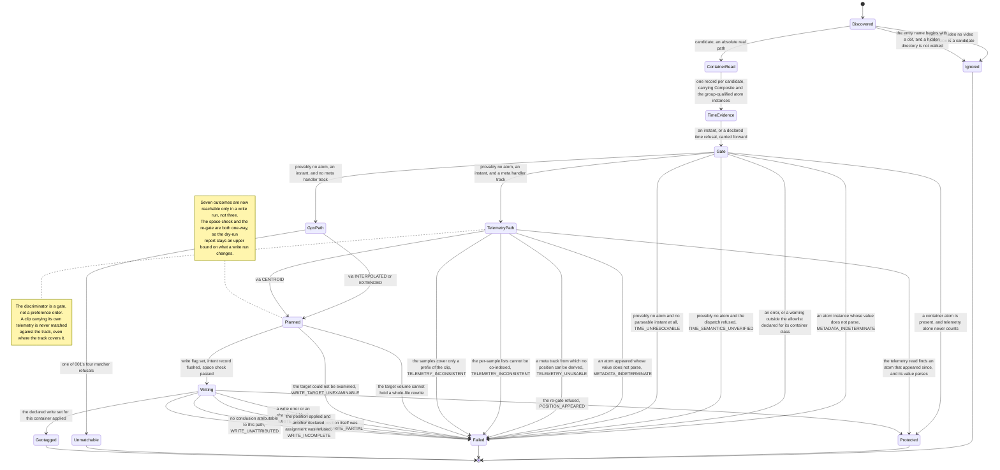
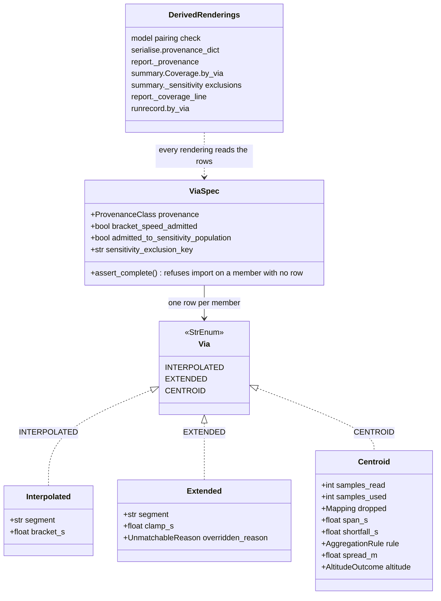
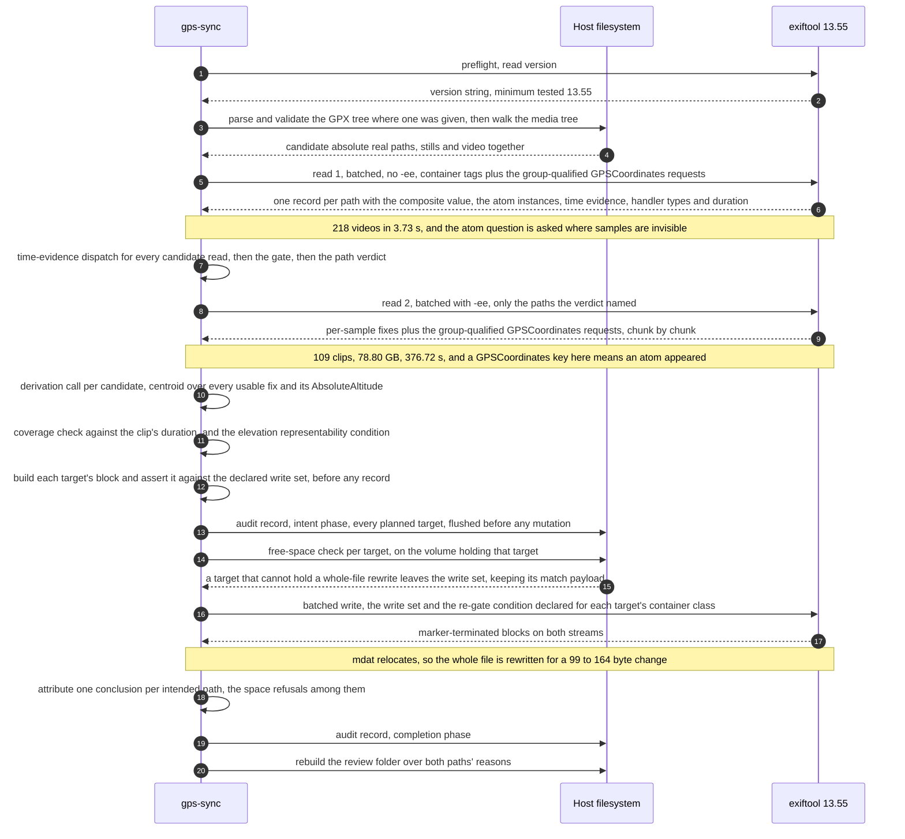

# Design — gps-sync: video container location

**Goal:** `geotagging`
**Milestone:** `milestone-01-core-geotagging` · no ticket
**Feature:** (no ticket — tracked in `planning/` only)
**Branch:** `feature/002-video-location`
**Status:** Draft
**Revision:** 5

---

## 1. Problem Statement

The archive holds **200 video files — 116 MP4 and 84 MOV, 114.93 GB** — and only 19 of them carry a position any viewer can read. **96 are DJI MP4, 73.82 GB, that carry a GPS fix for every video frame — 378,507 samples over the 109 clips the 2026-11-15 sweep read — and a container position for none of them.** Capture One, Finder, Photos and Lightroom all read the container atom, so every one of those clips opens as an unpositioned file while holding its own flight path inside its media data. A further 42 are Fujifilm X-T5 MOV originals that carry no telemetry at all: their position has to come from the GPX track, exactly as a still's does.

Issue 001 closed the stills case and handed four things to this issue by its own decision: the MOV geotag targets, the DJI container-atom publishing question, the `Keys` ISO 6709 video write path, and the whole video GPS-detection problem. Phase 1 measured all four against the live archive, and three of the measurements invert assumptions that 001's design recorded as settled.

**The read that supplies the data inverts the probe that guards the data.** Per-sample telemetry is invisible without `-ee`; with `-ee`, exiftool builds `Composite:GPSPosition` from the *first telemetry sample*. Measured against the shipped gate on the 14 smallest DJI clips: without `-ee` all 14 are `Failed{UNRECOGNISED_MINOR_WARNING}`, with `-ee` all 14 are `Protected{POSITION_PRESENT}`. Neither verdict writes anything, and the calibration population and the target population coincide by construction.

**The shipped writer succeeds on a video and writes where nothing reads.** `writer.build_write_lines` applied unmodified to a video target returns exit 0 and `1 image files updated`, emits both attribution markers so the run concludes `Geotagged` — and puts the position entirely in `XMP-exif` with a new `XMP-x:XMPToolkit`, with no `Keys`, no `UserData`, no `ItemList` and no GPS IFD, while **silently dropping `GPSDateStamp` and `GPSTimeStamp`**. `Composite:GPSPosition` reads the XMP value back, so the wrong write is idempotent and conceals itself, and it violates 001's EXIF-GPS-only decision while reporting success.

**The time-resolution dispatch is wrong for the files this issue makes writable, and wrong silently.** `timeres.container_class` dispatches on `file_type`, so every MOV takes the `QUICKTIME_UTC` branch, which does `stamp.replace(tzinfo=UTC)` on `record.create_date` — asserting rather than checking that the value is UTC. On a Fujifilm MOV the primary `CreateDate` instance is the *local* `ExifIFD` copy, so the resolved instant is late by the camera's whole embedded offset: `+06:00` on 36 files and `+08:00` on 5, over the 41 readable files, with no spread. The atom is no better even where it is genuinely UTC — on these files it is the *finalisation* instant, trailing the recording start by the clip's duration plus a constant 23.95–25.00 s. These 42 files are now GPX-match write targets, and **a match on a wrong instant writes a wrong position into a file that had none**, which is the one failure the never-overwrite invariant does not catch: the invariant protects files that already carry a position, and these carry none.

Two further measured facts shape the design rather than the problem. A video write is a **whole-file rewrite** — `mdat` relocated by 3,359,657 bytes on a 24 MB clip, first differing byte at offset 22 on a 91.5 MB clip, a full-size temporary file in the target's own directory — so write cost, write risk and disk demand scale with file size rather than with the 99–164 bytes of metadata added. And `-geotag` is no longer moot: its only data source is a track file, which is exactly what the GPX path needs, and it was measured writing a Fujifilm MOV correctly under exiftool's own default `-geotime`. 001 predicted this issue's MOV path as the likeliest place its Shape B prohibition would be violated, and that prediction is now live.

Why now: 001 is implemented, reviewed and has been run against the live archive on 2026-11-15, so the photo path's behaviour is a real regression surface rather than a hypothetical one. Phase 1 measured every quantity this design depends on — the whole 218-file population at container level, the whole 109-clip telemetry sweep, and byte-level write verification on four container producers. Those sweeps are dated, and the distinction matters for every figure quoted from them: the container-level population figures in this document were re-counted against the live archive on 2026-11-17, the byte totals among them — a `FileSize` sum needs no `-ee` and was re-derived with the counts — but every quantity derived from the telemetry sweep itself — the 378,507-sample count, the container-read and `-ee` timings, and every dispersion and altitude figure taken over the samples — remains the 2026-11-15 measurement over the then-218-file, 109-clip population and has not been re-derived, because re-deriving it costs a ~377 s `-ee` sweep.

---

## 2. Goals and Non-Goals

### Goals

- Write a container position into every video that lacks one and whose position is derivable, from **one of two sources chosen by the file's own structure**: the centroid of the clip's own per-sample telemetry where the clip carries telemetry, and a GPX match on the clip's start instant where it does not.
- Keep the never-overwrite invariant unchanged and unweakened, under the one reading that makes it meaningful for a container: **a stored container position is a location; per-sample telemetry is a data source.** All 96 DJI MP4 are therefore write targets, and all 19 already-positioned videos stay `Protected`.
- Make a presence verdict structurally incapable of being contaminated by sample data **and incapable of resting on a derived value alone**: the question "does this file already carry a position?" is answered by a read in which samples are invisible, and **each** read asks the atom question by group-qualified request, so that absence of a `GPSCoordinates` key *proves* absence of a `Keys`, `UserData` or `ItemList` atom — the three places the key covers, among them the one place this issue writes — while an atom whose value this backend cannot parse is *seen* rather than read as absence.
- Decide which of the two sources derives a position from **one discriminated call** whose return names the producing path or the reason neither applied, extending 001's six-variant union and its import-time completeness pattern rather than adding a second pattern.
- Dispatch time resolution on **the time evidence a file carries**, not on its container family, over a table that is total and whose default is refusal — so the Fujifilm MOV take 001's existing still rule verbatim, the DJI and Android atoms keep their UTC reading on declared evidence, and a container whose atom semantics are unverified is refused rather than guessed at.
- Write the position through a **write set declared per container class** — eight EXIF GPS tags for a still, one `Keys:GPSCoordinates` ISO 6709 value for a QuickTime container — selected by the same content-derived identity the write allowlist is keyed on, asserted **before the intent record is flushed** so an internal-consistency abort cannot be mistaken for an interrupted run, and never XMP.
- Report each measured way a refused tag value ends a write under a reason whose statement about the file on disk is true, with the backend's own diagnostic — distinguishing the block the backend abandoned, the block in which the position itself was refused, and the block in which the position was applied and some other declared assignment was refused — rather than as the unattributable case whose remedy is manual inspection, or as a `Geotagged` file that carries no position.
- Refuse an individual write that the target's volume cannot hold, under its own terminal reason, rather than aborting the run or discovering the condition mid-batch — and refuse under a second terminal reason of its own a target the same check cannot examine at all, one that vanished, moved or became unreadable between discovery and the write.
- Hold the `-geotag` prohibition structurally as well as by rule: close the transport's argument shape so that an arbitrary option line is not representable at the boundary, which gives the prohibition's test a statically enumerable subject.
- Keep video **opt-in**, and state the one-directional sense in which a bare invocation is still 001's: no video extension becomes a candidate, and the hidden-entry rule can only *remove* entries, so a bare run's candidate set is a subset of 001's and its write set with it — never a superset. Three classification differences follow, and the rendering differences are enumerated in FR11's census rather than counted or denied. A `--video` run produces one audit record, one exit code, one review folder and one report across stills and video together.
- Make the centroid auditable to 001's standard: the provenance records how many samples were read, how many of them the mean is over, how many were rejected under each declared reason, the sample-time span the read covered, the rule applied, how far the farthest used fix sits from the result, and which tag supplied the altitude.

### Non-Goals

- **No use of the GPX track for a clip that carries its own telemetry.** The drone-to-pilot separation 001 measured is a median 1035 m and a maximum 4620 m, so the track is not a fallback, not a cross-check and not a source on that path. The discriminator is a gate, not a preference order.
- **No use of exiftool's own geotagging machinery, on either path.** `-geotag`, `-geosync`, the `Geo*` API options and any invocation that reads a GPX or NMEA file stay prohibited in shipped code. The measured fact that `-geotag` writes a MOV correctly is a reason to state the prohibition more strongly, not to relax it: its correctness there comes from exiftool's own default `-geotime` expression, a rule outside this project's control, and it writes `XMP-exif` alongside the atom.
- **No XMP, on either path.** The declared write set for a container is the whole of what is written. 001's EXIF-GPS-only decision is not amended; it is generalised to "the declared set for this container class and nothing else".
- **No position written to `UserData` or `ItemList`.** Both lose `Composite`'s group precedence, so a write there is invisible to the probe that is supposed to see it and leaves two contradictory positions in one file.
- **No `--utc-offset` for a video container.** The flag keeps exactly the one application point 001 gave it: a local-time still carrying no offset tag. A QuickTime container's local-versus-UTC question is not the question the flag answers, and letting it stand in is precisely how a wrong position reaches a file that had none.
- **No per-sample position publishing, no track export and no GPS timing from telemetry.** The samples' `GPSDateTime` is `CreateDate + SampleTime` — measured to within 0.500 ms over 9,804 samples — so it is the container clock, not satellite time, and it is never read as an instant source.
- **No outlier sanitisation of the sample list — which is a different thing from the value domain every *derived* position in this project passes.** A sample component that is non-numeric, non-finite or outside ±90 / ±180, and a sample at the `(0,0)` no-fix sentinel, is not a fix: it is dropped under its own counted reason, exactly as a GPX trackpoint is. A fix that is merely far from the others is never discarded, because across 378,507 real samples no clip carries a corrupt-but-in-domain fix and a robustness rule would be calibrated against nothing. The first hazard is closed by a declared predicate; the second is recorded and the rule is not invented.
- **No *plausibility* bound on an elevation, on either position source**, because no measurement calibrates one: `AbsoluteAltitude` spans 1,637.7–3,978.5 m across all 378,507 samples and `gpx` validates a trackpoint's `<ele>` only by parsing it, so a numeric ceiling such as "a credible altitude range" would be the unfalsifiable rule this design refuses everywhere else. The one bound that **does** exist is of a different kind and is stated in the backend's own domain rather than in the world's: a derived elevation the backend cannot represent is refused **before** the write, because measurement shows the backend does not refuse it — it silently saturates or drops it at exit 0. §5 states that condition, its evaluator and its outcome, and §7 records why an unrepresentable elevation drops the elevation rather than the file.
- **The GPX video path is in scope for clips that do not move, and its admission rule is wider than that scope.** The justification for matching a whole clip to a single instant is the recorded statement that the Fujifilm MOV are shot stationary or near-stationary; the rule that selects the path is a provably resolvable start instant, which also admits the 19 dated Android MP4 and any future video of that shape. The displacement error on a moving clip admitted that way is the clip's own travel and is bounded by nothing in this design. §7 records the gap rather than this document claiming the scope and the rule coincide.
- **No automatic re-derivation of a position a clip already carries**, and no quality judgement about one. 001's statement that `Protected` makes no claim about a position's quality carries over unchanged.
- **No undo.** The audit record names what changed; nothing in the tool reverses it, and `--keep-original` is the only mechanism that retains the prior bytes — at +73.82 GB across the DJI set.
- **No new container admitted to the write allowlist beyond MP4 and MOV**, and no admission on anything but the verification evidence 001's gate defines.

---

## 3. Implementation Context

**Repository:** `/Users/astavonin/projects/gps-sync`

**This section records the repository as it stood on 2026-11-15, after issue 001 shipped.** Unlike 001, this design extends a working implementation rather than an empty tree: `src/gps_sync/` holds 28 modules and 3,960 lines, `tests/` holds unit, integration and e2e tiers, `README.md` carries every disclosure 001 mandated, the `Makefile` provides the verification entry points, `testdata/` holds a 19-file pinned fixture corpus of 353 MB, and `mutation-baseline.txt` holds a 107-entry mutation-gate baseline. The repository **is** under git, with two commits (`d539886` the implementation, `293ed8c` the planning state), and still has no `CLAUDE.md`; an earlier revision of this section asserted the opposite, and NFR8's tooling change below depends on which it is. Every contract named below as "unchanged" is a contract that exists in that tree and was read there.

Requirement IDs in this document are local to it. Where issue 001's requirements are referenced they are named as `001 FR12` and so on.

**Functional Requirements:**

| ID | Requirement | Measured anchor |
|---|---|---|
| FR1 | Admit video to the pipeline only under an explicit `--video` flag. Without it, no video extension is a candidate and the run's **classification** is 001's up to the three differences FR11 declares, every one of which only removes entries, while what a bare run **renders** moves at ten of the seventeen renderers FR11's census enumerates, and at two more in the write mode that is the only one producing their output: a bare run's candidate set is a **subset** of 001's and its exit code can only fall. With it, one run classifies stills and video together and produces one report, one audit record, one review folder and one exit code. | the photo path has already been run against the live archive — 323 RAF written on 2026-11-15 — so a change in what a bare invocation does is a regression against real data, while two runs over the archive's mixed folders would leave two reports to reconcile by hand |
| FR2 | Treat a stored container position as the whole of "already has a location" for a video, and per-sample telemetry as a data source that is never a position. Any present atom — in `Keys`, `UserData`, `ItemList` or an EXIF GPS IFD — is `Protected`; telemetry alone never is. | no viewer or map reads a clip's telemetry track as its position, so the 96 DJI clips read as unpositioned everywhere they are opened. The two rejected readings fail in opposite directions: any-position-anywhere makes **115 of 200** `Protected` — the 19 that carry a container position plus the 96 that carry telemetry — and leaves this issue no write targets at all. Both figures are the 2026-11-17 re-count of the live archive, where Phase 1 counted 128 of 218 on 2026-11-15; §6 records the difference and declares which figures the test derives rather than asserts |
| FR3 | Decide atom presence from a read in which per-sample data cannot appear, and ask the atom question **by group-qualified request in both reads** — in the container read, where its answer is an input to the gate beside `Composite:GPSPosition`, and again inside the read that supplies the samples. A `GPSCoordinates` key emitted by that request proves a `Keys`, `UserData` or `ItemList` atom exists; its absence proves none of those three does. The fourth place an atom can sit — an EXIF GPS IFD — is answered by `Composite:GPSPosition` in the container read, and §5 states the three facts that make re-asking it in the second read unnecessary. A presence verdict is never taken from a `Composite:GPSPosition` value alone, in **either** direction: not from one produced under `-ee`, and not from the *absence* of one, because `Composite:GPSPosition` is a **derived** tag and an atom whose payload this backend cannot parse emits no key for it at all. An emitted `GPSCoordinates` instance whose value does not parse is the gate's **indeterminate** answer whatever `Composite` says. | under `-ee`, `Composite:GPSPosition` is the first telemetry sample: 14 of 14 clips move from `Failed` to `Protected` on that flag alone. A group-qualified request prints as a bare `:GPSCoordinates` key **with no `-ee`**, returned in the same read beside the shipped nine-tag list — measured 2026-11-16 on a scratchpad copy carrying a planted `Keys` atom — and emits nothing at all for a RAF or a DNG, so the three added tags change no still's record. And the derived-tag hazard is measured on the same copy: with the atom's payload byte-patched to a decimal-comma locale form at identical length, the nine-tag read returns `FileType`, `CreateDate` and the `ExtractEmbedded` advisory and **no position key of any kind**, while the group-qualified request returns the atom verbatim. A gate reading `Composite` alone therefore calls that file provably absent, and the write — measured under the shipped `-if not $Composite:GPSPosition` — reports `1 image files updated` at exit 0 with the pre-existing atom **gone** |
| FR4 | Choose the position source from one discriminated call whose return names the producing path or the reason neither applied. The discriminator is the presence of a `meta` handler track on any track of the container, and it is a **gate**: a file carrying telemetry is never matched against the track, whatever the track covers. | `HandlerType == meta` is present on 96 of 96 DJI MP4 and absent on all 104 other videos, at 18 ms per file, and is a container standard rather than a vendor signature. 001's proposed `MetaFormat = dbgi` probe would miss 44 of the 96 — 46 % — in the direction of reporting "no telemetry" for a file with thousands of fixes |
| FR5 | Resolve each file's instant from a table total and disjoint over **four** dimensions of the record — which time tags are present, whether each present tag's **value parses**, the witness shape, and the container family — never from the container family alone, with refusal as the default. The value-validity dimension covers **every one of the four time tags the table reads** — `DateTimeOriginal`, `OffsetTimeOriginal`, `CreateDate` and `CreationDate` — and for each of them a present-but-blank value is kept distinguishable from an absent one in the record, on the shipped `OffsetTimeOriginal` precedent, so that a blank corroborating witness refuses rather than satisfying a row whose admission requires that witness's absence. The table's **default is the refusing row**, stated as a declared default rather than inferred from the rows' complement. An EXIF `DateTimeOriginal` that parses and carries a non-blank, parseable `OffsetTimeOriginal` outranks any container atom. A container atom is admissible as a UTC recording start only under a declared row of the atom-semantics table, whose brand condition is a declared set of major brands enumerated member by member with the evidence admitting each. "QuickTime-family" is one declared predicate over the container identity the read returns, stated once and used by every row that names it. `--utc-offset` is never consulted for a QuickTime container. | shipped `resolve_instant` is late by the whole embedded offset on the Fujifilm MOV — `+06:00` ×36, `+08:00` ×5 over 41 readable files, no spread — and the atom there is the finalisation instant, start + duration + 23.95–25.00 s. `DateTimeOriginal` and `OffsetTimeOriginal` are present on 41 of 41, so routing them down 001's existing still branch needs no new rule and fixes both errors at once. The blank-versus-absent requirement has a shipped precedent and a shipped counter-example in the same module: `records._primary` keeps `OffsetTimeOriginal` as `""` so a blank value refuses, while `records._first` — which every other time tag goes through — collapses a blank to `None`. A corroborating witness read through `_first` would therefore satisfy a "no witness of any kind" condition while the key is present and unreadable, which is the admission this table must not make |
| FR6 | Derive a telemetry position as the **arithmetic mean of every usable fix in the clip**, with the mean `AbsoluteAltitude` as its elevation, over a declared value domain: a sample is a fix only when both of its components parse as finite numbers inside ±90 and ±180 and the pair is not the `(0,0)` no-fix sentinel, with a count kept per rejection reason. Declare one **co-indexing rule** over every per-sample list the derivation reads — latitude, longitude, altitude and sample time — evaluated on the four lengths before any aggregation, so that no quantity is ever computed over a misaligned pairing and each way the rule can fail has a declared outcome. Declare the **order** the rule, the domain and the aggregation are evaluated in, as an ordered pipeline each of whose steps has a declared outcome for an empty or unsound input, so that no figure is ever computed over an empty set. A list of usable fixes spanning more than 180° of longitude is refused rather than averaged. Give the read a **diagnostic dimension of its own**, so that a telemetry scan stopping short of either end of the clip is detectable rather than indistinguishable from a complete scan: the **read** sample-time list's span — every co-indexed sample the read returned, so that a fix the value domain dropped still contributes its time and cannot be mistaken for a short scan — is compared against the clip's own `Duration` under a **two-sided** predicate, and a shortfall beyond a declared ceiling, or a negative one, is refused. Record the provenance: how many samples were read, how many were used, how many were rejected under each reason, the span the read covered, that span's shortfall against the clip's duration, the aggregation rule applied, the greatest distance from any used fix to the result, and the altitude tag the mean was taken over or the declared reason no elevation was derived. | `AbsoluteAltitude` is present on all 378,507 samples and `GPSAltitude` on none. Each receiver fix is held across about six video frames — 83.3 % of consecutive pairs are byte-identical across the archive — but the hold length is **not** uniform, so an unweighted mean over the 59.94 Hz list does **not** coincide with a mean over distinct fixes: on the committed fixture the hold runs are 1, 6, 6, 6 and 5 samples, 5 distinct fixes in 24, and the two means differ by 0.0737 m — negligible for photo geolocation against the 0.4876 m dispersion the same clip already carries. The farthest fix from the centroid is a median 130.55 m and reaches 1,695.76 m, which is why the dispersion is recorded rather than assumed small. The domain and the wrap refusal are the project's own rules rather than new ones: `gpx` already validates its position source for finite, numeric, in-range values, refuses the `(0,0)` sentinel and counts every drop by reason, and `matcher` already refuses an antimeridian bracket under its own reason. Neither rule fires on today's data — 0 of 378,507 samples are at `(0,0)`, every one lies in 41.9–42.8 N and 73.9–78.5 E, and the widest clip spans under 5° of longitude — which is why each is a declared predicate with a test rather than a measured population. The coverage dimension is the one that was missing entirely: without it a partially scanned clip returns `samples_read = samples_used = n`, zero drops, a small dispersion and an internally consistent provenance, and the error is the clip's own travel over the unscanned remainder, which reaches 3,113.27 m on this population and is bounded by nothing. The discriminator is measured and is an absolute shortfall rather than a ratio: `Duration` minus the read sample-time span is **0.0167 s — exactly one 59.94 Hz sample interval — on all three clips measured across the whole size range of the population**, 0.4004 s / 24 samples / 24 MB, 34.33 s / 2,058 samples / 466 MB and 681.51 s / 40,842 samples / 8.87 GB. The ratio form the earlier revision cited is not the right instrument: it is `(n−1)/n`, so it reads 0.958 on a sound 24-sample clip and 1.000 on a sound 40,842-sample one for the same 0.0167 s shortfall. `Duration` is present and parseable on 96 of 96 clips, range 0.4004–681.5142 s, and is in neither the shipped read's nine-tag list nor the container record, which is why it is added |
| FR7 | Add the third `via` value with its own provenance shape, and close every consumption site: the three that fail loudly on an unpaired value and **the four that fail silently**. The `via`-to-provenance pairing becomes a declared table with an import-time completeness check, on the same pattern as the reason registry. | `model._check_match_payload`, `serialise.provenance_dict` and `report._provenance` raise. `summary.Coverage.interpolated`/`.extended`, `summary._sensitivity`'s `via is Via.EXTENDED` test, `report._coverage_line` and `runrecord`'s `by_via` keys each drop or miscount a third value with no error. `summary.success_by_via` already iterates the enumeration and needs no change to its code, which is the shape the other four should have had — though its *output* still gains a member at 0, which FR11's census declares rather than denies |
| FR8 | Declare the write set per container class, keyed on the same content-derived identity the write allowlist is keyed on, with each member declared position-bearing or not under one stated predicate; build each target's block and assert it against the declared set **before the intent record is flushed**, since building a block needs no filesystem and an abort after the flush would leave the record in the phase reserved for an interrupted run. A QuickTime container receives exactly one tag assignment — `Keys:GPSCoordinates` as an ISO 6709 string — and no XMP, no `UserData`, no `ItemList` and no EXIF GPS tags. | the shipped stills set applied to a video reports success while writing `XMP-exif` only and silently dropping `GPSDateStamp` and `GPSTimeStamp`. `Keys` wins `Composite`'s group precedence, verified by the inverse: a `UserData` write on the Canon MOV left `Composite` reporting the file's original `Keys` value. The atom's own storage round-trips a 15-significant-digit value exactly — `42.1234567890123 77.1234567890124 2189.9` — which is the headroom the declared nine-decimal formatter sits inside, and it stores a sign verbatim in all four quadrants, which is why the formatter is declared signed and separate from the stills magnitudes. A repeated identical write leaves the file byte-size identical |
| FR9 | Diagnose each measured value-refusal shape under a reason whose statement about the target is true, and leave `WRITE_UNATTRIBUTED` for what is genuinely unknown. The classification's subject is **a path's own two blocks, with the stderr block read as the multiset of lines its marker terminates** rather than as "the warning", because a block carries several lines and two of them can satisfy rows with opposite statements. Partition every stderr line into three declared classes **in a declared order, because their predicates overlap** — an `Error:` line; a **refusal** line, being one that resolves a `<group>:<tag>` token naming an assignment this block emitted, with a parenthesised `ValueConvInv`/`PrintConvInv` suffix sufficient but **not** necessary, since three of the six measured wordings carry none; and anything else. Declare how that token is found — by matching each token's own text against the assignments this block emitted, not by its position in the line — because it is not the first token and one measured wording quotes a colon-bearing value ahead of it. Resolve each refusal line's token against **the assignments this target's own block actually emitted**, and conclude from one ordered partition over the resulting counts that is total and disjoint by first match — total including the cell where the backend reports an error on stdout and emits no `Error:` line to quote. The order is declared, because it is what the conclusion turns on: an error line outranks a refusal line, an unresolvable token outranks a resolvable one, and a refused position-bearing member outranks a refused non-position-bearing one. A block carrying no refusal line keeps 001's conclusion, so a benign advisory beside an applied message is still `Geotagged`. | measured on 2026-11-15 and 2026-11-16 against exiftool 13.55, on blocks replicating the shipped block shape including both markers. **Three measurements set the shape of the rule rather than only its rows.** A single block carries several diagnostics: on the committed DJI DNG, one block at exit 0 carried `Warning: Error converting value for GPS:GPSAltitude (ValueConvInv)` **and** `Warning: [minor] Possibly incorrect maker notes offsets`, which under a singular reading of "the warning" satisfies the refused-assignment row and the "an advisory outside the refusal family stays `Geotagged`" row at once, with opposite conclusions. The refusal wordings are not one family and are not one shape: measured 2026-11-16 in the shipped eight-assignment block with the numeric flag present, `-GPSLatitude=inf` and `=nan` give `Warning: Not a floating point number for GPS:GPSLatitude`, `-GPSLatitudeRef=XX` gives `Warning: String too long for GPS:GPSLatitudeRef` and `-GPSTimeStamp=abc:def:ghi` gives `Warning: Not a floating point number for GPS:GPSTimeStamp` — three wordings across three tags with **no parenthesised suffix at all** — beside `Warning: Argument "<value>" isn't numeric in abs in GPS:GPSLatitude (ValueConvInv)`, `Warning: Error converting value for GPS:GPSAltitude (ValueConvInv)` and `Warning: Longitude out of range in Keys:GPSCoordinates (ValueConvInv)`, which carry one. Keying on a prefix leaves most of them unmatched; keying on the suffix leaves three of them unmatched; and the unmatched direction is the success row. The one part every measured line carries is a group-qualified token naming an assignment the block itself made — and in one of them it is preceded by the operator's own quoted value, which may itself contain a colon (`Warning: Argument "abc:def" isn't numeric in abs in GPS:GPSLatitude (ValueConvInv)`), so how the token is found has to be declared and not guessed. And the comparison domain is the **emitted** block rather than the declared class, because the stills set is declared with eight members and emits six when no elevation was derived, so a token naming a class member this block never assigned is a contradiction rather than a partial success. An abandoned block emits **both** markers: stdout carries the path marker and no result message at all, stderr carries the `Warning:`, `Nothing to do.` and the marker, at exit 1 with no file modified — so the shipped `_conclude` does not stop at a missing block, it finds none of the three result messages, fails its exactly-one-signal check and reports `WRITE_UNATTRIBUTED`, safe in direction but with a remedy that sends the user to inspect a file nothing changed. A refusal **beside assignments that succeed** behaves differently and worse, and its two sub-shapes were measured separately **with the numeric flag present throughout**. With `-GPSLatitude` malformed: stdout `1 image files updated`, stderr the refusal line for that tag, and the file afterwards holds **every other assignment of the block, the longitude and both hemisphere references among them**, with only the refused magnitude missing — so `Composite:GPSPosition` emits no key, because it is derived from the pair, and one coordinate component is nonetheless on disk. With `-GPSLatitudeRef=XX`: stdout `1 image files updated` at exit 0, stderr `Warning: String too long for GPS:GPSLatitudeRef`, and the file holding `GPSLatitude 42.0721` with no reference, where `Composite:GPSPosition` reads back `42.0721 77.1292` — a southern position returned as its northern mirror, which the next run's gate then reports `Protected`. With only `-GPSAltitude` malformed in the same eight-assignment block: stdout `1 image files updated`, stderr `Warning: Error converting value for GPS:GPSAltitude (ValueConvInv)`, exit 0, and the file carrying `GPSPosition 42.0721 77.1292` and its date stamp with no `GPSAltitude` — the position the run planned, on disk. Both conclude **`Geotagged`** under the shipped parser, because its error test matches only `Error:`-prefixed lines: a success report for a file carrying no position in the first case, and a success report that is substantially true but silent about a dropped assignment in the second. The warning's token is group-qualified (`GPS:GPSLatitude`) where the declared stills assignments are unqualified, and exactly qualified (`Keys:GPSCoordinates`) where the declared QuickTime assignment is, which is why the comparison domain has to be declared rather than assumed to be equality. **What both split shapes are *not* is data-reachable**, which is measured and is why §5 labels the taxonomy internal-consistency diagnosis: the only inputs that refuse are non-numeric and non-finite tokens, and the formatters cannot emit one — not because the value domain bounds the derivation's inputs, which says nothing about its output, but because the representability condition is declared as **finite and** within the ceiling and drops a non-finite derived elevation before any formatter runs. Even a magnitude far outside the declared domain is **applied**: `-GPSLatitude=999.5` exits 0 with an empty stderr block |
| FR10 | Check free space per target, on the volume holding that target, after the intent record is flushed and immediately before the batch is spawned, report in a dry run the **peak** that check will evaluate rather than a sum over the planned set, and remove a target the volume cannot hold from the write set under its own terminal reason, `WRITE_INSUFFICIENT_SPACE` — and remove under a second terminal reason, `WRITE_TARGET_UNEXAMINABLE`, a target the same check cannot examine at all, carrying the operating system's own words. Both are post-match reasons, so each target keeps its match payload, stays in the coverage numerator and appears in both of the audit record's per-file lists. The check is per file so that one oversized clip cannot deny the others, and it accounts for retained `_original` siblings under `--keep-original`, whose demand accumulates per volume. | a video write creates a full-size `<name>_exiftool_tmp` in the target's own directory, so writing the archive's largest clip needs 8.87 GB free on the external volume. The volume reports 1,001.79 GB free of 1,863.00 GB, so the condition is not live on this archive today, which is why it is a refusal rather than a run-level abort. The second reason's anchor is the check's own position rather than a population: it runs after the intent record is flushed, so an examination that raises there has to become that target's conclusion, and an uncaught error would leave a record in `intent` phase — the state reserved for an interrupted run — for a run that wrote nothing |
| FR11 | Skip a directory entry whose name begins with a dot, under its own `Ignored{HIDDEN_ENTRY}` reason, on both paths and under both flag states. A directory is an entry: a hidden directory is reported once and its subtree is not walked. A bare run therefore differs from 001's in exactly **three** ways, all of them removals: **(i)** a hidden entry that 001 reported `Ignored{NOT_A_STILL}` is now `Ignored{HIDDEN_ENTRY}`; **(ii)** a hidden *file* whose final extension is a candidate extension ceases to be a candidate — 001 read and classified it, so whatever non-`Ignored` variant it terminated in loses that row, and the candidate set, the write set and the exit code can all fall; **(iii)** a hidden *directory* gains one row where 001 emitted none for it, while every row beneath it disappears, so the `Ignored` total can move in **either** direction. Nothing in the rule can add a candidate, a write target or an exit term. The rule is evaluated after the symlink branch and after the run-artifact prune, so neither of those changes. Declared beside those three is a **census of every renderer, stating per renderer whether its output moves on a bare run and why** — ten of seventeen move on a bare dry run and two more only on a bare write run, the one mode that produces their output, where an earlier revision declared eight renderers and seven movers and the revision before that one difference. No candidate, variant count, write target or exit term moves with any of them. The subset promise is therefore stated over **classification** and the rendering differences are enumerated rather than counted, because a promise of three plus one that a reader can falsify by diffing two JSON records is worse than a list of seventeen with a verdict each. | the archive already contains `.DSCF3226.MOV` — 196,083,712 bytes, a Fujifilm MOV reading with a truncated `mdat` trailer — and `discovery` does not skip dot-files today. A truncated container is exactly the input a write should never be attempted on, and a hidden sibling is an operating-system or tool artifact rather than a photograph. The reference tree is an external volume on which `.Spotlight-V100` and `.fseventsd` are routine, so whether the rule reaches directories is not a hypothetical question: leaving them walked would keep media under a hidden tree a write target, and walking them is what the rule exists to stop |
| FR12 | Admit exiftool's `[minor] The ExtractEmbedded option may find more tags in the media data` advisory to the benign-warning allowlist **for the video container classes only**: the allowlist gains a scope alongside each pattern, and a still emitting that advisory keeps 001's verdict. Admission is on the evidence 001's gate requires. | the shipped gate returns `Failed{UNRECOGNISED_MINOR_WARNING}` for 96 of 200 videos on that warning alone. The warning is not about the container's readability: it states that a second read mode exists, which is the read this issue takes up. The position state of all 96 files was independently confirmed — 0 of 96 carry an atom, verified by group-qualified request before and after a write — which is the standard 001 set for admitting a warning. The scope is what keeps FR1's promise true: the shipped allowlist is one unscoped tuple consulted for every record, no measurement counts the stills that emit this advisory, and an unscoped entry would therefore move an unmeasured number of stills from refused to write-eligible — a widening of a safety gate on the path already run against 323 real photos |
| FR13 | Chunk the telemetry read to a declared per-chunk budget, and state the **three quantities and the relation between them** rather than one figure in three units: the budget is declared **in bytes**, the chunk size is **derived from it in paths** by dividing by the measured maximum record size, and what is enforced at runtime is a **record count** — the number of telemetry records reachable from the read never exceeds one chunk's derived size and is zero once the last chunk is consumed. The enforced quantity is a record count because that is the one an instrumentation point can evaluate; the byte budget is what motivates the derivation and is not itself enforced, and the gap between the two is the parser-overhead gap §7 records. Reconcile each chunk's returned set against its requested set the way the container read does. | `-ee` records run a median 476,574 bytes and a maximum 8,894,679 bytes, so a 5,000-path chunk projects to roughly 2.4 GB of JSON held at once. The read parser itself is unaffected: 0 refusals over 200 container reads, a 308-key `-ee` record and a 40,842-instance sweep |
| FR14 | Grow the reason registry by eleven rows — eight per-file reasons and three **run-level** ones, taking it from 19 to 30 and its review-folder bucket set from 13 to 20 — and keep it the single declaring mapping across all five renderings, with the import-time completeness check unchanged. The three run-level rows go in the registry rather than beside it because the registry already declares a `run-level` variant with a full row, and because a row at `exit_term: 0` answers the only objection raised to putting them there. | a reason declared without its renderings hides exactly the files a user most needs to find. The seven new refusal reasons each have a distinct remedy, and collapsing any of them prints a remedy that is wrong for the state: `TIME_UNRESOLVABLE` would print "pass `--utc-offset`" for a file on which that flag must never be consulted; `WRITE_ERROR` would promise only a quoted diagnostic for a write whose operator most needs to be told that the target was rewritten; `WRITE_INSUFFICIENT_SPACE` would tell an operator to free space for a target that is no longer there to write; and the two refused-assignment shapes would share one remedy although a re-run retries one and is structurally refused on the other |
| FR15 | Close the transport's argument shape: the write operation accepts a per-target block description rather than caller-composed lines, and each of the four operations declares **its own** option vocabulary, asserted where that operation's options are actually constructed — in the argv list for the version check, the two reads **and the write's own invocation shape**, and in the argfile lines for the write's per-target blocks. The write's vocabulary therefore has an argv half as well as an argfile half, because the filename-charset option has to reach the write through `-common_args`, which exiftool admits only on the command line and only after every other option, so the argfile path is **not** the last argv element. A constructed option outside that operation's vocabulary, and an argfile line outside the declared line taxonomy, is an internal-consistency failure before any mutation; the taxonomy is stated as four shapes rather than three, because the shape carrying every derived value is an option and its value on one line. `-ee` is a member of the telemetry read's vocabulary and of no other, which makes the write block's freedom from it a declared property rather than a convention. | the prohibition is currently conventional only, and more weakly than it appears: `transport.write_command` is a fixed argv list, and `emit_argfile` validates **nothing** — it joins and encodes the lines it is handed. The absolute-and-newline-free check lives in a separate `path_line` helper that each composer must remember to call, so it is a convention one level above the boundary rather than a property of it, and nothing structural stops a caller passing `-geotag`. 001 asserts the prohibition over "every invocation the shipped code can construct", which a pass-through argument shape leaves without a well-defined subject. One vocabulary across all four operations would be the wrong object twice over: the reads put their options in argv and only their paths in the argfile, so an argfile-line check cannot reach them, and `-ee` — which the telemetry read must carry — would be legal inside a write block, where it would make `not $Composite:GPSPosition` false for all 96 DJI clips, refuse every write and leave the run exiting 0 |
| FR16 | Report a video's terminal outcome through exactly the same six variants, four exit codes, review buckets and JSON record as a still's, with the two paths distinguishable by `via` and by provenance rather than by a separate report. | 001's renderings are exhaustive over the union and the reason enumerations, so the cost of a new state is paid once in the registry; the cost of a second reporting path would be paid on every figure for ever |
| FR17 | Require a tracks root only for a run that can reach the GPX path: `--tracks` stays mandatory without `--video` and becomes optional with it. Omitted, the index is empty, which is a declared non-fatal state rather than an abort — a candidate that reaches the matcher is `Unmatchable{OUTSIDE_COVERAGE}` carrying neither a nearest segment nor a miss, which is exactly the empty-index shape 001's matcher result already declares. **An omitted root is a declared value, not an empty string**, in the options record, the JSON record, the audit record and the report, so "no tracks root was given" is distinguishable from a resolved-but-wrong path. And because `OUTSIDE_COVERAGE`'s own remedy names a tracks root the run does not have, a run with no root in which **any** candidate reached the matcher emits a declared run-level diagnostic saying so and naming the count; the per-file reason and its exit term 0 are unchanged, because nothing wrong was written and a legitimate coverage miss must not make a run non-zero. A tracks root that is supplied but holds no GPX file stays a fatal abort, so a mistyped path cannot pass for "no tracks". | 96 of the write targets — every one but the GPX-matched remainder — derive from the clip's own telemetry and read no track at all, so under the shipped `--tracks required=True` the run this issue exists to enable can only be invoked by fabricating an irrelevant GPX file. `gpx`'s parse raises at exit 2 on a readable-but-empty tracks root, before any candidate is classified, and 001's own `Unmatchable` contract already states that the nearest segment and the miss are absent together only against an empty index |
| FR18 | Refuse a derived elevation the backend cannot represent **before** the write, under a condition stated in the backend's own domain, evaluated by the derivation call over the derived position's own elevation, with the declared outcome that the position is written without an elevation and the declared reason recorded. State the condition's totality over every derived member whose value the backend may transform, and name the construction that satisfies it for the coordinates. A run in which it fired emits a declared run-level diagnostic naming the count, on the same rendering surfaces as the omitted-tracks-root diagnostic. | the backend does not refuse such a value, measured 2026-11-16 against exiftool 13.55 on scratchpad copies of the committed fixtures, in the shipped block shape with the numeric flag present: `-GPSAltitude=4294967295.0000` is stored exactly, and every magnitude above it exits 0 with `1 image files updated`, an **empty stderr block**, and the file holding `GPSAltitude 4294967295` — silently saturated to 2³²−1. The band is measured continuously rather than at its top end: `=4294967296.0000`, the first magnitude above the ceiling, already saturates, and `=5000000000.0000`, `=10000000000.0000`, `=100000000000.0000`, `=999999999999.0000` and `=1000000000000.0000` each behave identically. `-Keys:GPSCoordinates=42.0721 77.1292 <1e20 or above>` exits 0 with a clean stderr and stores `42.0721 77.1292`, the altitude component silently dropped; between 1e15 and 1e18 it stores the component reflowed to scientific-notation text. The only inputs measured refusing are `notanumber`, `inf` and `nan`, and what keeps the elevation formatter from emitting one is the **finiteness half** of the condition rather than the value domain: the domain bounds each sample's own altitude and the aggregation over in-domain samples can still return a non-finite value, measured. So the route an earlier revision traced from user data ended in exit 0, a `Geotagged` conclusion and a `Centroid` provenance asserting `altitude = ABSOLUTE_ALTITUDE`, against a file carrying a nonsense elevation or none — made permanent by idempotence, since the next run's gate sees the position and reports `Protected`. `AbsoluteAltitude` is present on all 378,507 samples, so the input is representable from a user's own data even though no measured sample reaches it |

**Non-Functional Requirements:**

Every timing in the Measured basis column below is the 2026-11-15 measurement, and so is each clip count, file count and byte total stated beside one: those figures are that measurement's own population, not the current one, and the timings have not been re-derived because re-deriving them costs a ~377 s `-ee` sweep.

| ID | Requirement | Measured basis |
|---|---|---|
| NFR1 | Zero runtime dependencies. The standard library and a local exiftool subprocess remain the whole of the runtime surface; no telemetry, geometry or container library is added. | the centroid is a mean over a list and the dispersion a great-circle distance, both of which `math` and `statistics` already provide; `geo.py` already holds the distance function the matcher uses |
| NFR2 | The container-level read keeps 001's process-count rule: one process per run at the reference envelope, bounded chunking above it, never one process per file. The telemetry read is bounded chunking under the carve-out 001 states for exactly this read, and its amortised per-file process cost stays negligible against the work it does. | 001's NFR1 scopes its process-count assertion to container-level metadata and states that it "does not constrain a future per-clip telemetry read". The telemetry sweep costs 376.72 s for 109 clips — about 3.45 s per clip — so even one process per clip would put spawn cost under 0.1 % of the read |
| NFR3 | A bare invocation's **classification** is unchanged to the three exceptions FR11 states and its **renderings** to the census FR11 declares beside them, and its wall time is **bounded rather than unchanged**: the container read's tag list grows for every candidate including stills, by **seven** requests — `HandlerType`, `CreationDate`, `MajorBrand`, `Duration` and the three group-qualified `GPSCoordinates` requests FR3 adds. The `CreateDate` instance count the record also gains is **not** one of them and costs no request at all: `-CreateDate` is already in the shipped list and `-a` already emits every instance, so the count is read off a tag the invocation carries today. The honest statement is therefore that a bare run's read stays inside the measured envelope for a wider tag list on the same population — 17 ms per file at the shipped 9-tag invocation and 23 ms per file at a 45-tag census, so a seven-tag growth to a 16-tag list is bounded above by that 6 ms per file and the requirement is falsified by a bare run exceeding it. A `--video` run costs the measured telemetry read on top: 380.9 s archive-wide worst case, of which 98.9 % is spent on the 109 clips whose telemetry is the data source. | container-level reads: 3.73 s for 218 videos at the shipped invocation, 3.93 s for the discriminator probe, 4.99 s for a 45-tag census. `-ee`: 376.72 s over the 78.80 GB of DJI video and 4.19 s over the 43.54 GB of everything else, because `-ee` scans media data only where a metadata track exists — the 1.19 GB iPhone ProRes clip read in 0.11 s |
| NFR4 | A dry run mutates no media file, with video in scope. Both reads open media read-only; no `_exiftool_tmp` and no `_original` is created; the free-space check stats a volume and writes nothing. Everything 001's property excepts is unchanged. | the temp file is created by the write only, in the target's own directory, and is renamed over the target; a dry run never spawns the writer |
| NFR5 | Every path reaching exiftool is an absolute literal argfile line or argv element — never a glob, never a bare directory, never an interpolated shell string — on the new read and the new write blocks as on the old. | all 200 video paths are absolute, all 200 contain a space, 3 contain `#` and 10 contain `ø`; a read and a write both round-tripped through an argfile for a path with `#` in a directory component, `#` in the basename and a non-ASCII basename, including the marker echoing the path verbatim |
| NFR6 | `README.md` gains the disclosures this issue creates: that a video write rewrites the whole file and relocates its media payload, that it needs free space equal to the clip's own size on the clip's own volume, that `--keep-original` would add 73.82 GB across the DJI set, that a written altitude on a drone clip is the **aircraft's** altitude and not the scene's, that the position is written to `Keys` as ISO 6709, that a container whose time semantics this project has not verified is refused rather than guessed at, that a hidden entry — a file or a directory with its whole subtree — is now skipped on every run including a bare one, so a photograph the user hid on purpose is no longer geotagged, that a clip whose telemetry scan covers less than its own duration is refused rather than positioned from the part that was read, that an elevation the file format cannot hold is dropped and the position written without it, that a video already carrying a container position this tool cannot read is refused rather than written, so a position written by another tool in a form this one does not parse is never overwritten, and that when the backend refuses one assignment of a multi-assignment write the target has still been rewritten — in one case carrying its position, in one carrying none, and in one carrying the planned magnitude with its hemisphere read as northern or eastern, which the next run will report as already positioned. | 001 made `README.md` the single place every disclosure lands, and each item above is a measured consequence a user cannot infer from the report |
| NFR7 | The four-code exit fold extends unchanged: 0, 1, 2, 3 with the same conditions, the same precedence and the same registry-derived terms. The seven new refusal reasons carry exit term 1, the new `Ignored` reason carries 0, and of the three new **run-level** rows two carry 0 — the omitted tracks root and the dropped elevation, neither of which may make a run non-zero — while the reconciliation row carries 1, matching its shipped neighbour and changing no run's code, since an anomaly there already leaves an intended path `WRITE_UNATTRIBUTED`. | the fold is a maximum over registry `exit_term` values plus the artifact status and the write-phase reconciliation, so a new row needs no fold change — only a correct term, and a term of 0 is what lets a run-level row exist without one |
| NFR8 | The mutation gate covers the modules this issue puts on the read → gate → dispatch → derive → write path: the six already in scope — `records.py`, `classifier.py`, `matcher.py`, `timeres.py`, `writer.py`, `exitcode.py` — plus the new telemetry module that extracts samples and computes the centroid. The acceptance rule needs an enforcement point before it can be a requirement at all, and today it has none, so this requirement is **two changes, not one**: a tooling change that gives the rule a mechanical subject, and a rule scoped to what that tooling can hold. The tooling change is **four parts**, because three of them close only one of the three measured halves of the bypass. **(i)** A renumber-proof entry identity — a digest of the mutant's own diff together with a digest of its enclosing function's source, alongside the ordinal name. **(ii)** The regeneration mode stops being authoritative: it writes a **candidate** baseline to its own path and **never** overwrites `mutation-baseline.txt`, so the prior baseline still exists at comparison time and its source is named — the committed file itself, with `git show HEAD:mutation-baseline.txt` as the independent check now that the repository is known to be under version control. **(iii)** The regeneration mode stops exiting before the comparison: it runs the admissions check against that prior baseline and exits non-zero on an entry admitted without a carried-forward justification whose function digest is unchanged. Promotion of a candidate over the committed baseline is then its own explicit step, refused unless the admissions check passed. **(iv)** The gate **reads the category column**, so an `UNCLASSIFIED` entry fails. The `Makefile`'s existing `mutants-baseline` target is **removed** by the same change rather than left beside the two new ones, because it is the entry point that invokes `--update` and so carries halves (ii) and (iii) of the bypass in its own name; §6 states the test requirements for all four parts and for the target set, which is the one change in this document that previously had neither. **The rule is then stated over a three-way partition of the run, because a mutant that is neither killed nor survived was bypassing it.** The gate splits every mutant by its own status column into **killed**, **survived** and an **undetermined** class carrying every other non-killed status, and refuses a run in which those three do not account for the whole population. A killed mutant passes. A survived mutant fails unless the committed baseline admits it with a category and a justification written against the current source, and fails unconditionally in the new telemetry module — **zero survivors there**, where a defect is a wrong coordinate and no prior baseline exists. An undetermined mutant whose status is a timeout counts as a detection up to a declared per-run budget, except inside the telemetry module, where it fails exactly as a survivor does; every other undetermined status — the mutant was not run, was run to no verdict, or was disposed of by something other than a test — fails the gate wherever it sits, and the regeneration mode writes no baseline entry for any of them. `UNCLASSIFIED` fails the gate, and an entry in a rewritten function requires a justification written against the rewritten source rather than inherited by name. Stating the rule over survivors alone left the zero-survivor half a hole the size of its own module: a telemetry mutant that timed out or was never run appeared in neither the survivor list nor the killed count, and the only check that would have refused it reads the survivor list. | the gate's stated criterion is the path "where a defect becomes a wrong coordinate or an overwritten position", and a defect in sample extraction or in the centroid is exactly a wrong coordinate. Two measured facts set the shape. **The rule as a blanket zero-survivor demand is unaffordable and its stated cost was understated by about twentyfold:** the functions §5 states are rewritten carry **64 of the 107** baseline entries — `classifier.classify` 19, `_container_refusal` 11, `_after_match` 6, `writer._conclude` 14, `run_write` 2, `_block_lines` 1, `assert_targets_writable` 1, `timeres.resolve_instant` 9, `records.TagRecord.from_json` 1 — with a further 27 in functions whose *contract* the ledger calls unchanged while the rule keys on *unmodified source*, so the band is 64–91 against the three this requirement previously named, and 465 of the suite's 1,089 mutants sit in those functions. The three `GENUINE-GAP` entries named are the gaps inside rewritten functions specifically — 2 in `resolve_instant`, 1 in `assert_targets_writable` — out of 7 in the file; the other 4 sit in untouched `matcher` functions and carry across by name. **And nothing enforces any of it — the bypass is three independent halves, verified in the script.** `scripts/mutants.sh --update` rewrites `mutation-baseline.txt` **in place** (`mv "${BASELINE}.new" "${BASELINE}"`) to the entire current survivor set, carrying a reason forward only on exact whole-name equality (`$1 in reason`) and labelling the rest `UNCLASSIFIED`; it then `exit 0`s *before* the comparison block; and the comparison, when it does run, projects the baseline to its first field (`{ print $1 }`) and so discards the category column. A gate that reads the category closes the third half only. The first two are what make "compare the candidate against the prior baseline" unsatisfiable as stated: by the time any comparison could run, the prior baseline has been overwritten by the candidate and the process has exited — which is why the tooling change above separates the candidate from the committed file and moves the comparison inside the regeneration mode, and why the admissions mode is named in the Verification block rather than left as an unplaced capability. Mutant names are numbered per function in source order, so "the same mutation of the same unmodified function" has no computable referent until the identity column exists. Given that every High across four passes of 001 was found by mutation and none by reading, a rule with no subject is the one kind of gate this issue cannot afford. **And the three-way partition's own basis is the backend's status vocabulary**, read from `mutmut results`: beside `killed` and `survived` it emits `timeout`, `no tests`, `not checked`, `skipped`, `check was interrupted by user`, `suspicious`, `segfault` and `caught by type check` — one of which, a timeout, is a detection under load and the rest of which decide nothing about the tests, which is why the rule reads a status rather than an absence from the survivor list. The timeout budget is declared at 25 per run against a quiet machine's measured none and a loaded machine's fourteen |
| NFR9 | The exiftool subprocess is reached through one named, substitutable boundary. It now declares **four** operations with declared result shapes — version, container read, telemetry read, batched write — rather than three, so the `-ee` invocation is enumerable rather than a flag a caller may add. | 001's boundary made the hardest failure modes unit-testable against a substituted transport; a telemetry read smuggled in as a variant of the container read would put the probe-inversion hazard outside that reach |

**Constraints:**

| Constraint | Consequence for the design |
|---|---|
| Per-sample telemetry is visible only under `-ee`, and `-ee` makes `Composite:GPSPosition` the first sample. | The presence question and the sample question are answered by two different reads, and each read asks its own presence question by group-qualified request so that absence is provable from either. |
| `Composite:GPSPosition` is a **derived** tag: where the backend cannot parse a `GPSCoordinates` payload into a pair it emits **no key**, not a key with an unreadable value. | Absence of that key is not evidence of absence of an atom, so the gate's provably-absent answer requires the group-qualified atom question as well — in the container read, not only in the telemetry read. The same fact scopes the write's re-gate condition: for a QuickTime target the condition names the three atom tags beside `Composite`, measured refusing exactly the file the shipped condition overwrites. |
| Without the numeric flag every coordinate is emitted in human-readable form: measured on the committed fixture, `Copy1:GPSLatitude` is `42 deg 20' 6.12" N` without it and `42.3350330850026` with it. | The numeric flag is a declared member of **both** reads' operation shapes, not an optional convenience, because the sample value domain is stated over numbers: without it every one of the 378,507 samples fails that domain, every clip is refused, and the declared drop counts would make an invocation defect look like a data problem. |
| The numeric flag bypasses a value-*format* refusal (`PrintConvInv`) and **not** a value-*conversion* refusal (`ValueConvInv`). | Both measured write-refusal shapes are reachable with the shipped flag set, so no row may be justified by the flag making it unreachable. What the flag does **not** do is make them reachable from user data: the only values that refuse are non-numeric and non-finite tokens, which no formatter can emit once the representability condition — stated as **finite and** within the ceiling — has refused a non-finite derived elevation upstream, so each row's statement about the file on disk has to be true while its cause is a defect in this tool. |
| A refusal line does not always carry a parenthesised conversion suffix: of the measured wordings, three of six carry none, across three tags. | The refusal class is keyed on a `<group>:<tag>` token resolving against the block's own emitted assignments, with the suffix a sufficient rather than a necessary condition, and the resolution is by match against those assignments rather than by a token's position in the line, because one wording quotes a colon-bearing value ahead of the token. |
| An unrepresentable value is not refused by the backend — it is silently saturated, reflowed or dropped at exit 0. | The containment for an out-of-domain derived value is **upstream of the write**, where every other guard in this project sits, and the write-phase refusal rows are a diagnosis of an internal defect rather than that containment. |
| A clip with no telemetry track is a clip from which no movement can be computed, and that same absence is what puts it on the GPX path. | The stationarity statement that makes a single-instant match sound for those clips is a scope constraint rather than a measurement, it cannot be checked from the files, and the rule that selects the path — a provably resolvable start instant — admits more than the population the statement covers. |
| `Composite:GPSPosition` has a group precedence and `Keys` wins it. | The write destination is `Keys`, so the probe reads back exactly what was written and a re-run is correctly idempotent. `UserData` and `ItemList` are prohibited destinations rather than merely unused. |
| exiftool will not create an EXIF GPS IFD in a QuickTime container, and `-GPSLatitude`/`-GPSLongitude` land in `XMP-exif` instead; `-GPSDateStamp` and `-GPSTimeStamp` produce nothing at all. | The write set is a function of the container class, and the instant is reported and audited for a video rather than written into it. |
| A video write is a whole-file rewrite: `mdat` relocates, a full-size temporary file is created in the target's own directory, and the first differing byte can be at offset 22. | Free space equal to the clip's own size is a per-file precondition of the write, and write cost and interruption exposure scale with file size. The file-granular interruption property 001 relies on is unchanged, because exiftool still assembles each output file in full and renames it into place. |
| `-overwrite_original` writes through a read-only video exactly as it does a read-only still: mode `-r--r--r--` unchanged, position applied. | The never-overwrite invariant has no filesystem-level backstop on video either: no read-only mount and no copy-on-write snapshot stands behind the gate, so every enforcement point the invariant has is one of ours — which is why the gate is evaluated twice on the telemetry path. |
| A `meta` handler track is a sound negative and only a candidate positive: such a track can carry gyroscope or timecode payloads. | A file whose telemetry track yields no usable fix is refused under its own reason rather than falling back to the track, because a fallback would write the pilot's position into the drone's clip. |
| `HandlerType` is per-track, so a container emits several instances of it. | The record carries every emitted instance of that tag, not the primary one. Taking the primary instance alone is the same class of error as taking the primary `CreateDate` instance on a Fujifilm MOV. |
| Instance numbers are assigned globally across groups, so a group-qualified request leaves gaps in the copy sequence and the emitted set depends on the tag list as well as on the file. | The reader's guarantee is stated as "the lowest *emitted* copy decides", and any rule that depends on *which* instance a value came from is expressed as a condition on the instance **count** rather than on a copy number. |
| exiftool's default output gives no named per-path write result, and its per-block line count varies by conclusion. | 001's nominal attribution by path marker is unchanged and carries over to video verbatim, as do the three message wordings — now joined by the value-refusal shapes this issue adds to the same version-pinned surface, by the marker emission measured for a block the backend abandons (both markers fire, with stdout carrying the marker and no result message), and by the applied-message-beside-a-warning shape a refused value produces when other assignments in the same block succeed — including the group-qualified form of the tag token the warning names. |
| `-geotag` writes MOV and MP4 correctly when a `-geotime` expression resolves, and writes `XMP-exif` alongside the container atom when it does. | The prohibition is restated and additionally enforced structurally. Its correctness on a Fujifilm MOV rests on exiftool's own default expression, which this project neither states nor tests nor can change. |
| exiftool 13.55 at `/opt/homebrew/bin/exiftool` remains the only credible backend, and the write-result wordings and flag interactions this design parses were measured on it. | The version check and the version-pinned surface are unchanged; the new wordings and the new read flag join that surface and are asserted against the real binary. |
| Adding a container to the verified-safe write allowlist requires evidence, not confidence. | MP4 and MOV are admitted on the byte-level evidence Phase 1 produced — payload identity, tag-set preservation, no tag-count regression, unchanged `-validate`, measured on a DJI MP4, a Fujifilm MOV, an Apple re-wrap MOV and a Canon MOV. The filesystem-attribute measurement 001's gate also requires is a precondition of the first release that writes video, on the same footing as it is for RAF and DNG. |
| `testdata/` is pinned by `.baseline.md5` (18 rows over 19 files, with `MANIFEST.json` inside the baseline), and 353 MB of real camera originals is the accepted repository weight. | Every fixture this issue adds updates both the baseline and the manifest, and §6 states the weight each one costs. |

**Verification:**

```bash
# Build / compile — interpreted language; dependency sync, or install the entry point
uv sync
make install            # pipx install --force . — puts gps-sync on PATH

# Test — linters first (Phase 6 order), then the three tiers, then the mutation gate
make lint && make typecheck
make test-unit
make test-integration   # requires exiftool 13.55 on PATH
make test-e2e
make mutants            # gate: partition every mutant by status into killed, survived and
                        # undetermined. A survivor needs a categorised baseline entry, and none is
                        # admitted in telemetry.py; a timeout counts as a detection within budget,
                        # outside telemetry.py; every other undetermined status fails.
                        # Not part of `make all`
make mutants-propose    # regenerate a candidate baseline and run the admissions check against the
                        # committed one; writes no authoritative file and exits non-zero on an
                        # entry admitted without a current justification
make mutants-promote    # replace the committed baseline with a candidate that passed the check
# make mutants-baseline is REMOVED by this issue: it is the `--update` entry point that rewrites
# mutation-baseline.txt in place and exits before the comparison, which is what NFR8 abolishes.

# Debug / run — dry-run is the default; no file is modified
gps-sync --media <media-root> --tracks <gpx-root>                       # 001 behaviour, no video
gps-sync --media <media-root> --video                                   # telemetry only; --tracks omitted, the index is empty
gps-sync --media <media-root> --tracks <gpx-root> --video
gps-sync --media <media-root> --tracks <gpx-root> --video --verbose
gps-sync --media <media-root> --tracks <gpx-root> --video --json > run.json
gps-sync --media <media-root> --tracks <gpx-root> --video --write --review-dir <dir>
```

**On-Device Verification:** N/A — `gps-sync` is a local command-line tool whose whole runtime surface is the host filesystem, the host Python interpreter and a local exiftool subprocess, and this issue adds no new runtime surface; the authoritative record is the `## On-Device Scope` section of `analysis.md`, which reads `NO` (on-device scope: NO).

**Context Files:**

- `/Users/astavonin/projects/gps-sync/planning/geotagging/milestone-01-core-geotagging/issues/002-video-location/analysis.md` — Phase 1 research for this issue and the source of every quantitative claim in this document, including both rounds of recorded decisions
- `/Users/astavonin/projects/gps-sync/planning/geotagging/milestone-01-core-geotagging/issues/001-gpx-photo-geotagger/design.md` — revision 4, approved; the contracts this design extends
- `/Users/astavonin/projects/gps-sync/planning/geotagging/milestone-01-core-geotagging/issues/001-gpx-photo-geotagger/design-review.md` — 37 single-agent findings recorded open and unfixed; several concern this issue's path
- `/Users/astavonin/projects/gps-sync/src/gps_sync/` — the shipped implementation, 28 modules
- `/Users/astavonin/projects/gps-sync/README.md` — where every disclosure this design mandates lands
- `/Users/astavonin/projects/gps-sync/testdata/` — the pinned fixture corpus, with `.baseline.md5` and `MANIFEST.json`
- `/opt/homebrew/bin/exiftool` — version 13.55, the minimum tested version
- `/Volumes/Data SSD 2TB/PhotoArchive` — reference media tree, 200 videos among 114.93 GB of video; read-only in tests

---

## 4. Architecture Overview



Shape B is unchanged: every decision is ours, and exiftool appears only as a batched tag reader — now twice, with the second invocation declared as its own operation — and a batched tag writer. The pipeline gains two stages (the path verdict and the derivation call) and one read, and it changes two existing stages (the time dispatch and the write set). No stage moves ahead of another and no variant is added to the outcome union — but classification stops being one call per file, and the seam that replaces it is declared below rather than left for an implementer to invent.

Five orderings in that diagram are load-bearing rather than incidental.

**Classification is evaluated in three phases, the middle one being the telemetry read, and §5 tabulates them.** The first phase runs over the container record alone and is pure: it applies the gate, resolves the instant, and — for a file the gate proved absent — returns a **path verdict** naming the GPX path or the telemetry path. The second phase is the read: the orchestrator collects the paths whose verdict names the telemetry path, and those paths and no others are what read 2 is given, so its path list is a value the first phase produced rather than a predicate re-evaluated later. The third phase is the derivation call, which takes the container record, the verdict, the clip's telemetry record where the verdict names one, the index and the options. Nothing recomputes the gate verdict across those seams and nothing carries it implicitly: it is a field of the verdict, and the second atom question — asked inside read 2 — reaches the derivation call as part of the telemetry record rather than as a second gate.

**The gate still precedes everything, and it is now evaluated twice on the telemetry path — three-valued both times, and over the same two inputs both times.** The container read answers the presence question where samples are invisible, from `Composite:GPSPosition` **and** the group-qualified atom instances the same read returns; the telemetry read asks it again, by the same group-qualified request, on the file it is about to source a centroid from, and its answer has the same three values: present, provably absent, or indeterminate. Asking it in the container read is what makes "provably absent" provable at all, because `Composite:GPSPosition` is derived and an atom the backend cannot parse emits no key for it. The second evaluation is not redundancy for its own sake: it is the only place that can see a `Keys`, `UserData` or `ItemList` atom appearing between the two reads — which is every group a write to a QuickTime container can create — and it is what makes the sample list's integrity a checked precondition rather than an assumption.

**The time-evidence dispatch precedes the path verdict, and both precede the matcher.** The instant is resolved for every candidate whose record was read, exactly as 001 resolves it, so a `Protected` video carries its date for the destination-layout issue **whenever the table admits one** — which is 001's own condition and not an unconditional promise; §5 names the class for which the table's refusal rows make it absent. Its *failure* is terminal for any file that passed the gate, on both paths — including the telemetry path, whose position does not depend on the clock — because `Planned` and `Geotagged` declare the instant mandatory and a written file with no instant would be the only one of its kind in the audit record. That costs nothing measurable: all 96 DJI atoms parse, and each is exactly 6.0 h from its own filename stamp.

**The path verdict is a gate, not a preference order.** A file with a `meta` handler track takes the telemetry path and the track is never consulted for it, even though its atom resolves and the track may well cover it. The alternative — try telemetry, fall back to the track — would write the pilot's position into the drone's clip whenever sample extraction failed for any reason, at a median separation of 1035 m.

**The free-space check sits inside the write phase, after the intent record, and is one-way.** It joins the write-phase re-gate as a mechanism that can only remove a file from the write set, so the dry-run report remains an upper bound on what a write run modifies. Its position after the intent record is what keeps the audit record total: the record names every target the run could have mutated, and the completion phase resolves each of those names — a space refusal among them — to exactly one conclusion. It also means the outcomes reachable only in a write run are now **seven**, not 001's three.



A video reaches exactly one of the same six terminal variants a still does, and `ContainerRead`, `TimeEvidence`, `Gate`, `GpxPath`, `TelemetryPath` and `Writing` are interior labels rather than union members — the union's membership is fixed at six, which is what lets four consumers match it exhaustively. The two paths are distinguishable in every rendering by `via` and by provenance, not by a second report.

Both diagrams put the time-evidence dispatch **before** the gate and over every candidate that was read, which is what §5 and §6 state and what the ordering paragraph above requires. An earlier revision drew it on the gate's provably-absent branch alone, which contradicts all three and is worse than cosmetic: an implementer following the architecture overview would resolve no instant for a `Protected` file and so reintroduce the exact regression the Fujifilm dispatch fix exists to remove.

---

## 5. Detailed Design

### What changes, and what is asserted unchanged

| Component | This issue's change | Contract after the change |
|---|---|---|
| `options` | add `--video`; make `--tracks` required only without it; restate the parser description and the `--utc-offset` help; carry both flags in the options record, with the tracks root rendered as a **declared absent value** rather than as the string form of a missing path | `--tracks` is mandatory for every run that can reach the GPX path and optional for a `--video` run, where omitting it declares an empty index; every other flag's meaning is unchanged. The options record's `tracks` field becomes nullable, which is the treatment `review_dir` and `utc_offset` already have there, so the record never carries the text of a path the run did not receive |
| `discovery` | a second candidate extension set, admitted only under `--video`; skip a directory entry whose name begins with a dot, directories included | the walk, the symlink skip, the inode dedup, the run-artifact prune and the final-extension rule that excludes `_original` are unchanged, and the new rule is ordered after every one of them |
| `records` | the container record carries every emitted `HandlerType` instance, **every one of the four time tags under the blank-preserving accessor**, `MajorBrand`, `Duration`, the `CreateDate` instance count and **the bare `:GPSCoordinates` instances the three group-qualified requests emitted**; the telemetry read's output parses into a **second declared record type** holding the per-sample lists and its own atom-key field; one declared parser for a `GPSCoordinates` atom value, stated below, joins the existing `Composite:GPSPosition` parser and follows its presence-probe rule rather than the telemetry value domain's | the `-a -G4` key shape, the instance ranking and the blank-versus-absent distinction are unchanged, and **all four time tags now *use* that distinction rather than three of them discarding it**: `DateTimeOriginal`, `CreateDate` and `CreationDate` join `OffsetTimeOriginal` on the accessor that keeps a present-but-blank value as `""`, because the shipped `_first` accessor collapses a blank to absent and the dispatch table has rows whose admission requires a tag's **absence** — FR5 states the requirement over four tags and a ledger that implemented it for one would leave a blank `DateTimeOriginal` reaching the sole-witness atom row. The change is a **removal** on the stills path and not a reclassification: a still whose `DateTimeOriginal` is blank is `Failed{TIME_UNRESOLVABLE}` under the collapsing accessor at the absent-tag row and `Failed{TIME_UNRESOLVABLE}` under the preserving accessor at the unparseable-value row — same variant, same reason, same exit term, a different row. The parser's refusal shape is unchanged and does not fire for video; `has_gps_key` and the atom instances stay fields of the container record alone, so no gate can be pointed at them on a telemetry record. The shipped `Composite:GPSPosition` parser is **not** changed and **not** unified with the telemetry domain: the asymmetry is deliberate and §5 states why |
| `reader` | a second entry point for the telemetry read with its own chunk budget, yielding each chunk to its consumer | the container read's chunking and its count-in-equals-count-out reconciliation are unchanged; the telemetry read reconciles the same way per chunk, and does not accumulate the population it has already read |
| `classifier` | admit the `ExtractEmbedded` advisory to the benign-warning allowlist **for the video container classes only**; **take the gate's presence answer from the atom instances as well as from `Composite:GPSPosition`**; split classification into a path verdict over the container record and an outcome over the derivation result; admit MP4 and MOV to the write allowlist with their write set; restate the extension-versus-identity cross-check's **comparison domain** from the identity token to the write-set class | the gate's **arity**, its two indeterminate reasons and the mode-independence of classification are unchanged; what changes is the gate's input set, from one derived field to that field plus the atom instances, which only ever moves a file from provably absent towards present or indeterminate — never the other way, so no file this gate admits today becomes a write target; the warning allowlist gains a scope beside each pattern rather than a second mechanism. The cross-check's *direction* is unchanged and its *subject* is not, because it cannot be: the shipped check refuses when the filename's extension differs from `f".{identity.lower()}"`, which was sound while every allowlisted identity was its own container family, and is wrong now that one family carries two identities. An ISO-branded `.mov` whose content-derived identity is `MP4` would be refused under a detail reading "write safety is unverified", which is **false** — MOV and MP4 are admitted together, on the same byte-level evidence, with the same write set. So the check becomes: the extension's own declared identity and the content-derived identity must map to the same **write-set class**; it still refuses a `.raf` whose content is an MP4, and its detail then says that the extension and the content name different write-set classes rather than claiming the container is unverified |
| `timeres` | replace the container-family dispatch with the time-evidence dispatch over a total table | the still branch's arithmetic is unchanged and is what a Fujifilm MOV now reaches. `--time-shift` still has exactly one application point, and that claim needs restating rather than repeating, because the rewrite takes the table from two resolving branches to four resolving rows: the shift is applied **where the resolved instant leaves the dispatch**, once, to whatever any admitting row produced — not inside a row, and not once per row. The shipped code applies it at each of its two return sites, which is the shape that does not survive four rows, and §6 asserts the single point over every resolving row rather than over one |
| *new* telemetry module | extract per-sample fixes from a telemetry record, apply the atom question, the co-indexing rule and the declared value domain, refuse an empty or unsound list, compute the centroid and its provenance | a pure function of a record plus the declared domain and aggregation rule; it holds no filesystem and no subprocess access |
| `matcher`, `index`, `gpx` | none | 001's path verbatim, including `--max-gap`, `--extend` and the segment-boundary guard, which the GPX path reuses unchanged; an empty index is 001's own declared state, and it is what an omitted tracks root produces |
| `model` | the third `via` value, the `Centroid` provenance, the `via`-to-provenance table with its completeness check, **a declaring table with an import-time completeness check for each of the three closed enumerations the provenance introduces** — the aggregation rule, the altitude outcome and the sample-rejection reason — the four new write-phase reasons added to the declared post-match reason set, and **three new `RunLevelReason` members**, which the registry's existing completeness check already covers because it iterates that enumeration | the six variants, their presence rules and the match-payload-survives-a-refusal rule are unchanged. The three new enumerations get the treatment the `via` table gets and for the same reason: each is closed, each is rendered in at least two places, and an enumeration with no declaring row is exactly what let the shipped `via` pairing map every future member onto `Extended`. Each table declares, per member, its human label, its JSON string and which of its own classes it belongs to, and the check refuses import on a member with no row — the rule's *membership* grows by four declared rows, taking the shipped three-member `Failed`-after-match set to seven and the rule's own member classes from six to ten, which is how that rule is extended rather than bent; `FileContext`'s contract is restated to separate the vendor fields no gate may read from the container identity the writer already reads |
| `registry` | eleven new rows — eight per-file reasons and three `run-level` ones; a restated rendering on **two** existing rows — `NOT_A_STILL`'s label and remedy, and one clause added to `WRITE_ERROR`'s remedy; and one **new column**, `per_file_lines`, with three values — `printed`, `suppressed`, and `not-applicable` for a row that has no per-file lines to print or suppress | the single-declaring-mapping property and the import-time completeness check are unchanged; no existing reason's value or JSON string changes. The new column exists because the report's suppression is currently a hard-coded value test — `report.py` builds its per-file list from `o.reason.value != "NOT_A_STILL"` — so moving hidden entries to their own reason would give **every** `.DS_Store` a per-file line, which FR11's own row denies when it says the change is confined to two `Ignored` reason counts. Declaring the suppression in the registry makes `HIDDEN_ENTRY` suppressed alongside `NOT_A_STILL` and turns the one rendering that was keyed on a reason's string into one more thing the single declaring mapping decides. The column is read for **every** variant rather than for `Ignored` alone, and it is mirrored into the JSON record's registry object, which is the copy issue 003 reads |
| `writer` | the write set becomes a function of container class with each member declared position-bearing or not under one declared predicate, and its ISO 6709 member gets its own **signed** formatter; the re-gate condition becomes a function of container class too, naming the three atom tags for a QuickTime target; each target's block is built and asserted against that set **before the intent record is flushed**; the attribution becomes one ordered partition over a path's two blocks, read as line multisets, which adds three conclusions and takes two of them out of a reported success; the free-space check between the flushed intent record and the spawn; a block-count reconciliation per stream, reported as a run-level diagnostic | nominal attribution by path marker, the reconciliation invariant, the re-gate and the two-phase audit ordering are unchanged, and every intended path still leaves with exactly one conclusion — space refusals included. The assertion moves **ahead of** the intent flush rather than staying "immediately before emission", because building a block is a pure function of a `Planned` target and its declared write set — no filesystem, no process — so nothing forces it to wait, and an internal-consistency abort after the flush would leave a record stuck in `intent` phase, which is the state 001 reserves for an interrupted run. The abort now happens before any record exists |
| `transport` | a fourth declared operation for the telemetry read; a closed argument shape for the write; one option vocabulary per operation, asserted where that operation's options are built; the path-representability predicate widened to the line-break set the marker partition actually splits on | one named, substitutable boundary with declared result shapes; the marker partition's own algorithm is unchanged, and the representability predicate is widened so the two agree. They do not today: `argfile.path_line` and `is_representable` refuse only `\n` and `\r`, while `partition_stream` recovers a path's identity from `str.splitlines()`, which also splits on the vertical tab, the form feed, the file, group and record separators, NEL, the Unicode line separator and the paragraph separator. A filename containing one of those is accepted at emission, written correctly, and then mis-attributed, because the marker line it echoes back is split into two and matches no intended path. The predicate therefore becomes "contains no character `str.splitlines()` treats as a break", stated once and enforced at the emission point |
| `summary`, `report`, `runrecord`, `serialise` | render the `via` breakout from the declared table rather than from two hard-coded members; give the centroid its own sensitivity-exclusion key **beside** the shipped `extended` key rather than in place of it; render an absent tracks root as absent; carry the run-level diagnostics in a **declared run-level object with one field per `RunLevelReason` member**, rendered on **every surface the run produces** — which is one surface in the default dry run and two at most in any run; add a run-level dispersion figure for the telemetry path; break the altitude figure out over its declared enumeration and the GPX-path term the enumeration does not cover; print the dry run's per-volume **peak** space demand, which is the figure the write run's own check evaluates | the coverage-rate *definition* and the clamp-window distribution are unchanged, and so is every figure's arithmetic. **The run-level diagnostics get a declared rendering surface rather than a report line**, because the report is the one rendering a `--json` consumer never sees: a run with no tracks root exits 0 with every GPX-path file under a remedy naming a root the run does not have, and that consumer automates on exit codes, so a diagnostic that exists only in the human text is invisible to the reader who most needs it. One declared object serves all three of this issue's run-level conditions — the omitted tracks root, the dropped unrepresentable elevation and the block-count reconciliation anomaly — each as a field carrying its own count, absent when its condition did not fire, and each declared by its own `RunLevelReason` registry row rather than beside the registry. Its fourth field is the shipped `WRITE_UNINTENDED_PATH` row's, carrying the count of unintended paths: that member had a registry row and no field of its own, so the object gains a branch for it and the one-field-per-member property holds over the whole enumeration rather than over this issue's three. **The dispersion figure is the telemetry path's answer to what 001 declared for the other path:** 001 renders a bracket-speed sensitivity distribution so a reader can see which matched positions are poorly constrained, and `CENTROID` outcomes are excluded from it by declaration, which would leave the telemetry path with no position-quality figure at all. So the summary also renders, over the `CENTROID` outcomes, the count and the minimum, median and maximum of `spread_m` — computed from a field the provenance already carries, needing no new input. **The altitude figure's rendering changes because its membership did, and the breakout's own domain is declared because it is narrower than the figure's:** `summary.altitude_unavailable` counts planned and written files whose position has no elevation, **on both paths**, which the report prints as "Altitude not available for N file(s)"; after this issue that count also covers an altitude list that could not be co-indexed and a mean the backend cannot represent, neither of which is an absent altitude source. The count's *definition* is unchanged and its rendering becomes a breakout — but the `altitude` enumeration lives on `Centroid` alone, so it cannot account for the figure by itself, in two independent directions: `ABSOLUTE_ALTITUDE` names files that **do** carry an elevation and that the figure therefore excludes, and a GPX-matched file whose position carries no elevation belongs to **no** member of that enumeration, which is the shipped case where `matcher` yields `ele=None` because a bracket endpoint had no `<ele>`. The breakout is therefore declared over five terms with a stated relation to the figure: the four `altitude` members over `CENTROID` outcomes, of which only the three absent-elevation members contribute, plus **one GPX-path term** counting planned and written `INTERPOLATED` and `EXTENDED` outcomes whose position carries no elevation. The identity §6 asserts is that the three absent-elevation members plus the GPX-path term equal `altitude_unavailable`, with `ABSOLUTE_ALTITUDE` outside the sum by its own definition — not that all four members sum to it, which no run can satisfy. What does change in both is **membership, not definition**: the coverage denominator enumerates the post-match reasons, and the sensitivity fold's dry-run-versus-write-run difference enumerates the write-run-only outcomes, so both enumerations grow by the four new post-match reasons wherever 001 states them — see the census below. `RunInfo.tracks_root` becomes nullable |
| `scripts/mutants.sh`, `Makefile` | the four-part tooling change NFR8 states, which is the only change in this document that is not in a Python module and was the only one with no ledger row: a renumber-proof entry identity beside the ordinal name; a regeneration mode that writes a **candidate** file and never the committed baseline; the admissions comparison moved **inside** that mode, ahead of any exit; and a gate that reads the category column. The `Makefile` gains `mutants-propose` and `mutants-promote` and **loses `mutants-baseline`** | `make mutants` keeps its name and its exclusion from `make all`, and its criterion is restated over the three-way status partition NFR8 declares — the script's own partition step splits every mutant into killed, survived and undetermined before any admission is decided. `mutants-baseline` is **removed rather than retargeted**, and its removal is the point rather than a tidy-up: it is the entry point whose `--update` rewrites `mutation-baseline.txt` in place to the whole current survivor set and then exits before the comparison, which is two of the three halves of the bypass NFR8 names. Leaving the target under its old name pointed at the new script would keep a documented way to overwrite the authoritative file, and leaving it pointed at the old behaviour would make the Verification block's two new targets an addition rather than a replacement. The committed `mutation-baseline.txt` stays the authoritative file and the only file the gate compares against; promotion is `mutants-promote` and is refused unless the admissions check passed |
| `audit`, `review`, `exitcode` | `RecordContext.tracks_root` becomes nullable; the run-level object reaches the audit record; nothing else beyond the new registry rows they already derive from | the two-phase record, the bounded review rebuild and the four-code fold are unchanged; the completion record's conclusions cover the space refusals because those are merged into the write result before it reaches the record, not because the record gained a third list |

### The CLI contract delta

| Flag | Argument | Default | Effect |
|---|---|---|---|
| `--video` | — | absent | admit video containers as candidates. Absent means no video extension is a candidate and the run is 001's run |
| `--tracks` | path | required without `--video`, optional with it | root of the GPX tree. Omitted under `--video`, the index is empty: nothing is matched, and any candidate that reaches the matcher is `Unmatchable{OUTSIDE_COVERAGE}` with neither a nearest segment nor a miss. A root that is supplied and holds no GPX file stays a fatal abort, so a mistyped path cannot pass for "no tracks" |

**An omitted tracks root has a declared rendering everywhere it is reported, and a run-level diagnostic where it would otherwise be invisible.** The four places that state it today each take a non-optional string — the options record emits the string form of the path, and the JSON record's, the audit record's and the report's own `tracks_root` fields are plain strings — so each becomes nullable with absence meaning "no tracks root was given", distinguishable from an empty string and from a resolved-but-wrong path. That rendering alone is not enough, because the per-file reason an omitted root produces is `OUTSIDE_COVERAGE`, whose remedy tells the operator to add the covering track to a tracks root the run does not have, at exit term 0 — the same mistake 001 made loud at exit 2 by requiring the flag. So the run also emits a declared run-level diagnostic, on one evaluable condition the summary already holds every input for: **no tracks root was given and at least one candidate reached the matcher**. It names the count and states that those files' remedy is not actionable in this run. Three things are *not* done, and each omission is a decision: the per-file reason is unchanged, because an empty index is 001's own declared `OUTSIDE_COVERAGE` shape; **its** exit term stays 0, because a legitimate coverage miss must not make a run non-zero and a conditional exit term would break the registry's single-declaring-mapping property; and no new *per-file* reason is added, because the state is a property of the run rather than of any file — which is the category the registry's `run-level` variant already declares, and where this diagnostic's own row goes, at exit term 0.

**Every run-level diagnostic is declared in the reason registry and rendered on every surface the run produces — which is at most two, and in the default mode exactly one.** Two things were wrong in an earlier revision and both are corrected here.

The first is where the diagnostics are declared. They were declared beside the registry, on the grounds that "the state is a property of the run rather than of any file" and that a per-file reason would need an exit term that makes a correctly positioned file non-zero. Both grounds are arguments *for* a registry row rather than against one: the registry already carries a **`run-level`** variant with a full row — `RunLevelReason.WRITE_UNINTENDED_PATH`, inside the same 19-row single declaring mapping, consumed by the exit-code fold and rendered by the reporter — whose category is exactly "a property of the run rather than of any file", and the exit-term objection is answered by declaring a row at **`exit_term: 0`**, which leaves the fold's maximum untouched. So each run-level diagnostic is a `RunLevelReason` member with its own registry row, carrying its label, its remedy, its stable JSON string and its exit term, and the registry's existing import-time completeness check — which already iterates that enumeration — is what refuses a member declared without one. The run-level object is then the rendering of those rows rather than a second declaring mapping: one field per member — all four of them, `WRITE_UNINTENDED_PATH` included, which had no field until this issue gave the object a branch per member — keyed on the member's own JSON string, present exactly when its condition fired and carrying that condition's own count.

The second is how many surfaces a run has. "Rendered in all three places a run reports itself" cannot be satisfied by any run: the audit writer exists only under `--write`, and the run renders the JSON record **or** the human report and never both — which this document's own closing limitation states. So a write run has two surfaces, and a **dry run has exactly one** — the mode the operator is in when a forgotten `--tracks` is actually discovered. The declared property is therefore per renderer: **each surface a run produces carries the run-level object in full**, the report when a report is rendered, the JSON record when `--json` is given, the audit record when a write run created one. §6 asserts it as three cases, one per surface, rather than as one case that no run can pass.

This issue declares three members: the omitted tracks root here, the dropped unrepresentable elevation §5 declares below, and the write phase's block-count reconciliation anomaly — a shortfall, a repeated marker or a trailing run of unterminated lines — which was otherwise a run-level fact with one surface, the audit record, under a rule requiring every surface. The enumeration's fourth member is 001's own `WRITE_UNINTENDED_PATH`, and it reaches the object as a field like the other three. Its row carries `exit_term: 1`, matching its shipped neighbour, and that term can change no run's code: any such anomaly leaves at least one intended path with no block of its own, which the attribution table's first rows already conclude `WRITE_UNATTRIBUTED` at exit term 1.

**Where the diagnostic prints relative to the reason it contradicts is declared, because the two disagree.** `OUTSIDE_COVERAGE`'s remedy names a tracks root, and in this run there is none, so the report prints the run-level diagnostics **before** the per-file reason sections, and the `OUTSIDE_COVERAGE` section carries a one-line cross-reference to the diagnostic for exactly the runs in which it fired. The reason's own remedy text is unchanged, because it is right for every other run that produces the reason.

Nothing else is added, nothing is removed, and one existing flag's requiredness becomes conditional on the new one. Two help texts change because they are now wrong rather than merely narrow: the parser description says stills, and `--utc-offset` says "offset for local-time stills that carry no `OffsetTimeOriginal`" — which stays true and gains the clause that the flag is never consulted for a video container. The options record carries `video` so the audit record and the JSON record state which mode produced them.

**The flag is a candidacy switch, not a mode.** It does not reach the classifier, the matcher, the path verdict or the writer: those see only candidates and records, so there is no video-specific branch anywhere downstream of discovery and no second classification path to keep in step with the first. This is the same containment 001 applied to `--write`, which only the orchestrator consults.

### Discovery: two candidate sets, and the two behaviour changes

The two-tier allowlist of 001 is unchanged in structure and gains one row in each tier.

| Tier | Contents | Enforced at | Keyed on | Behaviour for anything else |
|---|---|---|---|---|
| Candidate allowlist | the recognised still extensions, plus — only under `--video` — `.mp4` and `.mov` | Discovery | the filename's own final extension, case-insensitively | `Ignored{NOT_A_STILL}`, silently, never a failure |
| Verified-safe write allowlist | RAF and DNG with the EXIF GPS still write set; MP4 and MOV with the QuickTime `Keys` write set | Classifier, before the mode branch | the content-derived container identity the read returns | `Failed{WRITE_UNSUPPORTED_CONTAINER}` naming the container and stating that write safety is unverified |

The candidate set admits the two extensions the census found and no others: `find` over ten plausible video extensions returned 116 `.mp4` and 84 `.mov` and nothing else — no `.m4v`, `.avi`, `.mts`, `.3gp`, `.mkv`, `.webm`, `.lrf` or `.lrv`. Widening candidacy later is a one-line change with no verification debt, because candidacy decides only what gets read and reported; widening the *write* allowlist is the gated operation. The asymmetry is 001's and is unchanged.

`IgnoredReason.NOT_A_STILL` keeps its name and therefore its stable JSON string, and its human label and remedy are restated to cover both candidate classes — **the replacement text is written out in the registry delta below rather than promised there**, because an unwritten restatement is what made the row's distinct-remedy test uncheckable. The label becomes "not a candidate file type for this run" and the remedy, `None` today, becomes "if the entry is a video container, pass `--video` to admit it; otherwise the file type is outside this tool's scope" — one string that is true of both populations the row now covers and actionable for the one of them that has an action. The reason *value* is a wire-format string that the JSON record, the audit record and any consumer key on; renaming it to something accurate would break that contract for a cosmetic gain, and the row has no review subfolder, so nothing in the review folder is renamed either.

**The new hidden-entry reason is named `HIDDEN_ENTRY`, not `HIDDEN_FILE`.** It covers directories as well as files — a hidden directory is reported under it and its subtree is not walked — so a name saying "file" would describe half the row's own domain. This row is new in this issue, so it carries no wire-format obligation and the accurate name costs nothing; that is the whole of the difference between this row and `NOT_A_STILL`, whose name is kept for exactly the obligation this one does not have.

**Hidden entries are skipped, directories included, and this is where a bare invocation's behaviour changes.** Scoping the skip to `--video` was rejected: a safety rule whose applicability depends on an unrelated flag is a rule nobody can state. The change's direction is what makes it acceptable in a release that promises 001's behaviour otherwise: it **removes** candidates and therefore write targets, and can never add one.

A directory is an entry, so the rule has to say where it sits in the walk and what it does to a subtree. Both are declared, as one ordered disposition over every entry the walk sees:

| Order | Entry | Disposition | Unchanged from 001 |
|---|---|---|---|
| 1 | a symlink, hidden or not | `Ignored{SYMLINK}`, naming the target when it lies inside the media root | yes — the branch keeps its position, so a hidden symlink is still reported as a symlink |
| 2 | a directory in the run-artifact prune set | pruned, subtree skipped | yes — so a run-artifact root whose own name begins with a dot is still reported as pruned rather than as hidden |
| 3 | an entry whose name begins with a dot | `Ignored{HIDDEN_ENTRY}`; **if it is a directory, its subtree is not walked** | new |
| 4 | any other directory | walked | yes |
| 5 | a file whose final extension is in the candidate allowlist | candidate, inode-deduplicated | yes |
| 6 | anything else | `Ignored{NOT_A_STILL}` | yes |

Not walking a hidden subtree is the point of the rule rather than a side effect of it: the alternative leaves every media file beneath `.Spotlight-V100`, `.fseventsd` or a hidden backup folder a candidate and therefore a write target, which this design calls unacceptable, and on the reference volume those directories are routine.

**What a bare invocation sees is stated exactly, because "identical" is not true, and the promise that survives is a direction rather than an equality.** Three things change in what a bare run **classifies**, and only the first two are confined to `Ignored`. What a bare run *renders* changes in more places than that, and those are declared in the census after the table rather than folded into it or counted as one.

| # | What changes | Why it is not confined to `Ignored` | Direction |
|---|---|---|---|
| 1 | The **reason** a hidden entry is reported under moves from `Ignored{NOT_A_STILL}` to `Ignored{HIDDEN_ENTRY}` — every hidden entry, the `.DS_Store` files among them | it is: both reasons are `Ignored`, both carry exit term 0, neither has a review bucket | two `Ignored` reason counts move, the total is unchanged |
| 2 | A hidden **directory** is reported once under the new reason, where 001 reported it not at all, and every row beneath it disappears because the subtree is not walked | it is, for the rows that disappear, *unless* one of them was a candidate — which is case 3 | the `Ignored` total moves by one minus whatever the subtree emitted, so it can **rise** on an empty or candidate-only hidden tree and fall otherwise |
| 3 | A hidden **file whose final extension is a candidate extension** ceases to be a candidate. 001's walk decides candidacy on the final extension alone, so `.hidden.raf` was read and classified; now it is `Ignored{HIDDEN_ENTRY}` | it is **not**: that file's row leaves whatever non-`Ignored` variant it terminated in. So a non-`Ignored` variant count can fall, the candidate set and the write set can shrink, a coverage term can move, and the **exit code can fall** — a hidden still that was `Failed{TIME_UNRESOLVABLE}` at exit term 1 becomes an `Ignored` row at 0 | removal only |

**What a bare run *renders* is a census rather than a count, and the census is the declaration.** The figure has now been wrong twice in the same direction: one revision declared "one rendering difference" — `Via` gaining `CENTROID` in two breakouts — and the next declared eight renderers of which seven move. Measured against the tree, there are **seventeen** renderers, **ten** of them move on a bare dry run, and **two more** move only on a bare write run. The promise over classification is unaffected and is the half that matters for a tool that writes into irreplaceable files; the rendering promise is a row per renderer, each with a verdict and the reason for it, because a promise a reader can falsify by diffing two records is worse than an honest list.

**The census's subject and its instrument are declared, because the count drifted twice for want of them.** The subject is one renderer function per row across the four modules that render a run — eleven in `report`, four in `runrecord`, `audit._document` and `serialise.outcome_to_dict` — excluding the five value-formatting helpers those functions compose — `_duration`, `_coordinates`, `_context`, `_provenance` and `_unmatchable_detail`, none of which has output of its own — and the two assemblers, `report.render_report` and `runrecord.render_json`, whose own output is the concatenation of the rows below. The one decision an assembler still makes is named rather than left out: `render_report` selects the per-file list's membership, and that selection moves from a hard-coded reason-string test to the registry's new per-file-lines column while selecting **the same rows** on a bare run, since both suppress exactly the hidden-entry and `NOT_A_STILL` populations. The instrument is a diff of a bare run of this design's tree against a bare run of 001's over the same stills-only tree, the JSON record flattened to its key paths and the report to its line set. The verdicts below were measured that way on the committed corpus, which a bare dry run classifies `Ignored 3`, `Protected 1`, `Failed 0`, `Unmatchable 2`, `Planned 4`, `Geotagged 0`. Two of the seventeen have no output at all in a dry run, so their verdict is stated for a bare **write** run and the two counts are kept separate rather than folded together:

| Renderer | Does its output move on a bare run? | Why |
|---|---|---|
| `report.file_line` | **yes**, one line per outcome that carries a detail | `Protected` becomes a detail-bearing variant, so a `Protected{POSITION_PRESENT}` still whose instant could not be resolved now prints that reason beside its position. Measured on the committed corpus: the DNG's line gains `no instant: OffsetTimeOriginal is absent and --utc-offset was not given for this local-time still` |
| `report._counts_section` | **yes**, three lines | it prints each success variant's `success_by_via`, which `summary.summarise` already builds total over `Via` — so the `Planned` and `Geotagged` lines each gain `CENTROID 0` with no code change at all — and the `Ignored` section's reason line carries `NOT_A_STILL`'s restated label. This is the same property that makes `coverage.by_via` a declared difference, and the document named this function three times as "needs no change": true of the code, false of the output. Its run-level cross-reference cannot fire on a bare run |
| `report._run_level_lines` | **no** | new, and empty unless a run-level condition fired. None is reachable on a bare run over 001's own inputs: the omitted-tracks-root condition cannot be expressed without `--video`, because `--tracks` stays mandatory; the dropped-elevation condition needs a track `<ele>` above the backend's ceiling, which no file in the reference tracks root carries; and the block-count anomaly and the unintended-path condition each need a write-phase fault |
| `report._space_lines` | **yes**, one line per volume holding a planned target | new, and printed on every bare dry run that plans anything. Measured on the committed corpus: one line, volume `16777230`, 53,170,544 bytes at peak and 174,330,000 bytes accumulating under `--keep-original` |
| `report._telemetry_read_lines` | **no** | new, and gated on the telemetry read's own clip count, which is 0 without `--video` |
| `report._altitude_lines` | **yes**, one line becomes a breakout | the single total becomes a per-member breakout over the declared altitude enumeration plus the GPX-path term, as §5 declares below, and the four terms are printed at 0 rather than omitted |
| `report._dispersion_lines` | **no** | new, and gated on the `CENTROID` outcome count, which is 0 without `--video` |
| `report._coverage_line` | **yes**, one line wherever anything reached the matcher | it renders the mapping in enumeration order instead of two hard-coded members, so a third member appears at 0 |
| `report._remedy_lines` | **no** | the clamp-window and gap figures it renders keep both their arithmetic and their membership |
| `report._remedy_text_lines` | **yes**, one line on every bare run that classifies at least one non-still, and a second where hidden entries exist | it prints a line for every reason with a non-zero count **and a non-null remedy**; `NOT_A_STILL`'s remedy goes from `None` to a string, and `HIDDEN_ENTRY` carries one. The registry's suppression column does not prevent these: that column governs the per-file list, not the Remedies section |
| `report._sensitivity_lines` | **no** | the exclusion mapping is counted over the outcomes a run actually produced, not over the enumeration, so a run with no `CENTROID` outcome emits no `centroid` key. The fold's membership table decides which key an excluded member is counted under, not whether an absent member is printed — and that is deliberate, because the sensitivity line is the one place the stills path's own `extended` key must not move |
| `runrecord.summary_to_dict` | **yes**, twenty key paths added and one removed | `coverage.by_via` and both `success_by_via` objects gain `CENTROID`, three paths; `reason_counts` gains the eight new per-file reasons; `altitude_unavailable` stops being an integer and becomes an object of a total and a four-member breakdown, which is the one removal and five of the additions; and `centroid_dispersion` is a new object of four |
| `runrecord.space_demand_to_list` | **yes**, one entry per volume holding a planned target | new, and non-empty on a bare dry run that plans anything — the same forecast `_space_lines` prints, measured on the committed corpus as one entry carrying the volume, the peak and the retained demand |
| `runrecord._reconciliation_to_dict` | **yes**, two keys — on a bare **write** run only | it gains `unreconciled_blocks` and `unreconciled_paths`. The whole object is `null` in a dry run, in this design's tree and in 001's alike, so the difference exists only in the mode that produces it |
| `runrecord.build_run_record` | **yes**, three top-level keys plus the options mapping and the registry mirror | `run_level`, `space_demand` and `telemetry_read` are new top-level keys, present on a bare dry run; the options mapping gains `video`; and the registry mirror mirrors every registry row and every field of it, so it gains the eleven new rows, two restated texts and the new `per_file_lines` column on all thirty |
| `audit._document` | **yes**, one key — on a bare **write** run only | it renders the options record verbatim, which gains `video`; `tracks_root` becomes nullable here too, which changes nothing on a bare run, where `--tracks` is still mandatory and therefore always a string. A dry run writes no audit record, so the difference exists only in the mode that produces it |
| `serialise.outcome_to_dict` | **yes**, one key | `files[].detail` is new wherever the outcome carries one, because `Protected` joins `Failed` and `Unmatchable` as a detail-bearing variant. This is the JSON side of `file_line`'s own difference, so the two cannot disagree |

So **ten of the seventeen renderers move on a bare dry run, two more move only on a bare write run, and five move in neither mode.** Nothing a bare run **classifies** moves with them — no candidate, no variant count, no write target, no exit term — which is why the promise below is stated over classification and the census is stated beside it. The alternative for the `via` breakouts, rendering only the members a run produced, was declined: §6 asserts those breakouts total over the enumeration precisely so that a future fourth member cannot be silently dropped, and a membership rule that differs between the report and the JSON record is the shape this document is closing in four other places. The sensitivity line is not an inconsistency with that rule but the other side of it: a breakout over a closed enumeration is total, a count of exclusions is a count of what happened.

So the promise is one-directional, and that is what makes it acceptable in a release that otherwise keeps 001's behaviour: **a bare run's candidate set is a subset of 001's, its write set is a subset of 001's, every variant count moves only by entries whose own path contains a hidden component, and the exit code can only fall or stay.** Nothing in the rule can add a candidate, a write target or an exit term, which is the half that matters for a tool that writes into irreplaceable files. The *magnitude* on the reference archive is **not known**: the research establishes that the truncated MOV is the only dot-file among the **200 videos** and that no AppleDouble `._*` exists anywhere in the archive, and it says nothing about hidden stills, so this design does not claim there are none. That is why the regression in §6 asserts each of the three differences on a fixture tree it controls — including a planted hidden candidate, which is the only way case 3 is observable — rather than asserting an unchanged report over an archive whose hidden-still population was never counted. A hidden file carrying a recognised extension is in practice an operating-system or backup artifact — an AppleDouble `._DSCF1234.RAF` is the canonical case — and writing a position into one would be writing into a resource fork's sidecar rather than into a photograph.

### The presence probe: two reads, two questions

This is where the issue's central hazard is closed, and it is closed by **separating the question from the data** rather than by tuning a flag.

| Read | Scope | Invocation shape | The question it answers | Why it cannot be contaminated |
|---|---|---|---|---|
| Container read | every candidate, stills and video | 001's shape, with no `-ee`, plus the new tags below **and `-Keys:GPSCoordinates`, `-UserData:GPSCoordinates` and `-ItemList:GPSCoordinates` requested by group** | does this file carry a container position, what time evidence does it carry, and which derivation path does it take | per-sample data is invisible without `-ee`, so no sample can reach `Composite:GPSPosition`; `Composite` was measured reporting all 19 real container atoms across three different storage places. The group-qualified requests are what keep the *negative* sound: they answer the atom question from the key's own presence rather than from a derived value, and they emit nothing at all for a still, measured on a RAF and a DNG |
| Telemetry read | only the paths the path verdict named — a `meta` track present **and** the gate's verdict provably absent, both decided in phase 1 | **001's container-read flag set in full — the filename-charset option with its value, the JSON flag, the numeric flag, the all-instances flag and the `-G4` group flag — plus `-ee`**, with the per-sample tags (`GPSLatitude`, `GPSLongitude`, `AbsoluteAltitude`, `SampleTime`) and `-Keys:GPSCoordinates`, `-UserData:GPSCoordinates` and `-ItemList:GPSCoordinates` requested **by group**. The numeric flag is named explicitly because it is load-bearing and not inherited: without it the same tag reads `42 deg 20' 6.12" N` instead of `42.3350330850026`, so every sample would fail the declared value domain and every clip would be refused | what fixes does this clip hold, and is a `Keys`, `UserData` or `ItemList` atom still absent | the group qualifier lives in the request and never in the output key, so the record emits a bare `:GPSCoordinates` **if and only if** one of those three atoms exists — verified absent before a container write and present after it, on the same file under `-ee`. Those three are the scope that matters here: `Keys` is the only group this issue writes, and it is the group `Composite`'s precedence makes a write visible in |

Four invariants make that table a contract rather than a description.

**The container gate's provably-absent answer requires two inputs, because one of them is derived.** The shipped gate decides presence from the `Composite:GPSPosition` key alone, and that key is **derived**: where the backend cannot parse a `GPSCoordinates` payload into a latitude/longitude pair it emits no key at all, rather than a key carrying an unreadable value. So an atom this tool cannot read is indistinguishable, in that one field, from no atom — and the file is then a write target whose write destroys the position it already carried. Measured 2026-11-16 on a scratchpad copy of the committed clip: a planted `Keys` atom is read back and gates `Protected`; with its payload byte-patched to a decimal-comma locale form **at identical length**, so the box size is untouched, the shipped nine-tag read returns no position key of any kind, and the write under the shipped re-gate condition reports `1 image files updated` at exit 0 with the atom replaced. The container record therefore carries a **second** presence field — the bare `:GPSCoordinates` instances the three group-qualified requests emitted — and the gate is declared over both:

| Answer | Predicate, over the container record | Outcome |
|---|---|---|
| present | **exactly one** bare `:GPSCoordinates` instance was emitted and its value parses under the atom grammar below, **or** no such instance was emitted and `Composite:GPSPosition` is present and parses — the EXIF GPS IFD case, which the group-qualified requests do not cover | `Protected{POSITION_PRESENT}`, or `Protected{ZERO_POSITION}` when the parsed pair is exactly `(0,0)` |
| indeterminate | an instance was emitted whose value does not parse, **whatever `Composite` says and including the case where `Composite` emitted no key**; or more than one instance was emitted; or 001's own indeterminate conditions — a `Composite:GPSPosition` key whose value does not parse, and the record's own diagnostics | `Failed{METADATA_INDETERMINATE}`, its detail quoting the value or naming the count and quoting every value |
| provably absent | **no** `GPSCoordinates` instance was emitted **and** no `Composite:GPSPosition` key was emitted | continue to the path verdict |

That is the container-read half of the same three-valued question the telemetry read asks below, over the same grammar, with the same consequences — and it is why "provably absent" is a proof rather than an inference from a derived value. The same fact scopes the write's re-gate condition, which is declared **per container class** for the same reason the write set is: the QuickTime class's condition names the three atom tags beside `Composite`, the still class's is 001's unchanged. Measured on the same patched copy: the extended condition reports `1 files failed condition` and leaves the atom byte-identical, where the shipped condition overwrites it; and the extended condition writes a positionless clip and a positionless still unchanged, so it refuses nothing it should admit.

**A presence verdict is never read from a `Composite:GPSPosition` value produced under `-ee`, and two record types make that structural rather than disciplinary.** The two reads parse into two declared types. The container record is 001's, extended with the atom instances above, and its presence fields are read only by the container gate. The telemetry record is a new type carrying the per-sample lists and one presence field of its own — whether the group-qualified request emitted a bare `:GPSCoordinates` key — and it holds no composite value at all, because the telemetry read does not request one. So "reuse the gate" cannot quietly become "evaluate `has_gps_key` over a telemetry record": that field is not addressable on that type, and a container record with empty sample lists is not the same type as a telemetry record whose clip holds no fix, which is the discrimination the atom question and the co-indexing rule rest on. The measured consequence of getting this wrong is total: 14 of 14 clips flip from one terminal verdict to the opposite one on that flag alone.

**A sample list is never extracted from a record that also carries an atom key, and each way that precondition can fail has a declared predicate, a declared evaluator, declared data and a declared outcome for every answer.** After a container write, an `-ee` read of the same file reports 25 `GPSLatitude` instances rather than 24: the written atom takes **copy 0**, the original first sample is displaced from copy 0 to copy 1, and the list's last instance — the clip's own last fix — now sits at copy 24. So the instance list is "the telemetry samples" only while no atom exists: code that treats copy 0 as the first fix gets the atom, and code that averages every instance averages a previously written position into the next centroid. Every question below is evaluated by **the derivation call**, over **the telemetry record's own fields** and nothing else, before any aggregation.

The atom question is asked first, and it is **three-valued, exactly as the container gate is** — the design's claim that this is "the same question over a different record" is only true if its answer has the same arity:

**The predicate is over the emitted instance *count*, not over a copy number**, which is what §3's own constraint requires of any rule that would otherwise depend on which instance a value came from. All three groups the request names collapse to the same bare `GPSCoordinates` name, so a record can carry more than one instance of it, and no rule may pick one of them by copy number — instance numbers are assigned globally across groups and the emitted set depends on the tag list as well as on the file.

| Answer | Predicate, over the telemetry record | Outcome |
|---|---|---|
| present | **exactly one** bare `:GPSCoordinates` instance was emitted **and** its value parses under the atom grammar below | `AtomPresent{position}` → `Protected{POSITION_PRESENT}`, or `Protected{ZERO_POSITION}` when the parsed pair is exactly `(0,0)`, the position read from that very key, nothing written and no centroid computed |
| indeterminate | **exactly one** instance was emitted **and** its value does not parse | `AtomUnreadable` → `Failed{METADATA_INDETERMINATE}`, its detail quoting the value. An atom exists — the key's presence proves it — and its coordinates cannot be read, so the file's position state cannot be established and it is refused rather than written. This is the container gate's own third value reached from the second read, and it is why `AtomPresent` cannot be the only present-side member: with a mandatory position payload and a `Protected{POSITION_PRESENT}` construction rule that requires one, an unreadable value would otherwise have no constructible outcome at all |
| indeterminate | **more than one** instance was emitted, whatever their values | `AtomUnreadable` → `Failed{METADATA_INDETERMINATE}`, its detail naming the count and quoting every value. Several atoms exist in different groups and may disagree; selecting one of them would be a rule keyed on a copy number, which §3 forbids, and selecting none would be a file written while carrying a position. The file's position state cannot be established, so it is refused. This answer cannot be reached from a file this tool wrote — the write emits one `Keys` assignment — so like the two split write rows it is a diagnosis of a foreign writer or an internal defect rather than a user-reachable state, and it is declared because the alternative is a predicate that silently takes the first of two |
| provably absent | **no** `GPSCoordinates` instance was emitted | continue to the co-indexing rule |

**The atom grammar is the presence-probe grammar, not the telemetry value domain's.** A `GPSCoordinates` value read under the numeric flag is **two or three whitespace-separated numbers** — latitude, longitude, and an altitude when the writer derived one; measured on a written fixture as `42.1234567890123 77.1234567890124 2189.9`. Two numbers yield a position with no elevation; three yield a position with the third as its elevation; any other token count, or any token that is not a finite number, is the indeterminate answer above. The shipped `Composite:GPSPosition` parser accepts exactly two and would reject the three-component form, so this is a declared second parser rather than a reuse of that one — and like that one it applies **no** range check and does **not** refuse `(0,0)`, because on a presence probe any parseable value means hands-off and `(0,0)` has its own `Protected` row. §5's discussion of the centroid states why that asymmetry is correct and must not be unified away.

**One co-indexing rule covers every per-sample list the derivation reads, and it is expressed on the lengths** — which is what §3's constraint requires of any rule that depends on which instance a value came from. The telemetry record carries four lists: latitude, longitude, altitude and sample time. The rule is evaluated once, over the four lengths:

| Predicate | Outcome |
|---|---|
| the `GPSLatitude` and `GPSLongitude` counts disagree | `NoSource{TELEMETRY_INCONSISTENT}` → `Failed`, its detail naming both counts, rather than a silent truncation to the shorter list. No fix list can be formed at all, so nothing downstream runs |
| they agree — call it the **fix count** — and the `AbsoluteAltitude` count equals it | the *i*-th altitude belongs to the *i*-th fix; the elevation is the mean over those fixes whose altitude parses, and the provenance names the tag |
| the `AbsoluteAltitude` count is **zero**, or it equals the fix count and no entry in it parses as a finite number | no elevation is usable; the position is written without one and the provenance records `NONE_USABLE`. The two sub-cases share a value because they share an outcome and a remedy — there was no altitude this tool could use — and the drop counts already distinguish "absent" from "present and unreadable" |
| the `AbsoluteAltitude` count is non-zero and **unequal** to the fix count | **no elevation is derived at all** and the provenance records `NOT_CO_INDEXED` with both counts. The position is still sound, because latitude and longitude agree and are co-indexed, so refusing the clip would discard a good position over an altitude bookkeeping failure — while pairing the *i*-th altitude with the *i*-th fix across a gap would shift every later elevation by one and write a wrong elevation into a file that had none. Measured shape: one sample emitting no `AbsoluteAltitude` leaves latitude and longitude in agreement, so the fix-count check cannot catch it and the altitude list needs its own |
| the `SampleTime` count equals the fix count | `span_s` is the difference between the greatest and least sample time in **the read list** — every co-indexed sample, whether or not the value domain kept its fix — and the coverage check below is evaluable |
| the `SampleTime` count is zero or unequal to the fix count | `NoSource{TELEMETRY_INCONSISTENT}` → `Failed`, its detail naming both counts. This row **refuses** rather than recording an absent span, because the span is no longer a decorative field: it is the one input the coverage check below has, and admitting a clip whose span cannot be computed would re-open exactly the undetectable state that check exists to close. `span_s` is therefore **not** an optional field of `Centroid` — every `CENTROID` outcome has one, because a clip without one never becomes a `CENTROID` |

`SampleTime` is read for the span and for the coverage check, and for nothing else. It is never an instant source, which is the same prohibition the non-goals place on the samples' `GPSDateTime`.

**The rule, the domain and the aggregation are an ordered pipeline, and each step has a declared outcome for an empty or unsound input.** The co-indexing rule above is total over the four *lengths*, which is not the same as being total over its interaction with the value domain: the lengths can agree while the domain rejects every sample, and a figure computed over an empty used-fix set has no value. So the order is declared, and so is what each step does with nothing:

| # | Step | Evaluated by | Over | Outcome when its input is empty or unsound |
|---|---|---|---|---|
| 1 | the atom question | the derivation call | the telemetry record's own atom instances | terminal: `Protected` or `Failed{METADATA_INDETERMINATE}`; no later step runs |
| 2 | the co-indexing rule | the derivation call | the four list lengths | terminal: `Failed{TELEMETRY_INCONSISTENT}` on the two refusing rows above; no later step runs |
| 3 | the value domain, per sample | the derivation call | each sample's own pair | yields the **used-fix list** and one count per rejection reason; the list may be empty |
| 4 | the empty-list check | the derivation call | the used-fix list's length | **`Failed{TELEMETRY_UNUSABLE}` when it is empty**, its detail carrying the drop counts rather than claiming the clip held no samples. Nothing below runs, so no span, no shortfall, no wrap test, no mean and no dispersion is ever computed over an empty set |
| 5 | the span and the coverage check | the derivation call | the **read** sample-time list and the container record's `Duration` | the span is well defined because step 2 proved the list co-indexed and step 4 proved at least one fix usable; the coverage outcomes are declared below |
| 6 | the longitude-wrap check | the derivation call | the used fixes' longitudes | well defined for one fix, where the span is 0 |
| 7 | the aggregation | the derivation call | the used fixes | well defined for one fix, which is the degenerate case below. Its own arithmetic has a declared outcome for the case where it cannot produce a finite value, stated below, because the altitude's inputs are unbounded even though they are in-domain |

**The coverage check is the telemetry read's own diagnostic dimension, and without it a partial scan is invisible.** A clip whose media data scans only partially returns a prefix of its fixes, and every figure the provenance carries is then internally consistent and wrong in the same direction: `samples_read = samples_used = n`, zero drops, a small `spread_m`, a plausible span, and a centroid over the first *n* fixes whose error is the clip's own travel over the unscanned remainder — up to 3,113.27 m on this population, bounded by nothing. The check is the one discriminator the measurements supply, and it is an **absolute shortfall in seconds** rather than the ratio an earlier revision cited:

| | |
|---|---|
| **Predicate** | `0 ≤ Duration − span_s ≤ 1.0 s`, where `span_s` is the span of the **read** sample-time list — every co-indexed sample the read returned, whether or not the value domain kept its fix |
| **Evaluator** | the derivation call, step 5 above |
| **Data it reads** | the container record's own `Duration` and the read sample-time list — both already its declared inputs, once `Duration` joins the container record |
| **Outcome when it holds** | continue; the shortfall is recorded in the provenance beside the span |
| **Outcome when the shortfall exceeds the ceiling** | `NoSource{TELEMETRY_INCONSISTENT}` → `Failed`, its detail naming the duration, the span and the shortfall. The reason is the read-consistency one rather than `TELEMETRY_UNUSABLE` for the same test that separated them in the first place: this is a failure about the *record* the read returned rather than about the clip's telemetry, and its remedy is "re-run, then inspect" where the other row offers no action |
| **Outcome when the shortfall is negative** | the same refusal, its detail naming the three figures. A sample-time span **longer than the clip's own duration** is a record whose two halves disagree about the clip, and the predicate is two-sided so that the disagreement has a declared outcome rather than passing a one-sided test silently. No measured clip is in this state — all three measured shortfalls are `+0.0167 s` — so it is a declared predicate with a test rather than a measured population, and the direction is the one every other refusal here takes |
| **Outcome when `Duration` is absent or unparseable** | the same refusal, its detail naming the absent duration. Admitting it would mean admitting exactly the records on which the check cannot run, which is the direction every other refusal in this design declines |

**The span is over the read list and not over the used fixes, and that is what keeps the check's own statement true.** The pipeline runs the value domain before the span, so a span over the *used* fixes would shorten by exactly whatever the domain dropped at either end of the clip — and the canonical drop, a receiver without lock emitting the `(0,0)` sentinel for its first seconds, is precisely the shape the sentinel rule exists for. At 59.94 Hz the ceiling is 60 samples, so a real lock acquisition would push a sound clip past it and refuse it under a reason whose label says the telemetry is not internally consistent and whose remedy says to re-run — a false refusal under a false statement, for a clip with a derivable centroid over its remaining tens of thousands of fixes. The read list is co-indexed with the fixes by the rule above and is therefore available at the same step, so the check reads it directly: a dropped sample still contributes its sample **time**, and only a sample the read never returned moves the span. `span_s` is that one quantity in the provenance as well, so no second span field exists for two renderings to disagree about.

**The ceiling is 1.0 s and the measurement is why.** Across three clips spanning the whole size range of the population the shortfall is **0.0167 s — one 59.94 Hz sample interval — in every case**: 0.4004 s and 24 samples at 24 MB, 34.3343 s and 2,058 samples at 466 MB, 681.5142 s and 40,842 samples at 8.87 GB. A ceiling of 1.0 s therefore sits about sixty times above every measured sound clip and still refuses any scan that misses more than one second of its clip. The **ratio** form is not the right instrument and is the reason the dimension looked unavailable: it is `(n−1)/n`, so the same 0.0167 s shortfall reads 0.958 on a 24-sample clip and 1.000 on a 40,842-sample one, and a floor low enough to admit the first would admit a 4 % prefix of the second. What the ceiling buys is stated honestly in §7: it converts an unbounded undetected displacement into one bounded by the clip's own travel over at most a second, and it bounds nothing inside that second.

`Duration` is present and parseable on 96 of 96 clips, 0.4004 to 681.5142 s, and is in neither the shipped read's nine-tag list nor the container record — which is why it is added to both, and why the earlier statement that the ratio was "measured at 0.958 to 1.000 of the clip's own duration" described a quantity the design could not compute.

The third shape the measurements raised — one clip carrying both per-sample fixes and an EXIF GPS IFD — is **not** evaluable from this record, and this design says so rather than declaring a predicate that cannot fire. Under `-a -G4` an EXIF GPS instance prints under the same bare `GPSLatitude` name a sample does, distinguished by a copy number rather than by a group, so it is indistinguishable from a sample; and a latitude-versus-longitude count discriminator cannot catch it either, because an IFD contributes one of each and leaves the counts equal. Three facts close the case instead of a predicate. `Composite:GPSPosition` at the container read reports an EXIF GPS IFD — measured on the 6 files in this archive that carry one — so such a file is `Protected` before read 2's path list is even composed. exiftool will not create an EXIF GPS IFD in a QuickTime container, measured, so no run of this tool can produce one. And no file in the archive carries both. What remains is a window in which another writer creates that IFD between the two reads, and §7 records it as a limitation rather than as a closed case.

**That second evaluation is the same gate question asked over a different record, not a new gate.** What is reused is the question, its arity and its consequences — present means `Protected` and no write, indeterminate means `Failed` and no write, provably absent means continue — and what is *not* reused is the predicate, which cannot be: the two record types name their presence differently, and that is the property the paragraph above relies on. It is the one place a `Keys`, `UserData` or `ItemList` atom appearing between the two reads can be seen, which is the read-phase analogue of the window 001's write-phase re-gate covers. It reuses `POSITION_PRESENT` rather than `POSITION_APPEARED` because the latter's declared payload rule requires a match the file has not yet reached; §7 records the reporting imprecision that costs.

One caveat is carried from the measurements rather than smoothed away. The group-qualified read says *whether* an atom exists and not *which* group holds it, because all three of the groups it names collapse to the same bare name — harmless for what this issue writes, since `Keys` is the only destination, and harmless for what it reads, since the container read's `Composite` value covers all three places this archive actually uses.

### The derivation discriminator, and why it is a gate

The discriminator is **the presence of a `meta` handler track on any track of the container**, taken from the container read. It is measured present on 96 of 96 DJI MP4 and absent on all 104 other videos, costs 18 ms per file, and is a QuickTime container standard rather than a vendor signature. The probe 001 proposed — `MetaFormat = dbgi` — would have missed 44 of the 96, because 44 carry only a `djmd` track, and it would have missed them in the unsafe direction: reporting "no telemetry" for a file with thousands of fixes.

Three properties of the discriminator are stated as invariants, and one scope constraint travels with the path it sends files down.

**It reads every emitted instance of `HandlerType`, not the primary one.** A container emits one instance per track — `vide`, `soun`, `tmcd`, `meta` — so the predicate is "some instance equals `meta`". Reading the primary instance alone would be the same defect, in the same shape, as reading the primary `CreateDate` instance on a Fujifilm MOV.

**It is a gate, not a preference order.** A file with a `meta` track derives from telemetry or is refused; it is never matched against the track. The refusal reason exists for exactly this: a `meta` track can carry gyroscope or timecode payloads, so a track that yields no usable fix is `Failed{TELEMETRY_UNUSABLE}`. The alternative — a fallback to the GPX path — is the single most expensive mistake available here, because it fails silently and writes a plausible position that is a median 1035 m and up to 4620 m from the truth.

**It is load-bearing for correctness, not for cost.** The honest archive-wide `-ee` probe costs 380.9 s, of which 98.9 % is spent on the files that carry telemetry and are therefore the data source — so the cheap probe's whole runtime saving is the gap between 4.19 s and 3.93 s over the non-telemetry population. Its value is that it decides which path a file takes. A sound negative is all that is needed for that: `meta` absent proves no telemetry, verified against a full `-ee` read of all 104 non-DJI videos, which found 0 `SampleTime` tags.

**The GPX path carries a scope constraint, and it is a statement about shooting practice rather than a measurement.** Matching a whole clip to a single instant is sound for a clip that does not move, and the recorded justification for the Fujifilm MOV is the user's own statement that those clips are shot stationary or near-stationary — tripod or handheld, not travelling. It is carried here as a constraint and labelled as one, because it cannot be checked from the files: a clip with no telemetry track is precisely a clip from which no movement can be computed, and that same absence is what puts it on this path. The constraint covers the population it was given for. The rule that decides this path — a provably resolvable start instant — covers more than that population, and §7 states plainly what that costs and where it bites.

### Time-evidence dispatch

The defect is the dispatch, not the branch: `container_class(record.file_type)` sends every MOV to a branch that asserts its input is already UTC, and the input it is handed on a Fujifilm MOV is the local `ExifIFD` value. The fix replaces the dispatch and keeps both branches. The table below is total **and disjoint** over four dimensions of the record, and its **default is refusal**.

**"QuickTime-family" is one predicate, defined here and nowhere else.** A record is QuickTime-family when the content-derived container identity the read returns, upper-cased, is one of `MOV`, `MP4`, `M4V` or `QUICKTIME` — which is exactly the shipped `container_class`'s own domain, so no file changes family under this design. It is a statement about the **container identity** and has nothing to do with `MajorBrand`: the brand is a different field answering a different question, consulted by one row below, and the fact that the brand set excludes the classic QuickTime brand does **not** narrow the family. Confusing the two would be fatal rather than cosmetic — read the family as the `qt␣␣` brand partition and row 9 admits nothing, all 96 DJI clips fall through, and this issue's primary write path is dead.

**The four dimensions, named because §6 asserts totality over them.** (i) which time tags are present; (ii) whether each present tag's **value parses** — applied to all **four** tags the table reads, `DateTimeOriginal`, `OffsetTimeOriginal`, `CreateDate` and `CreationDate` alike, not to the atom alone and not to three of the four; (iii) the witness shape, meaning the instance count and what a `CreationDate` corroborates; (iv) the container family as defined above. Value validity is the dimension that kept being applied to fewer tags than the table reads, which is what let a present-but-unparseable `DateTimeOriginal` reach a row whose outcome is "resolved" and, until this revision, let a blank or unparseable `CreationDate` satisfy the one row whose admission requires that `CreationDate` be **absent**.

**A present-but-blank value is not an absent one, and the record has to preserve the difference for all four tags before the table can use it.** The shipped record reads `OffsetTimeOriginal` through an accessor that keeps a blank value as `""` and every other time tag through one that collapses a blank to `None`. `DateTimeOriginal`, `CreateDate` and `CreationDate` all join the first group, named individually, because the dispatch depends on each of them: row 9 admits a container atom as UTC partly *because* `DateTimeOriginal` is **absent** and partly because no `CreationDate` exists, so a key that is present and unreadable must refuse rather than satisfy either condition. Declaring it for one tag and implementing it for one tag are different things, and the gap between them is not symmetric: a collapsed blank `CreationDate` lets row 9 admit the atom on the brand condition alone, and a collapsed blank `DateTimeOriginal` lets the record reach row 9 at all. On the 19 dated Android MP4 a resolved instant decides the GPX match, so that is the wrong-position-into-a-file-that-had-none class rather than a reporting defect. 001 settled the identical question on the identical evidence for `OffsetTimeOriginal` — a flag must not stand in for a tag that is present and blank — and this is that decision applied to every tag the table reads.

**The table's default is declared, not inferred.** A record that matches no admitting row is refused, and which refusal it takes is itself declared rather than left to a reader to derive from the rows' complement: **`Failed{TIME_SEMANTICS_UNVERIFIED}` when a parseable `CreateDate` exists and the record is QuickTime-family — the container states a time this project cannot interpret — and `Failed{TIME_UNRESOLVABLE}` otherwise, when there is no candidate instant to interpret at all.** So the default is a refusing row in both of its forms, and no reachable combination falls through to an admitting one.

| # | Time evidence in the record | Container identity | Instant source | Offset source | Outcome |
|---|---|---|---|---|---|
| 1 | `DateTimeOriginal` present **and parseable**; `OffsetTimeOriginal` present, non-blank **and parseable** | any | `DateTimeOriginal` | the embedded offset; `--utc-offset` ignored even when supplied | resolved — 001's still rule verbatim. All 349 RAF are here, and so are the **41** readable Fujifilm X-T5 MOV — re-counted on the live archive on 2026-11-17, where Phase 1 counted 46 on 2026-11-15 — and any Canon MOV that carries both tags |
| 2 | `DateTimeOriginal` present and parseable; `OffsetTimeOriginal` present and **blank** | any | — | — | `Failed{TIME_UNRESOLVABLE}` naming the blank tag, flag or no flag. 001's rule, unchanged |
| 3 | `DateTimeOriginal` present and parseable; `OffsetTimeOriginal` present, non-blank and **unparseable** | any | — | — | `Failed{TIME_UNRESOLVABLE}` quoting the malformed offset. 001's shipped behaviour, previously unstated in this table: an offset the tool cannot read is not an offset, and `--utc-offset` must not stand in for it any more than it may for a blank one |
| 4 | `DateTimeOriginal` present and **blank, or present and unparseable** | any | — | — | `Failed{TIME_UNRESOLVABLE}` quoting the malformed value, or naming the blank tag. This is the row whose absence let an unparseable exposure instant reach row 1's "resolved" outcome; 001 refuses it in code and states it only as a §6 case. **The blank half is this revision's, and it is where the record's blank-preserving accessor earns its keep on a video**: under the shipped collapsing accessor a blank `DateTimeOriginal` reads as *absent*, so a QuickTime record carrying one skips rows 1–6 entirely and reaches row 9, where a parseable atom and a declared brand resolve it as UTC — the sole-witness admission made on the strength of a witness that is present and unreadable. On a still the same collapse is harmless, which is why 001 never had to settle it: an absent `DateTimeOriginal` on a non-QuickTime record is row 7, `TIME_UNRESOLVABLE`, the same variant, reason and exit term this row gives |
| 5 | `DateTimeOriginal` present and parseable; `OffsetTimeOriginal` absent | not QuickTime-family | `DateTimeOriginal` | `--utc-offset` | resolved with the flag; `Failed{TIME_UNRESOLVABLE}` without it. 001's row 2, unchanged |
| 6 | `DateTimeOriginal` present and parseable; `OffsetTimeOriginal` absent | QuickTime-family | — | — | `Failed{TIME_SEMANTICS_UNVERIFIED}`. The container holds a second, competing time witness and the flag cannot say which one the file means. The single Canon MOV is here — `DateTimeOriginal`, `Canon:TimeZone = 480` and no offset tag — which is the right answer for a file whose atom is measured to equal its EXIF local value exactly |
| 7 | `DateTimeOriginal` absent | not QuickTime-family | — | — | `Failed{TIME_UNRESOLVABLE}`: `CreateDate` is inadmissible as a still's exposure instant, whatever it holds and whether or not it is present. 001's rows 3, 4 and 6 collapsed into one row, which is what removes the overlap the previous table carried between its own rows 8 and 9 |
| 8 | `DateTimeOriginal` absent; `CreateDate` present, parseable, **exactly one instance**; `CreationDate` present, **non-blank, parseable**, carrying an explicit offset, and its value equals the atom plus that offset | QuickTime-family | `CreateDate` | none — the atom is UTC | resolved, atom-semantics row **corroborated**. The 4 iPhone MOV, all of which are `Protected` anyway |
| 9 | `DateTimeOriginal` absent; `CreateDate` present, parseable, **exactly one instance**; **no `CreationDate` key at all** — absent, which under the blank-preserving accessor is distinct from present-and-blank; `MajorBrand` in the declared brand set enumerated below | QuickTime-family | `CreateDate` | none — the atom is UTC | resolved, atom-semantics row **sole witness**. The **96** DJI MP4 — re-counted 2026-11-17, where Phase 1 counted 109 — and the 19 dated Android MP4 |
| 10 | `DateTimeOriginal` absent; a **parseable** `CreateDate` exists and neither row 8 nor row 9 admits it. This is the table's **declared default** for the cell, stated as the complement of those two rows rather than as a list, and the list is given only to name the declared members: a zone-less `CreationDate`; a `CreationDate` whose value disagrees with the atom; a `CreationDate` key that is present and **blank**; a `CreationDate` that is present, non-blank and **unparseable**; a brand outside the declared set; or more than one `CreateDate` instance | QuickTime-family | — | — | `Failed{TIME_SEMANTICS_UNVERIFIED}`. All 37 Apple re-wraps, on **two** of those members: 34 on a `CreationDate` whose value disagrees with the atom, and the 3 that carry no `CreationDate` at all on the brand condition alone. The 34's witness is **zone-bearing**, not zone-less — re-measured 2026-11-17, every one of the 34 carries a UTC `Z` suffix and sits 4:56:05 to 8:47:33 **earlier** than its own atom, and not one of those 34 gaps is a whole or half number of hours, so no zone reading reconciles the two witnesses: the disagreement is a different instant rather than a different zone. Zero MOV in this archive carry a zone-less `CreationDate`, so that member is declared and unpopulated here. The two `CreationDate` value-validity members are the ones an earlier revision left in no cell: row 8 needs a present-and-parseable witness, row 9 needs an absent one, and under the shipped collapsing accessor a blank value satisfied row 9's absence condition and admitted the atom as UTC on the brand condition alone — an unreadable second witness read as no second witness, at the one row whose admission rests on there being none |
| 11 | `DateTimeOriginal` absent; `CreateDate` absent, or present and **blank, or present and unparseable** | QuickTime-family | — | — | `Failed{TIME_UNRESOLVABLE}`. The one Android MP4 carrying `0000:00:00 00:00:00` is here, and a present-but-unparseable atom is this row's case rather than row 10's, which is what keeps the two disjoint |

**The ordering is the rule.** EXIF-offset evidence outranks any container atom, on both the stills and the video populations, because the offset is stated in the file by the camera that made the exposure while an atom's semantics are a per-vendor convention this project can only establish by measurement. That single precedence fixes both measured Fujifilm errors at once — the offset error of 6 h or 8 h and the finalisation error of the clip's duration plus 23.95–25.00 s — with no new rule, no new container class and no new tag, because row 1 is 001's row 1. Independent corroboration arrived from a different experiment: exiftool's own default `-geotime` on a Fujifilm MOV resolves `DateTimeOriginal` in the zone `OffsetTimeOriginal` states — the local stamp **minus** that offset — and wrote a coordinate for exactly that instant.

**Container family is a condition in rows 5 to 11 and never a sufficient one.** It appears only to say where an atom can exist. No row reads the container identity to decide what a value *means*, which is the conflation that produced the defect.

**The atom-semantics table is a declared allowlist with an evidence gate and a refusal default**, structurally the same object as 001's verified-safe write allowlist. Row 8 is the strongest evidence class available: a second, zone-bearing witness in the same file corroborates the atom per file, measured on 4 of 4. Row 9 rests on the ISO base media format's own definition of the creation time as UTC, corroborated over 115 files in this archive by the evidence the brand table below itemises member by member. It is the one row whose evidence is population-level rather than per-file, and §7 records what that costs. A brand or witness shape outside the table is refused, so the failure mode of an incomplete table is a file refused, never a file written from an assumed zone.

**The brand set, enumerated with the evidence for each member.** Row 9's brand condition is a declared set of two members. The two trailing spaces in the QuickTime brand are part of the code, not typography.

| `MajorBrand` | In the set | Files in this archive | Evidence |
|---|---|---|---|
| `isom` | yes | the 96 DJI MP4 and nothing else | the ISO base media file format defines the movie header's creation time as seconds since 1904-01-01 **UTC**. Corroborated per population: the atom is exactly 6.0 h from the filename stamp on all 96 DJI clips, and on those clips the per-sample `GPSDateTime` equals `CreateDate + SampleTime`, which holds only if the atom is the recording start |
| `mp42` | yes | all 20 Android MP4 | the same definition — `mp42` is an ISO base media brand — over the brand every Android MP4 in this archive carries: re-counted 2026-11-17, the 200 videos split `isom` 96, `mp42` 20 and `qt  ` 84, with no file of either MP4 population carrying the other's brand. Corroborated per population: the atom is exactly 2.0 h from the filename stamp on the 19 dated Android clips |
| `qt  ` | **no** | all 84 MOV: 42 Fujifilm, 37 Apple re-wrap, 4 iPhone, 1 Canon | the classic QuickTime file format is not the ISO base media format, and this archive holds the measurement that decides it: the Canon MOV's atom equals its EXIF **local** value exactly, so on the one file where an independent witness can rule, a `qt  ` atom is local |

Two consequences are stated because a reader will otherwise assume one or the other extreme. First, the row's **ground** is format-wide while its **admission** is a two-member allowlist, and both halves matter. The ground is the ISO base media format's own definition of that field as UTC, which is not a vendor claim and is corroborated here over 115 files — so the row is not keyed on a signature and is not vendor-narrow. The admission is nonetheless exactly `isom` and `mp42`: the format has many other brands (`mp41`, `iso2`, `iso4`, `avc1`, `dash` among them), and a container carrying one of those is **refused** until it is declared with its own evidence. Calling the row "format-wide" without that second half overstates it, because the set is not the format; calling it a narrow vendor gate understates it, because the two members are the format's most generic brands and name no vendor. Second, what is unambiguously narrow is the refusal: `qt  ` is outside the set, so every MOV reaching row 9's shape is refused, which on this archive is exactly the 3 Apple re-wraps that carry no `CreationDate` at all — the files no other condition in the table catches.

Second, **the comparison is a membership test over the stripped brand token.** The record's text accessor strips surrounding whitespace before a value reaches the table, so the QuickTime brand arrives as `qt`; the set's members are declared as the stripped tokens `isom` and `mp42`, and `qt` is not among them. A brand of nothing but spaces strips to empty, reads as absent and is refused by the default. The stripping is named because this is the one place where a trailing space would otherwise decide a file's time zone.

**Both of row 9's own conditions do independent work.** The instance-count condition refuses a file with two creation-date witnesses; the brand condition refuses a container family whose creation-time field this project has not established as UTC and has one measurement against. Neither subsumes the other, which is why each is tested on its own: on this archive the instance condition alone would admit the 3 brand-refused re-wraps, and the brand condition alone would admit an `isom` file carrying two `CreateDate` instances.

**The exactly-one-`CreateDate`-instance condition in rows 8 and 9 closes the measured defect structurally.** On a Fujifilm MOV the EXIF local value is the unprefixed copy 0 and the QuickTime atom is `Copy1:`, so a file with two creation-date witnesses is exactly the shape in which "the primary instance" means the wrong thing. Requiring a single instance refuses that shape outright rather than relying on a group-qualified request to pick the atom — which would be unreliable anyway, since instance numbers are assigned globally across groups and a group-qualified request leaves gaps in the sequence. The condition is a property of the record rather than of a vendor, and the archive shows why no rule may key on *which* instance holds the atom: on the Fujifilm MOV the unprefixed instance is the EXIF local value and the atom is `Copy1:`, while on the Canon MOV the order is the reverse — the atom is the unprefixed instance and the EXIF value is `Copy1:`. Two measured files, two opposite orders, so "the primary instance means the EXIF value" is not a fact about containers; the count is. The Canon never reaches these rows at all: it carries `DateTimeOriginal` with no offset tag and is refused at row 6.

**Why that condition is on the `CreateDate` cell and not on row 1's `DateTimeOriginal`, stated because the asymmetry is deliberate.** The condition exists where two emitted instances of one bare name carry **different semantics**: on a QuickTime container `CreateDate` is both the EXIF local value and the container atom, the archive shows the two in opposite instance orders on two files, and which instance is read decides the file's zone — so no rule may pick one and the count is the only sound predicate. `DateTimeOriginal` has no such collision: no QuickTime atom prints under that name, and every emitted instance of it is the same EXIF exposure instant in the same local sense, so the reader's "the lowest emitted copy decides" rule is sound for it and a second instance is a duplicate rather than a competitor. The second half of the argument is measured and decides it: a second instance of `DateTimeOriginal` **is** representable — writing an XMP copy to a committed DNG makes the container read emit `Copy1:DateTimeOriginal` beside the unprefixed one — so an instance-count condition at row 1 would refuse such a still, moving it out of whatever non-`Ignored` variant it reaches and **raising** a bare run's exit code on the path already run against 323 real photos. That is a classification difference that is not a removal, which FR1 forbids. The same reasoning covers `OffsetTimeOriginal`, which row 1 reads beside it.

**`--utc-offset` is never consulted for a QuickTime container.** Row 6 is where that is enforced and row 5 is where the flag keeps its one 001 application point. The ground is the same one 001 gave for refusing a present-but-blank offset tag: a flag whose value has no stated relation to the zone the file failed to declare, applied to a file that carries no position, writes a wrong position into a file that had none.

### The derivation contract

One call, one discriminated return. The orchestrator and the classifier do not branch on the path; they match on the result.

```
-- Illustrative contract sketch, not production code
PathVerdict = GpxPath{instant} | TelemetryPath{instant}     -- produced over the container record alone
Derivation =
    TrackMatch{position, via, provenance, bracket_speed?}   -- 001's matcher result, unchanged
  | TelemetryCentroid{position, via CENTROID, Centroid}
  | AtomPresent{position}                                   -- atom key present, value parses
  | AtomUnreadable{value}                                   -- atom key present, value does not parse
  | NoSource{reason, payload}                               -- a declared registry reason; 001's NoCoverage payload on the GPX path

Centroid{samples_read, samples_used, dropped, span_s, shortfall_s, rule, spread_m, altitude}
dropped     = one count per declared rejection reason  -- used plus dropped equals read, always
span_s      = the read sample-time list's own span     -- no optional field: a clip whose sample-time
                                                       -- list is not co-indexed never becomes a Centroid
shortfall_s = Duration - span_s                        -- inside the declared two-sided band, by construction
rule        = ARITHMETIC_MEAN                          -- declared, so a later variant is distinguishable
altitude    = ABSOLUTE_ALTITUDE | NONE_USABLE | NOT_CO_INDEXED | NOT_REPRESENTABLE
                                                       -- the tag, or the declared reason none was derived
```

Each of the three closed enumerations this sketch introduces — the aggregation rule, the altitude outcome and the rejection reason the drop counts are keyed on — gets a **declaring table with an import-time completeness check**, on the same pattern as the `via` table below and the reason registry. That is the pattern this codebase already enforces, and the failure mode it prevents has already happened once here: the shipped `via`-to-provenance rule is a binary expression that maps every member it does not name onto `Extended`.

**`altitude`'s four members are three different kinds of statement, and the enumeration declares which kind each is** — an earlier revision's name for the state it feeds, "altitude unavailable", is true of only one of them. `ABSOLUTE_ALTITUDE` names the **source** the mean was taken over. `NONE_USABLE` says the clip carried **no usable altitude source**: the list was empty, or co-indexed with no parseable entry. `NOT_CO_INDEXED` and `NOT_REPRESENTABLE` say an altitude source existed and **no elevation was derived from it** — in the first because the list could not be paired with the fixes, which is a read-consistency anomaly rather than a missing source, and in the second because the mean is not finite or lies outside what the backend can represent. **The enumeration is a property of a `CENTROID` outcome and not of the run's altitude figure**, which covers both paths: a GPX-matched file with no track elevation carries no `altitude` member at all, and `ABSOLUTE_ALTITUDE` names files the figure excludes. So the report's figure is rendered as a breakout over these four members **plus a declared GPX-path term**, with the relation to the total stated where the renderer is declared, rather than as one total under a label that is false for three of the four or as a four-member sum that cannot reach it.

The atom question's three answers reach the union as **two** members rather than one, because the present side has two outcomes that cannot share a payload: `AtomPresent` carries the position its `Protected{POSITION_PRESENT}` or `Protected{ZERO_POSITION}` outcome is constructed from, and `AtomUnreadable` carries no position because there is none to carry. A single member with an optional position would be the field that cannot be checked — the construction rule requires a position for exactly the reason that would be chosen, so an absent one has no constructible outcome.

**The call's input is declared, because the batched telemetry read sits between the dispatch and the centroid.** Two predicates decide which paths that read is given — the file carries a `meta` handler track, and the gate proved its atom absent — and both are properties of the container record, so both are settled before any sample exists. That is why classification is evaluated in three phases and why the seam between them is a value rather than a convention:

| Phase | Decides | Over | Produces |
|---|---|---|---|
| 1 — per candidate, pure | the three-valued gate, the time-evidence table, the derivation discriminator | the container record and the options | a terminal outcome, or a `PathVerdict` carrying the resolved instant and the gate's provably-absent verdict |
| 2 — per chunk, the only I/O | nothing | the paths whose phase-1 verdict is `TelemetryPath`, and no others | one telemetry record per clip, yielded chunk by chunk |
| 3 — per candidate, pure | the atom question, the co-indexing rule, the value domain, the aggregation, the matcher | the container record, the phase-1 verdict, the clip's telemetry record where the verdict names one, the index and the options | exactly one `Derivation` member |

The orchestrator owns the sequencing and owns no decision: it holds phase 1's verdicts, hands phase 2 the path list those verdicts name, and hands phase 3 each candidate's record pair. Nothing is recomputed across the seam and nothing travels implicitly — the gate's verdict and the resolved instant are fields of the `PathVerdict`, and the second atom question is a field of the telemetry record. That is why "the gate is evaluated twice" is a statement about two records rather than about two copies of a predicate.

Each member maps to exactly one outcome, and the registry supplies the mapping rather than a second table. `TrackMatch` and `TelemetryCentroid` go on to the container-identity write check and become `Planned` or `Failed{WRITE_UNSUPPORTED_CONTAINER}`. `AtomPresent` becomes `Protected{POSITION_PRESENT}` — or `Protected{ZERO_POSITION}` on a `(0,0)` pair, by the same rule the container gate applies — with the position read from the atom key the telemetry read emitted. `AtomUnreadable` becomes `Failed{METADATA_INDETERMINATE}`. And `NoSource` becomes the variant its reason's own registry row declares — `Unmatchable` for the matcher's four refusals, carrying 001's payload of nearest segment, miss and bracket, and `Failed` for `TELEMETRY_UNUSABLE` and `TELEMETRY_INCONSISTENT`.

Why one call rather than two entry points the orchestrator dispatches between: with two, the dispatch rule becomes ordinary control flow, and a file satisfying neither condition — or both — can fall through silently with nothing at the type level forcing the no-source case to be handled. With one discriminated return, the `NoSource` member is a value the renderings must handle, and it carries a registry reason rather than a bare failure, so the completeness check that already refuses import on a reason without renderings covers it too. This extends a pattern that is already load-bearing in this codebase instead of introducing a second one.

Three contracts bind the call. Its refusal member carries a reason that exists in the registry, so `NoSource` can never be rendered as a bare failure. Its telemetry member is produced only from a record that passed the atom question and the co-indexing rule, and over samples that passed the value domain, so a list carrying an atom, a list whose coordinate counts disagree and a list of values this tool cannot read all fail to become a position. And it is a **pure function of the inputs the phase table above names**: it opens no file and spawns no process, which is what keeps the two paths unit-testable at the same level and keeps the probe-inversion hazard reachable by a substituted transport.

### The third `via` value, its provenance, and the seven sites



**`Centroid` is shaped to the match that produced it, exactly as the other two are.** Each provenance names the interval the position is derived over and the identity of what derived it: `Interpolated` names a segment and a bracket width, `Extended` a segment, a clamp magnitude and the refusal it overrode, and `Centroid` the fixes it averaged and the span they cover. Its fields each have a declared consumer and none is a second name for another: `samples_read` is how many samples the clip yielded (24 to 40,842 measured), `samples_used` how many of those passed the value domain and the mean is therefore over, `dropped` one count per rejection reason so the two always reconcile — a provenance reading "24" must not leave a reader unable to tell 24 used from 24 read with 20 rejected — `span_s` the sample-time span the **read** covered — every co-indexed sample, so that it answers "how much of the clip was scanned?" rather than "how spread out were the surviving fixes?", which is what the coverage check needs and what a dropped prefix would otherwise hide — `shortfall_s` that span's shortfall against the clip's own `Duration` (measured at 0.0167 s on every clip measured, and inside the declared two-sided band by construction), `rule` the aggregation actually applied, `spread_m` the greatest great-circle distance from any used fix to the written position, and `altitude` either the tag the elevation's mean was taken over or the declared reason no elevation was derived. **No field is optional.** An earlier revision made `span_s` optional, absent exactly when the co-indexing rule could not pair the sample-time list with the fixes; that state is now a refusal rather than a `CENTROID`, because the span is the coverage check's only input, so the absent case is unreachable and a field declared optional for an unreachable state is a field two renderings can disagree about. A clip whose read returned a single sample still has `span_s = 0`, which is a value rather than an absence.

`spread_m` is the field that makes the record honest rather than merely complete, and it is why the provenance is not just a sample count. The farthest fix from the centroid is a median 130.55 m, a p90 495.93 m and a maximum 1,695.76 m; first fix to last reaches 3,113.27 m. A user reading the audit record for a clip that flew three kilometres needs the figure that says so, and no other field in the outcome carries it.

The field the research listed and this design does **not** add is "whether a container atom was mixed into the sample list". It is unnecessary because the state is unreachable for the three groups the second atom question covers: a file carrying an atom is `Protected` at the container read, and one that gains a `Keys`, `UserData` or `ItemList` atom between the reads is terminal at the atom question — `Protected` where the new value parses and `Failed{METADATA_INDETERMINATE}` where it does not, and in neither case does a sample list reach the aggregation. For the fourth place, an EXIF GPS IFD, what closes the state is the three facts given above and the limitation §7 records — not a boolean, which would be a field two renderings could disagree about for a state no measurement has produced. A boolean here would be a second name for a state that cannot occur, which is the kind of field two renderings can disagree about.

**`bracket_speed` is absent on a `CENTROID` outcome, by declaration rather than by accident.** There is no bracket, and a centroid-derived position is additionally **clock-independent**: a 60 s clock error displaces it by 0 m, because no part of the derivation reads the instant. That is the *reason* `CENTROID` is not admitted to the sensitivity fold's population — not the predicate the table keys on, for the reason given above — and it is why folding these files in at an absent speed would understate the exposure of the files the figure is actually about.

**Excluding `CENTROID` from that figure leaves the telemetry path with no position-quality figure, so the summary declares one of its own.** 001's bracket-speed sensitivity exists so that a reader can see which matched positions are poorly constrained, and the telemetry path is constrained by something else entirely — the dispersion of the fixes the centroid stands in for, which reaches a median 130.55 m and a maximum 1,695.76 m. So the summary renders, over the run's `CENTROID` outcomes, the count and the minimum, median and maximum of `spread_m`, beside the clamp-window distribution and computed from a provenance field it already holds. It needs no new input, it is excluded from the bracket-speed median rather than mixed into it, and it is what makes "the two paths are distinguishable in every rendering" true of the run-level figures as well as of the per-file ones.

**The pairing becomes a declared table with an import-time completeness check.** Today the rule is a binary expression — `Interpolated if via is Via.INTERPOLATED else Extended` — which silently maps every future member onto `Extended`. One row per `Via` member declares its provenance class, whether a bracket speed is admitted, whether it is admitted to the sensitivity fold's population, and the exclusion key it is counted under when it is not; the check refuses import when a member has no row, on the same pattern as the reason registry's own check. That is one pattern applied to two tables, not two patterns.

**The fold column carries exactly one meaning, which an earlier revision's phrasing did not.** It says whether the member is **admitted to the fold's population at all** — nothing else. Whether an admitted member actually contributes a speed is then decided by one further declared step that is not part of the table: the bracket-speed test, applied only to admitted members. Reading "yes, when a bracket speed is present" as one boolean conflated the two, and the two have different consumers: membership decides which exclusion key a file is counted under, and the speed test decides whether the median has a contributor. The shipped function's precedence — the `via is Via.EXTENDED` test *before* the speed test — is exactly this separation, and keying on the table preserves it.

| `Via` member | Provenance | Bracket speed admitted | Admitted to the fold's population | Exclusion key when it is not |
|---|---|---|---|---|
| `INTERPOLATED` | `Interpolated` | yes | yes | — (an admitted member with no bracket speed is counted under `speed_absent` by the speed test, not by this column) |
| `EXTENDED` | `Extended` | yes | no | `extended` — **the key the shipped code already emits, unchanged** |
| `CENTROID` | `Centroid` | no | no | `centroid` |

**The fold's membership is the declared field, and this design declines to declare it as "clock-dependent".** An extended position *is* clock-dependent — its clamp is a time clamp — so a truthful clock-dependency flag would mark `EXTENDED` as dependent, admit it to the fold, and collapse the distinct `extended` exclusion key the shipped `summary._sensitivity` emits today into `speed_absent`. That would be a regression on the stills path already run against 323 real photos, hidden inside a fix. So the declared field is 001's own fold membership — `Planned` and `Geotagged` with `via INTERPOLATED` and a present bracket speed, and nothing else — and each excluded member keeps its own key. The shipped function tests `via is Via.EXTENDED` *before* the speed test for exactly this reason, and that precedence is preserved by keying on the table rather than on a property.

Seven sites consume `via`. Three fail loudly on an unpaired or unknown value and are satisfied by the table above: the pairing check, `serialise.provenance_dict` and `report._provenance`, the last two through their existing exhaustive match plus a `Centroid` case. **Four fail silently, and closing them is the substance of this change:**

| Site | Behaviour today on a third value | After |
|---|---|---|
| `summary.Coverage.interpolated` / `.extended` | two fixed fields; a centroid is counted in `matched` and in neither breakout, so the two no longer sum to the numerator | one mapping keyed over the `Via` members, with `sum(by_via) == matched` asserted, which restores the totality 001's coverage-rate definition claims |
| `summary._sensitivity` | tests `via is Via.EXTENDED`, so a third value falls through to the speed branch and either contributes a meaningless speed or is counted as `speed_absent` alongside genuinely degenerate brackets | the exclusion is keyed on the table's fold-membership row and counted under that member's own declared key, so `extended` keeps the key it has today, `centroid` gains its own, and the report names *why* each set of files is not in the figure. The other four keys — `ignored`, `unmatchable`, `failed`, `protected` — are untouched |
| `report._coverage_line` | renders a hard-coded `INTERPOLATED n, EXTENDED n` | renders the mapping in enumeration order |
| `runrecord`'s `by_via` | emits a hard-coded two-key object | emits the mapping, so a consumer sees the new key rather than a silently short total |

`summary.success_by_via` already iterates the enumeration and needs no change **to its code, which is not the same as no change to its output**: it builds a count for every `Via` member, so the new member appears in it at 0 and the report's Outcomes section prints `CENTROID 0` on both of its success lines on a bare run. That is one of the census rows above, and it is the clearest case of why the census is stated per renderer: "needs no change" was true of this function three times over and false of what a reader sees. It is named here because it is the shape the other four should have had, and the test requirement in §6 is written so that *every* `via`-keyed figure is asserted total over the enumeration rather than over two members.

**A GPX-matched video reaches 001's existing `via` values unchanged.** `Interpolated{segment, bracket_s}` and `Extended{segment, clamp_s, overridden_reason}` are what a Fujifilm MOV produces, so the third value and its four silent sites are the telemetry path's cost alone.

### The centroid

The position is the **arithmetic mean of every usable fix in the clip**, and the elevation is the mean `AbsoluteAltitude`.

**What counts as a usable fix is a declared predicate, and it is the one this project already applies to its other position source.** A sample contributes to the mean only when its latitude and longitude both parse as finite numbers, both lie inside ±90 and ±180, and the pair is not exactly `(0,0)`. Every rejection is counted under its own reason and the counts travel in the provenance:

| Rejected when | Counted as | Why it is not a fix |
|---|---|---|
| a component is absent, non-numeric or non-finite | unparseable | a value this tool cannot read is not a measurement, and the alternative is a mean over whatever the media data happened to contain |
| a component lies outside ±90 or ±180 | out of range | no position exists there, so the value is corrupt rather than merely distant |
| the pair is exactly `(0,0)` | zero sentinel | `(0,0)` is a receiver's no-fix marker, which `gpx` already refuses on the project's other position source |

This is `gpx`'s own rule — finite, numeric, in range, not the zero sentinel, with a count per drop reason — adopted rather than re-derived, so the two sources this tool *derives* a position from are validated alike.

**There is a third coordinate parser in this project, the shipped code leaves it weaker than both, and it must not be unified with them.** The shipped `Composite:GPSPosition` parser applies neither the range check nor the `(0,0)` refusal: it accepts any two finite numbers. That is not an oversight, and this document previously claimed the asymmetry "does not exist", which invites exactly the wrong fix. The two kinds of parser answer different questions and therefore want opposite failure directions. A **presence probe** asks "does this file already carry a position?", where reading a file as positioned is the safe error — so any parseable value means hands-off, and an out-of-range or zero pair is still a position somebody wrote, which is why `(0,0)` has its own `Protected{ZERO_POSITION}` row rather than a refusal. A **data source** asks "is this value a measurement I may average and write?", where accepting a bad value is the unsafe error — so the domain is strict and a sentinel is dropped. Unifying them would move the `ZERO_POSITION` population out of `Protected` and into a refusal, turning files the tool currently keeps its hands off into write targets; the same applies to the `GPSCoordinates` atom parser declared above, which follows the presence-probe rule for the same reason. The asymmetry is the design, and §6 asserts it in both directions.

The altitude follows the value domain's shape one level down: a fix whose `AbsoluteAltitude` does not parse as a finite number still contributes its position, the elevation is the mean over those fixes whose altitude does parse, and when none does the position is written with no elevation at all. **No *plausibility* bound is placed on the elevation, and that is a stated decision rather than an omission.** `AbsoluteAltitude` spans 1,637.7–3,978.5 m across all 378,507 samples and `gpx` validates a trackpoint's `<ele>` only by parsing it, so no measurement calibrates a credible-altitude ceiling and inventing one would be the unfalsifiable rule this design refuses everywhere else. What the elevation **is** bounded by is a different kind of condition, stated in the backend's own domain and measured against it rather than against the world: the subsection below declares it, and the write-phase refusal rows are **not** the containment for it. The three sample-rejection reasons are provenance counters rather than registry rows, because they describe samples inside one clip rather than outcomes for a file, and the file-level outcomes they can produce are already declared: a clip with at least one usable fix yields a centroid over its usable fixes with the drop counts recorded, and a clip with none is `Failed{TELEMETRY_UNUSABLE}`.

**A fix list whose usable fixes span more than 180° of longitude is refused rather than averaged.** An arithmetic mean over longitudes that straddle the antimeridian lands roughly 180° from the flight path, silently, in a file that had no position — the same hazard `matcher` already refuses on the GPX path, where a bracket whose endpoints differ by more than 180° of longitude is `BRACKET_UNSOUND`, with its own review bucket and with clamping forbidden. The telemetry path takes the same direction rather than inventing a wrap-aware mean, for the reason that decides most of this document: a wrap-aware rule would need calibrating and nothing here calibrates it — the widest clip in the archive spans under 5° of longitude, so a wrap-aware mean would agree with the plain one on every file measured and go unfalsified exactly where it mattered. The refusal is `Failed{TELEMETRY_UNUSABLE}` with its detail naming the span, on the registry's own test: the remedy is the one that reason already prints, and a reason exists so that a remedy can differ.

**The mean's own arithmetic is declared, and so is its outcome when it cannot produce a finite value.** `ARITHMETIC_MEAN` is the sum of the used fixes' components divided by their count, in binary double precision — named rather than left to an implementer, because three reasonable implementations of "the mean" give three different behaviours on the same in-domain input: measured in this interpreter, over three samples each at `1.7e308` (finite, numeric, and admitted by the declared domain, which bounds the coordinates and not the altitude), a compensated-summation mean **raises** `OverflowError`, an exact-arithmetic mean **returns** `1.7e308`, and the declared sum-and-divide **returns `inf`**. The aggregation step therefore has three declared answers rather than one, and the two that are not a finite number share an outcome per component:

| The aggregation's answer | Outcome |
|---|---|
| a finite value | continue; the elevation goes on to the representability condition, the coordinates to the write set |
| a non-finite value, or an arithmetic failure raised by the summation | for the **altitude**: no elevation is derived, the position is written without one, and the provenance records `altitude = NOT_REPRESENTABLE` — the same outcome and the same enumeration member the representability condition produces, because it is the same statement about the same value. For a **coordinate**: `NoSource{TELEMETRY_UNUSABLE}` → `Failed`, its detail naming the component, which is an unreachable state kept total rather than a measured one — the coordinate domain is bounded to ±90 and ±180, so a sum of *n* in-domain values is at most 180*n* and no used-fix list this read can return approaches the overflow magnitude |

The same three answers cover the GPX path's own derived elevation, which is where a non-finite value is actually reachable: interpolating between two trackpoints whose `<ele>` values are `-1.7e308` and `+1.7e308` — both finite, both admitted by `gpx`, which validates an elevation only by parsing it — yields `inf`, measured at bracket weight 0.5 and at every other weight the matcher can produce. So "the inputs are in-domain" is not an argument that the derived value is, and the condition that catches it is the finiteness half declared above.

**`nan` is unreachable from in-domain data on both paths, and the finiteness guard is therefore defensive rather than data-justified.** An earlier revision traced it to bracket weight 0.0, where `(high.ele − low.ele) * weight` is `inf × 0.0` and so `nan`; the matcher never evaluates the interpolation at that weight, because it short-circuits an exact trackpoint hit to that point's own position before any arithmetic runs, leaving the weight strictly inside (0, 1) — and at every weight in that interval `inf × weight` is `inf` and `low.ele + inf` is `inf`. The weight-1.0 route is closed the same way and returns `inf` regardless. The centroid's own route cannot reach `nan` either: the declared sum-and-divide over finite values overflows to `inf` and `inf / n` is `inf`. **The guard's `isfinite` term is accordingly inert as logic**: `abs(nan) <= CEIL` and `abs(inf) <= CEIL` are both false, so the `<=` form alone is already total over every value a float can take, and the term is kept to say in the predicate which value each half names rather than because it decides any case. What it is **not** is redundant as a claim: the `inf` the two paths do reach is a measured, data-reachable value, and §6 pins the `nan` arm as a direct assertion on the predicate rather than as a route from user data.

The mean itself is conventional and trivially explainable in both the report and the provenance, and the case against it is synthetic on this data. The one synthetic case that was measured no longer reaches the mean at all — a `(0,0)` sample is refused by the value domain above — so what the mean's non-robustness bites on is a corrupt-but-in-domain fix, and across 378,507 real samples there is no such fix and no single-sample clip, so the outlier sensitivity that would argue for a component-wise median was not found. It is recorded as a decision taken on present evidence: mean and component median diverge by a median of 7.25 m but by up to 485.03 m on real clips, so if a clip with corrupt fixes ever appears, this is the choice to revisit first. **No time weighting is needed, and the reason is that the divergence is negligible rather than that it is zero.** A receiver fix is held across about six video frames — 83.3 % of consecutive pairs are byte-identical across the archive — but the hold length is **not** uniform, so an unweighted mean over the 59.94 Hz sample list is **not** the same figure as a mean over distinct fixes. The committed fixture is the measurement: its hold runs are 1, 6, 6, 6 and 5 samples, 5 distinct fixes in 24, and the two means differ by **0.0737 m** — against the same clip's own 0.4876 m dispersion, and far below anything that matters for placing a photograph. Weighting each distinct fix by the number of frames it is held over is not a third option: it reproduces the plain mean of the sample list exactly, for uniform and non-uniform holds alike, so the only comparator that diverges at all is the distinct-fix mean, and it diverges by the figure above.

`AbsoluteAltitude` is the only altitude the telemetry carries: it is present on all 378,507 samples at 1,637.7 to 3,978.5 m, and `GPSAltitude` is absent from every one. Writing its mean keeps the derivation symmetric with the horizontal components — same source, same rule, same provenance record — and symmetric with the stills path, which already writes a track elevation. Two consequences are accepted knowingly and disclosed: this is the **aircraft's** altitude and not the scene's, so a clip shot at 2,400 m over a lake at 1,600 m records 2,400 m; and the within-clip mean-versus-median altitude spread reaches 161.91 m, which is the same trade the horizontal mean already accepts.

The degenerate cases have declared answers, and **the coverage check above decides two of them rather than a special case doing it**. A clip whose read returned a **single sample**, which is therefore its only fix, yields that fix, with `samples_used = 1`, `span_s = 0` and `spread_m = 0` — but only when its own `Duration` leaves a shortfall inside the declared band, which for a single-sample read means a clip no longer than the ceiling itself. A single-sample read of a 30-second recording is refused, because a clip that holds one fix and a scan that stopped after one sample are the same record and nothing in it tells them apart. The neighbouring case is decided by the same predicate and falls the other way, which is the point of taking the span over the read list: a clip whose read returned thousands of samples of which the value domain kept **one** carries that one fix with the full read span behind it, so it is admitted with its drop counts rather than refused as a short scan; this supersedes the earlier unconditional statement that a one-fix clip yields its fix, and the refusal is the direction the rest of this design fails in. A clip whose fixes are all identical yields that position with `spread_m = 0`; the committed fixture is **not** that case — its own `spread_m` is 0.4876 m, with 0.7154 m between its first fix and its last — and it passes the coverage check at a 0.0167 s shortfall. A clip with no usable fix is `Failed{TELEMETRY_UNUSABLE}`. None of the three was observed in the archive; all three are representable, so each has an outcome rather than an assumption — and the first two are decided by one predicate rather than by two exceptions to it.

### Elevation representability, measured at the backend's own ceiling

**The backend does not refuse an elevation it cannot represent — it silently changes it.** An earlier revision of this document declined an elevation ceiling and named the write-phase refusal rows below as the containment for a corrupt-but-finite elevation, at five sites. That containment does not exist. Measured 2026-11-16 against exiftool 13.55 on scratchpad copies of the committed fixtures, in the shipped block shape with the numeric flag present throughout:

| Assignment, in the form the shipped formatter emits | Result | What the file holds afterwards |
|---|---|---|
| `-GPSAltitude=4294967295.0000` | exit 0, `1 image files updated`, empty stderr block | `GPSAltitude 4294967295` — the planned value |
| `-GPSAltitude=4294967296.0000`, the first magnitude above the ceiling | exit 0, `1 image files updated`, **empty stderr block** | `GPSAltitude 4294967295` — silently saturated to 2³²−1 |
| `-GPSAltitude=5000000000.0000`, `=10000000000.0000`, `=100000000000.0000` and `=999999999999.0000`, sampled across the band between | exit 0, `1 image files updated`, **empty stderr block** at every point | `GPSAltitude 4294967295` at every point — silently saturated to 2³²−1 |
| `-GPSAltitude=1000000000000.0000`, and every larger magnitude | exit 0, `1 image files updated`, **empty stderr block** | `GPSAltitude 4294967295` — silently saturated to 2³²−1 |
| `-Keys:GPSCoordinates=42.0721 77.1292 4294967295.0000` | exit 0, clean stderr | the three components, the third being the planned value |
| the same, third component 1e15 to 1e18 | exit 0, clean stderr | the third component **reflowed to scientific-notation text** (`1e+15`) |
| the same, third component 1e20 or above | exit 0, clean stderr | `42.0721 77.1292` — the altitude **silently dropped** |
| `-GPSAltitude=notanumber`, `=inf`, `=nan` | exit 0, applied message, `Warning: Error converting value for GPS:GPSAltitude (ValueConvInv)` | no `GPSAltitude` |

**The saturation band is measured continuously, not only at its top end.** `4294967295` is stored exactly, `4294967296` already saturates, and every point sampled between it and `1000000000000` behaves identically — exit 0, the applied message, an empty stderr block and `4294967295` on disk — so the interval between the ceiling and 1e12 carries measured evidence rather than extrapolation from its upper end.

Only the last row refuses, and its three inputs are exactly the shapes the representability condition below refuses upstream — non-numeric and non-finite — which no elevation formatter can then produce. The value domain alone would not close it: it bounds each **sample's** altitude and says nothing about what the aggregation over them returns, which is the gap the condition's finiteness half exists to fill. So the route the earlier revision traced from a user's own data did not end in a refusal. It ended in **exit 0, a `Geotagged` conclusion, a provenance recording `altitude = ABSOLUTE_ALTITUDE`, and a file carrying a nonsense elevation or none at all** — an audit record asserting that an elevation was derived and written against a file that has neither — and idempotence makes it permanent, because the next run's gate sees the position and reports `Protected`. `AbsoluteAltitude` is present on all 378,507 samples, so the input is representable from a user's own data even though no measured sample reaches it.

**The containment therefore moves upstream of the write, which is where every other guard in this project sits.** The value domain gains one condition, stated in the backend's own domain rather than in plausible-altitude terms:

| | |
|---|---|
| **Predicate** | the derived elevation is **finite** **and** its magnitude is at most **4,294,967,295** metres — the unsigned-rational numerator ceiling `GPSAltitude` was measured saturating at, and the magnitude below which the `Keys` atom's third component was measured round-tripping the planned value. **Both halves are stated, and the condition is the conjunction rather than the negation of the ceiling test**, because every comparison with a `nan` is false: `abs(ele) <= CEIL` is false for a `nan` (so it is caught) and `abs(ele) > CEIL` is also false for one (so it is **not**), and a formulation written as the `>` test alone lets a `nan` through to a formatter that emits the literal `nan`, one of the three tokens the backend does refuse. **The finiteness half is inert as logic and this design keeps it anyway**: `abs(nan) <= CEIL` and `abs(inf) <= CEIL` are both false, so the `<=` form is already total over every float, and the term names in the predicate which value each half is about rather than deciding a case the `<=` would miss. It is also **defensive rather than data-justified** — `inf` is reachable from a user's own `<ele>` values and from the centroid's own sum, while `nan` is reachable from neither, as the centroid subsection records |
| **Evaluator** | the derivation call, phase 3 of the classification table above — the one call both position sources return through |
| **Data it reads** | the derived position's own elevation and nothing else: the mean `AbsoluteAltitude` on the telemetry path, 001's track elevation on the GPX path. No file, no process, no second read, and no change to `matcher`, `index` or `gpx`, which produce the elevation the condition reads |
| **Outcome when it holds** | the elevation travels with the position and the declared write set is the full one |
| **Outcome when it fails** | **the derived position carries no elevation**, and the position itself is untouched — latitude and longitude were validated separately and a corrupt elevation says nothing about them — so the target is still written, under the write set's already-declared reduced form: six EXIF GPS assignments for a still, the two-number ISO 6709 form for a QuickTime container. On the telemetry path the provenance records `altitude = NOT_REPRESENTABLE`; on both paths the run-level diagnostic below names the count |

**Why the outcome drops the elevation rather than refusing the file.** A corrupt `<ele>` in a user's GPX file reaches the **stills** path, so a new terminal refusal would be a fourth bare-run classification difference and the first one that is not a removal — it would raise a bare run's exit code, falsifying FR1's one-directional promise on the path already run against 323 real photos. Dropping the elevation moves no variant count, no exit term and no candidate: the file is `Geotagged` either way, and the only difference is that an elevation the backend would have corrupted is declared absent instead. It is also the outcome this design already declares for every other way an elevation turns out not to be derivable, so the condition adds one member to an existing enumeration rather than a registry row. A registry row here would be a row with no data-reachable cause, which is the thing this document refuses to add anywhere else.

**The condition is evaluated over every derived member whose value the backend may transform, and the other members satisfy it by construction — a claim about the *derived* values, not about their inputs.** That totality is stated rather than assumed, because a condition over one member of eight is not a condition over the write set, and because checking the domains of a derivation's **inputs** establishes nothing about its **output**: the elevation's own inputs are each finite by the declared domain and its derived value is not, which is exactly why the condition names finiteness. The coordinates are the opposite case and the table says why — their domain is bounded at both ends, and both aggregations this design uses keep a value inside the interval its inputs span:

| Members | Why the condition is satisfied without evaluating it per run |
|---|---|
| `GPSLatitude`, `GPSLongitude`, `GPSAltitude` — **the three EXIF magnitudes, each of which has a `*Ref` tag beside it to carry the sign** | emitted as a magnitude, `abs(v):.9f` for the coordinates and `abs(ele):.4f` for the elevation, with `GPSLatitudeRef`/`GPSLongitudeRef`/`GPSAltitudeRef` carrying the sign. The coordinates are bounded to ±90 and ±180 by the declared domain, so the widest value that formatter can produce is `180.000000000`; the elevation is the member the condition exists for, below. 001 wrote 349 real stills through the coordinate formatter — 001's whole positionless RAF population, at the measured envelope 001 states that figure against, of which the 323 this document cites elsewhere are those written at default settings |
| the three components of the ISO 6709 string | **a separate, signed formatter — the one piece of new value-formatting code this issue introduces — declared in the write-set table below.** The QuickTime write set has no reference member to carry a sign, so the magnitude-plus-`*Ref` construction above is not available to it and `abs()` is the wrong function here. Its coordinate components are bounded by the same declared domain; its altitude component is the same derived elevation the condition reads |
| `GPSLatitudeRef`, `GPSLongitudeRef`, `GPSAltitudeRef` | a fixed set of literals — `N`, `S`, `E`, `W`, `0`, `1` — with no derived value to transform |
| `GPSDateStamp`, `GPSTimeStamp` | formatted from a resolved instant, which is a point in time rather than an unbounded number |
| the elevation, in both of its emitted forms | the only derived member whose value is unbounded upstream, which is why it is the only one the condition has anything to do. The two coordinates are bounded by the declared domain at both ends and their aggregation cannot leave it: a mean of values in ±180 is in ±180, and an interpolation between two of them is between them |

**A run in which the condition fired emits a declared run-level diagnostic**, in the run-level object the CLI delta above declares, on every surface that run produces — which is the human report alone in the default dry run. The condition is **at least one planned target's derived elevation was dropped as unrepresentable**, and the field carries the count. It is a run-level fact rather than a per-file reason for the reason the omitted-tracks diagnostic is one: nothing wrong was written, every affected file carries exactly the position the run planned, and a per-file reason would need an exit term that makes a correctly positioned file non-zero. No measured file reaches it — the altitude range across all 378,507 samples is 1,637.7–3,978.5 m — which is why it is a declared predicate with a test rather than a measured population.

### The write-phase contract delta



Both notes state the 2026-11-15 measurement in full — its own 218-video and 109-clip populations together with the byte total and the timings measured over them — and none of those quantities has been re-derived, which is why the counts in them are not the current ones stated in §1 and asserted in §6.

**Two write sets, declared once, keyed on the thing the allowlist is keyed on.** The verified-safe write allowlist stops being a set of identities and becomes a mapping from container identity to a *write-set class together with its verification evidence*, so a container cannot be admitted without declaring what gets written to it.

| Container class | Identities | Tag assignments | Position-bearing members | Byte-level evidence |
|---|---|---|---|---|
| EXIF GPS still | RAF, DNG | the eight EXIF GPS tags of 001, reduced to six when no elevation is derivable or the derived one is not representable | `GPSLatitude`, `GPSLongitude`, `GPSLatitudeRef`, `GPSLongitudeRef` — **four of eight** | 001's RAF and DNG verifications |
| QuickTime atom | MP4, MOV | exactly one: `Keys:GPSCoordinates` as an ISO 6709 string carrying latitude, longitude and, when derivable and representable, altitude | the single member — **one of one** | DJI MP4 +99 B, Fujifilm MOV +164 B, Apple re-wrap MOV +155 B, Canon MOV −9 B; media payload md5 identical in every case; tag sets preserved with no count regression; `-validate` unchanged, with the Canon's two pre-existing minor warnings surviving unchanged |

**The ISO 6709 value is produced by its own declared formatter, and that formatter is signed.** It is the one piece of new value-formatting code this issue introduces, and it is declared here rather than folded into the stills row, because the two sets carry a sign by opposite means: the stills set emits three magnitudes and three `*Ref` literals, and the QuickTime set is **one assignment with no reference member at all**, so the sign has nowhere to go but into the value. The declaration is:

| | |
|---|---|
| **Shape** | latitude, longitude and — when an elevation is derived and representable — altitude, as **signed** decimal numbers in that order, in one string |
| **Precision** | **9 decimal places for each coordinate and 4 for the altitude** — the same precision the EXIF magnitudes are emitted at, stated once here and nowhere else, so the two sources cannot drift. The "15 significant digits" the measurements record is a property of the *backend's storage*, not of this formatter: it is the headroom the declared precision sits inside, and §6 asserts the round-trip at the **declared** precision |
| **Sign** | taken from the value, never from `abs()`. Measured 2026-11-16 against exiftool 13.55 on scratchpad copies: the tag stores and reads back signs verbatim in all four quadrants — `-33.8688 151.2093`, `-33.8688 -151.2093`, `33.8688 -151.2093` and `33.8688 151.2093` each round-trip through `Keys:GPSCoordinates` and through `Composite:GPSPosition` unchanged — and a signed nine-decimal value with a **negative** altitude component, `-33.868812345 -151.209387654 -1234.5678`, round-trips exactly. So an implementation that reuses the stills magnitude formatter writes a clip shot at 33.87 S, 151.21 W as 33.87 N, 151.21 E: both components mirrored, up to ~180° of error, at exit 0 with an empty stderr block, reported `Geotagged`, and permanent, because the next run's gate reads the wrong value back and reports `Protected` |
| **Why it is declared separately rather than scoped** | the `abs()` construction is correct exactly where a `*Ref` member carries the sign, which is the three EXIF magnitudes and nothing else. Scoping it by naming the containers would leave one formatter with two behaviours; declaring two formatters makes the quadrant cases in §6 the test of which one a target got |

**The position-bearing column is one declared predicate, evaluated once per declared set rather than per run, and the cardinality it yields is four of eight.** An earlier revision stated it as four of eight in the table and as six-of-eight-not in the rationale that justified the attribution split, so an implementer could not build the column and §6's assertion contradicted §7's argument. The predicate is:

> **A member of a write set is position-bearing when the target on disk would not carry the position the run planned, if that member alone were refused.**

| Member | Position-bearing | Why the predicate falls that way |
|---|---|---|
| `GPSLatitude`, `GPSLongitude` | yes | the magnitude is gone, so there is no coordinate at all |
| `GPSLatitudeRef`, `GPSLongitudeRef` | yes | the magnitude survives with its sign undetermined, which is not the position the run planned — a hemisphere's worth of error, not a missing field |
| `GPSAltitude`, `GPSAltitudeRef` | no | the file carries exactly the planned latitude and longitude; an elevation is absent |
| `GPSDateStamp`, `GPSTimeStamp` | no | the same, with a stamp absent |
| `Keys:GPSCoordinates` | yes | the single assignment carries the whole position |

That column is load-bearing rather than documentary: it is what the attribution contract below reads to decide which of two opposite files the backend left on disk. Without it a refused `GPSAltitude` and a refused `GPSLatitude` are indistinguishable in the output stream, and one leaves the target carrying the position the run planned while the other does not.

**It also settles a third post-state neither split row's earlier statement was true for, and that sub-case has now been measured.** A refused hemisphere reference beside an applied magnitude leaves a file carrying the planned magnitude with its sign **assumed positive** — neither "carries no position" nor "carries the position the run planned". Under the predicate above it is a position-bearing refusal, so it concludes `WRITE_PARTIAL`, whose statement is therefore the one that is true of every sub-case it covers: **the target was rewritten and does not carry the position the run planned.** Both sub-cases are measured, by injecting a value the shipped formatters cannot emit, which is how every case in this taxonomy has to be reached: a refused magnitude leaves the block's other assignments on disk with the refused component alone missing, and a refused `-GPSLatitudeRef` leaves `GPSLatitude 42.0721` with no reference, where `Composite:GPSPosition` reads back `42.0721 77.1292`. An earlier revision asserted at three sites that the hemisphere sub-case "cannot be measured, because the hemisphere members are literals that no input can corrupt". The premise is true and the conclusion does not follow: no *user input* can corrupt a literal, and the row's declared cause is a defect in this tool, so the case is reached the same way the other two are — by emitting the defect. What the measurement changes is not the row but its **remedy**, because the two sub-cases leave opposite re-run behaviour: after a refused magnitude the re-gate still finds no position and a re-run retries, while after a refused reference the re-gate finds one and the next run reports `Protected{POSITION_PRESENT}` and never retries.

Three mechanisms keep the two sets from being confused, and all three are needed because the measured failure is a *silent success*.

**The set is selected by the target's container class, not by a conditional in the writer.** One declaration maps identity to class to assignments; there is no place where a video target and a still target flow through the same `if`. The field carrying that identity is the outcome context's `file_type`, and its contract is restated rather than quietly re-purposed. What no gate, branch or default may read are the context's **vendor** fields, `make` and `model` — that is the rule whose violation produced both the `dbgi` probe and the per-vendor time table this design rejects. `file_type` is not a vendor signature but the content-derived container identity, and the shipped writer's own pre-emission re-check already reads it to prove a target inside the write allowlist. This issue gives that field one further reader and declares the domain it is compared in: the identity's upper-case token against the declared identities, which is the comparison the shipped allowlist check already performs.

**The block is built and asserted against the declared set before the intent record is flushed, not merely before emission.** The writer's existing pre-emission re-check already proves each target absolute, not a symlink, listed once, `Planned`, and inside the write allowlist. It gains one clause: every tag assignment in the block belongs to the set declared for that target's identity, and the block contains no assignment outside it. A violation is an internal-consistency failure that aborts the run before any mutation, because nothing in user data can produce it.

**Its position is a decision rather than detail, and "immediately before emission" was the wrong one.** Building a block is a pure function of a `Planned` target and its declared write set — no filesystem, no process — so nothing forces the check to wait for the intent record. Leaving it at the emission point would mean an internal-consistency abort fires *after* the record is flushed, leaving on disk a record stuck in `intent` phase, which is the state 001 reserves for an interrupted run and which the next run reads as one: an abort that cannot lose data would be reported as the one failure mode that can. So the whole check runs first, every target's block is built and asserted, and only then is the record flushed — after which the only things that can remove a target are the space check and the re-gate, both of which are declared one-way. §6 asserts the absence of the record, not only the abort.

**No XMP is written for either class, and the prohibition is now a property of the declaration rather than of the tag list.** 001's decision was "the EXIF GPS tag set and nothing else, scoped to still containers"; this issue generalises it to "the declared set for this container class and nothing else", which is the form that survives a third class. The measured reason is specific: the shipped stills set applied to a video wrote `XMP-exif:GPSLatitude`, `GPSLongitude`, `GPSAltitude` and `GPSAltitudeRef` plus a new `XMP-x:XMPToolkit`, in a container region no byte-level verification has covered, while dropping `GPSDateStamp` and `GPSTimeStamp` without a warning and reporting `1 image files updated`.

**The instant is reported and audited for a video, never written into it.** `GPSDateStamp` and `GPSTimeStamp` are not in the QuickTime set because exiftool produces nothing for them in a QuickTime container. The outcome, the report, the JSON record and the audit record all carry the resolved instant exactly as they do for a still; the file does not.

**A refused value is diagnosed instead of left unattributed, and the diagnosis reads the whole block rather than "the warning".** A path's stderr block is the run of lines its own marker terminates, and it carries several: measured on the committed DJI DNG, one block at exit 0 held `Warning: Error converting value for GPS:GPSAltitude (ValueConvInv)` **and** `Warning: [minor] Possibly incorrect maker notes offsets`. Under a singular reading that stream satisfied the refused-assignment row and the "an advisory outside the refusal family stays `Geotagged`" row at once, with opposite conclusions and no rule to choose between them. So the classification's subject is the block's lines as a **multiset**, and the conclusion comes from one **ordered partition** with declared quantifiers.

**Three declared classes partition every line of a stderr block, by first match in the order below.** The order is part of the declaration rather than an arrangement of it: the predicates are not mutually exclusive, and a line satisfying two of them has to fall in exactly one.

| Order | Class | Predicate over one line | Measured instances |
|---|---|---|---|
| 1 | **E** | the line begins `Error:` | 001's own error test, unchanged. Measured: `Error: Error creating file: <path>_exiftool_tmp - <path>`, emitted **beside** a refusal line in the same block when the target's directory is not writable |
| 2 | **R** | not class E, **and** the line either carries a parenthesised `ValueConvInv`/`PrintConvInv` suffix **or** resolves a `<group>:<tag>` token naming a member this block emitted, under the extraction rule below | the six wordings in the measured set below, across five tags, three of which carry **no** suffix |
| 3 | **O** | every other line | `Warning: [minor] Possibly incorrect maker notes offsets`, `Warning: [Minor] Not decoding some large array(s)`, `Nothing to do.`, every benign advisory |

**E outranks R, and the precedence is declared because the predicates overlap rather than because an overlapping line was measured.** A line beginning `Error:` that also carried a conversion suffix would satisfy both predicates, and the conclusion differs: class E reaches the error rows, class R the split rows, which make opposite claims about the file. No such line was produced in measurement — the suffix was carried only by `Warning:`-prefixed lines across every input tried — so the precedence is a declared tie-break for a shape the backend is not known to emit, and it is declared because "two independent predicates" is not a partition. Where an `Error:` line and a refusal line arrive as **two** lines in one block, which **is** measured, each falls in its own class and the ordered row table below decides: `count(E) ≥ 1` with the errored stdout signal reaches the error row, whose statement that the target is unchanged is the true one.

**The refusal class is keyed on the token it resolves, not on the suffix, because the suffix is not carried by every refusal.** An earlier revision keyed class R on a parenthesised `ValueConvInv`/`PrintConvInv` suffix and called that "the invariant part of the backend's wordings". Measured 2026-11-16 against exiftool 13.55, in the shipped eight-assignment block with the numeric flag present throughout, that is false — the wording set has at least six members across five tags and three of them carry no suffix at all:

| Injected value | The line the backend emits | Parenthesised suffix | The token it names |
|---|---|---|---|
| `-GPSLatitude=notanumber`, `=abc:def`, `=0x12` | `Warning: Argument "<value>" isn't numeric in abs in GPS:GPSLatitude (ValueConvInv)` | yes | `GPS:GPSLatitude` |
| `-GPSLatitude=inf`, `=nan`, `=1e400` | `Warning: Not a floating point number for GPS:GPSLatitude` | **no** | `GPS:GPSLatitude` |
| `-GPSLatitudeRef=XX` | `Warning: String too long for GPS:GPSLatitudeRef` | **no** | `GPS:GPSLatitudeRef` |
| `-GPSTimeStamp=abc:def:ghi` | `Warning: Not a floating point number for GPS:GPSTimeStamp` | **no** | `GPS:GPSTimeStamp` |
| `-GPSAltitude=inf`, `=notanumber` | `Warning: Error converting value for GPS:GPSAltitude (ValueConvInv)` | yes | `GPS:GPSAltitude` |
| `-Keys:GPSCoordinates=42.0721 777.1292 25.0` | `Warning: Longitude out of range in Keys:GPSCoordinates (ValueConvInv)` | yes | `Keys:GPSCoordinates` |

Every one of the six reports `1 image files updated` on stdout at exit 0 when it sits beside assignments that succeed, and every one leaves the named assignment off the file. Under the suffix-only predicate the three suffix-free lines are class **O**, `count(R) = 0`, the partition falls through to its success row and the path concludes `Geotagged` — including the one shape that mirrors a hemisphere. What **is** invariant across all six is the group-qualified token naming an assignment the block itself made, which is the thing the two split rows already have to resolve in order to say anything about the file. So that becomes the class predicate, with the suffix kept as a **sufficient** condition so a refusal naming a tag the block never assigned is still a refusal and still reaches the unattributable row. §5's own objection to keying on "any `Warning:`" is answered by the same move rather than abandoned: a benign advisory resolves no emitted member — none of the measured advisories carries a `<group>:<tag>` token at all — so it stays class **O** and a successful write that emits one still concludes `Geotagged`.

**How the token is found is declared, because it is not the first token in the line and one measured wording quotes a colon-bearing value ahead of it.** `Warning: Argument "abc:def" isn't numeric in abs in GPS:GPSLatitude (ValueConvInv)` contains two colon-bearing tokens, and the first of them is the value the operator's own data supplied. So the extraction rule is stated, and it is a **match rather than a direction**: split the line on whitespace; strip each token of surrounding punctuation — quotes, brackets, parentheses, commas and semicolons, so that a member named inside the trailing suffix is still found; and take **every** token carrying a colon whose part after its last `:` names a member of this block's emitted assignments, case-insensitively. Where no token resolves, the line resolves nothing — which is the `R_unk` case when a suffix put it in class R.

**The rule takes every member a line names rather than scanning for a single winner, and where a line names more than one the ambiguity resolves to the position-bearing reading.** A line naming two emitted members does not say which assignment was refused, and the two readings make opposite statements about the file; of the two, the non-position-bearing reading is the one that tells the operator the target carries a position it may not, so the ambiguity is resolved the other way. An earlier revision declared a **right-to-left scan taking the first resolving token** instead, and that rule is withdrawn: it has no observable consequence, because taking every match makes the scan's direction invisible to every conclusion the partition can reach, and reversing it changes nothing in the suite. What makes the rule immune to the operator's own quoted value is therefore **resolution alone**: `"abc:def"` strips to `abc:def`, whose part after its last `:` is `def`, which names no member of any declared write set — so the line resolves `GPSLatitude` and nothing else, whichever end it is read from. A first-token rule would still be wrong, and for the resolution reason rather than a positional one: `Warning:` is itself a colon-bearing token.

**Each R line resolves its token against the assignments this target's own block actually emitted**, which is narrower than the class's declared membership and is the domain that matters: the still set is declared with eight members and emits six when no elevation is written, and the backend cannot refuse an assignment that was never made. The comparison is on the tag name alone, case-insensitively, after splitting both the token and each emitted assignment at the last `:` and discarding any group part — because the stills refusal names `GPS:GPSLatitude` while the emitted assignment is unqualified, so token equality would never fire on the one set where the split shapes are reachable at all. The resolution gives three sub-classes, kept disjoint by the ambiguity rule above even though a line may name several members: **R_pos** (resolves at least one position-bearing member of the emitted block), **R_non** (resolves one or more members, none of them position-bearing), **R_unk** (resolves no member of the emitted block).

**The conclusion is the first matching row of one ordered partition over the path's two blocks.** The rows are total over every combination of marker state, stdout signal and the three counts, and disjoint by first match:

| # | Predicate over this path's own blocks | Conclusion |
|---|---|---|
| 1 | either marker is missing, or either appears twice | `Failed{WRITE_UNATTRIBUTED}` |
| 2 | the stdout block carries **no** result message, and the stderr block has `count(R) ≥ 1` **and** a `Nothing to do.` line | `Failed{WRITE_ERROR}`, quoting every R line; the target is unchanged |
| 3 | the stdout block carries no result message, or more than one | `Failed{WRITE_UNATTRIBUTED}` |
| 4 | `count(E) ≥ 1` and the stdout signal is `1 files weren't updated due to errors` | `Failed{WRITE_ERROR}`, quoting every E line; the target is unchanged |
| 5 | `count(E) ≥ 1`, **or** the stdout signal is `1 files weren't updated due to errors` | `Failed{WRITE_UNATTRIBUTED}` — the two halves are the two ways the signals contradict: a result message standing beside an error line, and an error reported on stdout with no error line to quote. The second half is the cell an earlier revision's table left with no row at all, although the shipped `_conclude` covers it explicitly through its `errored and errors` test falling through to the contradictory-signals case |
| 6 | the signal is `1 files failed condition` and `count(R) ≥ 1` | `Failed{WRITE_UNATTRIBUTED}` — the backend both declined the re-gate condition and refused a value, which contradict about whether any assignment was attempted |
| 7 | the signal is `1 files failed condition` | `Protected{POSITION_APPEARED}`, carrying its `via` and provenance but no position |
| 8 | the signal is `1 image files updated` and `count(R_unk) ≥ 1` | `Failed{WRITE_UNATTRIBUTED}` |
| 9 | the signal is `1 image files updated` and `count(R_pos) ≥ 1` | `Failed{WRITE_PARTIAL}`, quoting every R line; the target was rewritten and **does not carry the position the run planned** |
| 10 | the signal is `1 image files updated` and `count(R_non) ≥ 1` | `Failed{WRITE_INCOMPLETE}`, quoting every R line; the target was rewritten and **carries the position the run planned**, with the named tags absent |
| 11 | the signal is `1 image files updated` and `count(R) = 0` | `Geotagged`, `via` and provenance preserved |

Three orderings in that table are the substance rather than its arrangement, and each resolves a collision the earlier singular rows left open.

**Unknown outranks known — row 8 before 9 and 10.** A block whose stderr carries one refusal naming a declared member beside one naming a tag the block never assigned is a contradiction about the block rather than a partial success: the tool cannot establish which assignments reached the file, so it cannot make either split row's statement. The earlier rows left this to whichever row was evaluated first.

**A position-bearing refusal outranks a non-position-bearing one — row 9 before 10.** If any position-bearing member was refused, the file does not carry the planned position whatever else was also refused, so `WRITE_PARTIAL`'s statement is the true one. Without the ordering a block refusing both `-GPSLatitude` and `-GPSAltitude` satisfies both rows with opposite claims about the file.

**Row 11 is quantified over `count(R) = 0`, not over "no warning".** That is what resolves the measured collision: the DJI DNG block has `count(R_non) = 1` and `count(O) = 1`, so it reaches row 10 and nothing else, and a block whose only lines are class **O** still concludes `Geotagged`, which is what keeps a benign advisory on the shipped stills path harmless.

**The abandoned block, as measured.** A value refusal that leaves the block with nothing to write exits 1, changes nothing, and emits **both** markers: this path's stdout block holds its marker and no result message at all, and its stderr block holds at least one refusal line — `count(R) ≥ 1`, the row's own quantifier — together with `Nothing to do.` and the marker. Both measured wordings reach this shape, which is why the row is keyed on the class rather than on a wording: a malformed altitude in a one-assignment block gives `Warning: Error converting value for Keys:GPSCoordinates (ValueConvInv)`, and an out-of-range coordinate in the same block gives `Warning: Longitude out of range in Keys:GPSCoordinates (ValueConvInv)`, each with `Nothing to do.` at exit 1 and the target untouched. The stdout block is therefore present and empty of result lines rather than missing, so the shipped parser does not stop at a missing block — it finds none of the three result messages, fails its exactly-one-signal check and returns the unattributable case under the detail "ambiguous result lines". That conclusion is right in direction, because nothing was written, and wrong in diagnosis, because the registry then sends the user to inspect by hand a file that nothing changed. Keying the row on a stdout block that is **present and carries no result message**, together with the stderr pair, therefore names exactly the shape the binary produces. The safe direction is kept because the pair is required: a path whose stderr block is merely silent, and a path neither of whose markers arrives, both still reach `WRITE_UNATTRIBUTED`. The two wordings join the version-pinned surface alongside the other three, and one measured property makes them safe to key on — the same pair appears for a nonexistent tag group, which is the other way an argument-level refusal can arise, and both leave the file untouched.

**A refusal beside assignments that succeed is three states, not one, and two of them leave opposite files on disk.** Measured on the same binary with the numeric flag present throughout: a refused assignment that sits beside assignments that succeed does not abandon the block. exiftool drops the bad tag, applies the rest and reports `1 image files updated` on stdout, with the refusal line on stderr and both markers emitted. What the file then holds depends entirely on **which** member was refused, and the eight-assignment stills set contains both kinds:

| The refused member | After-state | What the file is |
|---|---|---|
| a position-bearing magnitude — `-GPSLatitude` | **measured:** every other assignment of the block is present — **the longitude and both hemisphere references among them** — and the refused magnitude alone is absent, so `Composite:GPSPosition` emits no key, since it is derived from the pair | rewritten, carrying no readable position and **one surviving coordinate component**. An earlier revision wrote "no latitude, no longitude, no `Composite:GPSPosition`", which is false in its middle term: the longitude is on disk |
| a position-bearing hemisphere — `-GPSLatitudeRef` | **measured, by injecting the defect exactly as the other two rows are:** exit 0, `1 image files updated`, `Warning: String too long for GPS:GPSLatitudeRef`, and the file afterwards holding `GPSLatitude 42.0721` with **no `GPSLatitudeRef`** — where `Composite:GPSPosition` reads back `42.0721 77.1292`, **northern**, because an absent reference reads as positive | rewritten, and carrying a **readable position that is not the one the run planned**: a southern or western position becomes its own mirror image, by up to a hemisphere. It is the sub-case whose remedy differs, because the next run's gate reads that position and reports `Protected` |
| a non-position-bearing member — `-GPSAltitude` | **measured:** exit 0, and `GPSPosition 42.0721 77.1292` with the date stamp written and no `GPSAltitude` | rewritten, and **carrying exactly the position the run planned** |

The shipped parser's error test matches only `Error:`-prefixed lines, so a stderr block carrying a warning and no error reads as clean, the applied signal stands alone, and **every** one of these concludes `Geotagged`. For the first two that is the silent-success class this issue exists to close: a success in the report, a position in the audit record, and a file that does not carry it. For the third it is nearly true and still wrong in a way that matters: the position is right, and a declared assignment was dropped with nothing in any rendering saying so.

**Why the row is split rather than restated.** One row cannot serve both, and the design's own test for whether a reason earns its own row — does its remedy differ? — settles it, because here the remedies are not merely different but opposite. After a refused coordinate magnitude the re-gate still finds no readable position, so a re-run **retries** and reproduces the same state until the refused value's source is corrected. After a refused non-position assignment the file carries a position, so the next run's gate reports `Protected{POSITION_PRESENT}` and the re-run **never retries**: the same remedy would name an action the tool has made impossible. The measured hemisphere sub-case sits with the first row on its post-state and with the second on its re-run behaviour, which is why `WRITE_PARTIAL`'s remedy states both halves and keys them on the member its own detail names, rather than a further row being added for a state whose post-state statement is already the row's own. Collapsing the two into one row would also force a single audit statement about the position, and whichever one it made would be false for the four position-bearing members of the stills set or for the four that are not — the same four-and-four the column's predicate above yields, rather than the six-and-two an earlier revision computed here while the table beside it said four. Declaring them separately costs one registry row and makes each row's statement about the file on disk checkable against the file.

**Which shape a block can reach is decided by its declared write set, not by the defect.** A refusal needs company to be applied in its place, so the shape needs a block with more than one assignment. The still write set is eight assignments and reaches both split shapes. The QuickTime write set is **exactly one**, so a refused ISO 6709 value leaves the block with nothing to write and produces the abandoned-block shape instead — which is what the measured `Keys:GPSCoordinates` refusal did, at exit 1 with the file untouched. Two consequences follow. The ISO 6709 formatter is new code in this issue, and a defect in it reaches the abandoned-block row, where the target is unchanged. And both split shapes live on the stills path, which this issue does not otherwise change — so the rows are declared here because this is the issue that re-opens the attribution contract, not because video made the states reachable.

**The rows are keyed on class R's declared predicate, not on any warning.** Keying on any `Warning:` line beside an applied message would move a still that writes successfully while emitting a benign advisory from `Geotagged` to a failure, on the path already run against 323 real photos, by an amount no measurement bounds — the warnings a *successful* write emits were never counted. So the signal is class **R** above, whose predicate is a resolved `<group>:<tag>` token naming an assignment **this block made**, with a conversion suffix as a sufficient alternative. That is narrower than "any `Warning:`" in exactly the direction the objection names: every measured benign advisory resolves no emitted member and stays class **O**.

**The comparison set is the assignments the block emitted, not the class's declared membership, and the two differ by exactly the members the split turns on.** The still class declares eight members and a block emits six when no elevation is written, so a refusal naming `GPSAltitude` against a six-assignment block names a class member this block never assigned. Resolving it against the class would attribute a dropped assignment the backend was never asked to make; resolving it against the **emitted** set makes it `R_unk`, which is the honest reading — the signals contradict, so the tool cannot say what is on disk. That the ambiguity falls on `GPSAltitude` and `GPSAltitudeRef` is the reason it has to be settled: those are the two members the six-versus-eight difference consists of, and they are the non-position-bearing pair that distinguishes the two split rows.

Within that set, the domain of the comparison has to be stated because the two measured tokens do not have the same shape. The stills refusal reads `GPS:GPSLatitude` — group-qualified — while the emitted stills assignments are unqualified; the QuickTime refusal reads `Keys:GPSCoordinates`, matching its emitted assignment exactly. So **the comparison is on the tag name alone, case-insensitively, after splitting both the line's token and each emitted assignment at the last `:` and discarding any group part.** Dropping the group is correct rather than lax: the block emits only its own assignments, so a refusal inside it is about one of ours, and the group the backend names is simply the group it resolved that assignment into. Under token equality the clause would never fire on the stills set — the only set where the split shapes are reachable at all — the applied signal would stand alone, and the path would conclude `Geotagged`. This is the same kind of declaration the brand set makes for a stripped brand token and the write allowlist makes for an upper-cased identity.

**What neither split shape is.** Neither is a breach of the never-overwrite invariant and neither loses data: the target passed the re-gate because it carried no position, and afterwards it carries either no readable position, a magnitude with an undetermined sign, or exactly the position the run intended. What they cost is a container rewritten — 91 MB or 8.87 GB of it — stray or missing assignments from the file's own write set, and, until these rows exist, a success report. §7 records the per-shape consequence for the operator, including the one of the two that a re-run cannot clear.

**Marker emission for a block the backend abandons is measured, not presumed.** Attribution is nominal: a path's conclusion is read from the blocks its own two markers terminate, and the stream partition buffers lines until the next marker — so a block that emitted lines and never its marker would have those lines read as the *next* path's block, which is a cross-path mis-attribution rather than a missing conclusion. Measured on 2026-11-15 against exiftool 13.55, on blocks replicating the shipped block shape: both markers fire for a block the backend abandons, on both streams, at exit 1 with nothing modified. So the contract — both markers are emitted for every block the backend processes, whatever that block concludes — is a measured property of this version rather than an assumption, and §6 asserts it against the real binary for every conclusion in the table, because it is a property of the backend's output and not of our logic. The backstop is counting rather than inference: the number of marker-terminated blocks on each stream is reconciled against the intended path set, and a shortfall, a repeated marker or a trailing run of unterminated lines is a **run-level diagnostic** — its own `RunLevelReason` row, carried in the run-level object on every surface the run produces rather than in the audit record alone, which is what the rule declared above requires of a run-level fact — leaving every path it cannot isolate `WRITE_UNATTRIBUTED` instead of attributing a neighbour's lines to it. Nothing is inferred from the process status, exactly as in 001.

**All three rows are reachable with the shipped flag set, and none of them is reachable from user data. The taxonomy is internal-consistency diagnosis, not containment.** Two earlier readings of this design were wrong in opposite directions and both are corrected here rather than quietly dropped. The first held that the numeric flag made the refusals unreachable: false — the flag bypasses `PrintConvInv`, a refusal of an alternative value *format*, and not `ValueConvInv`, a refusal of the value itself, and both shapes were reproduced with the flag present throughout. The second held that the exposure was therefore "real rather than internal-only", with the refused-altitude shape called "the sub-shape most likely to occur in the field". **That is also false**, and the measurement that disproves it is the one that produced the elevation condition above: the backend does not refuse an out-of-domain elevation, it silently saturates or drops it at exit 0, so there was never a route from a corrupt `<ele>` to either split row.

With that condition in place, every value these blocks can emit is one the backend applies:

| Emitted member | What the formatter can emit | Measured against the backend |
|---|---|---|
| `GPSLatitude`, `GPSLongitude` | `abs(v):.9f` over a domain bounded to ±90 / ±180 | even a magnitude far outside the domain is **applied**: `-GPSLatitude=999.5` exits 0 with an empty stderr block |
| `GPSLatitudeRef`, `GPSLongitudeRef`, `GPSAltitudeRef` | the literals `N`, `S`, `E`, `W`, `0`, `1` | a fixed set with no **user** value to corrupt, so no input reaches the refusal — but the backend does refuse a corrupt literal, measured: `-GPSLatitudeRef=XX` gives `Warning: String too long for GPS:GPSLatitudeRef` beside an applied message, which is how the hemisphere sub-case of `WRITE_PARTIAL` is reached and tested |
| `GPSAltitude` | `abs(ele):.4f` under the representability condition above | the condition refuses upstream exactly the magnitudes the backend would transform; every remaining magnitude was measured applied |
| `GPSDateStamp`, `GPSTimeStamp` | formatted from a resolved instant | no corrupt case exists in the format |
| `Keys:GPSCoordinates` | the same values in one ISO 6709 string | a one-assignment block reaches the abandoned-block row rather than either split row, by the write-set argument above |

The only inputs measured refusing are `notanumber`, `inf` and `nan`, and an out-of-range coordinate inside the ISO 6709 string. What excludes each of them is stated precisely rather than attributed to the value domain at large: the coordinates are bounded at both ends by the domain and their aggregations stay inside it, while the elevation's non-finite cases are refused by the representability condition's finiteness half, which exists because the domain constrains that derivation's inputs and not its output. So all three rows are reachable **only** from a defect in this tool: a formatter emitting a shape it should not, a write set declaring a member the container cannot hold, a position-bearing column that disagrees with what the backend did, or a representability condition that lets through what the backend transforms. That is what the rows now claim to diagnose, and it is why their remedies name the diagnostic to report rather than a value for the operator to correct.

**The rows are kept rather than folded away, for the reason that has held across every revision.** `WRITE_ERROR`'s own declared post-state is that the target is **unchanged**, and both split shapes leave it rewritten — in one case carrying exactly the planned position. Folding them in would relocate a false post-state rather than remove one, and `WRITE_UNATTRIBUTED` would claim the tool cannot establish what happened in the one case where the backend named precisely what it dropped. What changes is the claim about where the states come from, not whether they are described.

**`WRITE_ERROR`'s remedy gains one clause rather than two, and the clause is single-action.** It keeps its value and its promise to quote the backend's own diagnostic, and gains: where that diagnostic is a value refusal, the refused value is one this tool formatted from data its own declared domain admitted, so the condition is a defect in this tool rather than in the file — the target is unchanged, a re-run reproduces it, and the quoted diagnostic is what to report. An earlier revision wrote that clause as "correct the value's own source", which was an action for the operator and so gave one row a two-clause remedy spanning a no-action state and an actionable one. **That row is decided on post-state identity rather than on remedy difference, and the switch of test is stated rather than left for a reader to notice:** its two sub-states — a backend error and an abandoned block — share the one fact the operator acts on first, that nothing changed on disk, and splitting them would add a row whose only difference is a quoted diagnostic the row already prints. The three neighbours were decided on remedy difference because their post-states genuinely differ; this one is not, because its sub-states' post-states do not.

**A per-target free-space check runs between the flushed intent record and the spawn, and can only remove a target.** For each planned target the run compares the free space on the volume holding that target against the target's own size plus a declared slack. **The slack is 1 MiB, declared as a value with its basis rather than as a derivation**: the measured metadata growth is +99 to +164 bytes across four container producers, with one case at −9 bytes, and 1 MiB is comfortably above that maximum while remaining negligible against the smallest clip in the population at 2.6 MB. It is stated as a number because a rule and a value that disagree cannot both be tested — the same reasoning the chunk size is declared under — and because §6 asserts the refusal boundary against it. A target that fails leaves the write set and terminates `Failed{WRITE_INSUFFICIENT_SPACE}`; the rest of the batch proceeds.

**The same check refuses a target it cannot examine at all, under its own reason.** Measuring a target's size, its volume and that volume's free space reads the target's own path, and that read can fail: the file vanished, moved or became unreadable between discovery and the write. The target then leaves the write set and terminates `Failed{WRITE_TARGET_UNEXAMINABLE}`, its detail carrying the operating system's own words, and the rest of the batch proceeds — one unexaminable target no more denies the others than one oversized target does. Three properties make it the sibling of the space refusal rather than a special case. It is a **post-match** reason, so the target keeps its `via`, provenance and bracket speed, stays in `matched` and appears in both of the audit record's per-file lists; outside the set, a target that vanished would drop out of the coverage numerator and the same tree would report one coverage rate in a dry run and another in a write run. It is **terminal rather than an abort**, because the check runs after the intent record is flushed: letting that read raise would leave a record in `intent` phase — the state 001 reserves for an interrupted run — for a run that wrote nothing. And the **dry run's forecast refuses nothing**, so a target it cannot examine is absent from the per-volume figures rather than reported there; a forecast has no conclusion to carry, and the write-time check is the one place that target gets one.

**Its detail content is declared, because it is otherwise the only new row whose detail is unspecified** — every other new reason states what its detail carries, and a refusal whose detail is left to an implementer is a refusal whose review-folder entry says nothing the report did not. The detail carries four figures the check already holds: the target's own size, the free space measured on the volume holding it, that volume's identity, and — under `--keep-original` only — the retained-original demand already accumulated on that volume. Those four are exactly what makes the refusal actionable, because the remedy's arithmetic differs between the two flag states and an operator reading "not enough space" against a volume with 60 GB free cannot otherwise tell why 8.87 GB did not fit.

Seven properties are stated because each is a decision:

- **Per file, not per run.** A single 8.87 GB clip must not deny the other targets, and the demand is genuinely per file: exiftool creates one full-size `<name>_exiftool_tmp` in the target's own directory and renames it over the target, so peak demand is one target at a time.
- **Per volume under `--keep-original`.** With that flag the `_original` sibling persists, so demand accumulates: the check then requires the target's own size plus the sum of the retained originals already planned on that volume. Without the accounting the flag would turn a per-file check into a wrong one, and across the DJI set the accumulated demand is 73.82 GB.
- **The evaluation order under accumulation is declared, because it decides which targets are refused.** Once demand accumulates, *which* targets fit depends on the order they are examined in, so the order is the intent record's own order — which is discovery order — and the first targets that fit are written. A largest-first or smallest-first order would write a different set from the same tree, and smallest-first would maximise the count written; both were declined because an operator reconciling the report against the intent record needs the two to agree, and a reproducible refusal set is worth more than one extra file.
- **An emptied write set spawns nothing.** If the check removes every target, no write process is spawned at all. The completion record is still written and still resolves every intended name to a space refusal, the exit code is 1 from those refusals, and the block-count reconciliation is satisfied trivially because the spawned path set is empty — stated so that an unspawned batch is a declared state rather than a gap between "the batch ran" and "the record is total".
- **It is a better diagnosis, not a guarantee.** Space can change after the check, and exiftool's own out-of-space failure still arrives as `Failed{WRITE_ERROR}` with the backend's message. The check exists so that the common case is named before 73.82 GB of rewriting starts rather than discovered in the middle of it.
- **A dry run reports the demand the write run's own check will evaluate, which is a peak and not a sum.** A dry run computes the same per-target sizes and the same volume identities the write run's check uses, so withholding the figure would be a choice rather than a limitation — but the figure has to be the one the check tests, and the check is per file. Without `--keep-original` the temporary file is created and renamed one target at a time, so the write run's requirement on a volume is the **largest** planned target on it plus the slack; a sum over the planned set overstates that by the ratio of the set's total to its largest member, which on the DJI set is 73.82 GB against 8.87 GB — a factor of **8.32**, reported against a condition that would not have fired. So the report states, per volume, the largest planned target's own size plus the slack, labelled as the peak a single write needs. **Under `--keep-original` the sum *is* the figure**, because every retained `_original` persists and the demand genuinely accumulates, so that flag's line is the sum of the planned targets' own sizes — 73.82 GB across the DJI set — and it is printed beside the peak rather than instead of it, since both conditions can refuse a target. §6 asserts the dry run's figure against the write run's own per-target requirement on the same tree, which is what keeps the two from drifting apart again.
- **After the intent record, and inside the post-match reason set.** The intent record is flushed first, so it names every target the run could have mutated — a space-refused or unexaminable one included — and the completion record then resolves each of those names to exactly one conclusion, the writer's own conclusions and both of the check's refusals merged in intent order. That is what keeps the audit record total over its own intended list, which is the list `WRITE_UNATTRIBUTED`'s remedy sends an operator to reconcile against the report. And `WRITE_INSUFFICIENT_SPACE` and `WRITE_TARGET_UNEXAMINABLE` are both declared members of the **post-match** reason set, as every other reason reachable from a `Planned` target is — `WRITE_PARTIAL` and `WRITE_INCOMPLETE` included — so the outcome keeps the `via`, provenance and bracket speed its `Planned` predecessor carried. Both halves of that are load-bearing: outside the set, the payload could not be carried at all, and the file would drop out of `matched`, so the same tree would report one coverage rate in a dry run and a different one in a write run — on exactly the files whose volume is full.

**Everything else in the write phase is unchanged, and three properties are asserted to survive video.** The intent record is still flushed before the writer is spawned and the completion record written after it returns, so an interrupted run is still detectable and a record stuck in `intent` phase is still the marker. Attribution is still nominal, by a per-block marker that is the target's own absolute path and nothing else, terminating its block. And the interruption granularity is still a file rather than a tag — exiftool assembles each output file in full and renames it into place, which is what the measured atom relocation shows happening wholesale rather than incrementally — so a killed batch leaves a prefix of fully written files and no file holding a partial position. The one new fact a reader should carry: the window per file is now proportional to the clip's size, so an interrupted video batch leaves a shorter prefix for the same elapsed time.

### The transport boundary and the `-geotag` prohibition

The prohibition's text is unchanged: **no shipped code path may use `-geotag`, `-geosync`, any `Geo*` API option, or any invocation that reads a GPX or NMEA file, and no exiftool expression may compute a position.** What changes is that it is now enforceable rather than conventional, because the measurements made it a live temptation on the GPX path: `-geotag` writes a Fujifilm MOV correctly under exiftool's own default `-geotime`, and the transport currently accepts whatever lines a caller composes.

Four changes close it, and the first three are the structural half of the gate.

**The write operation's input becomes a per-target block description rather than caller-composed lines.** The boundary builds each block itself from the target's path, the write set declared for its container class, the re-gate condition, the backup mode and the two markers. An arbitrary option line is then not representable at the boundary's input, so a convenience path through exiftool's own matching cannot be added without changing the boundary's type.

**Every option the shipped code can emit belongs to exactly one operation's vocabulary, and each vocabulary is asserted where that operation's options are actually built.** One flat list across all four operations is the wrong object twice over. It is unenforceable for three of them, because the version check and the two reads put their options in **argv** and only their paths in the argfile, and an argfile check will never see an argv element. It is also weaker at the argfile than it looks: `emit_argfile` validates **nothing** — it joins the lines it is handed and encodes them — and the absolute-and-newline-free proof lives in a separate helper each composer must remember to call, so today's invariant holds by convention one level above the boundary rather than as a property of it. Closing the write's argument shape is therefore two changes, not one: the boundary builds the block itself, **and** the line check moves into the emission point so that it is a property of the boundary rather than of its callers. And one shared vocabulary is unsafe for the fourth operation besides, because `-ee` has to be legal somewhere for the telemetry read to work at all, and sharing makes it legal inside a write block.

| Operation | Where its options are built | Its vocabulary | Asserted |
|---|---|---|---|
| version check | argv | the version flag alone | at the argv construction point |
| container read | argv | 001's declared read options and its declared tag list, unchanged | at the argv construction point |
| telemetry read | argv | 001's **five** read options in full — the filename-charset option with its value, the JSON flag, the numeric flag, the all-instances flag and the `-G4` group flag — **plus `-ee`**, plus its own declared tag list: the four per-sample tags and the three group-qualified atom requests | at the argv construction point — and `-ee` is a member here and in no other vocabulary. The numeric flag is enumerated rather than inherited, because the sample value domain is stated over numbers and its absence would refuse every clip. The charset option is enumerated for a blunter reason: an earlier revision counted 001's read options as four and left it out, and a vocabulary that omits an option the operation cannot run without makes the shipped invocation itself an internal-consistency failure by this design's own rule. It is the one member whose value sits in a **separate argv element** — `-charset` then `filename=utf8` — which is why it is named as the option with its value rather than as a flag, and 10 of the 200 video paths carry a non-ASCII character that depends on it — `ø`, in a directory component, on all 10; re-counted 2026-11-17, no video **basename** in this archive is non-ASCII |
| batched write | argv for the invocation shape, argfile lines for everything per target | argv: **four members and not 001's shape** — the argfile option, `-common_args`, and the filename-charset option with its value — so the argv is the argfile option, the argfile path, `-common_args`, `-charset` and `filename=utf8`, and **the argfile path is not the last argv element**. Argfile: the backup mode, the numeric flag, the re-gate condition and its value, the tag assignments of the target's declared write set, the two marker options and the block terminator | argv at construction; every argfile line at emission, beside the absolute-path invariant |

**The write's argv is no longer 001's, and where the charset option sits in it is a correctness condition rather than a style.** exiftool resets its options at every `-execute`, so an option given before the argfile governs the **first** block alone; the exception is the options following `-common_args`, which are re-read for every command — and its own documentation states that this option and its arguments must come after all other options and that it is one of the two options an argfile may not contain. So the filename-charset option has to reach the write through `-common_args` on the command line, which puts it **after** the argfile option and its path and makes the argfile path an interior argv element rather than the last one. Any statement about the write's argv slice has to say so, and the declared vocabulary above names `-common_args` as a member for the same reason. The placement is observable rather than inferred, which matters on a platform whose own default is already UTF-8: with the charset value set by the test to one that cannot decode a UTF-8 basename, the production shape leaves **both** blocks of a two-block batch unable to resolve their files — two `Error: File not found` lines, `0 image files updated` twice — while 001's shape fails only the first and writes the second at `1 image files updated`. §6 asserts the vocabulary against the argv the shipped code actually builds, in both directions, which is where that member is caught if it goes missing again.

**The argfile line taxonomy has four shapes, not three, and the fourth is the one carrying every derived value.** The previous statement — a declared option, a value of one, or an absolute path — omitted the shape the writer actually emits for every assignment and for the backup mode's own arguments: an option and its value on **one** line, as `option=value`. An implementation holding only the three-shape taxonomy either rejects every assignment or, reading the gap charitably, accepts any line containing `=`. So the declared shapes are: **(i)** a declared option alone; **(ii)** a declared option and its value on one line, split at the **first** `=`, where the part before it must be a declared option of this operation or an assignment to a declared member of this target's write set, and the part after it is derived data, constrained only to be representable as a line; **(iii)** a declared option whose value is the following line, where the operation's shape puts it there; **(iv)** an absolute path. A constructed option outside its operation's vocabulary, and an argfile line outside those four shapes, is an internal-consistency failure before any mutation. Per operation, that gives the prohibition's test a statically enumerable subject for all four — which one flat list asserted at the argfile could not do for the three whose options never pass through it.

**The check's subject is a block's line *sequence*, not each line independently**, because shape (iii) is not a property one line has. A value line following its option — the re-gate condition's value is the measured case — is not a declared option, is not an `option=value` line and is not an absolute path, so a per-line assertion over the four shapes refuses it and the invariant is unsatisfiable for the one shape the writer actually emits twice per block. Declaring the subject as the sequence makes shape (iii) a **pair**: a value line is admitted exactly as the successor of a declared option whose shape puts its value on the next line, and a value line with no such predecessor is the failure. The other three shapes remain per-line.

**Path representability is defined over the break set the marker partition actually splits on**, which is wider than the one the shipped helpers check. `argfile.path_line` and `is_representable` refuse `\n` and `\r`; `transport.partition_stream` recovers a path's identity with `str.splitlines()`, which also splits on the vertical tab, the form feed, the file, group and record separators, NEL, the Unicode line separator and the paragraph separator. A filename containing any of those is accepted at emission, written correctly, and then **mis-attributed** — its echoed marker arrives as two lines, matches no intended path, and the correctly written file concludes `WRITE_UNATTRIBUTED` while a neighbour's block absorbs the fragment. So the declared predicate is "the path contains no character `str.splitlines()` treats as a line break", stated once and enforced at the emission point, which is the same place the absolute-path invariant moves to. Nothing in the reference archive exercises it — all 200 video paths are absolute, 3 contain `#` and 10 contain `ø` — which is why it is a declared predicate with a test rather than a measured population.

**`-ee` cannot reach a write block, and that is a named property with its own test rather than a convention.** The write's vocabulary does not contain it, the write's input is a block description with nowhere to put an arbitrary option, and the emission assertion rejects any line outside the vocabulary. It is stated separately because its failure is silent and total rather than partial: the re-gate condition is evaluated by exiftool inside the write process, and this design's own central measurement is that `-ee` makes `Composite:GPSPosition` the first telemetry sample — so `-ee` in a write block makes that condition false for all 96 DJI clips, every block reports `1 files failed condition`, all 96 conclude `Protected{POSITION_APPEARED}`, and the run exits **0** while printing a remedy no re-run can clear.

**The read operations are closed the same way**, which matters now that one of them carries `-ee`: the telemetry read is a declared operation with a declared tag list and a declared result shape, not a flag a caller may add to the container read. The probe inversion is a property of that flag, so the flag's reachability is part of the contract.

And the argument invariants that were already there are restated at their new scope rather than assumed: no glob, no wildcard and no bare directory ever crosses the boundary, on either read or the write, because any of them would re-admit every file the gate excluded behind its back. Every path is an explicit absolute argfile line, including the marker lines, whose text is the target's own path and nothing else.

### The reason registry delta

Eleven rows, taking the registry from 19 to 30: eight per-file reasons and three run-level ones. Seven of the eight are refusals and each takes a review bucket of its own, so the bucket set goes from 13 to 20. The import-time completeness check is unchanged and still refuses import when any enumeration member lacks a row — including a `RunLevelReason` member, which it already iterates — and `review_subfolders()` still derives the bucket set from the same rows.

| Variant | Reason | Review subfolder | Human label | Remedy the report prints | Per-file lines | Exit term |
|---|---|---|---|---|---|---|
| `Ignored` | `HIDDEN_ENTRY` | none | hidden entry skipped, with its subtree when it is a directory | rename the entry without its leading dot if it should be processed; for a directory that admits its whole subtree | **suppressed** | 0 |
| `Failed` | `TIME_SEMANTICS_UNVERIFIED` | `unverified-time-semantics/` | the container states no time zone this tool can verify | none; `--utc-offset` is not admissible for a video container, because a wrong zone here writes a wrong position into a file that has none | printed | 1 |
| `Failed` | `TELEMETRY_UNUSABLE` | `unusable-telemetry/` | the clip's telemetry did not yield a position this tool will write | none; the detail says which case it was — no usable fix among the samples read, or a fix list spanning more than half the globe — and the gate refuses the GPX track as a substitute | printed | 1 |
| `Failed` | `TELEMETRY_INCONSISTENT` | `inconsistent-telemetry/` | the clip's telemetry record is not internally consistent, so no fix list this tool will average could be formed | re-run; a disagreement that persists means the container's telemetry track cannot be read consistently and the clip needs inspecting by hand. The detail names the case and its figures — the two coordinate counts, the sample-time and fix counts, or the clip's duration, the span and the shortfall | printed | 1 |
| `Failed` | `WRITE_INSUFFICIENT_SPACE` | `insufficient-space/` | not enough free space for a whole-file rewrite | free at least the clip's own size on the volume holding it, or move the clip to a volume with room; a video write rewrites the whole file. Under `--keep-original` the requirement is larger and accumulates: every retained `_original` already planned on that volume stays, so the space needed is this clip's size plus the sum of those — the detail names both figures | printed | 1 |
| `Failed` | `WRITE_TARGET_UNEXAMINABLE` | `target-unexaminable/` | the target could not be examined when the write was about to start | the file vanished, moved or became unreadable between discovery and the write, and nothing was written to it; the detail carries the operating system's own words. Check that the file is still where the report says and re-run | printed | 1 |
| `Failed` | `WRITE_PARTIAL` | `partial-write-no-position/` | the position itself was refused and the rest of the write set was applied | the target was rewritten and does **not** carry the position this run planned, and nothing in this tool reverses that. The refused value is one this tool formatted from data its own declared domain admitted, so this is a defect in this tool rather than in the file: report the quoted diagnostic. **What a re-run does depends on which member the detail names, and both halves are stated because they are opposite.** A refused coordinate **magnitude** leaves no readable position, so the re-gate still finds none and a re-run retries, reproducing this state until the defect is fixed. A refused hemisphere **reference** leaves the magnitude on disk with its sign read as positive, so the next run's gate reports the file as already positioned and never retries: that file carries a position which may be its own mirror image, and it has to be corrected or removed by hand | printed | 1 |
| `Failed` | `WRITE_INCOMPLETE` | `incomplete-write/` | the position was applied and another declared assignment was refused | the target was rewritten and **carries the position this run planned**, with the named tags absent. The refused value is one this tool formatted from data its own declared domain admitted, so this is a defect in this tool rather than in the file: report the quoted diagnostic. A re-run will not add the missing tags — the file now reports as already positioned and is not written again — so supply them separately if they are needed | printed | 1 |
| `run-level` | `NO_TRACKS_ROOT_FOR_MATCHED_CANDIDATES` | none | no tracks root was given and candidates reached the matcher | those files are `Unmatchable{OUTSIDE_COVERAGE}`, and that reason's own remedy names a tracks root this run does not have: pass `--tracks` to match them, or ignore the reason for this run. The field carries the count | `not-applicable` | 0 |
| `run-level` | `ELEVATION_NOT_REPRESENTABLE` | none | a derived elevation was dropped as unrepresentable | the affected files carry exactly the position the run planned and no elevation; on the telemetry path the provenance names the member, on the GPX path it does not. The field carries the count | `not-applicable` | 0 |
| `run-level` | `BLOCK_COUNT_UNRECONCILED` | none | the marker-terminated block counts do not reconcile against the intended path set | every path the shortfall prevented isolating is reported `WRITE_UNATTRIBUTED` and must be reconciled by hand against the audit record; the field carries the count and names the shape — a shortfall, a repeated marker or a trailing run of unterminated lines | `not-applicable` | 1 |

**The per-file-lines column is new, and it exists because one rendering was keyed on a reason's string rather than on the registry.** `report.py` builds its per-file list from `o.reason.value != "NOT_A_STILL"`, so `NOT_A_STILL` is the one reason whose files get no line of their own. Moving hidden entries to `HIDDEN_ENTRY` would therefore give **every** `.DS_Store` a per-file line — a visible change to a bare run's report that FR11's own row denies when it says the difference is two `Ignored` reason counts moving. Declaring suppression in the registry makes `HIDDEN_ENTRY` suppressed alongside `NOT_A_STILL`, removes the one rendering decided outside the single declaring mapping, and costs one column. **The column is the registry row's `per_file_lines` field and it has three values, not two**, because the registry holds rows that have no per-file lines to print or suppress. The three are `printed` — each of that reason's files gets a line of its own, which is every row 001 declared and every new refusal row here; `suppressed` — none of them does, which is `NOT_A_STILL`'s treatment today and `HIDDEN_ENTRY`'s under this issue; and `not-applicable` — the row names no file at all, so there is nothing to print or to suppress, which is what every `run-level` row declares and no other row does, the shipped `WRITE_UNINTENDED_PATH` row included. **The field governs the per-file list alone and not everything a row renders**, which is why a `run-level` row can declare `not-applicable` and still reach the report: the run-level object carries each fired condition's count, and the reconciliation section still names every unintended path verbatim. Declaring `printed` for those rows would instead make the obvious test — every row whose field reads `printed` prints a per-file line for each of its files — unsatisfiable, since such a row has no files; §6 asserts that test over exactly those rows. **One renderer reads the field and one record mirrors it.** `report.render_report` selects the per-file list by it, for **every** variant rather than for `Ignored` alone, which is what replaces the hard-coded value test; and `runrecord.build_run_record` mirrors it into the JSON record's registry object beside each row's label, remedy and exit term, which is the copy issue 003 reads.

Two existing rows change their rendering and not their value. `NOT_A_STILL` keeps its stable JSON string, and its label becomes "not a candidate file type for this run" with the remedy "if the entry is a video container, pass `--video` to admit it; otherwise the file type is outside this tool's scope". And `WRITE_ERROR` keeps its value and its existing promise that the backend's own diagnostic is quoted, gaining **one** clause: "where that diagnostic is a value refusal, the refused value is one this tool formatted from data its own declared domain admitted, so this is a defect in this tool rather than in the file — the target is unchanged, a re-run reproduces it, and the quoted diagnostic is what to report." An earlier revision wrote that clause as an instruction to correct the value's own source, which gave the row a two-clause remedy spanning its no-action sub-state and an actionable one; §5 states why the row is decided on post-state identity rather than on remedy difference and why one clause is therefore the right shape.

Three properties of this delta are deliberate. Each new refusal has a **distinct remedy**, which is the test 001 set for whether a reason earns its own row: collapsing `TIME_SEMANTICS_UNVERIFIED` into `TIME_UNRESOLVABLE` would print "pass `--utc-offset`" for exactly the files on which that flag must never be consulted; collapsing either split write row into `WRITE_ERROR` would promise only a quoted diagnostic for a state in which the target *was* rewritten and the user needs to be told so; and collapsing the two split rows into each other would print "re-run" for a file the next run refuses to write, or withhold it from a file the next run retries. Each new `Failed` reason has a **review bucket**, because a file the tool tried to act on and could not is the case a user most needs to find; the two split write rows take buckets that name their own post-state, so an operator triaging the review folder sees which files carry a position without opening one. And the bucket set only grows: every bucket 001 declared is still declared, so a review folder an earlier release built still satisfies the rebuild precondition and the marker version does not change.

The same test decides what does **not** earn a row, and it also decides what previously shared one and should not. The three sample-rejection reasons the centroid counts stay provenance counters inside one clip rather than outcomes for a file. The longitude-wrap refusal stays inside `TELEMETRY_UNUSABLE`, because its remedy is that row's word for word — there is nothing for the operator to do and the detail names the span. **The read-consistency failures do not**, and an earlier reading of this delta was wrong to fold the first of them in: a coordinate-count disagreement, a sample-time list that cannot be co-indexed and a sample list covering only a prefix of the clip are failures about the *record the read returned*, not properties of the clip's telemetry, and their remedy is "re-run, then inspect" where the other cases offer no action — so all three take `TELEMETRY_INCONSISTENT`. They share that row on the delta's own test rather than by convenience: one remedy covers all three word for word, and each is distinguished by the detail's own figures rather than by a separate row whose remedy would be identical. That also repairs `TELEMETRY_UNUSABLE`'s label, which previously had to assert that no position could be derived while covering a case where one was derivable and declined by policy; the restated label claims only what is true of both cases it keeps. `TELEMETRY_INCONSISTENT`'s label is restated for the same reason — "the per-sample coordinate lists disagree in length" was true of one of its three cases — to the one statement true of all three: the clip's telemetry record is not internally consistent.

### Reader chunking for the telemetry read

The container read keeps `READ_CHUNK_SIZE` and its reconciliation. The telemetry read gets its own budget, because the unit that matters is bytes rather than paths: `-ee` records run a median 476,574 bytes and a maximum 8,894,679 bytes, so 5,000 paths project to roughly 2.4 GB of JSON held at once. The chunk size is therefore **derived and declared rather than chosen**, by one rule with one arithmetic answer — and the unit is stated, because without it the same rule yields two different values. The budget is **256,000,000 bytes**, written out rather than as "256 MB", since 256 MiB would give 30 where 256 MB gives 28 and only one of the two can be tested. Divided by the measured maximum record size of 8,894,679 bytes and rounded down: 256,000,000 ÷ 8,894,679 = 28.78, so the declared chunk size is **28**. Both numbers appear here so the rule and the value cannot drift apart, which is what §6 asserts.

**Three quantities in three units are involved, and the relation between them is declared rather than left to a reader to reconstruct.** The **budget** is 256,000,000 **bytes** and is declared, not enforced. The **chunk size** is 28 **paths** and is derived from the budget by the division above. What is **enforced at runtime** is a **record count** — at most 28 telemetry records reachable from the read at any instant. The enforced quantity is a count because that is the one an instrumentation point on the read's own result shape can evaluate; a byte figure would need the parser's own retained-size accounting, which this project has not measured. The gap between the count and the byte budget is therefore the parser-overhead gap §7 records, and stating the three units is what keeps "a budget in bytes" from reading as a claim that bytes are what the gate checks.

Two things the budget does **not** bound are stated rather than implied, because both were measured and both are bigger than the figure above. The quantity actually held is not JSON text but the parsed object graph it becomes — a maximum-size record is roughly 163,000 instance keys — so the retained bytes per chunk exceed the budget by whatever the parser's overhead is. And the divisor is a *measured maximum over this archive*, not an enforced cap: nothing refuses a record larger than any yet seen, so a longer telemetry list raises the peak proportionally. §7 records both with their consequence.

What *is* bounded is what a run **retains**, and the property has to be stated as retention because that is what it claims. "Each chunk is consumed before the next is read" is an ordering statement, and an implementation that interleaves *and* accumulates satisfies it — which is exactly what the shipped container read does, so the ordering form pins nothing here. The declared property is therefore a count: **the number of telemetry records reachable from the read never exceeds one chunk's declared size at any instant, and is zero once the last chunk has been consumed.** The evaluator is a declared instrumentation point on the read's own result shape; the data is the count of records the read holds; and an implementation that accumulates fails on the count even though it interleaves correctly. The container read may accumulate its records, because a container record is a handful of keys; a telemetry record is up to 40,842 instances of one tag, and accumulating the whole telemetry population would make retained memory a function of the archive rather than of the chunk. So the telemetry read yields each chunk, the derivation call folds each record into one position and one `Centroid` provenance, and no clip's sample lists are retained past the clip. The count-in-equals-count-out reconciliation applies per chunk and in total, with the same unsafe direction 001 names: a dropped record would read as "no samples", which must be an abort rather than a silent empty centroid. And the process count is bounded chunking under the carve-out 001's process-count requirement states for exactly this read — the amortised cost is negligible, since the sweep spends about 3.45 s per clip and a spawn costs milliseconds.

### Cross-cutting properties

- **Classification stays mode-independent and the classifier still does not take the write flag.** Every gate that can refuse a file — candidacy, the three-valued gate, the time-evidence dispatch, the path verdict, the derivation call's own refusals, being the matcher's four plus `TELEMETRY_UNUSABLE`, `TELEMETRY_INCONSISTENT` in each of its three cases and the unreadable-atom case, and the container-identity write check — is evaluated before the mode branch, and the classifier returns `Planned` for every write-eligible file in both modes. The elevation representability condition is also evaluated there and is the one new check that refuses a **value** rather than a file, so it changes which assignments a block carries and never which mode a file reaches.
- **The outcomes reachable only in a write run are now seven, and the census of 001 sites that state the enumeration is completed here.** `Failed{WRITE_ERROR}`, `Failed{WRITE_UNATTRIBUTED}` and `Protected{POSITION_APPEARED}` are joined by `Failed{WRITE_INSUFFICIENT_SPACE}`, `Failed{WRITE_TARGET_UNEXAMINABLE}`, `Failed{WRITE_PARTIAL}` and `Failed{WRITE_INCOMPLETE}` — the first two because the check that produces them runs only under `--write`, after the intent record is flushed, where a dry run's forecast refuses nothing. 001's design states that trio as the complete mode-differing set at **five** sites, not three, and each becomes seven: its dry-run goal bullet, its dry-run requirement, its exit-code mode-independence property — and **two more, both about the sensitivity fold**, one in the fold's own prose and one in the trade-off row that justifies the fold's membership, each saying that those three outcomes are `Planned` in a dry run and excluded in a write run. The second of those sits inside a `summary` figure this document's own ledger calls otherwise unchanged, which is why the ledger now distinguishes a figure's definition from its membership. The direction is unchanged at every one of the five: a dry run that exits 1 still tells the user a write run will too, a clean dry run still does not promise a clean write run, and the dry run's fold population is still an upper bound on the write run's.
- **Two further 001 enumerations grow with the post-match reason set, and for the same reason.** The coverage rate's **denominator** is defined by enumerating the post-match reasons, and the match-payload rule is stated over "six member classes"; the four new post-match reasons take the denominator's enumeration from seven terms to eleven and that count from six to ten. Neither the coverage-rate *definition* nor its arithmetic changes — what changes is the membership the definition quantifies over, which is the distinction the ledger draws. 001 asserts the match-payload rule **in both directions**, naming the reasons that carry no payload as well as those that do; this document does the same, so `TIME_SEMANTICS_UNVERIFIED`, `TELEMETRY_UNUSABLE` and `TELEMETRY_INCONSISTENT` are declared **outside** the set — none of them ever reached the matcher — and §6 asserts that negative direction beside the positive one.
- **Idempotence holds on both paths, and the write destination is why.** A clip this issue writes carries a `Keys` atom, which wins `Composite`'s precedence, so the next run's container read reports it and the file is `Protected{POSITION_PRESENT}`. Writing `UserData` or `ItemList` instead would leave the probe reporting the *old* value, which is the measured way a successful write becomes invisible to its own gate.
- **The never-overwrite invariant's enforcement count rises from four to six, and one of the four is strengthened rather than merely counted.** It is enforced in our process upstream of the subprocess; structurally by the writer's input type admitting only `Planned`; at the argument boundary by the absence of globs and directories; at the moment of the write by the per-file re-gate condition, **which for a QuickTime target now names the three atom tags beside `Composite:GPSPosition`**, because the shipped condition was measured overwriting an atom whose payload the backend cannot parse; and now on the read side twice, by the group-qualified atom question in the container read and again in the telemetry read. The two read-side points answer different questions — the first makes "provably absent" provable, the second covers the window between the reads — which is why both are counted.
- **Security.** No new external input is parsed: the telemetry read's output is the same `-a -G4` JSON shape the parser already accepts, measured at 0 refusals over a 308-key record and a 40,842-instance sweep. The new attack surface is the option vocabulary, which is a narrowing rather than a widening. No network call, no secret, no shell.
- **Observability.** Both paths render through one report, one JSON record and one audit record. A reader can tell the two apart by `via` and provenance, and the `via` breakout is total over the enumeration rather than over two members, which is the property that makes the coverage rate's own definition true again.
- **exiftool version coupling.** The surface grows by ten measured items: the `-ee` flag's effect on `Composite:GPSPosition`; the group-qualified request's output-key shape; the numeric flag's effect on a per-sample coordinate's value form, which the sample value domain depends on; the two-or-three-number grammar of a `GPSCoordinates` value read numerically; the **`ValueConvInv`/`PrintConvInv` suffix** the attribution parser keys the refusal class on, and the fact that it is carried by at least two unrelated wordings; the **group-qualified form of the tag token** inside those lines, which the comparison domain is declared against; the markers a block the backend abandons emits — both of them, which attribution depends on and which no reading of the output can infer; the applied-message-beside-a-refusal shape a refused value produces when other assignments in its block succeed, in both of its measured after-states; **the magnitude at which `GPSAltitude` saturates rather than refusing** — 2³²−1, which the representability condition is declared against; and **the `Keys` atom's own transformation thresholds**, the reflow to scientific-notation text and the silent drop of the altitude component. The last two are the ones whose drift is most dangerous, because a backend that started *refusing* those values instead would move files from a silent transformation into a refusal row this design says is unreachable from data. Each is asserted against the real binary rather than assumed, and the declared minimum tested version is unchanged.
- **Extension points this issue leaves.** The atom-semantics table and the write-set declaration are both rows behind evidence gates, so admitting an iPhone ProRes write or a further container's atom semantics is a checklist rather than a judgement call. The aggregation rule is declared in the provenance, so a median variant is addable without making past records ambiguous.
- **The destination-layout issue's promise is restated with 001's own condition, and the new refusal rows widen the class it excludes.** 001 promises that a `Protected` file carries its resolved instant **whenever one could be resolved**, with the failure path declared — a `Protected` file whose instant cannot be resolved stays `Protected`, instant absent, no failure raised — and asserts both directions at its §6. The shipped classifier does exactly that, handing an absent instant to `Protected` on a time failure. So the promise for video is the conditional one, not the unconditional "a `Protected` or `Geotagged` video carries its instant" this document previously stated. **The exception class is new and is named here:** a video whose time evidence reaches a refusal row of the dispatch table — the two `TIME_SEMANTICS_UNVERIFIED` rows, 6 and 10, and any `TIME_UNRESOLVABLE` row a QuickTime container reaches, rows 2, 3, 4 and 11 — carries no instant, where the shipped container-family dispatch gave it one. On this archive that is **39 of the 200**: the 37 Apple re-wraps and the 1 Android clip that are `Failed` under those rows, plus the single Canon MOV, which is `Protected{POSITION_PRESENT}` and refused at row 6. The `Protected` half is one file and the class 003 receives is thirty-nine. The direction is an improvement rather than a loss: that file's atom is measured to be **local**, so the instant 001's dispatch supplied for it was wrong by the camera's zone, and 003 now receives no instant rather than a wrong one. `Geotagged` is safe by construction, because the instant is mandatory on both write paths and a file cannot reach `Geotagged` without one. `Protected{POSITION_PRESENT}` and `Protected{ZERO_POSITION}` still carry their position, which is the other half of what 003 was promised. §6 asserts both directions for video as 001 did for stills, and §7 records the class as an accepted limitation.

---

## 6. Test Requirements

The three rules of 001 govern every test here unchanged: fixtures are copies created in the test's own temporary directory and no test writes to an original; every binary fixture is committed or derived by the test from a committed one; and the committed corpus is pinned by `testdata/.baseline.md5`, so a drifted, missing or unrecorded file fails the fixtures that derive from it.

### The fixture gap, stated plainly

**The committed video fixture is atypical, and no committed fixture exercises motion.** `testdata/media/drone/DJI_20261026094214_0024_D.MP4` holds 24 fixes over 0.4004 s with a centroid spread of **0.4876 m** — 0.7154 m between its first fix and its last — and 16,000,512 of its 24,384,519 bytes are a single `free` atom — it is the shortest clip in the archive and an aborted or trimmed recording rather than a representative one. Real clips reach 3,113.27 m first fix to last and 1,695.76 m from the centroid. The fixture therefore exercises the smallest sample list in the population and no movement at all.

The gap is closed in two different ways, because it is two different gaps. **Motion is a property of the aggregation, which is a pure function**, so it is covered exhaustively at unit level over synthetic fix lists — a kilometres-long track, a stationary clip, a one-fix clip, an all-identical list, and the synthetic all-zero list that the archive does not contain. No binary fixture can cover those cases better, and committing a multi-gigabyte clip to cover one of them is not a trade worth making. **Container behaviour is a property of a real file**, so it needs real fixtures, and three are required:

| Fixture | Size | What only it can assert | Cost |
|---|---|---|---|
| one Fujifilm X-T5 MOV camera original | about 91.5 MB, the smallest of the 42 Fujifilm MOV originals | the EXIF-offset time class against the real binary, including that the EXIF local value is the unprefixed instance and the atom is `Copy1:`; the finalisation offset, atom minus start-plus-duration, inside the measured 23.95–25.00 s band; a `Keys` write to a MOV with byte-level verification | the largest single addition; it is the GPX path's own container and the one whose mis-dispatch writes a wrong position into a positionless file |
| one Android MP4 carrying a `UserData` position | about 2.6 MB, the smallest of the Android MP4 and the smallest clip in the archive | that a `Keys` write wins `Composite`'s precedence over a **pre-existing** `UserData` value, which no synthetic record can show; the sole-witness atom class on a positioned file | small |
| one Apple re-wrap MOV | about 3.1 MB, the smallest of the 37 Apple re-wraps | the `TIME_SEMANTICS_UNVERIFIED` refusal against a real `Keys:CreationDate` that is zone-bearing and whose value disagrees with the atom; a video that carries neither telemetry nor an atom | small |

The existing DJI MP4 fixture is retained and carries the `-ee` record shape, the probe inversion, the telemetry write and the post-write instance collision. Adding the three above takes the corpus from 19 files and 353 MB to 22 files and about 450 MB, and **each addition updates both `testdata/.baseline.md5` and `testdata/MANIFEST.json`** — the baseline covers the manifest, so the declared oracle is not the one artifact whose own drift goes unnoticed. A truncated or size-reduced stand-in is not admissible for any of the three, because the byte-level, payload-digest and tag-set assertions are statements about a real container and do not hold on one. The hidden-file case is planted per tree by the test that wants it, as the `.DS_Store` cases already are, so a committed file at that path cannot let the planting be deleted unnoticed.

### Unit Tests

**The telemetry probe, the atom question and the co-indexing rule** (the regression on this issue's central hazard; these must fail against an implementation that reads presence from `Composite:GPSPosition`):

- A telemetry record carrying 24 fixes and **no** `GPSCoordinates` key yields a centroid; the same record with a `GPSCoordinates` key yields `Protected{POSITION_PRESENT}` with the position taken from that key and no centroid computed. This is the pair that discriminates a contaminated presence verdict from a clean one.
- **The atom question is asserted three-valued over four declared rows, one case per row, and the predicate is asserted to read the instance *count*.** With **exactly one** instance: a two-number `GPSCoordinates` value yields `AtomPresent` with that position and no elevation; a three-number value yields `AtomPresent` with the third number as the elevation — the shape this issue's own writer produces, which the shipped two-number `Composite:GPSPosition` parser would reject, so the case fails against an implementation that reuses that parser; a value of one number, of four, or carrying a non-numeric token yields `AtomUnreadable` → `Failed{METADATA_INDETERMINATE}` quoting the value, **not** a refusal to construct and not a silent fall-through to the centroid. With **more than one** instance the record is `AtomUnreadable` → `Failed{METADATA_INDETERMINATE}` whatever the values, **including the case where both parse and agree** — which is the case an implementation taking the first instance passes and this one must fail, since §3 forbids any rule keyed on a copy number. With **no** instance the record continues to the co-indexing rule. The three-number case is asserted at the measured precision, `42.1234567890123 77.1234567890124 2189.9`.
- A `(0,0)` `GPSCoordinates` value yields `Protected{ZERO_POSITION}`, not a refusal and not `POSITION_PRESENT`. And a `GPSCoordinates` value outside ±90 / ±180 yields `AtomPresent`, hands off, **not** a drop — the pair that pins the presence probe's deliberate asymmetry against the telemetry value domain. An implementation that unifies the two parsers fails both of these and would move the `ZERO_POSITION` population into write eligibility.
- The telemetry read's declared tag list is asserted to request no `Composite:GPSPosition` at all, and a telemetry record shape carrying one anyway — its value equal to the first fix, with no `GPSCoordinates` key — is **not** read as positioned. An implementation that consults a composite value under `-ee` fails here and passes every other test in the file.
- A container record whose `Composite:GPSPosition` parses — the shape an EXIF GPS IFD presents in at the container read — is `Protected` and is absent from the path list the telemetry read is given. This is the case that stands in for "a clip carrying both samples and an EXIF GPS IFD": at the telemetry record's level that shape is indistinguishable from a sample list, so the assertion sits where the discrimination actually exists.
- **The container gate is asserted three-valued over both of its inputs, and the derived-value case is asserted directly.** A container record carrying a bare `:GPSCoordinates` instance whose value **does not parse** and **no `Composite:GPSPosition` key at all** — which is exactly what the backend returns for an atom it cannot read — is `Failed{METADATA_INDETERMINATE}` quoting the value, and is asserted **not** to be provably absent, not to reach the path verdict and not to appear in any write set. A record carrying such an instance *and* a parseable `Composite` value is `Protected`. A record carrying more than one instance is `Failed{METADATA_INDETERMINATE}` naming the count. A record carrying neither an instance nor a `Composite` key is provably absent and continues. An implementation whose gate reads `Composite` alone passes every other case in the suite and fails the first of these, which is the one that puts an overwrite into an irreplaceable file.
- **The three group-qualified requests are asserted inert on a still.** A still's container record is asserted to carry no `:GPSCoordinates` instance, and a bare run's classification over a stills tree is asserted identical with and without the three tags in the read's declared list — the assertion that keeps the gate's second input a widening of what it reads rather than a change to the stills path.
- A record whose `GPSLatitude` and `GPSLongitude` instance counts disagree is `NoSource{TELEMETRY_INCONSISTENT}` with both counts in its detail, rather than truncated to the shorter list and rather than reported under `TELEMETRY_UNUSABLE`, whose remedy offers no action where this one does.
- **The co-indexing rule is asserted on every list it covers, one case per declared outcome.** An altitude list whose count equals the fix count yields an elevation and an `altitude` field naming the tag. An altitude list of length zero, and a co-indexed one whose every entry is unparseable, each yield a position with no elevation and `altitude = NONE_USABLE`. An altitude list that is non-empty and one shorter than the fix count — the measured shape of a clip where one sample emits no `AbsoluteAltitude`, with latitude and longitude still in agreement so the fix-count check cannot catch it — yields a position with **no elevation at all**, `altitude = NOT_CO_INDEXED` and both counts in the provenance; it is asserted that the elevation is not the mean of the misaligned list and that the clip is not refused. A sample-time list equal to the fix count yields `span_s`; one of length zero or of any other unequal length yields **`NoSource{TELEMETRY_INCONSISTENT}`** with both counts in its detail, and the case is asserted to produce no `Centroid` at all, so `span_s` is a mandatory field rather than an optional one.
- **The ordered pipeline is asserted at its one empty-input boundary.** A record whose four lists are co-indexed and every one of whose samples the value domain rejects yields `NoSource{TELEMETRY_UNUSABLE}` with the drop counts in its detail, and it is asserted that **no** span, shortfall, wrap test, mean or dispersion figure is computed — the cases are written so that an implementation evaluating any of those over an empty used-fix list raises rather than returning a figure. That is the gap a rule total over list *lengths* leaves open, since the lengths agree in exactly this case.
- **The telemetry coverage check is asserted on both sides of its declared band and on each way it cannot be evaluated.** A record whose `Duration` minus the read sample-time span is 0.0167 s — the measured value on every clip measured — yields a centroid with that shortfall in its provenance. One at exactly the declared 1.0 s ceiling yields a centroid; one just above it yields `NoSource{TELEMETRY_INCONSISTENT}` with the duration, the span and the shortfall in its detail, so the ceiling cannot drift without failing. One whose span **exceeds** its `Duration` — a negative shortfall, which the one-sided predicate admitted silently — is asserted refused under the same reason with the same three figures, so the predicate's lower bound is pinned as a declared outcome rather than a case that passes by not being tested.
- **The coverage span is asserted to be over the read sample-time list and not over the used fixes, by the case that distinguishes them.** A record whose **first two seconds** of samples are at the `(0,0)` no-fix sentinel — the canonical receiver-acquiring-lock shape, about 120 such samples at 59.94 Hz — and whose remaining samples run to the end of a ten-second clip is asserted to yield a **centroid**, with the dropped samples counted under the zero-sentinel reason and `span_s` asserted equal to the full read span. The case is sized so the two bases fall on opposite sides of the ceiling with no marginal arithmetic: over the **read** list the shortfall is one sample interval, 0.0167 s, well inside the 1.0 s ceiling, and over the **used fixes** it is about 2.0 s, well outside it. An implementation computing the span over the used fixes therefore refuses a sound clip as `TELEMETRY_INCONSISTENT`, under a label saying the telemetry is not internally consistent and a remedy saying to re-run — so that implementation fails here and passes every other case in this group. A prefix shape is asserted directly: a record whose fixes span the first half of a clip's own duration, over a clip whose half-duration exceeds the ceiling, is **refused**, and it is asserted that the refusal does not depend on any drop count, dispersion figure or internal inconsistency, because a prefix read has none — `samples_read` equals `samples_used`, the drops are zero and the provenance is otherwise coherent, which is why this is the only assertion that can catch it. A record whose `Duration` is absent, and one whose `Duration` does not parse, are each refused rather than admitted. And a single-sample read is asserted **both** ways against its own duration: one sample of a 0.4 s recording is admitted with `span_s = 0` and a shortfall of 0.4 s, inside the ceiling, and one sample of a 30 s recording is refused at a shortfall of 30 s — the pair that pins the degenerate case as decided by this predicate rather than by an exception to it. A record whose read returned the clip's whole sample-time list while the value domain kept only **one** fix is asserted **admitted**, with `span_s` the full read span, which is the same degenerate case on the other basis and the one a used-fix span would refuse.
- The two record types are asserted distinct: a telemetry record carries no composite-position field and a container record carries no sample lists, so neither read's presence predicate is addressable on the other's record. **The evaluator of that assertion is the suite, not the type checker**, which is a separate gate run by its own `make typecheck` target and cannot fail a test: the case asserts at runtime that the field is absent from the type's own declared field set, so it fails in `make test-unit` on an implementation that merges the two records. The type checker's refusal of the same expression is the second, independent gate and is named as such rather than relied on here.
- Read 2's path list is asserted to be exactly the candidates whose phase-1 verdict is `TelemetryPath` — no candidate the gate refused, and none without a `meta` track — and the derivation call is asserted to receive, per candidate, the container record, that verdict, and a telemetry record exactly when the verdict names one. An implementation that re-derives either predicate after the read, or computes a centroid for a record handed to it without a verdict, fails here.
- A post-write record shape — 25 `GPSLatitude` instances with the atom at copy 0 — is refused by the precondition, not averaged. This is the idempotency collision as a unit case.

**The centroid, as a pure function over synthetic fix lists:**

- A clip moving kilometres: the centroid is the arithmetic mean of every usable fix, `spread_m` equals the greatest distance from the result to any used fix, and the figure is in the hundreds or thousands of metres rather than silently small.
- A stationary clip: the centroid is that position and `spread_m` is 0.
- A single-sample read of a clip whose duration is inside the coverage ceiling: that fix, with `samples_used = 1`, `span_s = 0`, `spread_m = 0`.
- Mean altitude is the mean of `AbsoluteAltitude` over every used fix whose altitude parses, and the provenance names that tag. A list carrying `GPSAltitude` instead and no `AbsoluteAltitude` yields a position with no elevation, and the provenance records `NONE_USABLE` rather than naming a tag it did not read — asserted beside a co-indexed altitude list none of whose entries parses, which records the same value, so the enumeration is total over both ways an altitude *source* can be missing rather than only over the absent one.
- **The elevation representability condition is asserted on both sides of the backend's measured ceiling, and the previous revision's case is inverted.** A fix list whose mean `AbsoluteAltitude` is 4,294,967,295 m produces a position carrying that elevation. A list whose mean is one metre above it, and a list whose mean is `1e300`, each produce a position carrying **no elevation**, with `altitude = NOT_REPRESENTABLE` and the position itself asserted identical to the same list's under a plausible altitude — so the condition is pinned as dropping the elevation and never the fix, the file or the coordinates. **The non-finite cases are asserted in the same group, because they are the ones a ceiling-only test lets through**: a fix list whose altitudes are finite and in-domain but whose mean is `inf` — three samples at `1.7e308`, measured to give `inf` under the declared sum-and-divide, `OverflowError` under a compensated summation and `1.7e308` under exact arithmetic — produces a position carrying no elevation with `altitude = NOT_REPRESENTABLE`, and the **aggregation's own arithmetic failure** is asserted to reach the same outcome rather than escaping the call. **The `nan` arm is asserted directly on the predicate and not through a route from data, because no such route exists:** the condition is handed `nan` and asserted to refuse it, which is what pins the `<=` form — an implementation testing only `abs(ele) > CEIL` passes both ceiling cases and fails this one, because every comparison with a `nan` is false. Its data-reachability is asserted in the other direction, as an absence: the GPX path's interpolation between trackpoint elevations of `-1.7e308` and `+1.7e308` — both finite, both admitted by `gpx`, which validates an elevation only by parsing it — is asserted to give `inf` and never `nan`, at bracket weight 0.5 and across the open interval the matcher can produce, because the matcher short-circuits an exact trackpoint hit before the interpolation and so never evaluates it at weight 0.0 or 1.0; and the declared sum-and-divide over three in-domain altitudes is asserted to give `inf` rather than `nan`. Those two cases are what keep the design's claim that the arithmetic has an `inf` route and no `nan` route falsifiable. An earlier revision asserted the opposite here: that an absurd elevation reaches the write set "unrefused", on the premise that the backend's own rational conversion would refuse it. It does not — §5's measurement table shows it saturating at 2³²−1 with an empty stderr block at exit 0 — so that case asserted the hazard rather than the containment, and it is replaced rather than kept beside the new one. The ceiling cases and the `inf` case are asserted on the GPX path's track elevation as well, since the condition is evaluated over the derived position on both paths and the GPX path is where a user's own `<ele>` arrives.
- **The run-level unrepresentable-elevation diagnostic is asserted per surface, because no run has more than two.** The orchestrator creates the audit writer only under `--write` and renders the JSON record **or** the report, never both, so the assertion is three cases over the same three planned targets, one of whose elevations is unrepresentable: a **dry run** emits the diagnostic naming the count 1 in the human report, which is its **only** surface in that mode; a **dry run with `--json`** emits it in the JSON record's run-level object, which is its only surface there; and a **write run** emits it in the audit record **and** in whichever of the other two that run rendered. A fourth case asserts the field **absent from every surface a run produces** when the same three targets carry plausible elevations. The exit code is asserted **0** in all of them and all three files `Geotagged`, which is the direction that keeps FR1's promise. An earlier revision asserted all three surfaces of a single run, which no run can satisfy and which contradicts this document's own closing limitation that one run produces the report or the JSON record and not both.
- **The run-level object is asserted to be the registry's rendering and not a second declaring mapping.** Every `RunLevelReason` member is asserted to have a registry row — the check the registry already performs over that enumeration — and every field the run-level object can carry is asserted to be keyed on a member's own JSON string, so a member added without a row refuses import and a field with no member cannot be rendered. **The object is asserted to have a branch for all four members, `WRITE_UNINTENDED_PATH` included**: a write run whose backend concluded about one path the run did not intend is asserted to carry that member's field with the count of unintended paths, beside the three this issue declares, so the one-field-per-member property is asserted over the enumeration rather than over this issue's own members — an implementation that renders only the three fails here. The two diagnostics declared at exit term 0 are asserted **not** to move a run's exit code, on a run whose only other outcomes are at term 0.
- **The block-count reconciliation is asserted as a run-level diagnostic on every surface its run produces.** A write run whose stream omits one intended path's marker is asserted to carry the reconciliation field, with its count and its shape, in the audit record and in that run's other surface, beside the `WRITE_UNATTRIBUTED` conclusions for the paths the shortfall prevented isolating — and a clean write run is asserted to carry no such field anywhere. Its exit term is asserted not to raise the code above what those conclusions already set.
- A list with no usable fix yields `NoSource{TELEMETRY_UNUSABLE}`, including the case in which samples were read and every one of them was rejected — the drop counts, not an empty list, are what the provenance then shows.
- A list carrying a non-numeric component, a non-finite component and an out-of-range component drops exactly those three samples, one under each reason, and averages the rest. `samples_used` plus the drop counts is asserted to equal `samples_read` on every case in this group, so the two figures cannot drift and a provenance can never read "24" ambiguously.
- A synthetic list containing one `(0,0)` fix drops that sample under the zero-sentinel reason: the centroid equals the centroid of the same list with the sample removed, `samples_read` exceeds `samples_used` by exactly one, and the drop count names the reason. The behaviour the hazard predicted — an injected `(0,0)` moving the mean 1.2 km — is asserted **not** to occur, because the sample never reaches the aggregation. What the test pins is the decision that the domain refuses it and the mean does not have to survive it. Asserted **beside** the presence-probe case above, where the same `(0,0)` pair is hands-off: one value, two parsers, two opposite and deliberate outcomes.
- A list whose usable fixes span more than 180° of longitude is `NoSource{TELEMETRY_UNUSABLE}` with the span in its detail, and the arithmetic mean of that list — which lands roughly 180° from the fixes — is asserted never to be produced. A list spanning 179° is averaged, so the predicate is pinned on both sides of its boundary rather than only where it refuses.
- **The no-weighting decision is asserted against the comparator §5 actually reasons about, which is the mean over *distinct* fixes.** A hold-length-weighted mean is not a comparator at all: weighting each distinct fix by the number of frames it is held over reproduces the plain mean of the sample list exactly, for uniform and non-uniform holds alike, so a case asserting the two differ asserts a number differs from itself. The comparator that does diverge is the mean over distinct fixes, each counted once. So the assertion is on a list with **non-uniform** holds — fix A at 1.0 held one frame and fix B at 9.0 held three, giving the sample list `[1.0, 9.0, 9.0, 9.0]` — where the plain unweighted mean is **7.0** and the distinct-fix mean is **5.0**: the result is asserted to equal 7.0 and asserted **not** to equal 5.0, with both values computed in the case, so an implementation that silently de-duplicates fails. The uniform-hold list `[1.0, 1.0, 9.0, 9.0]` is kept beside it, where both means are **5.0** and the result is asserted to equal each — the pair that shows the two comparators coincide only when the hold is uniform. **What the decision rests on is asserted against the committed fixture rather than against a uniformity the data does not have**: the fixture's hold runs are asserted to be 1, 6, 6, 6 and 5 samples with 5 distinct fixes in 24, so the holds are **not** uniform; the plain mean and the distinct-fix mean are asserted to differ, by 0.0737 m; and that divergence is asserted to be the figure the decision accepts, with both means computed in the case so a later revision cannot restate the justification as a coincidence. A hold-length-weighted mean is asserted to equal the plain mean **exactly** on both lists, which is why it is not a third comparator.

**The time-evidence dispatch**, over records produced by the record parser from `-a -G4`-shaped input, never hand-constructed with derived fields supplied:

- A Fujifilm-shaped MOV record — `DateTimeOriginal` and `OffsetTimeOriginal` present, `CreateDate` carrying two instances with the EXIF local value unprefixed and the atom as `Copy1:` — resolves from `DateTimeOriginal` **minus** the embedded offset. Asserted for `+06:00` and for `+08:00`, and asserted to differ from the shipped result by exactly 6 h and exactly 8 h, so the defect this fixes is pinned by its own magnitude.
- The same record is asserted **not** to resolve to the atom, and the difference between the atom and the true start is asserted to be the clip's duration plus roughly 24 s — so an implementation that "fixes the offset" by preferring the `Copy1:` instance fails here.
- Row 9's shape resolves from the atom as UTC for **each** declared brand member: `isom` on a DJI-shaped record and `mp42` on an Android-shaped one. Both are asserted, because one case cannot show that a set has two members.
- The same row-9 shape carrying the QuickTime brand — stored as `qt` followed by two spaces — is `Failed{TIME_SEMANTICS_UNVERIFIED}`, refused on the brand condition **alone**: it has exactly one `CreateDate` instance, no `CreationDate` of any kind and a parseable atom, so inverting the brand set makes this case fail and leaves every other case in the suite passing. The record's value is asserted to arrive stripped to `qt`, which pins the membership test to the stripped token rather than to a four-character code.
- The same row-9 shape carrying `mp41` — an ISO base media brand that is **not** a declared member — is refused, which is what pins the row's admission as a two-member allowlist rather than as the format at large. Asserted beside the two admitted members, so the three cases together state exactly how wide the row is.
- **"QuickTime-family" is asserted as the declared identity set and not as the brand.** A record whose identity is `MP4` and whose `MajorBrand` is `isom` is QuickTime-family and resolves at row 9; a record whose identity is `MOV` is QuickTime-family and is refused there on the brand. An implementation that reads the family off the brand admits nothing at row 9 and fails every DJI case in the suite, which is the failure this assertion exists to produce early.
- A record whose `MajorBrand` is absent, and one whose value is nothing but spaces, are both refused by the table's default rather than admitted.
- A Canon-shaped record — `DateTimeOriginal`, no offset tag, an atom equal to the EXIF local value, and the atom as the **unprefixed** instance with the EXIF value as `Copy1:` — is `Failed{TIME_SEMANTICS_UNVERIFIED}` at the `DateTimeOriginal`-with-no-offset row, not at the catch-all. It is asserted together with the Fujifilm case, whose instance order is the reverse, because the pair is what forbids any rule keyed on which instance holds the atom.
- An iPhone-shaped record — a `CreationDate` carrying an explicit offset equal to the atom plus that offset — resolves from the atom as UTC; the same record with the corroborating value *disagreeing* with the atom is refused rather than resolved.
- **A `DateTimeOriginal` that is present and blank is `Failed{TIME_UNRESOLVABLE}` at row 4 on a record that otherwise satisfies row 9 exactly** — one parseable `CreateDate` instance, no `CreationDate` of any kind, and a `MajorBrand` the declared set contains. This is the case the ledger's own gap admitted: under the collapsing accessor the blank reads as absent, the record skips rows 1 to 6, and row 9 resolves it from the atom as UTC — a sole-witness admission granted because the witness that contradicts it was unreadable. It is asserted together with the record parser, so the blank value is asserted to arrive as `""` rather than as absent, and an implementation reading `DateTimeOriginal` through the collapsing accessor is asserted to **fail here while passing every other case in the suite**. The still counterpart is asserted beside it and is asserted **unchanged**: a non-QuickTime record with a blank `DateTimeOriginal` is `Failed{TIME_UNRESOLVABLE}` under either accessor, at a different row, with the same variant, reason and exit term, so the accessor change is a removal on the stills path rather than a reclassification.
- **A `CreationDate` that is present and blank, and one that is present and unparseable, are each `Failed{TIME_SEMANTICS_UNVERIFIED}` on a record that otherwise satisfies row 9 exactly** — one `CreateDate` instance, a parseable atom, and a `MajorBrand` the declared set contains. These are the two cases an earlier revision left in no cell of the table, and the blank one is the dangerous half: it is asserted together with the record parser, so that the blank value is asserted to arrive as `""` rather than as absent, and an implementation reading `CreationDate` through the collapsing accessor is asserted to **fail here while passing every other case in the suite** — because a collapsed blank satisfies row 9's "no `CreationDate` key at all" and admits the atom as UTC on the brand condition alone. The pair with 001's own blank-`OffsetTimeOriginal` case is asserted in the same file, so the two tags' treatment is visibly the same rule.
- **The table's declared default is asserted in both of its forms, on records built to match no admitting row.** A QuickTime-family record with no `DateTimeOriginal` and a parseable `CreateDate` that no row admits is `TIME_SEMANTICS_UNVERIFIED`; one with no candidate instant at all is `TIME_UNRESOLVABLE`. The assertion is that the default refuses rather than that some row happens to catch it, so an implementation that reaches an admitting row by falling through fails.
- **`--time-shift` is asserted to have exactly one application point across all four resolving rows, not across two branches.** The same shift is applied to a row-1 record, a row-5 record with `--utc-offset`, a row-8 record and a row-9 record, and each result is asserted to differ from the same record's unshifted result by exactly the shift — and the shift is asserted applied **once**, by a case whose shift is non-zero and whose expected value would be doubled by a second application. The shipped function applies it at each of its two return sites, which is the shape that does not survive four rows, so this is the case that catches a rewrite that kept that pattern per row.
- An Apple-re-wrap-shaped record — the archive's own re-wrap shape, a **zone-bearing** `CreationDate` carrying a UTC `Z` whose value is hours earlier than the atom — is `Failed{TIME_SEMANTICS_UNVERIFIED}`, **and is still refused when `--utc-offset` is supplied**. The assertion is on the outcome and its reason, because the field value alone does not show the flag was refused the chance to stand in. A **zone-less** `CreationDate` is asserted refused at the same row beside it, as a declared member of row 10 that this archive does not populate.
- A QuickTime record with `DateTimeOriginal` and no offset tag is `Failed{TIME_SEMANTICS_UNVERIFIED}` with and without `--utc-offset`, while a *still* record of the same shape resolves with the flag — the pair that pins the flag's single application point.
- A QuickTime record with two `CreateDate` instances and no `DateTimeOriginal` is refused, not resolved from the primary instance. This is the structural closure of the measured defect and the case a vendor-keyed rule would pass by accident.
- A record carrying `0000:00:00 00:00:00` is `Failed{TIME_UNRESOLVABLE}`.
- The dispatch table is asserted **total and disjoint** over four dimensions: the present-tag set, **value validity applied to every time tag the table reads**, the witness shape and the container family. Value validity is asserted on all **four** tags, because applying it to fewer than the table reads is what let two rows both claim one shape, let another shape reach a "resolved" outcome, and left a blank corroborating witness satisfying a row that requires its absence: a present-but-**unparseable** `DateTimeOriginal` is `TIME_UNRESOLVABLE` and not resolved from row 1; a present, non-blank but unparseable `OffsetTimeOriginal` is `TIME_UNRESOLVABLE` and not resolved; a present-but-unparseable atom is `TIME_UNRESOLVABLE` and not `TIME_SEMANTICS_UNVERIFIED`, whose remedy differs; and a present-but-blank or present-but-unparseable `CreationDate` is `TIME_SEMANTICS_UNVERIFIED` and not admitted at row 9. Disjointness is asserted on the one pair that previously overlapped — a non-QuickTime record with no `DateTimeOriginal` and a present-but-unparseable `CreateDate`, which the earlier table's rows 8 and 9 both claimed — by asserting that exactly one row matches it. Every combination reaches exactly one row and no record falls through to an admitting one.
- The stills rows are asserted unchanged against the 001 cases, including the blank-offset refusal in both directions.

**The path verdict and the derivation call:**

- A record with a `meta` handler track on a non-primary instance takes the telemetry path. A record whose only `HandlerType` instances are `vide` and `soun` takes the GPX path. The non-primary case is the one an implementation reading the primary instance fails.
- A record with a `meta` track whose instant resolves and whose index coverage includes that instant **still** takes the telemetry path and is never matched. This is the no-fallback invariant, and it must fail against an implementation that tries telemetry and falls back.
- A record with a `meta` track whose telemetry yields nothing is `Failed{TELEMETRY_UNUSABLE}` and is not matched against the index.
- The derivation call's return is asserted exhaustive **by the suite**: every member is asserted to be produced by some input in the group, and the set of members the group produced is asserted equal to the union's declared membership — so a member added without a case fails `make test-unit` rather than only `make typecheck`, which runs separately and cannot fail a test.

**The `via` enumeration and its seven sites:**

- The pairing table is total over `Via`: a member with no row refuses import, asserted the way the registry's own completeness check is asserted.
- **Each of the three new provenance enumerations is asserted to have a declaring table and a completeness check**, on the same pattern and in the same file as the `via` table's: the aggregation rule, the altitude outcome and the sample-rejection reason. For each, a member with no row is asserted to refuse import, and every rendering that reads it is asserted to read it from the table rather than from a literal. The case exists because this document's own `via` finding is the same defect one level down — a closed enumeration with no declaring mapping, rendered in two places — and because three new ones were introduced in the same revision that fixed the first.
- **The `altitude` enumeration's own figure is asserted as a breakout with a declared domain, and the identity asserted is the one a run can satisfy.** A run mixing all four `CENTROID` members **and** a GPX-matched file whose track bracket carried no `<ele>` is asserted to render a per-member count in the report and in the JSON record, plus the declared GPX-path term. The identity asserted is that **the three absent-elevation members plus the GPX-path term equal `summary.altitude_unavailable`**, whose definition — planned and written files whose position carries no elevation, on both paths — is asserted unchanged. `ABSOLUTE_ALTITUDE` is asserted **outside** that sum, since it names files that carry an elevation and the figure counts files that do not; and the GPX-path term is asserted **non-zero** in that run, since a GPX-matched file with no elevation belongs to no member of an enumeration that lives on `Centroid`. An earlier revision asserted all four members summing to the figure, which no run can satisfy in either direction, and that case is replaced rather than kept beside this one. The label "altitude not available" is asserted **not** to stand alone over the total, since it is true of one member of four.
- A `CENTROID` outcome paired with an `Interpolated` or `Extended` provenance raises at construction, and a `Centroid` provenance paired with `INTERPOLATED` raises.
- A `CENTROID` outcome carrying a `bracket_speed` raises.
- Every `via`-keyed figure is asserted **total over the enumeration**, not over two members: the coverage breakout sums to `matched` on a mixture of all three values; the JSON `by_via` object carries a key for every member; the report's coverage line names **every member of the enumeration, those at 0 included** — so it is a bare run's declared rendering difference rather than a line a reader may or may not see, a distinction an earlier revision's "every member present" left ambiguous between two implementations of the same function; and `success_by_via`'s code is unchanged and still iterates the enumeration, so its own rendering carries the new member at 0 too.
- The post-match reason set's membership is asserted **in both directions**, as 001 asserts its own. Positively: a `Failed{WRITE_INSUFFICIENT_SPACE}`, a `Failed{WRITE_TARGET_UNEXAMINABLE}`, a `Failed{WRITE_PARTIAL}` and a `Failed{WRITE_INCOMPLETE}` outcome are each constructible **with** their match payload and are counted in `matched`, so one tree's coverage rate is asserted identical between a dry run and a write run in which one target's volume is full, one target has vanished since discovery, one target's position was refused and one target's other assignment was refused. Negatively: `Failed{TIME_SEMANTICS_UNVERIFIED}`, `Failed{TELEMETRY_UNUSABLE}` and `Failed{TELEMETRY_INCONSISTENT}` are each constructible **only without** a match payload and are outside both coverage terms, because none of them reached the matcher. An implementation that attaches the payload to every new `Failed` reason passes the positive half alone, which is 001's own stated reason for asserting both.
- The coverage denominator's enumeration is asserted to carry all four new post-match reasons, and the `via` breakout to be total over the numerator with them present — the two assertions 001 states must be jointly satisfiable, re-asserted over the grown membership.
- **The sensitivity fold's exclusion keys are asserted to stay distinct, which is a regression on the shipped stills path and not only a new case.** A mixed run is asserted to emit `extended` for every `via EXTENDED` outcome — the key the shipped code emits today — `centroid` for every `CENTROID` outcome, and `speed_absent` for an `INTERPOLATED` outcome with no bracket speed, with none of the three absorbing another. An `EXTENDED` outcome carrying no bracket speed is asserted to count as `extended` and **not** as `speed_absent`, which pins the shipped precedence. A run of centroid-only outcomes reports the figure as having no contributors rather than reporting a speed. An implementation that keys the exclusion on clock-dependency rather than on fold membership folds `EXTENDED` in and fails the first of these.
- `serialise.provenance_dict` and `report._provenance` render a `Centroid` with **every** declared field present, and the record is asserted to have **no** optional field — a provenance built without `span_s` or without `shortfall_s` is asserted unconstructible, because the clip that would have produced it is refused before a `Centroid` exists. A single-sample read's `span_s = 0` and `shortfall_s` are asserted rendered as the values they are, which is the case the earlier absent-versus-0 assertion was reaching for.
- **The telemetry path's run-level dispersion figure is asserted present, correct and separate from the bracket-speed median.** A run producing three `CENTROID` outcomes with known `spread_m` values renders their count and their minimum, median and maximum; the bracket-speed median over the same run is asserted to have no contributor from them; and a run with no `CENTROID` outcome is asserted to render the figure as having no contributors rather than as zeros. The case exists because excluding `CENTROID` from 001's sensitivity figure would otherwise leave the telemetry path with no position-quality figure at all, where 001 declared one for the other path.
- **003's promise is asserted for video in both directions, as 001 asserts it for stills.** A `Protected` video whose time evidence the dispatch table admits carries its resolved instant; a `Protected` video whose evidence reaches a refusal row carries **no** instant and raises no failure, staying `Protected` — asserted on the Canon-shaped record, which is `Protected{POSITION_PRESENT}` and refused at row 6, and asserted to differ from the shipped `QUICKTIME_UTC` result, which supplied an instant derived from a measured-local atom. A `Protected{POSITION_PRESENT}` video is asserted to carry its position in both cases.

**The write set and its selection:**

- A video target's block contains exactly one tag assignment, `Keys:GPSCoordinates`, in ISO 6709 form, and contains no `-GPSLatitude`, no `-GPSLongitude`, no `-GPSDateStamp`, no `-GPSTimeStamp`, no `-XMP:` and no `-UserData:`/`-ItemList:` assignment. A still target's block contains the eight EXIF GPS assignments and no `Keys` assignment. The two sets are asserted disjoint.
- A `Planned` outcome whose container identity is a video one, handed a block built for the still set, is an internal-consistency failure — the assertion, not the selection, is what this case pins. **It is asserted to abort before the intent record is flushed**, with no audit record on disk afterwards: the block is built from the target and its declared write set alone, so nothing forces the check to wait for the filesystem, and an abort after the flush would leave a record in `intent` phase, which is the state 001 reserves for an interrupted run and which a later run would read as one. The case asserts the absence of the record, not only the abort.
- **The ISO 6709 formatter is asserted signed, one case per quadrant, and an `abs()` implementation fails three of the four.** A position at 33.87 N 151.21 E, one at 33.87 S 151.21 E, one at 33.87 N 151.21 W and one at 33.87 S 151.21 W are each formatted and re-parsed, and each is asserted to yield **its own** coordinates — not their magnitudes. The three southern or western cases are what fail against the stills magnitude formatter, and they are asserted at unit tier over the formatter alone and again in the integration tier against the real binary, where the written atom is read back through `Composite:GPSPosition` and asserted signed. A negative **altitude** component is asserted in the same group, since the QuickTime set has no `GPSAltitudeRef` to carry its sign either.
- The ISO 6709 value round-trips **at the formatter's declared precision** — nine decimal places per coordinate and four for the altitude — asserted by formatting and re-parsing, and asserted against the real binary by writing and reading back `-33.868812345 -151.209387654 -1234.5678` unchanged. The backend's own 15-significant-digit storage round-trip is asserted beside it as the headroom the declared precision sits inside, **not** as the formatter's precision: an implementation emitting the stills `:.9f` magnitude form passes a precision assertion and fails every quadrant case, which is why the two are separate assertions.
- A video position with no derivable elevation produces an ISO 6709 value with no altitude component, and one with elevation includes it.
- **Each write set's position-bearing members are asserted as a declared property with the declared cardinality**, because the attribution contract reads them: the stills set is asserted to declare **four of its eight** members position-bearing — the two coordinate magnitudes and the two hemisphere references — and its altitude pair and date and time stamps not; the QuickTime set is asserted to declare its single member position-bearing, one of one. The hemisphere members are asserted position-bearing explicitly, because that is the half an implementer reading "the coordinate assignments" would drop, and it is what makes `WRITE_PARTIAL`'s restated post-state true of all three of its sub-cases. An implementation that leaves the column undeclared, or declares it over two members, cannot satisfy the attribution cases below.
- **The numeric flag is asserted present in every write block and in both reads' argv.** In the write block it is asserted for the reason it is actually there — it bypasses the measured value-*format* refusal, which applies to all four tag groups equally — and the suite asserts alongside it that it does **not** prevent a value-*conversion* refusal, so no test and no reader can treat it as making the refusal rows unreachable. In the telemetry read's argv it is asserted because the sample value domain is stated over numbers: a telemetry record whose coordinate values arrive in the human-readable form the flag's absence produces is asserted to refuse every sample and to yield `TELEMETRY_UNUSABLE`, which is the case that fails loudly against an invocation missing the flag instead of silently reporting a data problem.
- Every option the four operations can construct is enumerated and asserted against **that operation's own** vocabulary — argv for the version check, the two reads and the write's own invocation shape, argfile lines for the write's per-target blocks — and each vocabulary is asserted against the prohibition. The write's argv is asserted to carry `-common_args` and the filename-charset option with its value **after** the argfile option and its path, so that the argfile path is asserted **not** to be the last argv element and a reordering that puts the charset option before the argfile fails; the paired behavioural assertion is that a two-block batch given a charset value no UTF-8 basename can decode fails to resolve the file in **both** blocks rather than only the first, so the placement is observable on a host whose own default is already UTF-8. `-ee` is asserted present in the telemetry read's vocabulary and **absent** from the write's, and a write block is asserted `-ee`-free at emission, so the suite fails if the flag ever reaches a block. A check over argfile lines alone would pass while two operations' options went uninspected, which is why the subject is per operation.
- **Each vocabulary is asserted to contain every option its own real invocation emits, not only the ones this document enumerates.** The assertion runs in the other direction from the one above: the argv the shipped code actually builds for each operation is partitioned against that operation's declared vocabulary and asserted to leave nothing over. The filename-charset option **and its separate value element** are the members that fail an enumeration copied from this document's earlier revision, which counted 001's read options as four; and a vocabulary missing an option the operation cannot run without makes the shipped invocation an internal-consistency failure by this design's own rule, so the suite must catch it rather than the first non-ASCII filename.
- **The argfile line taxonomy is asserted over all four declared shapes, and its subject is the block's line *sequence*.** Every line a real write block emits is asserted to belong to exactly one declared shape; an `option=value` line whose option part is not a declared option or an emitted write-set member is rejected; and a line that merely *contains* `=` in its value part — the derived data — is accepted, so the check is asserted to split at the first `=` rather than to admit anything with an `=` in it. **Shape (iii) is asserted as a pair**: the re-gate condition's value line is accepted as the successor of its declared option and the identical line is asserted **rejected** when it appears with no such predecessor — the case a per-line check cannot express, and the reason the earlier three-shape-per-line statement was unsatisfiable for the one shape the writer emits twice per block. The check is asserted to run **at the emission point**, on a composer that passes unvalidated lines, since the shipped emitter validates nothing and the invariant currently holds only by its callers' convention.
- **Path representability is asserted over the break set the marker partition splits on, not over `\n` and `\r` alone.** A target path containing a vertical tab, and one containing a Unicode line separator, are each asserted **refused at emission**; the assertion is paired with the partition, by feeding a stream in which such a path's marker was echoed and asserting that the partition recovers two lines rather than one — which is why admitting the path would mis-attribute a correctly written file. A path containing `#` in its basename and one containing a non-ASCII directory component are asserted accepted, since 3 of the archive's own video paths carry the first and 10 the second — and a non-ASCII **basename** is asserted accepted beside them, as the shape the charset option exists for and the one the archive does not hold.

**Attribution:**

- A path whose stdout block is **present and carries no result message**, while its stderr block holds at least one refusal line and a `Nothing to do.` line, concludes `Failed{WRITE_ERROR}` quoting every refusal line — asserted for each of the two measured wordings, so the row is pinned on the class and not on a prefix. That is the measured abandoned-block shape, markers on both streams and no result line, and the case is asserted on a block built that way rather than on a missing block, because a missing block is a different state. A path whose stderr block lacks the pair still concludes `WRITE_UNATTRIBUTED`, and so does a path neither of whose markers arrives, so the new row cannot absorb the silent case.
- **The applied-message-beside-a-refusal shape is asserted as a three-way split, and the discriminating input is the member the refusal line names.** With the line naming a position-bearing member the path concludes `Failed{WRITE_PARTIAL}`; with it naming a non-position-bearing member of the same emitted block the path concludes `Failed{WRITE_INCOMPLETE}`; with it naming a tag that resolves to no member of the emitted block the path concludes `Failed{WRITE_UNATTRIBUTED}`. All three are asserted **not** to be `Geotagged`, which is what the shipped parser returns for every one of them because its error test matches only `Error:`-prefixed lines. The two split conclusions are asserted to differ in their declared statement about the target, so an implementation that reports one row for both fails whichever case it did not describe.
- **The ordered partition is asserted on a block carrying several lines, which is the case a singular reading gets wrong.** A stderr block holding a refusal naming a non-position-bearing member **and** a `[minor]` advisory — the shape measured on the committed DJI DNG at exit 0 — is asserted to conclude `WRITE_INCOMPLETE` and **not** `Geotagged`, so the row quantified over "no refusal line" cannot fire beside a refusal. A block holding refusals naming **two** position-bearing members concludes `WRITE_PARTIAL` once. A block holding one refusal naming a position-bearing member and one naming a non-position-bearing member concludes `WRITE_PARTIAL`, not `WRITE_INCOMPLETE`, which pins row 9's precedence over row 10. A block holding one refusal naming a declared member and one naming a tag the block never assigned concludes `WRITE_UNATTRIBUTED`, which pins row 8's precedence over both. Each case is asserted to produce exactly one conclusion, and the group is asserted exhaustive over the three counts, so a fourth combination cannot reach no row.
- **The refusal class is asserted over the whole measured wording set, suffix-free members included, and over the declared class precedence.** Each of the six measured lines is asserted to be a refusal line: `Warning: Argument "notanumber" isn't numeric in abs in GPS:GPSLatitude (ValueConvInv)`, `Warning: Error converting value for GPS:GPSAltitude (ValueConvInv)` and `Warning: Longitude out of range in Keys:GPSCoordinates (ValueConvInv)`, which carry a suffix, **and** `Warning: Not a floating point number for GPS:GPSLatitude`, `Warning: String too long for GPS:GPSLatitudeRef` and `Warning: Not a floating point number for GPS:GPSTimeStamp`, which carry none. An implementation keying on a prefix fails most of them and one keying on the suffix fails exactly the last three — and in both cases the unmatched direction is `Geotagged`, which is what these assertions exist to catch. A `[minor]` advisory and a `Warning:` line naming **no** member this block emitted are asserted **not** to be refusal lines, which is the direction that keeps a benign advisory on the shipped stills path harmless; an earlier revision asserted instead that "a bare `Warning:` with no parenthesised suffix" is not a refusal, which is the defect stated as a test and is replaced rather than kept. A line beginning `Error:` is asserted to be class **E** even when it also carries a conversion suffix, which pins the declared precedence rather than leaving two predicates to overlap.
- **Token resolution is asserted on the wording that quotes a colon-bearing value, and what the case pins is resolution rather than a scan direction.** A refusal line reading `Warning: Argument "abc:def" isn't numeric in abs in GPS:GPSLatitude (ValueConvInv)` — the exact line the backend emits for `-GPSLatitude=abc:def`, measured — is asserted to resolve to the emitted `GPSLatitude` assignment and **not** to `abc:def` or to the line's own leading `Warning:`, so the path concludes `WRITE_PARTIAL` and not `WRITE_UNATTRIBUTED`. **This fixture cannot discriminate a scan direction and is not asserted to**: the quoted token strips to `abc:def`, whose part after its last `:` is `def`, which names no member of either declared write set, so the line resolves exactly one member whichever end it is read from — which is the same fact that makes the withdrawn right-to-left rule unobservable. What direction is replaced by is asserted separately: a line naming **two** emitted members, one position-bearing and one not, is asserted to resolve **both** and to conclude `WRITE_PARTIAL`, so the ambiguity's declared resolution towards the position-bearing reading is pinned where it is actually observable, and an implementation that stops at the first resolving token fails whichever of the two it stopped at.
- **The comparison domain is asserted on the measured token shapes and on the emitted-versus-declared distinction, in the directions that would otherwise fail silently.** A stills block whose refusal reads the group-qualified `GPS:GPSLatitude` against the unqualified emitted `-GPSLatitude=` is asserted to **match**, and a QuickTime block whose refusal reads `Keys:GPSCoordinates` against its identically qualified emitted assignment is asserted to match as well. Under token equality the first does not fire, the applied signal stands alone and the path concludes `Geotagged`, so this is the single case that discriminates a declared comparison domain from an assumed one. Case differences in the tag name and the group part are asserted immaterial. And **a six-assignment block whose refusal names `GPSAltitude` — a member of the declared class that this block did not emit — is asserted to conclude `WRITE_UNATTRIBUTED`, not `WRITE_INCOMPLETE`**, which is the one case that distinguishes the emitted set from the class and is exactly the pair of members the six-versus-eight difference consists of.
- The remaining neighbours are asserted beside the split: the same stdout with a clean stderr block is `Geotagged`; the same stdout with a stderr line outside the refusal class is `Geotagged` — what keeps a benign advisory on the shipped stills path from being read as a failure — the same stdout with an `Error:` line is `WRITE_UNATTRIBUTED`; and the **re-gate** signal beside a refusal line is `WRITE_UNATTRIBUTED` rather than `Protected{POSITION_APPEARED}`, which pins the row that refuses the contradiction and is the one combination no earlier revision named.
- **The errored signal with no error line to quote is asserted, because it is the cell the table previously had no row for.** A path whose stdout block carries `1 files weren't updated due to errors` while its stderr block holds **no** `Error:` line concludes `Failed{WRITE_UNATTRIBUTED}`, with the contradiction named in its detail — matching the shipped `_conclude`, whose `errored and errors` test falls through to the contradictory-signals case for exactly this shape. It is asserted with and without a refusal line present, so neither the split rows nor the error row can absorb it, and the group is asserted exhaustive over the three stdout signals crossed with the error and refusal counts.
- The partition is asserted on the hostile shape: a stream in which one block emits lines and never its marker produces a block-count shortfall, and every path that shortfall prevents isolating concludes `WRITE_UNATTRIBUTED` — rather than those lines being read as the next path's block. Marker emission per conclusion is measured against the real binary in the integration tier.
- The four existing conclusions are asserted unchanged, including that a non-zero process status is not a verdict on any path.

**The free-space check:**

- The space probe is a declared, substitutable input, so the refusal is unit-testable: a target whose volume reports less than its own size plus the declared 1 MiB slack is removed from the write set and terminates `Failed{WRITE_INSUFFICIENT_SPACE}`, while the other targets in the same batch are written. The boundary is asserted on both sides of the declared slack — one byte below it refuses, the slack exactly refuses nothing — so the value cannot drift without failing.
- **A target the probe cannot examine is asserted to terminate `Failed{WRITE_TARGET_UNEXAMINABLE}` and not to abort the run.** A probe that raises for one target of three is asserted to leave that target refused with the raised error's own text in its detail, the other two written, and the exit code 1; the refused outcome is asserted to carry its `via`, provenance and bracket speed and to stay in `matched`, which is the half that keeps a dry run's and a write run's coverage rate equal over the same tree. It is asserted **distinct from the space refusal** — the detail and the reason differ, and an implementation that reports a vanished target as out of space prints a remedy naming free space for a file that is no longer there — and the audit record is asserted to resolve that target's intended name to this conclusion rather than leaving the record in `intent` phase. The dry run's forecast over the same tree is asserted to omit the unexaminable target from its per-volume figures and to refuse nothing.
- Under `--keep-original`, demand accumulates per volume: three targets of equal size against a volume holding room for two yield two writes and one refusal, not three writes. **Which** two is asserted: the first two in the intent record's own order, so the refusal set is reproducible against the record rather than dependent on iteration order, and an implementation that refuses by size fails here.
- When the check removes **every** target, no write process is spawned, the completion record still resolves every intended name to a space refusal, the exit code is 1, and the reconciliation reports no shortfall over an empty spawned set — asserted so that an unspawned batch is a declared state rather than a gap between the intent record and the conclusions.
- **The dry run's space figure is asserted to equal the write run's own requirement, not a sum over the planned set.** On a tree of three targets of different sizes on one volume, the dry run's reported per-volume demand is asserted equal to the **largest** target's size plus the declared slack — which is exactly what the write run's per-target check evaluates at its peak — and asserted **not** equal to the sum, with both figures computed in the case so the two cannot be confused. Under `--keep-original` the same tree's reported demand is asserted to be the sum of the three sizes, printed beside the peak and not instead of it. The pair is what pins the figure to the condition it warns about: on the DJI set the sum is 73.82 GB against a peak of 8.87 GB, so a run reporting the sum warns about a condition 8.32 times larger than the one the check would apply.
- The probe is asserted to be consulted for the volume holding the **target**, not the working directory or the temporary directory.
- The audit record is asserted total over its own intended list: a space-refused target appears in the intent record's intended list **and** in the completion record's conclusions, carrying `WRITE_INSUFFICIENT_SPACE` with its `via` and provenance — so an operator reconciling the report against the record finds no file that the dry run called `Planned` and the record never mentions.

**Discovery:**

- Without `--video`, no `.mp4` or `.mov` entry is a candidate and each is `Ignored{NOT_A_STILL}`; with it, each is a candidate. No other count changes.
- An entry whose name begins with a dot is `Ignored{HIDDEN_ENTRY}` under both flag states, including one whose extension is a recognised still extension and one whose extension is a recognised video extension.
- **Each of the three bare-run differences is asserted on its own fixture tree, including the one that leaves `Ignored`.** (i) A hidden entry with no candidate extension — a planted `.DS_Store` — moves from `Ignored{NOT_A_STILL}` to `Ignored{HIDDEN_ENTRY}`, with the two reason counts asserted to have moved by exactly the number of such entries and the `Ignored` total unchanged. (ii) A planted **hidden still** carrying a recognised extension, which 001's extension-only rule made a candidate, is asserted to leave the candidate set entirely: no read, no classification, and the non-`Ignored` variant it previously terminated in asserted to lose that row. Where that variant carried exit term 1, the run's exit code is asserted to **fall** — the one assertion that pins the promise as one-directional rather than as an equality. (iii) A hidden **directory** containing a recognised still and a recognised video is reported once as `Ignored{HIDDEN_ENTRY}` and its contents produce no rows at all, with the `Ignored` total asserted to change by **one minus** what that subtree used to contribute — asserted on an empty hidden directory too, where the total **rises** by one, which is the case a "the total falls" assertion would get backwards.
- Precedence is asserted at all three boundaries the new rule touches: a hidden symlink is `Ignored{SYMLINK}`, a run-artifact root whose own name begins with a dot is reported as pruned, and a hidden directory that is neither is `Ignored{HIDDEN_ENTRY}`.
- `NOT_A_STILL`'s restated label and remedy are asserted as text, and asserted distinct from `HIDDEN_ENTRY`'s — the check that was uncheckable while the replacement text was promised rather than written.
- **`HIDDEN_ENTRY`'s per-file lines are asserted suppressed, from the registry's own column.** A tree with ten planted `.DS_Store` files is asserted to produce ten `Ignored{HIDDEN_ENTRY}` rows in the counts and **no** per-file lines in the report, exactly as 001 produced none for them under `NOT_A_STILL` — so the reason change is asserted invisible in the report body, which is what FR11's row claims. The suppression is asserted read from the registry rather than from a reason string, by asserting that an implementation keyed on the string `NOT_A_STILL` fails this case. **The field's third value is asserted rather than assumed away**: every row whose `per_file_lines` reads `printed` is asserted to print a per-file line for each of its files, every row reading `suppressed` to print none, and every `run-level` row is asserted to read `not-applicable` and to have no per-file lines to print — the assertion that would be unsatisfiable if those rows declared `printed`, since a run-level row names no file. The shipped `WRITE_UNINTENDED_PATH` row is asserted to read `not-applicable` **while the report is asserted to name each unintended path**, and that pair is what pins the field to the per-file list alone rather than to everything a row renders: an implementation that reads the field as "this row prints nothing" drops the reconciliation section's own lines and fails the second half. And the JSON record's registry object is asserted to carry the field on every row, since that mirror is what issue 003 reads.
- **The extension-versus-identity cross-check is asserted over the write-set class, not the identity token.** An `.mov` file whose content-derived identity is `MP4` is asserted **not** refused, because both identities map to the QuickTime write-set class — the case the shipped `extension != f".{identity.lower()}"` check refuses with a detail reading "write safety is unverified", which is false for a container this issue admits on byte-level evidence. A `.raf` whose content is an MP4 is asserted still refused, and its detail is asserted to say that the extension and the content name different write-set classes rather than that the container is unverified. The pair is what pins the check's direction as unchanged while its subject changed.
- The `_original` exclusion, the symlink skip, the inode dedup and the run-artifact prune are asserted unchanged with video admitted.

**The gate's warning allowlist:**

- A **video** record whose only warning is the `ExtractEmbedded` advisory is **provably absent** and continues to the dispatch, while a **still** record whose only warning is that same advisory stays `Failed{UNRECOGNISED_MINOR_WARNING}` exactly as in 001. That pair is what pins the entry's scope, and it is the case an unscoped entry fails while every other case in the suite passes. A record whose container identity is unknown is treated as outside the video scope and stays `Failed`, which is the safe direction for a truncated file.
- A record carrying that advisory **and** a second unrecognised warning is `Failed`, and the reason is `UNRECOGNISED_MINOR_WARNING` only when every unrecognised warning is minor-tagged — so the new allowlist entry cannot mask a serious warning behind a benign one.
- An unprefixed `Bad GPS directory` warning beside the advisory is `Failed{METADATA_INDETERMINATE}`, which is the case that proves the allowlist widening did not soften the one warning class bearing directly on whether a position could be read.

### Integration Tests

Marked to run separately, crossing the real filesystem and a real exiftool 13.55.

- **The probe inversion against the real binary, in both directions.** On the committed DJI fixture: the container read reports no position and the file continues to the dispatch; a read with `-ee` and the group-qualified requests emits **no** `GPSCoordinates` key; after a container write, the same `-ee` read emits one. A positionless clip must not read as positioned at any point in that sequence. This is the hazard the whole design is arranged around, so it is asserted against the binary rather than a substituted transport.
- **The unparseable atom against the real binary, which is the case that proves the gate's negative.** The test derives its fixture from the committed clip: write a `Keys:GPSCoordinates` atom, then byte-patch its payload to the decimal-comma form `+42,0721+077,1292+2189,900/` **at identical length**, so the box size is untouched and the file stays a valid container. The container read is then asserted to return **no `Composite:GPSPosition` key** and **one bare `:GPSCoordinates` instance carrying the unparsed payload**; the file is asserted `Failed{METADATA_INDETERMINATE}`; and the file's bytes are asserted identical after a full `--video --write` run over the tree containing it. The negative control is asserted beside it: with the same block emitted under the **shipped** re-gate condition the backend reports `1 image files updated` and the atom is replaced — so the case fails loudly against an implementation that keeps either half of the old predicate. The QuickTime re-gate condition is asserted in both directions on the same pair, and asserted to write a positionless clip and a positionless still unchanged.
- **The post-write instance collision.** After the write, the `-ee` read of the fixture reports 25 `GPSLatitude` instances with the written atom at copy 0, and the atom question refuses that record. Without this case, a second run would average a written position into the next centroid.
- **The Fujifilm dispatch against the real binary.** On the Fujifilm MOV fixture, read under the shipped container invocation: the record carries the EXIF local value as the unprefixed instance and the atom as `Copy1:`; the resolved instant equals `DateTimeOriginal` **minus** `OffsetTimeOriginal`, which is the rule's own direction and is 12 h from the reading an earlier revision wrote here for a `+06:00` file; the atom **minus** the start **minus** `Duration` lies inside 23.95–25.00 s, which is the quantity the rule and the test both compute and which the `plus` an earlier revision wrote puts at 38–116 s across the real population; and the resolved instant differs from the shipped `QUICKTIME_UTC` result by the whole embedded offset.
- **The write lands where it is read from.** A `Keys:GPSCoordinates` write to a copy of each video fixture: the value reads back through `Composite:GPSPosition` **and** through a group-qualified `Keys` request; no XMP property of any kind is present afterwards; no `UserData` or `ItemList` coordinate appears; the media payload's md5 is unchanged; the tag-name set loses nothing and does not regress in count; and `-validate` reports what it reported before, including the Canon-style pre-existing minor warnings where the fixture has them.
- **`GPSDateStamp` and `GPSTimeStamp` are not silently lost**, because they are not written: the emitted block is asserted to contain neither, and the written file is asserted to carry neither, so the measured silent drop cannot recur as an invisible success.
- **`Keys` precedence over a pre-existing `UserData` value.** On the Android fixture carrying a `UserData` position: it is `Protected` and not written. On a copy whose `UserData` value is retained while the atom is cleared from `Keys`, a `Keys` write makes `Composite` report the **new** value. This is the measured inverse — a `UserData` write left `Composite` reporting the old `Keys` value — and it is why the destination is not a cosmetic choice.
- **Idempotence on video.** A second pass over a written clip reports `Protected{POSITION_PRESENT}`, spawns no write process and changes zero bytes.
- **The never-overwrite invariant over the already-positioned population.** Each of the three storage places this archive uses is represented — `Keys`, `UserData` and an EXIF GPS IFD in a MOV — and every one is `Protected` with its bytes and mtime unchanged, in dry-run and in write mode. The reference-archive case asserts it over all 19.
- **The resolvable-instant rule admits and refuses the right real files, on brands read from the binary rather than assumed.** The Fujifilm MOV resolves from its EXIF offset; the Android MP4 resolves from its atom, with its `MajorBrand` asserted to be one the declared set contains; the Apple re-wrap MOV is `Failed{TIME_SEMANTICS_UNVERIFIED}` with its bytes unchanged and remains refused under `--utc-offset`, with its `MajorBrand` asserted to be the QuickTime brand the set excludes.
- **Dot-file and truncated-container skipping.** A planted hidden copy of a video fixture is `Ignored{HIDDEN_ENTRY}`, reaches neither read nor either argfile, and is byte-identical afterwards. A copy truncated by the fixture that is *not* hidden is `Failed{METADATA_INDETERMINATE}` rather than a write target — the two cases together cover the archive's own hidden truncated file whichever way it is encountered.
- **All four measured value-refusal shapes, against the real binary, emitted under the configuration the product actually produces.** Every block in these cases carries the numeric flag, as every shipped block does: the earlier specification of two of them "without `-n`" described an invocation this tool never emits, and the measured streams are identical with the flag present, so nothing is lost and the cases now test the product. **(i)** A block whose **only** assignment carries a malformed value exits 1 with its stdout block holding the marker and no result message, its stderr block holding the conversion-refusal `Warning:` and `Nothing to do.`, and the target's bytes unchanged; the path concludes `Failed{WRITE_ERROR}` quoting the warning. **(ii)** An eight-assignment block whose malformed assignment is a position-bearing **magnitude** reports `1 image files updated` on stdout and the refusal line on stderr, and leaves the file carrying **every other assignment of the block — the longitude and both hemisphere references among them** — with only the refused magnitude absent and no `Composite:GPSPosition`, since that tag is derived from the pair; the path concludes `Failed{WRITE_PARTIAL}`. The surviving longitude is asserted **present**, because an earlier revision asserted "no coordinates at all" here, which the binary contradicts. **(ii-b)** The same block with its `-GPSLatitudeRef` assignment malformed — `=XX`, measured — reports `1 image files updated` at exit 0 with `Warning: String too long for GPS:GPSLatitudeRef`, and leaves the file carrying `GPSLatitude 42.0721` with **no reference**, where `Composite:GPSPosition` is asserted to read back `42.0721 77.1292`; the path concludes `Failed{WRITE_PARTIAL}` and a **second run over the same file** is asserted to report `Protected{POSITION_PRESENT}` and attempt no write, which is the half of that row's remedy a re-run cannot clear. This is the sub-case three earlier sites called unmeasurable. **(iii)** The same block with only its **altitude** assignment malformed reports `1 image files updated`, exits 0, and leaves the file carrying `GPSPosition` and its date stamp with no `GPSAltitude` — the position the run planned — and the path concludes `Failed{WRITE_INCOMPLETE}`. Each is asserted **together with the file's own after-state**, because what the rows claim about the file is the thing the backend called success. The first case is asserted on a block of one assignment and the other three on blocks of several, which pins the design's claim that the one-assignment QuickTime write set can reach only the first shape. **Each of the four is reached by injecting a value the shipped formatters cannot emit**, and the cases say so, because that is the rows' own declared cause: these are internal-defect diagnoses, so a test has to simulate the defect rather than supply hostile user data.
- **The backend's non-refusal of an unrepresentable value is asserted on the binary, in both of its measured shapes, because it is what the upstream condition is declared against.** A stills block assigning `-GPSAltitude=1000000000000.0000` is asserted to exit 0, report `1 image files updated`, emit an **empty** stderr block, and leave the file holding `GPSAltitude 4294967295`; a QuickTime block whose ISO 6709 third component is 1e20 or above is asserted to exit 0 with a clean stderr and store the two coordinates with the altitude component gone. Both are asserted **not** to produce a refusal line of any kind, which is the fact that moved the containment upstream and the one whose drift on an exiftool upgrade would matter most. Asserted beside them: `notanumber`, `inf` and `nan` **do** produce the refusal line, and the declared value domain is asserted to exclude all three upstream.
- **The measured refusal wording set is pinned against the real binary, because the class predicate is declared from it.** All six of the lines §5 records are asserted, one per injected value — `-GPSLatitude=notanumber` and `=abc:def` the `Warning: Argument "…" isn't numeric in abs in GPS:GPSLatitude (ValueConvInv)` form, `-GPSLatitude=inf` and `=nan` the suffix-free `Warning: Not a floating point number for GPS:GPSLatitude`, `-GPSLatitudeRef=XX` the suffix-free `Warning: String too long for GPS:GPSLatitudeRef`, `-GPSTimeStamp=abc:def:ghi` the suffix-free `Warning: Not a floating point number for GPS:GPSTimeStamp`, `-GPSAltitude=inf` the `Warning: Error converting value for GPS:GPSAltitude (ValueConvInv)` form, and an out-of-range ISO 6709 component the `Warning: Longitude out of range in Keys:GPSCoordinates (ValueConvInv)` form — and each is asserted to carry the `Warning: ` prefix and a group-qualified token naming the assignment the block made. These are the cases that fail loudly when the backend's wordings drift, which is the exposure the class predicate carries and §7 records.
- **The numeric flag does not make a value refusal unreachable, asserted on the binary.** The injected cases above are run with the flag present and the refusal still occurs, which is the measured fact a prior reading of this design had backwards. Asserted beside its counterpart: a value refused for its *format* rather than its *value* is accepted with the flag and refused without it, so the two refusal classes are distinguished against the binary rather than conflated.
- **The telemetry coverage check against the real binary, on the committed fixture.** The fixture's `Duration` read under the shipped container invocation is asserted to be 0.4004 s; its `-ee` sample-time span is asserted to be 0.3837 s; the shortfall is asserted to be 0.0167 s — one 59.94 Hz sample interval — and the clip is asserted to pass the check and yield a centroid. A copy of the same fixture whose telemetry read is truncated to its first six samples is asserted **admitted**, because the declared predicate cannot refuse it: the fixture is the archive's shortest clip at 0.4004 s, so its six-sample prefix leaves a shortfall of about 0.317 s — inside the declared 1.0 s ceiling — and no prefix of a clip this short can fall a second short of its own duration. The case is kept rather than inverted because that is precisely what separates the declared absolute shortfall from the superseded ratio form: the truncated read's span is 0.21 of the duration, which the 0.90 ratio floor §7 names refuses, while a sound 24-sample read of the same fixture reads `(24−1)/24` = 0.958, which that floor admits — so the ratio instrument refuses here exactly the read the declared absolute-shortfall predicate admits. The **refusing** direction has no committed fixture at all — none of them carries telemetry over a clip long enough to produce a refusable prefix — so it is asserted at unit tier over a synthetic record, as the unit group above states, and what this tier pins is the admitting side together with the three figures read from the real binary.
- **Marker emission per conclusion, against the real binary.** Both markers are asserted present for every conclusion in the attribution table, the abandoned block among them, because attribution rests on them arriving whatever a block concludes and no reading of the stream can infer it. The wordings and the marker behaviour are version-pinned, so these are the cases that fail loudly on an exiftool upgrade.
- **A per-file write error inside an otherwise successful video batch** is attributed to the right path, with the other targets `Geotagged` and correct — the fixture being a read-only *containing directory*, since a read-only file is written through.
- **A read-only video is written through**, mode unchanged, asserted so that the absence of a filesystem backstop stays a measured fact of this release rather than a remembered one.
- **Mid-batch interruption on video is file-granular.** A killed batch of video copies leaves every file either byte-identical or carrying the complete declared write set, with an intent-phase audit record naming every intended path.
- **The telemetry read's chunking, reconciliation and per-chunk consumption.** A tree of more clips than the declared chunk size yields one record per clip across several processes, count in equals count out, and a record the fixture withholds is a tool-level abort rather than an empty centroid. The declared chunk size is asserted to equal the declared budget **in bytes** divided by the measured maximum record size, rounded down — 256,000,000 ÷ 8,894,679 = 28 — so neither the value nor its unit can drift from the rule that derives it. And **retention** is asserted rather than ordering: the count of telemetry records reachable from the read is asserted never to exceed the declared chunk size at any instant, and to be zero after the last chunk is consumed. Interleaving alone is asserted to be insufficient, by running the same assertion against a consumer that interleaves *and* accumulates and requiring it to fail — which is the shape the shipped container read has, so an implementation that copies that pattern is caught here.
- **A `--video` run with no tracks root.** Over a copied tree holding a telemetry-carrying clip, a video with no telemetry and a still, a run given `--media` and `--video` and no `--tracks` parses no GPX tree, builds an empty index, and reports the clip `Planned{via CENTROID}` — `Geotagged` in write mode, with its bytes carrying the atom. The other two are `Unmatchable{OUTSIDE_COVERAGE}` with neither a nearest segment nor a miss, and the run exits 0. **The run-level diagnostic is asserted present and correct on every surface the run produces, which is one in this mode** — the dry run's human report carries the field with the count of candidates that reached the matcher with no index, and the same tree re-run with `--json` carries it in the JSON record's run-level object, and a write run over it carries it in the audit record as well. Each surface is asserted to render the tracks root as **absent** rather than as an empty string or the text of a path, which is what distinguishes a forgotten flag from a root that covers nothing. **The JSON surface is asserted as its own case and not as an afterthought**: the run exits 0, so a consumer automating on exit codes sees nothing wrong, and a diagnostic present only in the human text would be invisible to exactly that reader. **The single-surface fact is asserted rather than worked around**: the default dry run is asserted to carry the diagnostic in its report and to produce no JSON record and no audit record at all, which is the mode the operator is in when a forgotten `--tracks` is discovered. The report is additionally asserted to print the diagnostics **before** the per-file reason sections and to cross-reference the diagnostic from the `OUTSIDE_COVERAGE` section, so the reason's remedy and the diagnostic that contradicts it cannot be read in the wrong order. A `--video` run over the same tree **with** a covering tracks root is asserted to emit no such field on any surface it produces, so the condition is pinned on both sides. The same tree without `--video` exits 2 on the missing flag, and a `--video` run pointed at a tracks root that holds no GPX file exits 2, so "no tracks wanted", "tracks wanted and not found" and "tracks given and covering nothing" stay three distinguishable states.
- **No prohibited capability is reachable, and the subject is now enumerable.** Every option the shipped code can emit is inspected against the declared vocabulary and asserted free of `-geotag`, `-geosync`, any `Geo*` option and any GPX or NMEA input, across all four operations. A test additionally asserts that a block description cannot carry an undeclared option at all.
- **The mutation tooling's four parts are asserted, because they are the enforcement point every other gate in this issue is measured against.** The cases run the script against a small fixture baseline rather than the real suite, so they cost seconds. **(i)** An entry whose enclosing function is unchanged is asserted to match its baseline entry **after the function above it has been edited and the ordinals have shifted**, which is what the diff-and-function digests buy and what the ordinal name alone cannot express. **(ii)** The regeneration mode is asserted to leave `mutation-baseline.txt` **byte-identical** and to write its candidate elsewhere — asserted on a baseline whose own content differs from the candidate, so a no-op cannot pass it. **(iii)** The regeneration mode is asserted to run the admissions check **before returning**, and to exit non-zero on an entry admitted with no justification or with `UNCLASSIFIED`, where the shipped script exits 0 ahead of the comparison block. **(iv)** The gate is asserted to fail on a baseline entry whose category column reads `UNCLASSIFIED`, where the shipped comparison projects the baseline to its first field and cannot see it. And the target set is asserted: `make mutants-propose` and `make mutants-promote` exist and `make mutants-baseline` **does not**, so the entry point that rewrites the authoritative file in place cannot be invoked by its old name.
- **The status partition is asserted beside those four, because it is what gives the zero-survivor rule a total subject.** A results fixture is partitioned by status and asserted to split into killed, survived and undetermined with every mutant in exactly one class, and a pair of results files whose three classes do not account for the whole population is asserted to refuse the run rather than to gate on a prefix. On the partition's own classes: a telemetry-module mutant carrying a status that is neither `killed` nor `survived` is asserted to **fail** the gate — the shape that passed it while the rule was stated over survivors alone, since such a mutant appears in neither the survivor list the zero-survivor check reads nor the killed count; a timeout outside the telemetry module is asserted counted as a detection within the declared per-run budget and asserted to fail above it, so the budget cannot drift; every other undetermined status is asserted to fail wherever it sits; and the regeneration mode is asserted to write no baseline entry for an undetermined mutant and to report it as an admissions problem instead.
- **Process counts.** The container read spawns one process for a fixture tree at or below the reference envelope; the telemetry read spawns the number the declared budget implies and no more; the write spawns one. A regression to per-file spawning is caught here.
- **A `--video` dry run mutates nothing**, with the telemetry read included: every input file's bytes and mtime match digests taken before the run, no `_exiftool_tmp` and no `_original` appears anywhere in the tree, and `runs/` holds no record.
- **The reference-archive regression**, skipped unless the volume is mounted and the environment flag is set. A `--video` dry run over the archive's movie files is asserted as a **partition** whose parts sum to the total the test itself counted, so a miscount anywhere shows up as a partition that does not sum: `Ignored{HIDDEN_ENTRY}` 1, the truncated dot-file; `Protected` 19, being 5 `Keys`, 8 `UserData` and 6 EXIF GPS IFD; `Failed{TIME_SEMANTICS_UNVERIFIED}` 37, the Apple re-wraps — 34 refused on a zone-bearing `CreationDate` whose value disagrees with their atom and 3, carrying no `CreationDate` at all, on the brand condition alone, asserted as that split rather than as one total; `Failed{TIME_UNRESOLVABLE}` 1, the Android clip carrying `0000:00:00 00:00:00`; `Planned` 101, being 96 `via CENTROID` and 5 GPX-matched Fujifilm MOV — with each of the 96 additionally asserted to **pass the coverage check** against the **declared** band, `0 ≤ shortfall_s ≤ 1.0 s`, so a regression in the check shows here as a `TELEMETRY_INCONSISTENT` count rather than as a silent pass. The tighter 0.0167 s figure is **not** asserted over the 96: it was measured on three clips, §7 says so, and asserting a bound sixty times tighter than the predicate over a population it was not measured on would fail this test on a clip the design admits by its own rule. The three measured clips carry that figure in their own cases, where it belongs; and `Unmatchable` 41, being 30 Fujifilm MOV and 11 Android MP4 outside the current track window. **Three classes of figure sit in that partition and the test treats each differently, because two of the three move without any change to this design.** The figures that are properties of the files alone are literals and hold: the hidden entry, the `Protected` 19 with its 5-8-6 split, the 37 re-wraps with their 34-3 split, and the 1 undated Android clip. The figures that move with the **track set** — the GPX-matched count, the `Unmatchable` total and both of its parts — are derived by the test from the window of the tracks it is actually given, as they already were: the 5 and the 41 above were measured against a 7-file set spanning 2026-10-26T04:49:34Z to 2026-10-31T05:02:55Z, and the analysis is explicit that the path must not be sized to today's 5. **And the figures that move with the archive's own contents are derived the same way, which is this revision's change:** the total, the `via CENTROID` count and the `Planned` total all fell between 2026-11-15 and 2026-11-17 — from 218, 109 and 114 to **200, 96 and 101**, the archive having lost 13 DJI MP4 and 5 Fujifilm MOV with every other sub-population unchanged — so the test counts the tree's own `.mp4` and `.mov` files and its own `meta`-track population rather than comparing them against a literal. The values above are the 2026-11-17 measurement and are stated so a reader can see the partition reconcile; the assertion is the reconciliation, not the literal. That distinction is what makes the instrument able to fire at all: against a literal total, an archive that gains or loses a clip fails the test for the wrong reason, and an archive that drifts while the literal is updated to match hides a real miscount. Mixing a literal with a window from a different track set is how the figures and their bases came apart before. A bare run over the same tree is covered by the E2E bare-run case below, which states the one reason shift this design declares.

### E2E Tests

- **A bare run is 001's run over what it classifies, to the three classification differences this design declares, and the promise asserted is a direction rather than an equality.** Over a copied tree containing stills and video and **no hidden entries at all**, a run without `--video` reports 001's documented variant counts for that tree, the same candidate set, the same write set and the same exit code, with every video entry `Ignored` — that is the equality, and it holds only on a tree where the hidden-entry rule has nothing to do. **The renderer census is asserted row by row in the same case rather than denied, and the instrument is the diff the census is declared against.** The bare dry run's JSON record is flattened to its key paths and its report to its line set, and the symmetric difference against 001's over the same tree is asserted to be **exactly** what the census declares — so an undeclared rendering difference is a failure rather than an unnoticed addition, which an assertion written as "each declared row is present" cannot deliver. Each of the census's **ten** rows that move on a bare dry run is asserted to move exactly as the census says: both `success_by_via` breakouts and the coverage line carrying `CENTROID` at 0; the `Ignored` counts line carrying `NOT_A_STILL`'s restated **label**; the `NOT_A_STILL` remedy line present; the free-space line present with its volume, peak and retained figures; the altitude line rendered as a four-term breakout; the `Protected` row's per-file line carrying its new `detail`; the JSON `by_via` key and `summary_to_dict`'s nineteen other new key paths present, with its one removed path — `altitude_unavailable` as an integer — asserted gone; the three new top-level keys `run_level`, `space_demand` and `telemetry_read` present, with `space_demand` carrying one entry per volume holding a planned target; the registry mirror carrying the eleven new rows and the new `per_file_lines` column on all thirty; and `files[].detail` present wherever an outcome carries one. The **five** non-moving rows are asserted **unchanged** — the run-level, telemetry-read and dispersion lines emitting nothing, the remedy figures unchanged, and the sensitivity line's exclusion keys unchanged, which is the regression that protects the shipped `extended` key. The assertion is that *only* the census's rows moved: the candidate set, every variant count, the write set and the exit code are asserted identical to 001's for that tree. **The two rows the census marks write-run-only are asserted on the same tree run with `--write` and still without `--video`**, which is the only mode that produces them: the audit record's options mapping carries `video` and the JSON record's reconciliation object carries `unreconciled_blocks` and `unreconciled_paths`, and the same diff is asserted to hold no other difference — so the census is total over both modes of a bare run rather than over the default one alone. Over the same tree with hidden entries planted, the assertions become one-directional: the candidate set is a **subset** of 001's, the write set is a subset, the exit code is less than or equal, and every count that moved is accounted for by an entry whose own path carries a hidden component. The reason shift is asserted here on the planted `.DS_Store` files — `Ignored{HIDDEN_ENTRY}` where 001 reported `Ignored{NOT_A_STILL}`, the two counts moved by exactly that number of entries — and the other two differences are asserted by the discovery cases above, including the planted hidden candidate that is the only way the candidate-set narrowing is observable. This is the regression that protects the shipped photo path, and stating the differences as a direction is what keeps the promise from being falsified by the first hidden photograph.
- **A `--video` dry run then a `--video` write run over the same copied tree:** the files the dry run reported `Planned` are exactly the files the write run reported `Geotagged`, with the same coordinates and the same provenance, across both paths and both write sets in one run.
- **One run, one set of artifacts.** The run produces one audit record listing stills and video together with each entry's `via` and provenance, one exit code, one report and one review folder whose buckets include both paths' reasons; a third pass reports every written file `Protected` and carries an empty intended list.
- **The exit code is right for a mixed tree:** a tree whose only refusals are coverage misses and hidden entries exits 0; the same tree plus one re-wrap whose `CreationDate` disagrees with its atom exits 1; the same tree plus a target whose volume cannot hold it exits 1; the same tree plus a target whose position was refused exits 1; and the same tree plus a target whose altitude assignment alone was refused also exits 1, although that file carries its position — the case that pins the decision to report a dropped assignment as a failure rather than as a success.
- **The `via` breakout is total end to end:** on a tree producing all three `via` values, the report's coverage line and the JSON's `by_via` object both sum to the matched count, and the sensitivity line names the centroid exclusions.
- **The independent cross-check against `exiftool -geotag` stays the sole permitted exception** and is extended to the MOV path: for the GPX-matched video files both implementations place, the coordinates agree within the documented tolerance and both refuse the same out-of-coverage files. The telemetry path has no cross-check by construction, because `-geotag` cannot produce a centroid from a clip's own samples — which is stated in the test rather than left as an asymmetry a reader must explain.

---

## 7. Trade-offs and Alternatives

The consequential decision is **where the choice between the two position sources is made, and whether the GPX path is ours at all** — given that exiftool's own `-geotag` was measured performing that path correctly on the very container this issue is about.

### Option A — one pipeline, two sources behind one discriminated derivation call (CHOSEN)

**Pros:** one classification path, so every figure, bucket, exit term and audit field is computed once for both paths. The dispatch is a value the renderings must handle rather than control flow in the orchestrator, so a file satisfying neither condition or both cannot fall through silently. The GPX path reuses 001's matcher, index, segment guard, `--max-gap` and `--extend` verbatim, which means its correctness is already tested and its cross-implementation check already exists. The telemetry path shares the gate, the writer, the attribution and the audit record, so the never-overwrite invariant has one enforcement story rather than two.
**Cons:** the derivation call's union is a third contract to keep exhaustive, and the time-evidence dispatch has to be total over a wider input space than 001's table. The single pipeline also means a `--video` run pays the telemetry read's 376.72 s before any file is written, rather than classifying lazily.
**Cost:** the build cost is one new discriminated contract and one new time table, with the GPX path reused rather than rewritten. The recurring cost is the 376.72 s telemetry read before any file is written on a `--video` run, plus the standing obligation to keep that union exhaustive over an input space wider than 001's time table.
**Misses:** none.

### Option B — a separate `video` subcommand, or two pipelines

**Pros:** no risk to the shipped photo path at all, and each pipeline can be sized for its own read. The telemetry path would need no time resolution, no index and no matcher.
**Cons:** two reports, two exit codes and two audit records to reconcile by hand over an archive whose folders mix stills and video — the user's own stated reason for rejecting it. Every invariant that matters would be implemented twice, and the one that matters most has no filesystem backstop. The gate, the attribution contract, the registry and the review folder would drift, and the second pipeline's drift would be invisible until it wrote something.
**Cost:** the gate, the writer, the attribution contract, the registry and the review folder are each built and maintained twice, and the never-overwrite invariant has no filesystem backstop, so the second implementation's drift costs nothing until it writes. Thereafter every run costs two reports, two exit codes and two audit records reconciled by hand over folders that mix stills and video.
**Misses:** FR16 — one report, one exit-code fold and one JSON record for both paths — and NFR7, since a second reporting path produces a second of each.

### Option C — delegate the GPX path to `-geotag` and own only the centroid

**Pros:** measurably works today: `-geotag` wrote a Fujifilm MOV correctly under its own default `-geotime`, resolving `DateTimeOriginal` in the zone `OffsetTimeOriginal` states — the local stamp **minus** that offset — which is the right instant. It would remove the matcher, the index and the time dispatch from the video path entirely.
**Cons:** it is wrong for three independent reasons, each sufficient. It writes `XMP-exif` alongside the container atom, so it violates 001's decision to write only the verified region, in a container whose XMP region no measurement has covered. It moves position derivation outside this project's own matcher, so the segment-boundary guard — the defect that fabricated a position 25 km from either track end — no longer applies, and `-geotag` has no equivalent. And its correctness here rests on exiftool's own default expression, a rule this project does not state, cannot test and cannot change: it is right for a reason outside our control, which is the same thing as being right by luck. It would also require `-geotag` in shipped code, which 001 prohibits precisely because this path is where the temptation arrives.
**Cost:** the lowest build cost of the three, because the matcher, the index and the time dispatch leave the video path entirely. What is saved at build time is paid later and elsewhere: an `XMP-exif` write into a container region no measurement covers, a dropped segment-boundary guard, a correctness resting on an exiftool default this project cannot state, test or change, and `-geotag` in shipped code, which 001 prohibits.
**Misses:** FR8 — a QuickTime container receives `Keys:GPSCoordinates` and no XMP — NFR9's four declared operations, which do not include `-geotag`, and the §3 constraint that `-geotag`'s correctness here rests on an exiftool default this project neither states nor tests nor can change.

**Decision:** Option A. B's cost is paid on every figure for ever and its failure mode is silent divergence on the one invariant with no backstop; C trades a stated, tested rule for an untested one in order to avoid writing code that already exists and is already tested.

### Secondary decisions

| Decision | Chosen | Alternative | Why |
|---|---|---|---|
| What "already has a location" means for a video | atom-only: a stored container position is a location, telemetry is a data source | any position anywhere, telemetry included; or atom-only plus a new terminal state for a clip with telemetry and no atom | no viewer or map reads a clip's telemetry as its position, so those clips read as unpositioned everywhere they are opened. Any-position-anywhere makes 115 of 200 `Protected` and leaves the issue zero write targets; the new-state variant adds registry rows and a seventh-variant question to describe a category the atom-only reading already makes writable |
| Presence probe arrangement | two reads, each answering one question, **and each asking the atom question by group-qualified request**: a container read with no `-ee` whose gate reads `Composite:GPSPosition` **and** the atom instances, and a telemetry read that asks the same question again | one `-ee` read for both questions; two full reads of the whole tree; or **the container gate reading `Composite:GPSPosition` alone, which is what an earlier revision declared** | a single `-ee` read is what inverts the probe — 14 of 14 clips flip verdict on that flag — and a group-qualified request alone, while measured sound, would make the gate's correctness depend on a request shape rather than on the absence of sample data. Two reads cost nothing extra in practice: the container read is already paid for every candidate, and the `-ee` read runs only on the files whose samples are the data source. **The gate reading `Composite` alone had to be corrected rather than refined, because that tag is derived:** where the backend cannot parse an atom's payload it emits no key, so an atom this tool cannot read is indistinguishable from no atom, and the file becomes a write target whose write destroys the position it carried — measured end to end on a scratchpad copy whose planted atom was byte-patched to a decimal-comma form at identical length. Three group-qualified tags in a list this issue already grows by four answer it, inside the per-file read budget NFR3 already states, and they emit nothing for a still |
| Telemetry discriminator | a `meta` handler track on any track, read from every emitted `HandlerType` instance | `MetaFormat = dbgi` or the handler description, as 001 proposed; or a full `-ee` probe of every file | the `dbgi` probe misses 44 of 96 DJI clips — 46 % — in the unsafe direction. `HandlerType == meta` separates the population exactly on all 200 files, is a container standard rather than a vendor signature, and is corroborated by a full `-ee` read of all 104 non-telemetry videos finding 0 `SampleTime` tags. A full probe of everything buys nothing: it costs 380.9 s and agrees with the cheap probe on every file |
| Discriminator semantics | a gate: telemetry present means the track is never consulted | a preference order with the track as fallback | a fallback writes the pilot's position into the drone's clip whenever extraction fails for any reason, at a median separation of 1035 m and a maximum of 4620 m, and it fails silently because the result looks like an ordinary match |
| Time dispatch | on the time evidence the record carries, over a total table whose default is refusal, with EXIF-offset evidence outranking any atom | correct the instance selection by preferring the `Copy1:` atom; or keep the container-family dispatch and add a per-vendor table | preferring the atom fixes the 6 h and 8 h offset error and leaves the instant wrong by the clip's own duration plus 24 s, because that atom is the finalisation instant. A per-vendor table is the same mistake as the `dbgi` probe in a different place: it keys a correctness rule on a signature rather than on evidence, and it would have to be extended for every new source. Dispatching on evidence needs no new rule at all, because 001's still branch is already the right branch for these files |
| Atom-UTC admission | a declared atom-semantics table with an evidence gate and a refusal default: a corroborating zone-bearing witness, or a sole-witness atom whose `MajorBrand` is in the declared set | admit every QuickTime atom as UTC; or refuse every atom and require EXIF evidence | admitting every atom is what the shipped code does and it is wrong on two measured populations — the Fujifilm local value and the Canon's genuinely local atom. Refusing every atom would refuse the 96 DJI clips' reported instants and the 19 Android clips the user's decision admits. The table's failure mode is a file refused, which is the direction everything else in this project fails in. The brand condition's two members, `isom` and `mp42`, are the generic ISO base media brands, so the sole-witness row rests on **the format's own definition of that field**, corroborated over 115 files — it is format-wide rather than vendor-narrow, and this document does not also describe it as a narrow gate. What is narrow is its refusal of the QuickTime brand, which is where the archive's one measured local atom sits |
| The exactly-one-`CreateDate`-instance condition | required for both atom rows | select the atom by a group-qualified request instead | instance numbers are assigned globally across groups, so a group-qualified request leaves gaps in the copy sequence and the emitted set depends on the tag list as well as on the file — a fragile basis for a rule that decides which value is read as UTC. A condition on the instance *count* refuses the ambiguous shape outright, which is exactly the shape the measured defect lives in |
| `--utc-offset` for video | never consulted | admit it for a QuickTime container with no EXIF offset | the flag's value has no stated relation to a container atom's zone, and the file carries a second competing witness. The precedent is 001's own: it refuses to let the flag stand in for an offset tag that is present but blank, because on a file with no position a wrong zone writes a wrong position where there was none |
| Aggregation rule | arithmetic mean of every usable fix | component-wise median; or the midpoint actually-flown fix | conventional and trivially explainable in the audit record and the provenance. The case for a median is synthetic here, and the synthetic case that motivated it no longer reaches the mean: a `(0,0)` sample is outside the declared value domain and is dropped before aggregation, so what a median would buy is robustness against a corrupt-but-in-domain fix — of which 378,507 samples hold none, with no clip under 24 fixes. The cost is recorded rather than hidden — mean and median diverge by a median 7.25 m and up to 485.03 m — and the provenance names the rule so a later change is distinguishable in past records |
| Sample value domain | adopt `gpx`'s rule for the telemetry source: finite, numeric, inside ±90 / ±180, not the `(0,0)` sentinel, with a count per rejection reason in the provenance — and keep the **presence probes** weaker rather than unify them | declare no domain and average whatever the read returns; invent a telemetry-specific rule; or unify all the coordinate parsers onto the strict rule | the record carries raw values parsed out of media data, so without a domain the mean is taken over unvalidated input and formatted into an irreplaceable file. Adopting the existing rule rather than writing a new one means the two sources this tool *derives* a position from are validated alike. **Unifying every parser onto it is the alternative that has to be named and refused**, because an earlier reading of this design claimed the asymmetry "does not exist" and so invited exactly that. It does exist and it is correct: the shipped `Composite:GPSPosition` parser applies neither the range check nor the `(0,0)` refusal, because a presence probe asks "does this file already carry a position?", where reading a file as positioned is the safe error and any parseable value therefore means hands-off. Unifying them would move the `ZERO_POSITION` population — files the tool currently keeps its hands off, under a row whose remedy says the tool will not decide for you — out of `Protected` and into write eligibility. The new `GPSCoordinates` atom parser follows the presence-probe rule for the same reason. The decision also keeps "no outlier sanitisation" honest: a `(0,0)` pair is a no-fix marker rather than an outlier, and a distant-but-valid fix is still never discarded |
| An elevation bound | **no plausibility bound, and one representability condition stated in the backend's own domain**: the derived elevation is **finite and** `abs(ele) ≤ 4,294,967,295` m, evaluated by the derivation call over the derived elevation on both sources, whose failure drops the elevation and writes the position without one | a numeric ceiling such as a plausible altitude range; refuse a fix whose altitude is implausible; leave the elevation bounded only by finiteness and let the write-phase refusal rows contain it — **the previous decision**; refuse the whole file when the elevation is unrepresentable; or verify the write by reading back what landed | nothing calibrates a *plausibility* ceiling: `AbsoluteAltitude` spans 1,637.7–3,978.5 m across 378,507 samples, `gpx` validates a trackpoint's `<ele>` only by parsing it, and no measured sample or trackpoint is out of plausible range — so such a ceiling would be the unfalsifiable rule this document refuses everywhere else. **The previous decision has to be reversed rather than refined, because the containment it named does not exist.** Measured 2026-11-16 with the shipped flag set: `-GPSAltitude` at any magnitude above 2³²−1 exits 0, reports the applied message, emits an **empty** stderr block and stores `4294967295`; the `Keys` atom reflows the component to scientific-notation text and then drops it silently. Only `notanumber`, `inf` and `nan` refuse, and the condition's **finiteness half** is what excludes those — the value domain does not, because it bounds the altitude samples the aggregation reads rather than the value the aggregation returns, and the aggregation over in-domain samples was measured returning `inf`. So an unbounded elevation produced a reported success carrying a value the run did not plan, with a provenance asserting an elevation was derived — permanent, because idempotence makes the next run report `Protected`. A **representability** condition is not the unfalsifiable rule a plausibility ceiling would be: it is a measurement about the backend, and measuring above it falsifies it. **It is stated as finite *and* within the ceiling, and the finiteness half is not decoration:** the value domain bounds each altitude *sample*, which says nothing about the value the aggregation returns, and three reasonable implementations of the mean were measured giving three different answers on the same in-domain input — `inf`, an `OverflowError` and a finite value — while the GPX path's interpolation between two finite in-domain elevations gives `inf` at every bracket weight the matcher can produce, since it short-circuits an exact trackpoint hit before the interpolation and so never evaluates it at the one weight that would give `nan`. So the ceiling half is what the reachable `inf` is caught by, the finiteness half is **inert as logic** — `abs(nan) <= CEIL` and `abs(inf) <= CEIL` are both false, so the `<=` form alone is total — and it is kept as a declaration of which value each half names, defensively, rather than because any measured route reaches `nan`. So the condition is declared over the **derived** value with both halves, the aggregation step has its own declared outcome for an arithmetic failure, and the mean's own arithmetic is named rather than left to an implementer. Read-back verification was the other candidate and was declined as more machinery for the same result: it would add a second read of every written file, place the guard *after* the irreversible act, and still need a declared outcome for a mismatch — whereas the condition sits where every other guard in this project sits. **Dropping the elevation rather than the file** is what keeps FR1's promise: a corrupt `<ele>` reaches the stills path, so a terminal refusal there would be the first bare-run difference that is not a removal and would raise a bare run's exit code on the path already run against 323 real photos. Refusing the whole fix on an implausible altitude would discard a sound position over a threshold no measurement supports, and no registry row is added because its cause would not be reachable from any input |
| The coverage check on the telemetry read | refuse a clip whose **read** sample-time span falls more than **1.0 s** short of the clip's own `Duration`, or exceeds it at all, under `TELEMETRY_INCONSISTENT` with the three figures in its detail | no coverage dimension at all — **the previous position**; the same check over the **used** fixes' span, which was the previous basis; a ratio floor such as 0.90 of the duration; bound the error instead by refusing above a dispersion threshold; or record the shortfall without refusing on it | the previous position left one hazard with no detection at all: a partially scanned clip returns a prefix, and every figure the provenance carries is then internally consistent — `samples_read = samples_used = n`, zero drops, a plausible span, a small dispersion — while the error is the clip's own travel over the unscanned remainder, up to 3,113.27 m here and bounded by nothing. A **ratio** floor is the instrument the earlier text implied and is the wrong one: the sound ratio is `(n−1)/n`, so 0.958 on a 24-sample clip and 1.000 on a 40,842-sample one describe the same 0.0167 s shortfall, and a floor low enough to admit the first admits a 4 % prefix of the second. The **absolute shortfall** is flat across the population: 0.0167 s — one 59.94 Hz sample interval — on clips of 0.4004 s, 34.33 s and 681.51 s, spanning 24 MB to 8.87 GB, so a 1.0 s ceiling sits about sixty times above every sound clip measured. A dispersion threshold would discard sound positions over a figure no measurement calibrates, which is the rule this document refuses elsewhere. Recording the shortfall without refusing would put the figure in the audit record of a file this tool had already written from a prefix. **The span's basis is the half that had to be corrected rather than chosen:** over the *used* fixes the pipeline's own order turns a legitimate value-domain drop at either end of the clip into a shortfall of exactly that length, so a receiver acquiring lock — the canonical `(0,0)` shape the sentinel rule exists for — refuses a sound clip under a reason whose label says the telemetry is inconsistent and whose remedy says to re-run; over the **read** list a dropped sample still contributes its time, and only a sample the read never returned moves the span. The predicate is two-sided for the same reason the table's default is declared: a span longer than the clip's own duration is a disagreement with a declared outcome rather than a case that passes a one-sided test. What the ceiling does **not** buy is stated in the limitations: it bounds the undetected residue at a second of the clip's own travel rather than at zero, and it sees only a scan that stops short of an end |
| Longitude wrap | refuse a fix list spanning more than 180° of longitude, under `TELEMETRY_UNUSABLE` with the span in its detail | a wrap-aware mean named in the provenance; or no rule at all | the project already refuses the identical hazard on its other path — an antimeridian bracket is `BRACKET_UNSOUND`, with clamping forbidden — so refusal is the direction already chosen for data that cannot be averaged. A wrap-aware mean would need calibrating and nothing calibrates it: the widest clip spans under 5° of longitude, so such a rule would agree with the plain mean on every measured file and stay unfalsified exactly where it mattered. No rule at all leaves a silent centroid roughly 180° from the flight path, written into a file that had none |
| The tracks root | required only without `--video`; omitted under `--video` it declares an empty index, a state 001's matcher result already defines — with a declared absent rendering everywhere it is reported **and** a run-level diagnostic when any candidate reached the matcher | keep it mandatory for every run; add a separate telemetry-only subcommand; raise `OUTSIDE_COVERAGE`'s exit term when the index is empty; or add a new reason for the no-index case | 96 of the write targets — every one but the GPX-matched remainder — read no track at all, so a mandatory tracks root makes the run this issue exists to enable invocable only by fabricating an irrelevant GPX file. A subcommand was declined by the invocation decision this design already carries. The safe half is kept: a tracks root that is *supplied* and holds no GPX file is still a fatal abort, so a mistyped path cannot be read as "no tracks wanted". **What relaxing the flag costs had to be paid for explicitly rather than left absent:** under 001 a forgotten `--tracks` was a loud exit 2, and without the diagnostic it becomes exit 0 with every GPX-path file in `no-track-coverage/` under a remedy that names a tracks root the run does not have — a refusal reported with a remedy wrong for the state, which is the shape this design calls unacceptable elsewhere. A conditional exit term was declined because it would break the registry's single-declaring-mapping property and make a legitimate coverage miss non-zero; a new reason was declined because the state is a property of the run, not of any file. A run-level diagnostic is the one mechanism that names the operator's mistake without either |
| The second atom question's scope | answer it for `Keys`, `UserData` and `ItemList` in read 2, and for an EXIF GPS IFD at the container read, stating the residue | request the IFD group-qualified in read 2 as well; or declare a precondition that refuses a record carrying any EXIF GPS instance | the group qualifier lives in the request and never in the output key, so an EXIF GPS instance and a per-sample fix arrive under the same bare name with only a copy number between them — a precondition over that record would be a predicate that cannot fire, and a lat-versus-lon count discriminator does not fire either because an IFD contributes one of each. The question is therefore answered where the discrimination exists: `Composite:GPSPosition` at the container read reports an IFD, measured on 6 files, and exiftool cannot create one in a QuickTime container. What is left is a window, and it is recorded below rather than closed by a predicate |
| The derivation call's input | three declared phases, with the path verdict as the value that crosses the seam and the record pair as the call's input | one call that re-derives the gate and the discriminator after the read; or an orchestrator-held flag | read 2's path list depends on two predicates over the container record, so they are settled before any sample exists; the only question is whether what crossed the seam is a value or a convention. Re-deriving the gate after the read is where a presence verdict can be recomputed differently or lost, which is the one verdict this issue's central hazard turns on, and an orchestrator-held flag puts the same state somewhere no type checks it |
| The telemetry read's record type | a second declared record type with its own presence field | one record type with the sample lists as optional fields | one type leaves `has_gps_key` addressable on a record for which it is undefined — a positioned file reported provably absent — and leaves a container record with empty sample lists indistinguishable from a telemetry record whose clip holds no fix, which is exactly the discrimination the atom question and the co-indexing rule rest on. Two types make the error a type error |
| The warning allowlist's scope | scope each pattern to the container classes whose evidence admitted it | one unscoped allowlist, as shipped | the advisory's evidence is video evidence: 0 of 96 clips carry an atom, verified by group-qualified request before and after a write. Admitting it unscoped moves a still whose only unrecognised warning is that advisory from refused to write-eligible, on a path already run against 323 real photos, by an amount no measurement bounds — the archive's stills were never counted for it. A scope costs one column and makes the exposure zero by construction rather than unmeasured |
| Mutation baseline regeneration | **change the tooling first, then scope the rule to what the tooling can hold**: a renumber-proof entry identity; a regeneration mode that writes a **candidate** file and never overwrites the committed baseline; the admissions comparison moved **inside** that mode so it runs before any exit, against the committed baseline that therefore still exists (with `git show HEAD:mutation-baseline.txt` as the independent check); promotion as its own refused-unless-clean step; and a gate that reads the category column — all three modes named in the Verification block — then the acceptance rule over a three-way status partition: killed, survived, and an undetermined class carrying every other status, with a timeout read as a detection within a declared per-run budget outside the telemetry module and every other undetermined status failing wherever it sits; then zero survivors in the new telemetry module, a timeout there failing like a survivor, and elsewhere an entry admitted only with a justification written against the current source | admit only entries that are the same mutation of the same unmodified function, re-keyed, with zero survivors in all new or rewritten code — the rule as previously stated; regenerate wholesale and accept what survives; or keep the 107-entry file and let the gate fail | the baseline has to be rewritten, because mutants are numbered per function in source order and this issue edits functions in four of six in-scope modules; keeping the old file is not an option, since every number in it has moved. A wholesale regeneration would silently accept every survivor in sample extraction and the centroid — the precise code the gate exists to keep strict. But the rule as previously stated **had no mechanical subject and a cost twentyfold larger than it claimed**, which is why it is re-scoped rather than restated. No subject, in **three** independent halves verified in the script: `--update` rewrites `mutation-baseline.txt` in place to the whole current survivor set, carrying a reason forward only on exact whole-name equality and labelling the rest `UNCLASSIFIED`; it exits 0 before the comparison block; and the comparison projects the baseline to its first field, discarding the category column. A gate that reads the category closes the third half and leaves the first two, which is what made "compare the candidate against the prior baseline" unsatisfiable as previously stated — by the time any comparison could run, the prior baseline has been overwritten and the process has exited, and the earlier text named no source for it while asserting the repository was not under version control. It is: two commits, so the committed baseline and its git history are both available, and the decision above separates the candidate file from the committed one so that the comparison has something to compare against without needing git at all. And the mutant name's per-function ordinal gives "the same mutation of the same unmodified function" no computable referent at all. Cost: the functions this design states are rewritten hold **64 of the 107** entries and 465 of the suite's 1,089 mutants, with a further 27 entries in functions whose contract the ledger calls unchanged while the rule keys on source — a 64–91 band against the three the requirement named, which were the `GENUINE-GAP` entries in those functions rather than the rule's scope. Demanding zero survivors across all of that is not affordable in this issue, and a requirement nobody can meet is weaker than a narrower one that is enforced: so zero is kept where it is both affordable and most load-bearing — the new module, where a defect is a wrong coordinate and no prior baseline exists — and everywhere else the enforced property becomes a justification that is present and current, which is the half the tooling can actually check |
| Altitude | write the mean `AbsoluteAltitude`, and name the tag in the provenance | omit altitude on the telemetry path; or omit it there and keep track elevation on the GPX path | same source, same rule and same provenance as the position, and symmetric with the stills path which already writes elevation. The two costs are accepted knowingly: it is the aircraft's altitude, not the scene's, and the within-clip mean-versus-median spread reaches 161.91 m. Naming the tag is what keeps the record honest, since `GPSAltitude` and `AbsoluteAltitude` mean different things and only one is present |
| Write destination | `Keys:GPSCoordinates`, ISO 6709, with `-n` | `UserData`; `ItemList`; or `QuickTime:`, which resolves to `ItemList` | `Keys` wins `Composite`'s group precedence, so the probe reads back what was written and a re-run is correctly idempotent. The alternatives lose that precedence, which is not cosmetic: a measured `UserData` write left `Composite` reporting the file's old `Keys` value — a successful write invisible to its own probe, leaving two contradictory positions in one file. `Keys` is also where this archive's own camera originals store theirs |
| Write-set shape | one declaration mapping container identity to a write-set class and its verification evidence | a conditional in the writer; or one superset of tags with the unsupported ones silently dropped | the measured failure is a silent success: the stills set applied to a video reports `1 image files updated` while writing XMP only and dropping two tags. A superset institutionalises that drop. Tying the write set to the same rows as the allowlist means a container cannot be admitted without declaring what gets written to it, and the pre-emission assertion makes a mismatch an abort rather than a write |
| The abandoned-block conclusion | its own attribution row, keyed on a stdout block that is **present and carries no result message** together with at least one refusal line and a `Nothing to do.` line in this path's stderr block | leave it as `WRITE_UNATTRIBUTED`; or treat any messageless block as an error | measurement settles the keying. Both markers fire for an abandoned block, so the path *has* a stdout block — one with no result line in it — and the shipped parser reaches the unattributable case through its exactly-one-signal check rather than through a missing block. A row keyed on a missing block would name a state this refusal does not produce; keyed on a present-but-messageless block with the stderr pair, it names the measured shape and keeps the safe direction, since the pair is required and a merely silent path still reaches the unattributable case. Treating any messageless block as an error would absorb the genuinely unknown case, the one state that must stay distinguishable. What the row buys is a correct diagnosis for a condition that **is** reachable with the shipped flag set, though **not** from user data: the numeric flag bypasses a format refusal and not a value refusal, which one earlier reading had backwards, and the route an earlier reading then traced from an unbounded elevation does not exist either, because the backend silently saturates such a value rather than refusing it. So the row diagnoses a defect in this tool, and `WRITE_ERROR`'s remedy is **not** left exactly as it is: it keeps its value and its promise to quote the backend's diagnostic, and gains **one** clause — the refused value is one this tool formatted from data its own declared domain admitted, so the condition is a defect in this tool, the target is unchanged, and the quoted diagnostic is what to report. An earlier revision's version of that clause told the operator to correct the value's source, which gave this row a two-clause remedy spanning a no-action sub-state and an actionable one. **This row is decided on post-state identity rather than on remedy difference, and the switch of test is deliberate:** its two sub-states — a backend error and an abandoned block — share the one fact the operator acts on, that nothing changed on disk, so a split would add a row whose only difference is a diagnostic the row already quotes. The three neighbours were decided on remedy difference because their post-states differ; these two do not |
| The refused-assignment conclusion | **two** reasons discriminated by whether a position-bearing member of the target's **emitted** block was among the refused tags: `WRITE_PARTIAL` when it was, `WRITE_INCOMPLETE` when it was not — both keyed on the applied message together with a refusal line naming a member of that block, with no `Error:` line, and resolved by the declared precedence when a block carries several | accept the shipped outcome; one row restated to assert only what the signal establishes; one row reporting the state through `WRITE_ERROR` with a declared detail; conclude `WRITE_UNATTRIBUTED`; key it on any `Warning:` beside an applied message; or **remove both rows, since neither has a data-reachable cause** | the shipped outcome has to go first: the error test matches only `Error:`-prefixed lines, so a warning-only stderr block reads as clean and the path concludes **`Geotagged`** for every sub-shape — in two of three a success report for a file that does not carry the planned position. Then the split, which is the substance. **Measured with the numeric flag present, the sub-shapes leave opposite files on disk**: a refused `-GPSLatitude` leaves the target rewritten carrying every other assignment of the block — the longitude and both hemisphere references among them — with only the refused magnitude missing and no `Composite:GPSPosition`, since that tag is derived from the pair; and a refused `-GPSAltitude` in the same eight-assignment block leaves it carrying `GPSPosition 42.0721 77.1292` — the position the run planned — at exit 0. **Four of the stills set's eight members are position-bearing and four are not**, by the declared predicate in §5; an earlier revision computed six-and-two here while the table beside it said four-and-four, which is the contradiction that made the column unbuildable. **The data-reachable route this row was once justified by does not exist**, and the justification is withdrawn rather than repaired: the backend does not refuse an out-of-domain elevation, it silently saturates or drops it, so there was never a path from a corrupt `<ele>` to either row — and with the representability condition upstream there is no path from any user input to either. Removing them was therefore the alternative to weigh seriously, and it is declined on the same ground that has held across revisions: `WRITE_ERROR`'s own declared post-state is that the target is **unchanged**, and both shapes leave it rewritten, in one case correctly positioned, so folding them in relocates a false post-state rather than removing one. A single restated row was declined because it would have to say nothing about the position either way, in a record whose purpose is to be right about what changed on disk. `WRITE_UNATTRIBUTED` would claim the tool cannot establish what happened when the backend named precisely what it dropped. Keying on any warning would be the unsafe direction, moving a still that writes successfully while emitting a benign advisory from `Geotagged` to a failure on the path already run against 323 real photos. So the rows are kept, their motivation is restated as **internal-consistency diagnosis** — a defect in this tool's formatting, its write-set declaration or its position-bearing column — and their post-state statements stay load-bearing because that is what makes the diagnosis checkable against the file. The cost of the split is accepted and disclosed: one correctly positioned file reported as a failure |
| The variant for a refused non-position assignment | `Failed{WRITE_INCOMPLETE}`, exit term 1, its own review bucket | `Geotagged`, since the position is in the file and correct | the file *is* positioned, which is the argument for `Geotagged` and the reason the cost of refusing it is stated rather than denied. It is declined because the backend refused a value **this tool formatted**, from data this tool's own domain admitted — so the condition is a defect in this tool, and reporting a defect as an unqualified success is the same silent-success class the whole write-phase delta exists to close. 001's precedent cuts the other way only in appearance: a position written without elevation because none was *derivable* is `Geotagged`, and so is one written without elevation because the derived one is not representable — both are planned six-assignment blocks, not eight-assignment blocks two of whose assignments the backend threw away. That distinction is what the representability condition buys: the state a user's own data can produce is now the planned six-assignment block, and this row is left describing only the defect |
| Free-space check | per target, after the flushed intent record and before the spawn, removing a target under its own reason — a post-match reason — and removing under a second post-match reason a target the check cannot examine at all, with per-volume accumulation under `--keep-original`, a declared 1 MiB slack, intent-record order as the accumulation order, no spawn at all when the write set empties, and a dry-run figure that is the **peak** the check evaluates rather than a sum over the planned set | abort the run; check once per run; check before the intent record; report the planned set's aggregate size in the dry run — **the previous figure**; leave the slack, the order and the empty-set case undeclared; or omit the check and let exiftool fail | a single 8.87 GB clip must not deny the other targets, and the demand genuinely is per file because the temp file is created and renamed one target at a time. A run-level abort would make the largest clip in a tree decide whether anything is written — and the same argument puts the examination failure under its own terminal reason rather than letting it raise: the check runs after the intent record, so an uncaught error there would abort a run that wrote nothing and leave a record in the phase reserved for an interrupted one, while one unexaminable target denying the others is the run-level abort in a smaller disguise. Omitting the check leaves the common case to be discovered part-way through 73.82 GB of rewriting, with the backend's message as the only diagnosis. Checking *before* the intent record would keep the record honest only by leaving the refusal out of it altogether — a file the dry run called `Planned` that the audit record never mentions, which is precisely the reconciliation `WRITE_UNATTRIBUTED`'s remedy sends an operator to perform. The three smaller declarations are each a decision rather than detail. The slack is a **value** with a stated basis rather than a derivation, because §6 asserts the refusal boundary against it and a rule that disagrees with its value cannot be tested; 1 MiB sits above the measured +164-byte maximum growth and below anything that matters against the 2.6 MB smallest clip. The accumulation **order** is declared because under accumulation the order decides which targets are refused, and an operator reconciling the report against the intent record needs the two to agree — a size-ordered pass would write a different set from the same tree, and maximising the count written is worth less than a reproducible refusal set. And the empty-write-set case is declared because otherwise "the audit record is total over its own intended list" rests on a batch having run. **The dry-run figure had to be corrected rather than chosen:** the aggregate it previously printed is not the quantity the write run's check tests, because that check is per file and the temporary file is created and renamed one target at a time — on the DJI set the aggregate is 73.82 GB against a per-file peak of 8.87 GB, a factor of 8.32, so a dry run warning on the aggregate warns about a condition the write run would never apply. The sum is the right figure under `--keep-original`, where demand genuinely accumulates, and it is printed there beside the peak |
| Dot-file skip scope | always, on both paths, under its own reason, and over directories as well as files | only under `--video`; files only, leaving hidden directories walked; or not at all | a safety rule whose applicability depends on an unrelated flag is a rule nobody can state. Stopping at files leaves every media file beneath a hidden tree a candidate and so a write target, which this design calls unacceptable and which the reference volume makes concrete — `.Spotlight-V100` and `.fseventsd` are routine there. Stopping at directories leaves the archive's one hidden file, a 196 MB truncated container, a candidate. The rule removes candidates and can never add one, so it is acceptable in a release that otherwise promises 001's behaviour — and the promise is therefore stated as that direction rather than as an equality, because the rule reaches outside `Ignored`: 001 decided candidacy on the final extension alone, so a hidden file carrying a recognised extension *was* read and classified, and removing it moves a row out of a non-`Ignored` variant and can lower the exit code. What that costs is stated below rather than claimed to be nothing, because the archive's hidden-still population was never counted |
| The telemetry re-gate's reason | `Protected{POSITION_PRESENT}` — or `Protected{ZERO_POSITION}` on a `(0,0)` pair — with the position read from the atom key the telemetry read emitted, and `Failed{METADATA_INDETERMINATE}` when that key's value does not parse | `Protected{POSITION_APPEARED}`; a new reason for the read-phase window; or a single present-side answer with an optional position | `POSITION_APPEARED` declares its match payload present, and at the telemetry read the file has not been matched, so using it would require relaxing a construction-time rule and would put a member in the coverage numerator with no `via` to be split by — the same silent-drop shape this issue exists to close. A new reason would add a row to describe a window of seconds. **A single present-side answer carrying an optional position is the alternative that cannot be built**, and it is worth naming because the design previously declared exactly that: the construction rule for `POSITION_PRESENT` requires a position, so an answer with none has no constructible outcome and the contract was unsatisfiable rather than merely imprecise for the unreadable case. Making the question three-valued — the same arity the container gate has — gives every answer an outcome and costs no new registry row, because the indeterminate answer reuses the reason the container gate already uses for "the position state cannot be established". The remaining cost is a reporting imprecision, recorded below |
| Instant on the telemetry path | required, as for every other written file | optional, since a centroid needs no clock | making it optional would relax `Planned` and `Geotagged`, the two variants that declare the instant mandatory, and would put a written file with no instant into the audit record and into the destination-layout issue's input. The refusal costs nothing measurable: all 96 atoms parse, and each is exactly 6.0 h from its own filename stamp |
| `NOT_A_STILL` | keep the value and the JSON string; restate the label and remedy, **with the replacement text written into the registry delta** | rename it to something accurate; or restate it without writing the text | the reason value is a wire-format string the JSON record, the audit record and any consumer key on, and the row has no review bucket, so a rename would break a contract for a cosmetic gain. Writing the text out is the half that was missing: a restatement declared in three places and never written leaves the row's own distinct-remedy test — the test this design applies to every new row — with nothing to check, and leaves the most actionable remedy in the delta ("pass `--video`") promised rather than printed. The new hidden-entry row takes the opposite decision on the name for the opposite reason: it is new, so it carries no wire obligation and is named `HIDDEN_ENTRY` rather than for files alone |
| Candidate video extensions | the two the census found, `.mp4` and `.mov` | all ten plausible video extensions; or admit anything and let the write allowlist refuse it | candidacy decides only what gets read and reported, so widening it later carries no verification debt and refusing now carries no risk — `find` over ten extensions returned only these two across 200 files. The *write* allowlist is where evidence is required, and it is keyed on content-derived identity rather than on the extension |
| Telemetry chunk size | derived from a declared memory budget divided by the measured maximum record size | reuse `READ_CHUNK_SIZE`; or one process per clip | 5,000 paths of `-ee` output project to roughly 2.4 GB of JSON held at once, at a measured median of 476,574 bytes and a maximum of 8,894,679 per record. One process per clip would be defensible on cost — spawn time is under 0.1 % of the 3.45 s per clip — but it abandons the batching property for no gain |
| `-geotag` containment | close the boundary's argument shape and give **each operation** its own option vocabulary, asserted where that operation's options are built | one vocabulary shared across all four operations, asserted at the argfile; or leave the prohibition as a rule plus a test over "constructible invocations" | the prohibition's test had no well-defined subject while the transport accepted caller-composed lines, and this issue is the one 001 named as the likeliest place a violation would arrive. One shared vocabulary asserted at the argfile fixes less than it appears to: the version check and both reads put their options in argv, so for three of four operations the assertion would inspect nothing, and `-ee` — which the telemetry read cannot do without — would be legal inside a write block, where it inverts the re-gate for all 96 DJI clips while the run exits 0. Per operation, the subject is enumerable for all four and the dangerous flag is confined to the one operation that needs it |
| New reasons | eleven rows taking the registry to 30 and its bucket set to 20 — eight per-file reasons, each with a distinct remedy, and three `run-level` rows, two of them at exit term 0 | five rows, folding the instance-count disagreement into `TELEMETRY_UNUSABLE` and the two refused-assignment shapes into one; reuse `TIME_UNRESOLVABLE` and `WRITE_ERROR` for the refusals; or **declare the run-level diagnostics outside the registry, which is what an earlier revision did** | `TIME_UNRESOLVABLE`'s remedy is "pass `--utc-offset`", which is the one action that must never be taken for a container whose atom semantics are unverified. `WRITE_ERROR`'s remedy quotes a backend diagnostic an insufficient-space refusal does not have, and declares the target unmodified, which neither refused-assignment shape is. Three rows were added beyond the earlier five on the same test. The instance-count disagreement is a read-consistency failure about the record rather than a property of the clip, and its remedy — re-run, then inspect — differs from the no-action remedy the other `TELEMETRY_UNUSABLE` cases share; folding it in also forced that row's label to claim no position could be derived for a case where one could. The two refused-assignment shapes have opposite remedies, because a re-run retries one and is structurally refused on the other. And an unexaminable target is not an out-of-space one: folding it into `WRITE_INSUFFICIENT_SPACE` would print "free at least the file's own size on the volume holding it" for a file that is no longer on that volume, where this row's remedy is to check that the file is still where the report says and re-run. A reason exists so a remedy can differ. **The three run-level rows were declared outside the registry in an earlier revision on two grounds, and both are arguments for the registry rather than against it:** the category "a property of the run rather than of any file" is exactly the `run-level` variant the registry already declares, with a shipped row consumed by the exit-code fold and rendered by the reporter; and the objection that a per-file reason would need an exit term that makes a correctly positioned file non-zero is answered by a row at `exit_term: 0`, which leaves the fold's maximum untouched. Declaring them there costs nothing and buys the registry's own completeness check, which already iterates that enumeration, plus the label, remedy and JSON string every other diagnostic gets from one place. The one row at term 1, the block-count reconciliation, matches its shipped neighbour and cannot raise a code, because any such anomaly already leaves an intended path `WRITE_UNATTRIBUTED` |
| Mutation-gate scope | add the new telemetry module to the six already in scope; leave the renderers and discovery out | add discovery and the renderers too; or leave the scope as it is | the gate's criterion is the path where a defect becomes a wrong coordinate or an overwritten position, and sample extraction and the centroid are exactly that. A defect in the dot-file skip produces a candidate that the gate then refuses, and a defect in a label is not a wrong coordinate — so 001's exclusions stand for the same stated reason |

### Accepted limitations

- **A written drone altitude is the aircraft's, not the scene's.** A clip shot at 2,400 m over a lake at 1,600 m records 2,400 m, because `AbsoluteAltitude` is the only altitude the telemetry carries and `GPSAltitude` is absent from all 378,507 samples. The provenance names the tag the mean was taken over so the record says what it means, and `README.md` discloses it, but nothing in the tool converts one to the other.
- **A centroid is a single point standing in for a whole clip, and on a moving clip it is a point the aircraft may never have occupied.** The farthest fix from the centroid is a median 130.55 m and reaches 1,695.76 m; first fix to last reaches 3,113.27 m; and the centroid sits up to 166.29 m from any position actually flown. This is inherent in writing one coordinate per file and is recorded rather than mitigated: the provenance carries `spread_m` so a user can see which clips the figure is poor for, and the alternative — refusing clips above some spread — would discard a usable position over a threshold no measurement supports.
- **The arithmetic mean is not outlier-robust against a corrupt-but-in-domain fix, and the archive cannot calibrate a rule that would be.** The injected-`(0,0)` hazard that was measured — 1.2 km of movement where a median moves 0.0 m — no longer reaches the mean, because `(0,0)` is outside the declared value domain and is dropped and counted before aggregation. What is left is a fix that passes the domain and is still wrong: in range, finite, not the sentinel, and kilometres from the flight path. No such sample exists in 378,507, and no clip has fewer than 24 fixes, so a robustness rule would be justified by the hazard's shape alone and calibrated against nothing. The decision is recorded as the first to revisit if a clip with corrupt fixes appears, and the provenance records the rule and the drop counts so past records stay interpretable either way.
- **A `--video` run over this archive exits 1, on 37 files, with no action that clears it.** All 37 Apple re-wraps are refused under `TIME_SEMANTICS_UNVERIFIED`, which carries exit term 1 — 34 on a `Keys:CreationDate` that is zone-bearing and whose value disagrees with their atom, and the 3 that carry no `CreationDate` at all on the brand condition alone. The two actions that exist — move them out of the scanned tree, or supply a container whose atom semantics the table admits — are both awkward, and a suppression flag was declined for 001's reason: it would invite exactly the unverified write the table exists to prevent. This is the same shape as 001's own accepted case, where a positionless DJI DNG is refused on a minor warning with no remedy, and it is disclosed the same way.
- **An iPhone ProRes MOV is admitted to the write allowlist without having been write-tested.** The allowlist is keyed on content-derived container identity, and `FileType` is `MOV` for the Fujifilm, Apple re-wrap, Canon and iPhone ProRes files alike — so the byte-level evidence from three independent MOV producers is what admits the fourth. No ProRes clip was write-tested, the smallest being 1.19 GB. The exposure is bounded but real: all 4 are `Protected` today, so the path is unreachable on this archive, and a ProRes clip is also where the whole-file rewrite and the free-space check bite hardest. A codec-keyed condition was declined because codec is not the variable a metadata write touches — the write rewrites `moov` and relocates `mdat` wholesale — and keying a safety rule on a codec signature would be the vendor-signature mistake in a new place. The gate that closes it is one write test on a real ProRes clip, at the same bar RAF and DNG cleared.
- **The sole-witness atom row rests on population evidence, not on per-file evidence.** It reads an ISO base media container's creation time as UTC when that atom is the file's only time witness and its `MajorBrand` is `isom` or `mp42` — the two most generic brands in the format, so the row is format-wide rather than vendor-narrow — corroborated over 115 files in this archive and by the format's own definition of the field. A third-party MP4 that writes local time into that atom would be resolved one zone out, and on the GPX path that is a wrong position written into a file that had none. Three things bound it: the telemetry path never matches on the instant, so the exposure is GPX-path MP4s only; the 19 such files in this archive are all outside the current track window; and the row is in a table with a stated evidence gate, so narrowing it is a declared change rather than an edit to a predicate.
- **The telemetry read's own re-gate reports an atom that appeared mid-run as though it had been there all along.** It concludes `Protected{POSITION_PRESENT}` rather than `POSITION_APPEARED`, for the contract reason given above, so the report cannot distinguish "already positioned at read time" from "positioned between the two reads" for that one window. The window is seconds rather than the write phase's tens of seconds, the file is not written either way, and the `Protected` variant carries no detail field in which the distinction could otherwise live.
- **A video write is irreversible, rewrites the whole file, and the only mechanism that retains the prior bytes doubles the footprint.** `-overwrite_original` relocates `mdat` and rewrites 73.82 GB to add 99–164 bytes per clip across the DJI set; `--keep-original` retains a full-size `_original` sibling, which would add 73.82 GB to the archive. The audit record names what changed and is not an undo. The filesystem-attribute cost 001 measured for stills applies here too and is a precondition of the first release that writes video.
- **A bare invocation differs from 001's in three classification ways and at ten of its seventeen renderers — twelve of them in a bare write run — and only two of the three classification differences stay inside `Ignored`.** A hidden entry's reason moves from `NOT_A_STILL` to `HIDDEN_ENTRY` — with no new per-file lines, because the registry now declares that row's lines suppressed exactly as `NOT_A_STILL`'s are; a hidden directory gains one row where 001 emitted none and its subtree's rows disappear, so the `Ignored` total can move in **either** direction rather than only falling; and a hidden *file carrying a candidate extension* leaves the candidate set, which 001's extension-only rule had admitted — so a non-`Ignored` variant count can fall, the write set can shrink, and the **exit code can fall** where such a file had been a `Failed`. The rendering differences are not classification differences and are enumerated in §5's census rather than counted: a third `via` member at 0 in three breakouts, `NOT_A_STILL`'s restated label and its new Remedies line, the altitude line as a four-term breakout, a free-space line and its JSON twin, a `detail` on every `Protected` row and in `files[]`, three new top-level JSON keys, eleven registry rows and a `per_file_lines` column in the JSON mirror, and a `video` key in the options mapping that a bare write run also carries into the audit record — every one of which a consumer diffing two records will see, and none of which moves a count. The promise that survives is therefore one-directional over classification rather than an equality over everything: nothing can add a candidate, a write target or an exit term. The size of every effect on the reference archive is **not known**: the research counted the hidden files among the 200 videos and found exactly one, and confirmed that no AppleDouble `._*` exists anywhere in the archive, but it never counted hidden stills — so this design does not claim the archive's report is unchanged, which is why §6 asserts each of the three differences on a fixture tree it controls, including a planted hidden candidate as the only way the third is observable. A user who hid a photograph on purpose and expected it geotagged will not get that, and `README.md` says so.
- **A `Protected` video whose time evidence the dispatch table refuses carries no instant, which narrows what the destination-layout issue receives.** 001's promise is conditional — a `Protected` file carries its resolved instant whenever one could be resolved, and stays `Protected` with the instant absent when it could not — and this design keeps the condition rather than restating the promise unconditionally. What it adds is a class for which the condition now fails where the shipped dispatch happened to succeed: a video reaching a `TIME_SEMANTICS_UNVERIFIED` row, or any `TIME_UNRESOLVABLE` row, has no admissible evidence and so no instant, whatever variant it terminates in. **On this archive that class is 39 of the 200 videos, not one**, and the distinction between its parts matters less to 003 than its size does: the 37 Apple re-wraps and the 1 Android clip carrying `0000:00:00 00:00:00`, which are `Failed` and carry no instant; plus the 1 Canon MOV, which is `Protected{POSITION_PRESENT}` and refused at row 6 because it carries `DateTimeOriginal` with no offset tag. (The one hidden entry is not read at all and so has no outcome to carry an instant; every other video — the `Planned` set, the `Unmatchable` set and the other 18 `Protected` — carries one.) The shipped container-family dispatch supplied an instant for all 39. **003's folder selection is date-driven and this document names 003 as the consumer the promise is for**, so a class of 39 is the size of the hand-sorting that promise does not cover, where a class of one would have been a footnote. The direction is still an improvement: the Canon's atom is measured **local**, and 34 of the 37 re-wraps carry a zone-bearing `CreationDate` whose value disagrees with their atom by 4:56:05 to 8:47:33 — never by a whole or half hour, so the two witnesses name different instants rather than different zones — while the other 3 carry no `CreationDate` at all, so the instants the shipped dispatch supplied for them came from an atom a second witness contradicts, or from one with no second witness at all, rather than being right, and 003 now receives nothing rather than something wrong — but it receives nothing for 39 files, and for a container whose semantics are later verified the atom-semantics table's own row is where that is fixed. `Geotagged` is unaffected by construction, since the instant is mandatory on both write paths, and `Protected{POSITION_PRESENT}` still carries its position.
- **The `meta`-track discriminator is verified across this archive and not proved universal.** Every one of the 104 non-telemetry videos was read under `-ee` and none carries per-sample data, so the probe agrees with the honest answer on all 200 files. A container hiding GPS in a track exiftool does not parse would defeat both the probe and the check that corroborates it, and such a clip would be matched against the GPX track if its instant resolved — the one case in which the no-fallback gate cannot help, because the gate would never fire.
- **The telemetry chunk budget is declared in one unit, derived into a second and enforced in a third, and the enforced one bounds a smaller quantity than the declared one.** The three are stated together in §5 so they cannot be read as one figure: a budget of 256,000,000 **bytes**, declared; a chunk size of 28 **paths**, derived by dividing by the measured maximum record size; and a retention bound of 28 **records**, which is what an instrumentation point actually checks. The gap between the third and the first is the parser's own overhead — what is held is the parsed object graph rather than the JSON text, and a maximum-size record is roughly 163,000 instance keys — so the real peak exceeds the byte budget by an amount this project has not measured. And nothing enforces the divisor: a clip whose telemetry list is longer than any of the 109 measured raises the peak proportionally and is not refused. Both are accepted because what the design does enforce is visible and sufficient here — the chunk count is derived from a declared rule, the retained record count is bounded at any instant so retained memory is a function of the chunk rather than of the archive, and the budget is a declared number a later measurement of the parser's overhead can correct.
- **The stationarity constraint that makes a single-instant match sound covers the Fujifilm MOV, and the rule that selects this path covers more than that population.** The constraint is the user's statement about how those clips were shot rather than a measurement, and it cannot be verified from the files: a clip with no telemetry track is precisely a clip from which no movement can be computed, and that absence is what puts it on this path. The path's own admission rule is evidence quality — a provably resolvable start instant — which also admits the 19 dated Android MP4 and any future video of that shape, and no stationarity statement covers those. **The consequence is a position error, not a reporting gap, and it is unbounded by anything in this design.** A clip that does move, admitted on evidence quality rather than on the statement that it does not, is written with the position its *start* instant matched — so the error is the clip's own displacement over its own duration, which no rule here caps and no field records. The telemetry path measures that quantity directly on the only population where it can be measured, and it is large: 3,113 m first fix to last on a 389-second clip. On this path there is no equivalent number because there is no telemetry, which is both why the path exists and why the error cannot be bounded. What bounds it today is coverage rather than design: all 19 Android clips are December 2019 against tracks covering five days of October 2026, so none is matched. The reporting gap is real but secondary, and it is now **asymmetric between the two paths**: the container record carries `Duration` for every candidate, so the quantity exists for both, but only the telemetry path records it in the outcome — through `Centroid`'s own `shortfall_s`, which the coverage check needs. The GPX path's provenance is 001's `Interpolated` and `Extended`, which name a segment and an interval but not the clip's duration, so the report cannot distinguish a two-second tripod shot from a thirty-minute moving one. Narrowing the admission rule to carriers of an embedded EXIF offset is foreclosed by the recorded decision that chose evidence quality over a vendor scope; adding a duration field to those two provenance shapes would change a rendering on a bare stills run, which is the cost this design declines for a state no measured file reaches — and it is the first thing to revisit if a track covering one of those clips is ever added, because the input is already in the record and only the rendering is missing.
- **An EXIF GPS IFD appearing between the two reads would not be detected, and the centroid would include one value that is not a sample.** The second atom question covers `Keys`, `UserData` and `ItemList`; an EXIF GPS instance reaches the telemetry record under the same bare tag name a per-sample fix uses, separated only by a copy number, so no predicate over that record can tell them apart — and a latitude-versus-longitude count check cannot either, because an IFD contributes one of each. Three facts bound it rather than close it: the container read's `Composite:GPSPosition` reports such an IFD, measured on the 6 files in this archive that carry one, so a file that already has one is `Protected` before the second read is composed; exiftool will not create an EXIF GPS IFD in a QuickTime container, so no run of this tool can produce one; and the displacement, if it ever happened, is one instance inside a list of at least 24. What is uncovered is a foreign writer adding that IFD during the seconds between the two reads — the same window the re-gate covers for the other three groups.
- **All three value-refusal rows are reachable with the shipped flag set and none of them is reachable from a user's own data, so the taxonomy is internal-consistency diagnosis rather than containment.** Two earlier revisions were wrong here in opposite directions. The first said the rows were unreachable because every block carries the numeric flag: wrong, because that flag bypasses a value-*format* refusal and not a value refusal, and both shapes were reproduced with it present. The second said the exposure was "real rather than internal-only", through a corrupt-but-finite elevation: also wrong, and measurably so — the backend does not refuse such a value at all. It stores `4294967295` for any `GPSAltitude` magnitude above 2³²−1, at exit 0, with an empty stderr block; the `Keys` atom reflows the component to scientific-notation text and then drops it silently. The only refusing inputs are `notanumber`, `inf`, `nan` and an out-of-range coordinate inside the ISO 6709 string. The coordinates are excluded by the declared domain, whose bound the aggregations preserve; the two non-finite elevation shapes are excluded by the representability condition's **finiteness** half, and not by the domain, which bounds that derivation's inputs rather than its output. With the condition upstream of the write, every value these blocks can carry is one the backend applies. So the rows describe states only a defect in this tool can produce — a formatter emitting a shape it should not, a write set declaring a member the container cannot hold, a position-bearing column that disagrees with what the backend did, or a representability condition that lets through what the backend transforms — and they are kept because `WRITE_ERROR`'s own post-state claim would be false for them. **The residue the rows do carry is a wording race, and its direction is declared.** Class R is keyed on a token resolving against this block's own emitted assignments, so a future backend wording that names an emitted member while the assignment in fact succeeded would move that path from `Geotagged` to a split row: a false failure, which is the safe direction, and never a silent success. The instrument that would end the race rather than run it is a **confirming read of the emitted members**, performed only for the paths whose block carried a refusal line — a defect path, so its cost is zero on a clean run, which is a much smaller cost than the second read of *every* written file that an earlier revision weighed and declined. It is not adopted here because it is a second read operation with its own declared outcomes, and the measured wording set is now pinned by §6 against the real binary; it is the first thing to add if that set drifts again. What the rows cost meanwhile is honesty about priority: this taxonomy protects nothing, it only describes, and the gaps that *can* protect a file — the container gate's atom question, the ordered pipeline's empty-set step and the telemetry read's coverage check — are where the same effort went in this revision.
- **The elevation representability condition drops a value and says so at run level, but on the GPX path it does not say so per file.** When the condition fires, the written file carries the position the run planned and no elevation. On the telemetry path the `Centroid` provenance records `altitude = NOT_REPRESENTABLE`, so the per-file record is complete. On the GPX path 001's `Interpolated` and `Extended` provenances carry no altitude field at all, so the per-file record shows a position without an elevation and does not say which of two reasons applies — the trackpoint had no `<ele>`, which 001 already renders silently, or the derived elevation was not representable. Adding a field to those two shapes was declined because it changes a rendering on a bare stills run for a state no measured file reaches, which would be a second undeclared bare-run difference bought for a case that has never occurred. The run-level diagnostic is what closes the gap at the level where it matters: a run in which the condition fired says so, with a count, on every surface that run produces, so an operator knows to look. Per-file attribution on that path is the thing to add if the condition ever fires in practice.
- **The telemetry coverage check sees a scan that stops short of an end, and not a gap in the middle of one.** `span_s` is the greatest sample time minus the least, so it falls when the read is truncated at either end of the clip and does **not** move when the read returns the clip's first and last samples with a stretch missing between them. An interior-gap record therefore passes the check with a coherent provenance — `samples_read = samples_used`, zero drops, a plausible span and a shortfall at the measured 0.0167 s — while the centroid omits whatever the clip travelled across the gap, which nothing here bounds. Nothing in 378,507 samples across 109 clips exhibits it, and no instrument for it is declared, for the reason this document declines rules elsewhere: the one that would work — the largest interval between consecutive read sample times, against the same ceiling — needs a sample rate to be calibrated against, and the rate is a per-clip property this design does not read. It is the first thing to add if an interior-gap record is ever observed, and the input it needs is already in the record. What the check does bound is stated next.
- **The telemetry coverage check bounds the undetected end-truncation residue at a second of the clip's own travel rather than at zero.** A scan that stops more than 1.0 s short of the clip's duration is refused; one that stops less than that short is admitted, and the centroid then omits whatever the clip travelled in that time. At the fastest displacement measured — 3,113 m over a 389-second clip, about 8 m/s — the residue is of the order of 8 m against the 3,113 m an undetected whole-prefix read could contribute, and the shortfall is in the provenance either way so the figure is visible rather than assumed. The ceiling is a measured quantity and not a calibrated error bound: every sound clip measured sits at 0.0167 s, so 1.0 s is about sixty times that, and tightening it towards the measurement would refuse clips whose containers carry trailing silence this archive does not exhibit. Three clips were measured, not 109, which is the limit on the claim: the shortfall was identical on all three and they span the whole size range, but a fourth clip with a longer trailing gap would widen the measured band and is the first thing to re-measure if the check ever refuses a clip an operator believes is sound.
- **A refused position leaves a rewritten container and stray assignments behind, the tool does not clean them up, and one of its three sub-cases cannot be cleared by a re-run at all.** All three are now measured, by injecting the value a defect would emit. A refused coordinate **magnitude** leaves the file carrying every other assignment of the block — the surviving longitude and both hemisphere references among them — with the refused component alone missing and `Composite:GPSPosition` absent, because that tag is derived from the pair; an earlier revision described this as "no coordinates at all", which the binary contradicts. A refused hemisphere **reference** leaves `GPSLatitude 42.0721` with no reference, where `Composite:GPSPosition` reads back `42.0721 77.1292` — so a southern or western position is on disk as its own mirror image. The third is both refused at once. The row's statement is the one true of all three — the target was rewritten and does not carry the position the run planned — rather than the narrower "carries no position", which is false for the second. **What differs between them is the remedy, and that is the limitation.** After a refused magnitude the never-overwrite invariant is intact, nothing pre-existing was lost, a 91 MB or 8.87 GB container was rewritten to achieve nothing, and a re-run is safe and retries, because the re-gate still sees no readable position. After a refused reference the file carries a **readable and wrong** position, so the next run's gate reports `Protected{POSITION_PRESENT}` and never retries: the tool has made the file ineligible for its own correction, and the only route back is to clear the position by hand. Nothing pre-existing was lost there either — the file had no position — but the end state is worse than the first sub-case and the remedy says so rather than promising a re-run. An earlier revision asserted at three sites that this sub-case could not be measured, on the true premise that no user input can corrupt a literal and the false inference that the state is therefore unreachable; the row's declared cause is a defect in this tool, so the state is reached exactly as the other two are.
- **A refused non-position assignment leaves a correctly positioned file that this tool can never finish, and reports it as a failure.** The target carries exactly the position the run planned, so the never-overwrite invariant is intact and the file is better off than before — and the named tag, in practice the altitude, is absent. A re-run cannot add it: the next run's gate sees the position and reports `Protected{POSITION_PRESENT}`, by the same correctness that makes every write idempotent. So the remedy names what can be acted on — report the quoted diagnostic, since the refused value is one this tool formatted, and supply the missing tag by other means if it is needed — and does not promise a re-run. An earlier revision called this "the data-reachable shape"; it is not, as the limitation above records, and the remedy no longer sends the operator to correct a source that produced a value their own data cannot produce. Two further costs are accepted rather than hidden. The run exits 1 and the file is linked into a review bucket although its position is correct, which is the price of not reporting a dropped assignment as a success. And the completion record states the conclusion and the refused tag while the *position* on disk is named only by the intent record's own planned entry for that file, because `Failed` carries no position field; adding one would change a presence rule 001 declares, so the two phases of the record are read together, which is what the record is for.
- **One run cannot produce both the human report and the JSON record**, unchanged from 001, and the audit record is what keeps that a convenience cost rather than an auditability one.

---

## 8. Open Questions

*(None — omit this section or list specific open questions as `- [ ] <question>` items)*
