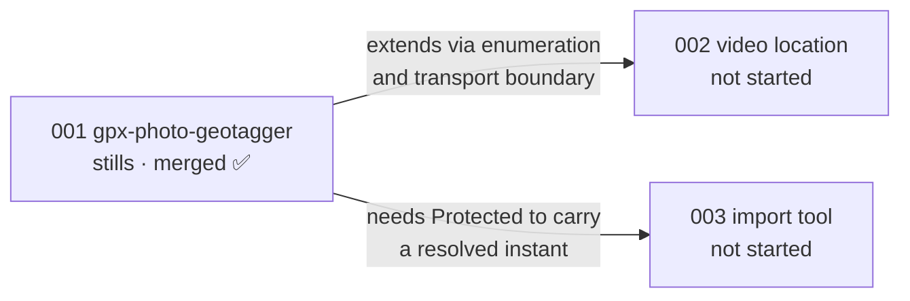

# Milestone 01 — Core Geotagging

Write GPS metadata into a photo and video archive from recorded GPX tracks, without ever overwriting a position that is already there.

## Issues

| Issue | Scope | Phase |
|---|---|---|
| `001-gpx-photo-geotagger` | Stills (RAF, DNG) — discovery, GPS gate, GPX parse and merge, matching, interpolation, review folder, audit record | `merged ✅` |
| `002-video-location` | Video (MOV, MP4) — container atom from the centroid of the clip's own telemetry, never from the GPX track | `not started` |
| `003-import-tool` | Import with automated destination-folder selection against `year/country-region/place` | `not started` |

## Dependency order

## Blockers

None. 002 and 003 are unblocked but not started, and neither may begin without an explicit `/start`.

## Notes carried from 001

- The `via` enumeration is deliberately open and documented as such; 002 adds a third value with its own provenance shape. `model._check_match_payload` rejects an unpaired value loudly at construction rather than coercing it.
- The `-geotag` prohibition is held by convention, not by the transport's argument shape — `analysis.md` still carries "does `-geotag` write MOV correctly?" as an open question, and 002's MOV path is where the design predicts a violation.
- The read parser accepts only `SourceFile` and the `-a -G4` instance shape, aborting the run otherwise. 002 reads QuickTime containers and may need a second group family; that is a deliberate tripwire for it to update, not an oversight.
- A positionless DJI DNG can never be written: every camera original carries `ProfileHueSatMapData`, whose minor warning is outside the benign allowlist. Recorded as an accepted limitation in design §7.
- 37 single-agent design findings (S4, S6–S41) remain open by explicit direction and are listed in `issues/001-gpx-photo-geotagger/design-review.md`.
