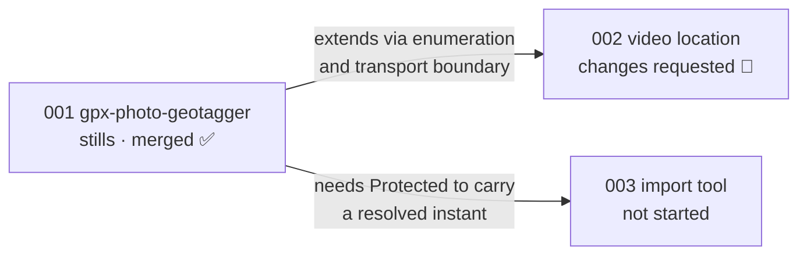

# Milestone 01 — Core Geotagging

Write GPS metadata into a photo and video archive from recorded GPX tracks, without ever overwriting a position that is already there.

## Issues

| Issue | Scope | Phase |
|---|---|---|
| `001-gpx-photo-geotagger` | Stills (RAF, DNG) — discovery, GPS gate, GPX parse and merge, matching, interpolation, review folder, audit record | `merged ✅` |
| `002-video-location` | Video (MOV, MP4) — container atom in `Keys`, from the centroid of the clip's own telemetry (DJI) or from a GPX match (Fujifilm, stationary) | `changes requested 🔄` |
| `003-import-tool` | Import with automated destination-folder selection against `year/country-region/place` | `not started` |

## Dependency order

## Blockers

**002's implementation is committed and pushed on `feature/002-video-location`, and no reviewer has assessed it.** Both review files read CHANGES REQUESTED: `design-review.md` is re-review 3's verdict against Revision 4 and has never seen Revision 5; `code-review.md` is re-review 1's and has never seen the fixes made after it. Every Critical, High and Medium finding in both was fixed and independently verified by measurement — including design H1, where the elevation containment was rebuilt around the measured behaviour on exiftool 13.55 (silent saturation to `4294967295` on the stills set, a silently dropped altitude on the QuickTime set, both at exit 0) rather than around a value refusal that does not exist. The twelve failures that actually occurred during implementation are in `issues/002-video-location/observed-failures.md`, all `covered` by a named test; the five findings dropped by decision are in `dropped-findings.md`. Neither marker was flipped, because no reviewer gave another verdict. 003 is not started; neither issue may advance without an explicit user command.

## Notes carried from 001

- The `via` enumeration was left open by 001's design and documented as such; 002 added its third value, `CENTROID`, with its own provenance shape. `model._check_match_payload` rejects an unpaired value loudly at construction rather than coercing it.
- The `-geotag` question is settled by measurement in 002's `analysis.md`: it **does** write MOV and MP4 correctly, and it is **irrelevant** — its only data source is a track file, so it cannot produce a centroid of a clip's own telemetry. It is not a forbidden shortcut, it is not a candidate. The prohibition remains conventional, and the XMP hazard it carries reaches 002 anyway through the shipped writer's own tag set, with no `-geotag` involved.
- The read-parser tripwire **does not fire** on QuickTime: 0 refusals across all 218 archive videos, across an unrestricted `-ee` read of the fixture (308 keys), and across a 109-clip sweep reaching 40,842 instances of one tag (sweep measured 2026-11-15, before 18 clips were deleted from the archive; the container population is now 200). `-G4` emits only the instance family, and a group-qualified read keeps the qualifier in the request. 001's note that 002 "may need a second group family" is not borne out — though telling *which* group holds an atom would need one, and `Composite`'s `Keys` precedence makes that a live question.
- A positionless DJI DNG can never be written: every camera original carries `ProfileHueSatMapData`, whose minor warning is outside the benign allowlist. Recorded as an accepted limitation in design §7.
- 37 single-agent design findings (S4, S6–S41) remain open by explicit direction and are listed in `issues/001-gpx-photo-geotagger/design-review.md`.
